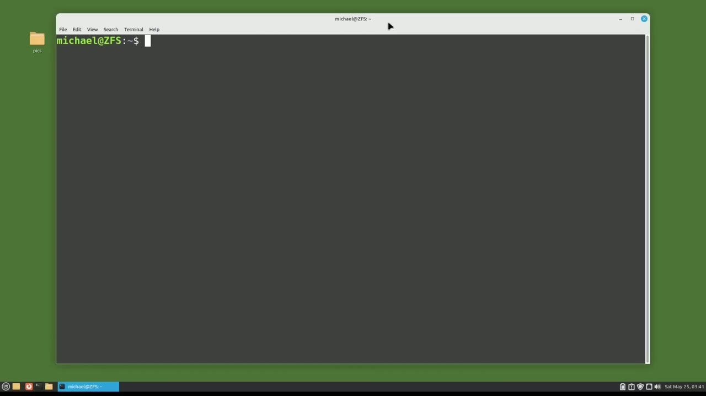
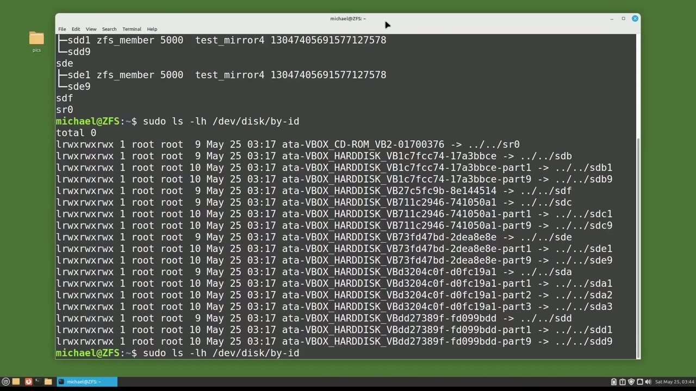
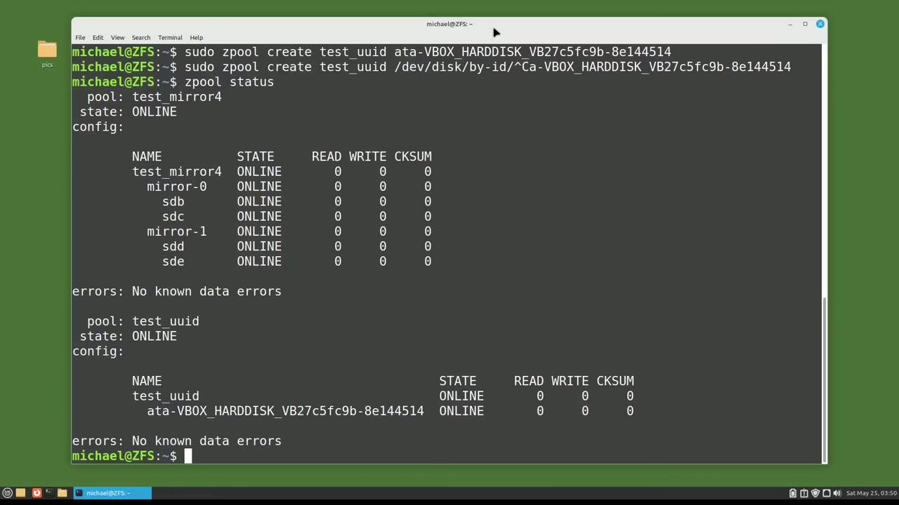
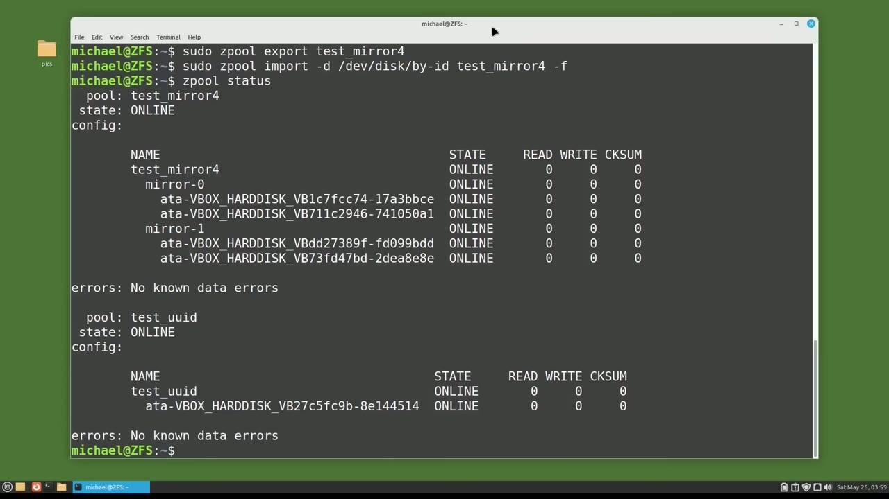

[← Course contents](../../01.md)

# 104. ZFS pt3 - UUID

**Course:** [Linux Command Line - Entire Tutorial Series](https://www.youtube.com/watch?v=avg65oY7sj4)  
**Transcript:** [`Linux Command Line - Entire Tutorial Series transcript`](../../../../course_videos/Linux%20Command%20Line%20-%20Entire%20Tutorial%20Series/Linux%20Command%20Line%20-%20Entire%20Tutorial%20Series.txt)  
**Video:** 17:44:46–17:53:32 ([open at this time](https://www.youtube.com/watch?v=avg65oY7sj4&t=63886s))

## Introduction

Up to now, every time I've created a Z-Pool, I've used the device name, for example, DevSdb. And that works, but if another disk drive is added and then the computer is rebooted, the device DevSDB might not be pointing to the intended disk anymore, meaning DevSDB might be the disk that was just plugged in. And ZFS is looking for Z-Pool data on DevSDB, but won't find any. So instead of setting up our Z-Pools with the device name, we want to use the UUID.

## Detailed Explanation

<details>
  <summary>Step 1 — Run `zfs`, `ls vlk-f`, `sudo -lslhf`</summary>

### Step 1 — Run `zfs`, `ls vlk-f`, `sudo -lslhf`

- [x] **Use `zfs`**
  - Up to now, every time I've created a Z-Pool, I've used the device name, for example, DevSdb.
  - And that works, but if another disk drive is added and then the computer is rebooted, the device DevSDB might not be pointing to the intended disk anymore, meaning DevSDB might be the disk that was just plugged in.
  - And `zfs` is looking for Z-Pool data on DevSDB, but won't find any.

- [x] **So instead of setting up our Z-Pools with the device name, we want to**
  - So instead of setting up our Z-Pools with the device name, we want to use the UUID.
  - UUID stands for universally unique identifier.
  - And we talked about UUID back in video 83.

- [x] **Use `ls vlk-f`**
  - I'm going to see what disks I have available by typing ls, vlk-f.
  - And we see the disks sdb, sdc, sdd, and sde are all in use with the test mirrored for Z-Pool.
  - But we still have dev sdf available, so I'll use that one.

- [x] **Use `sudo -lslhf`**
  - To find the UUID for Dev sdf, I'm going to type `sudo -lslhf` forward slash dev forward slash disk forward slash by--id.
  - And this shows us the UUIDs for all of the disks.

```bash
zfs
ls vlk-f
sudo -lslhf
```



</details>

<details>
  <summary>Step 2 — Run `grep sdf`, `last`, `zfs`</summary>

### Step 2 — Run `grep sdf`, `last`, `zfs`

- [x] **Use `grep sdf`, `last`, `zfs`**
  - Since we're only looking for device sdf, I will add on `grep sdf` to the `last` command.
  - And I'm going to copy that by double clicking and right click copy.
  - Now I'll create a `zfs` Z pool with a UUID just like I did with the device name.

- [x] **Souz pool, create, and we'll give this Z pool the name, test UUID**
  - Souz pool, create, and we'll give this Z pool the name, test UUID.
  - And then instead of putting dev sdf, I'm going to paste in the uuid for dev sdf.
  - Now this worked for me, but if it did not work for you because it did not find the u u.d, you might need to add in the full path name, meaning dev disk by id before pasting in the uuid.

- [x] **Let's check out our new Z pool with Z pool status**
  - Let's check out our new Z pool with Z pool status.
  - And here we see the test UUID Z pool is using the UUID.
  - But we also see the test mirror 4 Z pool, which is still using the device IDs.

- [x] **So we just learned how to create Z pools using the UUID instead of**
  - So we just learned how to create Z pools using the UUID instead of the device name.
  - The 4-disc mirror Z pool was created in the `last` video.
  - We might already have important data on that Z pool mirror and we don't want to lose it.

```bash
grep sdf
last
zfs
```



</details>

<details>
  <summary>Step 3 — Run `zfs`</summary>

### Step 3 — Run `zfs`

- [x] **Use `zfs`**
  - `zfs` will allow us to change the device disk names to UUIDs by exporting the Z-Pool and then importing that Z-Pool, requesting to use the UUIDs instead of the disc names when we import it.
  - Now while we're talking about exporting and importing Z-Pools, if you want to move a Z-Pool to another computer, you can do that by exporting the Z-Pool, then move all the disks for that Z-Pool to a new computer, then import that Z-Pool on the new computer and that will work.
  - Now I haven't personally tried it, but all the Z-Pool information is stored on the Z-Pool itself, and that's what makes it possible to move a Z-Pool to a different computer.

- [x] **Okay, back to our Z-Pool device name problem**
  - Okay, back to our Z-Pool device name problem.
  - I'm going to export the 4-disc Z-Pool Mirror with the command.
  - And now I'm going to import that same Z-Pool mirror and use the UUIDs instead of the disk names with the command.

- [x] **And the D is for device or search for devices in dev, disk by id**
  - And the D is for device or search for devices in dev, disk by id.
  - Then we'll give it the pool name, test mirror 4.
  - This will force the import, even if the pool appears to be potentially active.

- [x] **Use `zfs`**
  - Now when I type Z pool status, we see the Z pool disks by UUID instead of the device names we saw earlier.
  - And now we can also safely add and remove more disks to this computer without worrying that they may affect our `zfs` storage Z pool.
  - UUIDs are better than the disk name, but when using the UUID, it might be difficult to know which disk we're talking about if there are disk errors or the disk is not working.

- [x] **Use `zfs`**
  - To give our discs a custom `zfs` disk name.
  - Maybe we have multiple storage devices and multiple disks on those storage devices.
  - So we want a custom name to help us find a disk drive quickly and easily if we have to swap out a bad drive.

- [x] **Use `zfs`**
  - I'm going to give our dev sdf disk drive a custom `zfs` id.
  - Before I can give a custom name, I'm going to need to know the UUID of the device I want to give the custom name.

```bash
zfs
```



</details>

<details>
  <summary>Step 4 — Run `ls -lh`, `grep sdf`, `zfs`</summary>

### Step 4 — Run `ls -lh`, `grep sdf`, `zfs`

- [x] **Use `ls -lh`, `grep sdf`, `zfs`**
  - And remember, we got that by typing in `ls -lh` dev disk by id `grep sdf`.
  - And now I'm going to remove the test UUID Z pool that we created earlier because we want to recreate that Z pool with the custom `zfs` name.
  - So I will remove that Z pool with SOUZPool Destroy test.

- [x] **Now I'm going to cd into the directory at czfs**
  - Now I'm going to cd into the directory at czfs.
  - And I want to edit the file V-Dev underscore ID.com.
  - I'll do that with Vim, so the command will be SuduVimv underscore ID.com.

- [x] **I'm going to press I to go into insert mode**
  - I'm going to press I to go into insert mode.
  - And to give our UUID an alias, I'm going to type the word alias.
  - And then I'm going to give it the name that I want to give our disk.

- [x] **I'm going to call this one, Storage Unit 1 underscore disk bay 3**
  - I'm going to call this one, Storage Unit 1 underscore disk bay 3.
  - Then I'll need to give it the path of dev disk by id.
  - And then I'm going to paste in the UUID.

- [x] **Use `sudo`**
  - I'm going to press escape to get out of insert mode, colon wq to write and quit out of Vim.
  - And one more thing I need to do is to type `sudo` U-Dev adm trigger.
  - And now we can create a Z-Pool with that new custom disc name.

- [x] **Use `zpool`, `zpool status`**
  - Then the name I'll give this Z-Pool will be custom disk name and now we'll type in that new custom disk name that we just put in that file storage unit one disk bay three pressing enter and our new `zpool` is created let's see what that looks like with `zpool status` custom disk name and here we see
  - For Z-Pool custom disk name, it's online, and the disk name is Storage Unit 1, Disc Bay 3.
  - So if we ever need to swap out that disk, we know exactly where it is.

- [x] **Use `zfs`**
  - In the next tutorial, we will continue looking at `zfs` for the Linux command line.

```bash
ls -lh
grep sdf
zfs
sudo
zpool
zpool status
```



</details>

<details>
  <summary>Questions and Answers</summary>

## Questions and Answers

### Question 1: What does `zfs` do in this chapter?

<details>
<summary>Answer</summary>

- [x] And `zfs` is looking for Z-Pool data on DevSDB, but won't find any.

</details>

### Question 2: What does `ls vlk-f` do in this chapter?

<details>
<summary>Answer</summary>

- [x] I'm going to see what disks I have available by typing ls, vlk-f.

</details>

### Question 3: What does `sudo -lslhf` do in this chapter?

<details>
<summary>Answer</summary>

- [x] To find the UUID for Dev sdf, I'm going to type `sudo -lslhf` forward slash dev forward slash disk forward slash by--id.

</details>

### Question 4: What does `grep sdf` do in this chapter?

<details>
<summary>Answer</summary>

- [x] Since we're only looking for device sdf, I will add on `grep sdf` to the last command.

</details>

### Question 5: What does `last` do in this chapter?

<details>
<summary>Answer</summary>

- [x] Since we're only looking for device sdf, I will add on grep sdf to the `last` command.

</details>

### Question 6: What does `ls -lh` do in this chapter?

<details>
<summary>Answer</summary>

- [x] And remember, we got that by typing in `ls -lh` dev disk by id grep sdf.

</details>

### Question 7: What does `sudo` do in this chapter?

<details>
<summary>Answer</summary>

- [x] And one more thing I need to do is to type `sudo` U-Dev adm trigger.

</details>

### Question 8: What does `zpool` do in this chapter?

<details>
<summary>Answer</summary>

- [x] Then the name I'll give this Z-Pool will be custom disk name and now we'll type in that new custom disk name that we just put in that file storage unit one disk bay three pressing enter and our new `zpool` is created let's see what that looks like with `zpool` status custom disk name and here we see

</details>

### Question 9: What does `zpool status` do in this chapter?

<details>
<summary>Answer</summary>

- [x] Then the name I'll give this Z-Pool will be custom disk name and now we'll type in that new custom disk name that we just put in that file storage unit one disk bay three pressing enter and our new zpool is created let's see what that looks like with `zpool status` custom disk name and here we see

</details>

</details>

## Summary

This chapter, ZFS pt3 - UUID, walks through Run zfs, ls vlk-f, sudo -lslhf; Run grep sdf, last, zfs; Run zfs; Run ls -lh, grep sdf, zfs. Commands from the transcript: `zfs`, `ls vlk-f`, `sudo -lslhf`, `grep sdf`, `last`, `ls -lh`, `sudo`, `zpool`, `zpool status`.

## References

- [Linux Command Line - Entire Tutorial Series (YouTube)](https://www.youtube.com/watch?v=avg65oY7sj4)
- [This chapter at 17:44:46](https://www.youtube.com/watch?v=avg65oY7sj4&t=63886s)
- [Local transcript](../../../../course_videos/Linux%20Command%20Line%20-%20Entire%20Tutorial%20Series/Linux%20Command%20Line%20-%20Entire%20Tutorial%20Series.txt)
