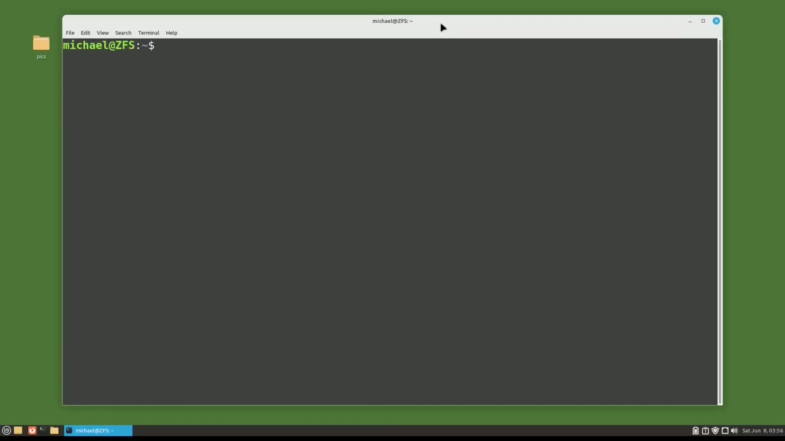
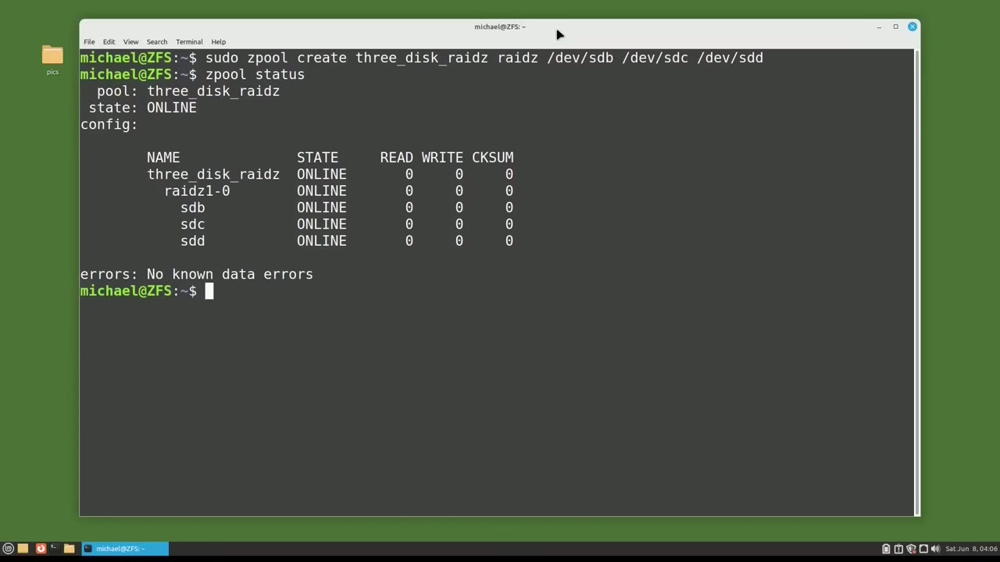
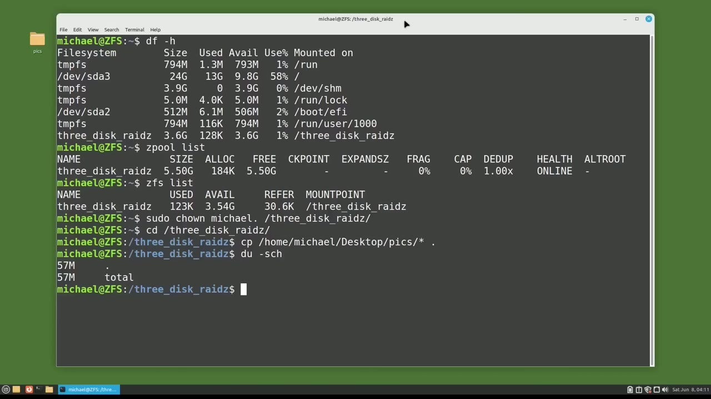
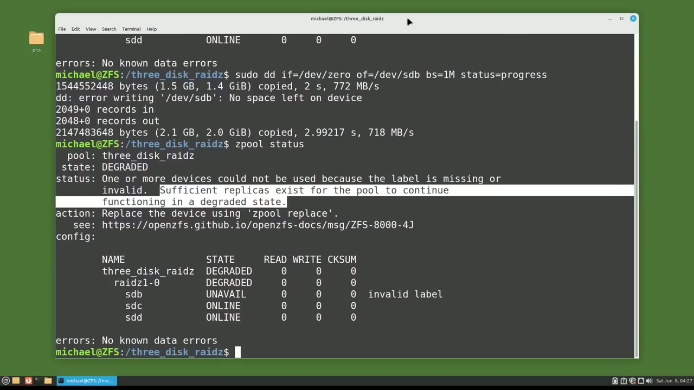

[← Course contents](../../01.md)

# 105. ZFS pt4 - RAIDZ

**Course:** [Linux Command Line - Entire Tutorial Series](https://www.youtube.com/watch?v=avg65oY7sj4)  
**Transcript:** [`Linux Command Line - Entire Tutorial Series transcript`](../../../../course_videos/Linux%20Command%20Line%20-%20Entire%20Tutorial%20Series/Linux%20Command%20Line%20-%20Entire%20Tutorial%20Series.txt)  
**Video:** 17:53:32–18:03:50 ([open at this time](https://www.youtube.com/watch?v=avg65oY7sj4&t=64412s))

## Introduction

In this video, we're going to look at the ZFS Raid Z, a ZFS is comparable to the LVM RAID 5 we looked at in an earlier tutorial. A ZFS RAIDZ is the same as ZFS raidz1, meaning we can lose up to one single hard drive and the RAIDZ can continue on one disk down until the bad drive can be replaced. And then the new disc will be re-silvered into the Rade Z-Pool, and the Rade Z will be back up working at 100%. ZFS also has a Rade z2, where up to two discs can be lost at one time, and the Rade zzz pool can continue on.

## Detailed Explanation

<details>
  <summary>Step 1 — Run `zfs`, `sudo`</summary>

### Step 1 — Run `zfs`, `sudo`

- [x] **Use `zfs`**
  - In this video, we're going to look at the `zfs` Raid Z, a `zfs` is comparable to the LVM RAID 5 we looked at in an earlier tutorial.
  - A `zfs` RAIDZ is the same as `zfs` raidz1, meaning we can lose up to one single hard drive and the RAIDZ can continue on one disk down until the bad drive can be replaced.
  - And then the new disc will be re-silvered into the Rade Z-Pool, and the Rade Z will be back up working at 100%.

- [x] **Use `zfs`**
  - `zfs` also has a Rade z2, where up to two discs can be lost at one time, and the Rade zzz pool can continue on.
  - But the total usable Rade z2 disk space will be two disks less than the total discs in the Rade z2 Z pool.
  - To see the minimum number of disks required for a `zfs`, RaidZ, I will type Sudo-ZPool Create, then I will give it the name My RaidZ.

- [x] **And then we need to tell it what type of Z pool we're creating, and**
  - And then we need to tell it what type of Z pool we're creating, and that will be a Raid Z.
  - And then the disk where we want to store this RaidZ, and that would be Dev, sdb.
  - And notice with this command, I'm only giving it one disk.

- [x] **Use `zfs`**
  - When I press enter, I get the message, Raid Z requires at least two devices.
  - So there's our minimum number of disks that we need for a `zfs`, Raid Z pool, two disk drives.
  - I'm going to type this command again, but instead of Raid Z, I'm going to make this Raid z1.

- [x] **And pressing Enter again, we get the same message**
  - And pressing Enter again, we get the same message.
  - I'll run this command one more time, but this time I will change this to Raid z2.
  - And here I get the message, a minimum of three discs are required for a Raid z2 Z pool.

- [x] **Use `zfs`, `sudo`**
  - So now we know the `zfs` Rade zzz pool minimums.
  - We need at least two devices for a Raid z1 and three devices.
  - And now I will create a Raid Z with 3 disks by typing `sudo` Z pool create.

- [x] **Use `zfs`**
  - And then I will give it the name 3Disc Raid Z.
  - And then I'll type Raid Z to let `zfs` know what type of Z pool we are creating.
  - And then I'll give it the disks where we want to store this Rade Z-Pool, which is Dev-S-D-S-D-S-D-D.

- [x] **Pressing Enter, and our Rade Z-Pool is created**
  - Pressing Enter, and our Rade Z-Pool is created.
  - Is made up of the disks sdb, sdc, and sdd.

```bash
zfs
sudo
```



</details>

<details>
  <summary>Step 2 — Run `df -h`, `zfs`, `which`</summary>

### Step 2 — Run `df -h`, `zfs`, `which`

- [x] **Use `df -h`**
  - I'm going to clear the screen again and type `df -h`.
  - And we see our 3Disc grade Z has 3.6 gigabytes of storage available.
  - That sounds about right for 3, 2 gigabyte disk drives, `which` would be 6 gigabytes total.

- [x] **Use `zfs`, `which`**
  - For one of the 2 gigabyte disk drives, and the other 0.4 gigabyte is lost to `zfs` file system support for Raid Z.
  - Here we see a size of 5.5 gigabytes for our Raid Z Z-Pool.
  - So Z-Pool list is showing us the total disk space the Z-pool is using, `which` is different from the 3.6 gigabytes available we have to use.

- [x] **Use `zfs`**
  - That we saw with the df command. Now I'm going to type `zfs` list.
  - Here we see we have 3.54 gigabytes of disk base available.
  - This does not match exactly the amount from the df command, but it's close enough to say that it's likely a rounding error.

- [x] **Use `sudo`**
  - Now I want to add some data to the Raid zz pool, but before I do that, I'm going to set the ownership to Michael for the Raid zz pool with the command, `sudo`, Chon, Michael, dot, 3-disc, RaidZ.
  - Now I will cd into the directory, and I will add in the pictures from the desktop to this directory with cp, Home, Michael, Desktop Picks.
  - We want everything in there, and I want to copy them all right here.

- [x] **Use `du -sch`**
  - Now typing `du -sch` shows that only 57 megabytes are being used.

```bash
df -h
zfs
which
sudo
du -sch
```



</details>

<details>
  <summary>Step 3 — Run `dd`, `du -sch`, `sudo dd`</summary>

### Step 3 — Run `dd`, `du -sch`, `sudo dd`

- [x] **Use `dd`, `du -sch`**
  - That's not very much disk space, so let's add another file to this directory with a `dd` command.
  - This will add a 2 gigabyte file to this directory.
  - It's done. Let's check out how much space is being used now with `du -sch`.

- [x] **Now we're using 2.1 gigabytes of disk space**
  - Now we're using 2.1 gigabytes of disk space.
  - Let's run that command again a second time, but change test file to test file 2.
  - And we'll see how much space is actually available.

- [x] **Use `dd`, `du -sch`**
  - So we see the `dd` command stopped because it ran out of disk space.
  - Let's check out how much space is being used again with `du -sch`.
  - We now know that we have 3.6 gigabytes of storage available for our Raid z1 with 3 disk drives that are 2.

- [x] **Use `sudo dd`, `dd`**
  - Gigabytes in size. I'm going to clear the screen again. I'm going to type Z-pool status to show that our raid z-z pool is online and working as expected. What I want to do now is to make one of the discs in the Raid z-z pool unavailable. And I'll do that by writing zeros to one of the
  - Disc drives in the Raid z-z pool with the `dd` command. `sudo dd`, if for the end file equals dev 0.
  - So we're writing zeros and the of out file will equal dev sdb.

- [x] **I'll set the block size equal to 1M and the status equals progress**
  - I'll set the block size equal to 1M and the status equals progress.
  - Let's see what our Z pool looks like now with Z pool status.
  - Now mine is showing that device sdb is unavailable.

- [x] **If everything was showing still okay for you, you might need to run**
  - If everything was showing still okay for you, you might need to run the scrub command.
  - And that would be S-Pool Scrub and then the Z-Pool name.
  - In short, a scrub will check the Z-Pool for errors.

- [x] **Use `zfs scrub`**
  - We'll talk about `zfs scrub` in a future tutorial.
  - So we see the Z-Pool status is showing us that it is degraded.
  - For the 3 disk RAIDZ and that one device, sdb, is unavailable.

```bash
dd
du -sch
sudo dd
zfs scrub
```



</details>

<details>
  <summary>Step 4 — Run `zfs`, `ls -lh`</summary>

### Step 4 — Run `zfs`, `ls -lh`

- [x] **Use `zfs`**
  - We see in the status that sufficient replicas exist for the Z-Pool to continue functioning in a degraded state, so it is still working and our data is safe, but `zfs` is recommending we take the action, replace the device using Z-Pool replace. To replace this disk in the Z-Pool, I'm going to type the command
  - Replace, then I'm going to give the Z pool name that we want to replace one of the discs and that is three disk raid z. Now I'm going to give it the bad device name, the one that we want to replace dev sdb and then the new device with, we want to replace this with which will be dev sdf and I showed in an earlier
  - For the `zfs` tutorials, we have discs sdb through sdf to work with in this group of tutorials.

- [x] **And then I'm going to add on a semicolon Z pool status to show us the**
  - And then I'm going to add on a semicolon Z pool status to show us the status right away.
  - Let's run this. And here we see the sdb has the invalid label and device sdf is resilvering into the Z pool.
  - We see that one or more devices is currently being resilvered.

- [x] **Use `ls -lh`**
  - And our recommended action is to wait for the resilver to complete.
  - And we see the message that 1.77 gigabytes was re-silvered into the Rade z-zz pool with zero errors.
  - Let's make sure all our data is there with `ls -lh`.

- [x] **All our files are still there safe and sound**
  - All our files are still there safe and sound.
  - And our Z-pool is back up working with three disks once again.
  - A quick note about the Dev sdb drive. It's not bad, we just set everything to zeros, so we can use this device in a new Z pool or even swap it back into this Rade Z.

- [x] **Use `zfs`**
  - In the next tutorial, we will continue looking at `zfs` for the Linux command line.

```bash
zfs
ls -lh
```



</details>

<details>
  <summary>Questions and Answers</summary>

## Questions and Answers

### Question 1: What does `zfs` do in this chapter?

<details>
<summary>Answer</summary>

- [x] In this video, we're going to look at the `zfs` Raid Z, a `zfs` is comparable to the LVM RAID 5 we looked at in an earlier tutorial.

</details>

### Question 2: What does `sudo` do in this chapter?

<details>
<summary>Answer</summary>

- [x] And now I will create a Raid Z with 3 disks by typing `sudo` Z pool create.

</details>

### Question 3: What does `df -h` do in this chapter?

<details>
<summary>Answer</summary>

- [x] I'm going to clear the screen again and type `df -h`.

</details>

### Question 4: What does `which` do in this chapter?

<details>
<summary>Answer</summary>

- [x] So Z-Pool list is showing us the total disk space the Z-pool is using, `which` is different from the 3.6 gigabytes available we have to use.

</details>

### Question 5: What does `df` do in this chapter?

<details>
<summary>Answer</summary>

- [x] That we saw with the `df` command. Now I'm going to type ZFS list.

</details>

### Question 6: What does `du -sch` do in this chapter?

<details>
<summary>Answer</summary>

- [x] Now typing `du -sch` shows that only 57 megabytes are being used.

</details>

### Question 7: What does `dd` do in this chapter?

<details>
<summary>Answer</summary>

- [x] That's not very much disk space, so let's add another file to this directory with a `dd` command.

</details>

### Question 8: What does `sudo dd` do in this chapter?

<details>
<summary>Answer</summary>

- [x] Disc drives in the Raid z-z pool with the dd command. `sudo dd`, if for the end file equals dev 0.

</details>

### Question 9: What does `zfs scrub` do in this chapter?

<details>
<summary>Answer</summary>

- [x] We'll talk about `zfs scrub` in a future tutorial.

</details>

### Question 10: What does `ls -lh` do in this chapter?

<details>
<summary>Answer</summary>

- [x] Let's make sure all our data is there with `ls -lh`.

</details>

</details>

## Summary

This chapter, ZFS pt4 - RAIDZ, walks through Run zfs, sudo; Run df -h, zfs, which; Run dd, du -sch, sudo dd; Run zfs, ls -lh. Commands from the transcript: `zfs`, `sudo`, `df -h`, `which`, `du -sch`, `dd`, `sudo dd`, `zfs scrub`, `ls -lh`.

## References

- [Linux Command Line - Entire Tutorial Series (YouTube)](https://www.youtube.com/watch?v=avg65oY7sj4)
- [This chapter at 17:53:32](https://www.youtube.com/watch?v=avg65oY7sj4&t=64412s)
- [Local transcript](../../../../course_videos/Linux%20Command%20Line%20-%20Entire%20Tutorial%20Series/Linux%20Command%20Line%20-%20Entire%20Tutorial%20Series.txt)
