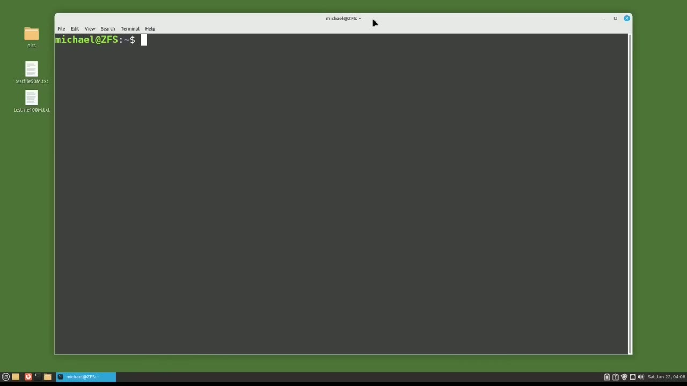
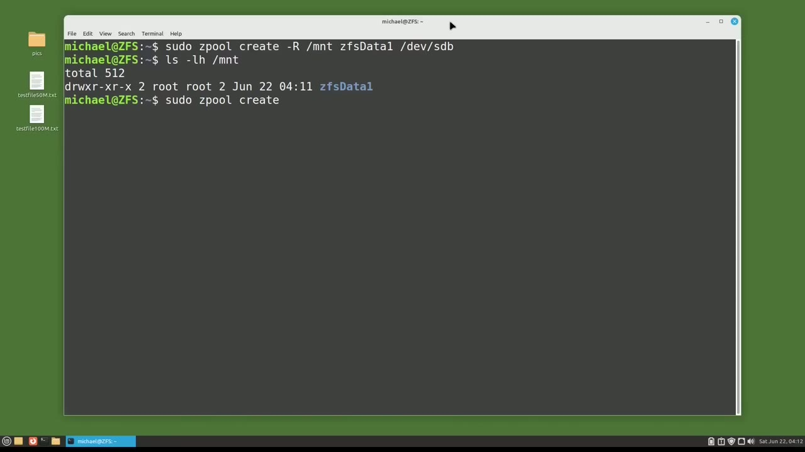
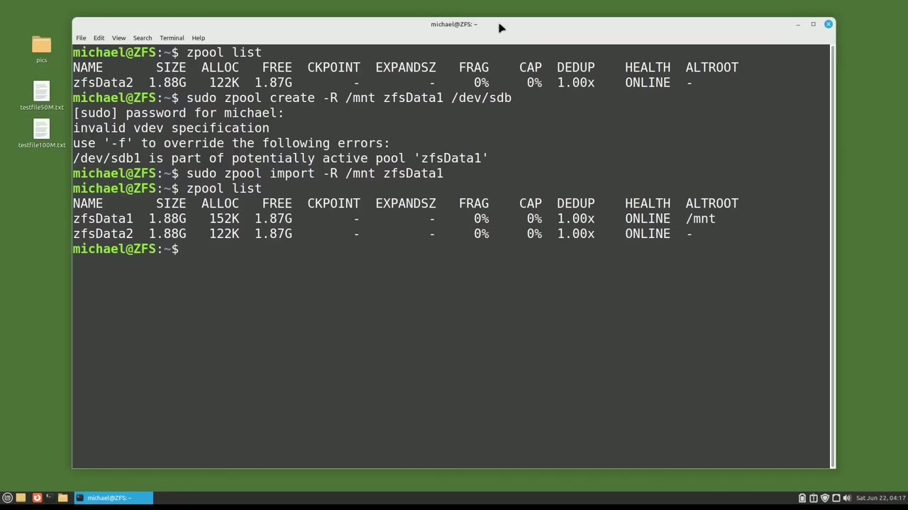

[← Course contents](../../01.md)

# 106. ZFS pt7 - SubDirectories pt 1

**Course:** [Linux Command Line - Entire Tutorial Series](https://www.youtube.com/watch?v=avg65oY7sj4)  
**Transcript:** [`Linux Command Line - Entire Tutorial Series transcript`](../../../../course_videos/Linux%20Command%20Line%20-%20Entire%20Tutorial%20Series/Linux%20Command%20Line%20-%20Entire%20Tutorial%20Series.txt)  
**Video:** 18:03:50–18:08:28 ([open at this time](https://www.youtube.com/watch?v=avg65oY7sj4&t=65030s))

## Introduction

Up to now, every time I've created a ZFS Z pool, I placed it in the root directory. And then I would cd into the ZFS directory with a forward slash and the ZFS directory name. I'm going to create a new ZFS Z pool, but this time I want to create it as a sub-directory of the directory slash mnt. And I'll do that with the command, sudo ZPool Create.

## Detailed Explanation

<details>
  <summary>Step 1 — Run `zfs`, `sudo zpool create`, `ls -lh -lhmt`</summary>

### Step 1 — Run `zfs`, `sudo zpool create`, `ls -lh -lhmt`

- [x] **Use `zfs`**
  - Up to now, every time I've created a `zfs` Z pool, I placed it in the root directory.
  - And then I would cd into the `zfs` directory with a forward slash and the `zfs` directory name.
  - I'm going to create a new `zfs` Z pool, but this time I want to create it as a sub-directory of the directory slash mnt.

- [x] **Use `sudo zpool create`, `zfs`**
  - And I'll do that with the command, `sudo zpool create`.
  - So then I will add what I want to be the root directory, which is slash mnt.
  - Then I will type my new Z pool name, which will be `zfs` data 1.

- [x] **Use `ls -lh -lhmt`**
  - And then I will add the device where I want to store the new Z pool, which is slash dev slash sdb.
  - Pressing enter, and our new Z pool is created in slash mnt.
  - We can see that with `ls -lh -lhmt`.

- [x] **And now I'm going to create a Z-Pool the way we've been creating them**
  - And now I'm going to create a Z-Pool the way we've been creating them up to now in the root directory with S-DooPool Create.

```bash
zfs
sudo zpool create
ls -lh -lhmt
```



</details>

<details>
  <summary>Step 2 — Run `zfs`, `reboot`, `sudo reboot`</summary>

### Step 2 — Run `zfs`, `reboot`, `sudo reboot`

- [x] **Use `zfs`, `reboot`, `sudo reboot`**
  - And then I'll give it the name `zfs` Data 2.
  - And I'll put this one on device slash dev slash s-d.
  - D.c. Everything's looking good so far, but now I'm going to `reboot` the machine with `sudo reboot` Now. So I've restarted the computer and logged in. Now I'm going to type Z-pool list.

- [x] **Use `zfs`**
  - And we only see one of the Z-pools I created. And it's the one that we created in the root directory. My first thought is maybe I forgot to create the other Z-pool.
  - So I'll try that now with SUDUZPool Create -R slash mnt.
  - And we'll call this `zfs` data 1.

- [x] **And I want this to go on slash dev slash sdb**
  - And I want this to go on slash dev slash sdb.
  - And when I press enter, we get the message invalid V-Dev specification.
  - Slash-dev slash sdb1 is part of a potentially active pool.

- [x] **Use `zfs`, `sudo`**
  - `zfs` Data 1.
  - So we see our `zfs` Z pool is still out there on Dev sdb1.
  - So to import the Z pool, I will type `sudo` Z pool import -uppercase R slash mnt `zfs` data 1.

- [x] **Let's check it out again with Z-Pool List**
  - Let's check it out again with Z-Pool List.

```bash
zfs
reboot
sudo reboot
sudo
```



</details>

<details>
  <summary>Step 3 — Run `zfs`, `zfs version`, `zfs -kmod`</summary>

### Step 3 — Run `zfs`, `zfs version`, `zfs -kmod`

- [x] **Use `zfs`, `zfs version`**
  - And the `zfs` Dataset 1 is mounted in slash mnt with the alternate route.
  - So this looks like a bug in the version of `zfs` I'm using.
  - Let's see which version of `zfs` I'm using with `zfs version`.

- [x] **Use `zfs`, `zfs -kmod`**
  - And we see I'm in `zfs` 2.1.5-1.
  - 22.04.04. There's also `zfs -kmod`. 2.1.5-1.
  - Ubuntu 622.04.3. So that's the version with the problem. Hopefully they'll get this fixed in the next version of `zfs`.

- [x] **But if you want to have an alternate route, we just need to remember**
  - But if you want to have an alternate route, we just need to remember to run that import command when we log in.
  - We might want to put that in our dot-bash-rc file to run when we log in, or else we could run the option to import the Z-Pool using System D when the computer starts up.
  - If you don't know how to do that, you might want to visit the Linux command line Video 58, where I show how to run a job when the computer starts up.

- [x] **Use `zfs`**
  - In the next video, we'll continue looking at `zfs` for the Linux command line.

```bash
zfs
zfs version
zfs -kmod
```



</details>

<details>
  <summary>Questions and Answers</summary>

## Questions and Answers

### Question 1: What does `zfs` do in this chapter?

<details>
<summary>Answer</summary>

- [x] Up to now, every time I've created a `zfs` Z pool, I placed it in the root directory.

</details>

### Question 2: What does `sudo zpool create` do in this chapter?

<details>
<summary>Answer</summary>

- [x] And I'll do that with the command, `sudo zpool create`.

</details>

### Question 3: What does `ls -lh -lhmt` do in this chapter?

<details>
<summary>Answer</summary>

- [x] We can see that with `ls -lh -lhmt`.

</details>

### Question 4: What does `reboot` do in this chapter?

<details>
<summary>Answer</summary>

- [x] D.c. Everything's looking good so far, but now I'm going to `reboot` the machine with Sudo `reboot` Now. So I've restarted the computer and logged in. Now I'm going to type Z-pool list.

</details>

### Question 5: What does `sudo reboot` do in this chapter?

<details>
<summary>Answer</summary>

- [x] D.c. Everything's looking good so far, but now I'm going to reboot the machine with `sudo reboot` Now. So I've restarted the computer and logged in. Now I'm going to type Z-pool list.

</details>

### Question 6: What does `sudo` do in this chapter?

<details>
<summary>Answer</summary>

- [x] So to import the Z pool, I will type `sudo` Z pool import -uppercase R slash mnt ZFS data 1.

</details>

### Question 7: What does `zfs version` do in this chapter?

<details>
<summary>Answer</summary>

- [x] Let's see which version of ZFS I'm using with `zfs version`.

</details>

### Question 8: What does `zfs -kmod` do in this chapter?

<details>
<summary>Answer</summary>

- [x] 22.04.04. There's also `zfs -kmod`. 2.1.5-1.

</details>

</details>

## Summary

This chapter, ZFS pt7 - SubDirectories pt 1, walks through Run zfs, sudo zpool create, ls -lh -lhmt; Run zfs, reboot, sudo reboot; Run zfs, zfs version, zfs -kmod. Commands from the transcript: `zfs`, `sudo zpool create`, `ls -lh -lhmt`, `reboot`, `sudo reboot`, `sudo`, `zfs version`, `zfs -kmod`.

## References

- [Linux Command Line - Entire Tutorial Series (YouTube)](https://www.youtube.com/watch?v=avg65oY7sj4)
- [This chapter at 18:03:50](https://www.youtube.com/watch?v=avg65oY7sj4&t=65030s)
- [Local transcript](../../../../course_videos/Linux%20Command%20Line%20-%20Entire%20Tutorial%20Series/Linux%20Command%20Line%20-%20Entire%20Tutorial%20Series.txt)
