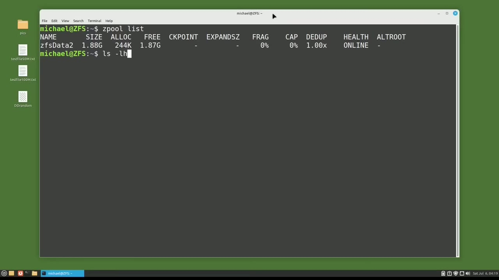
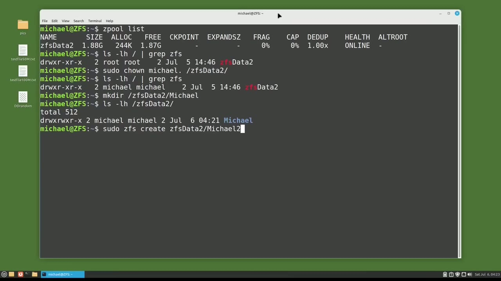
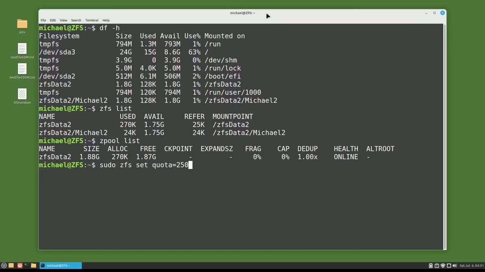
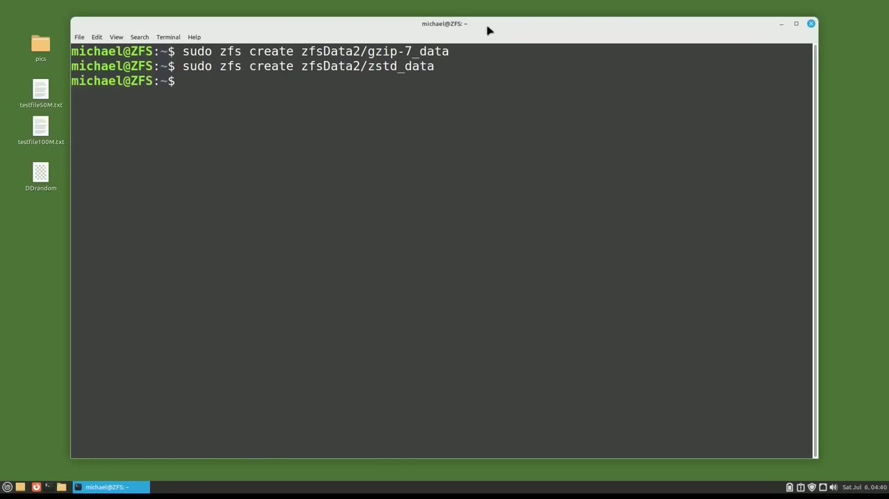
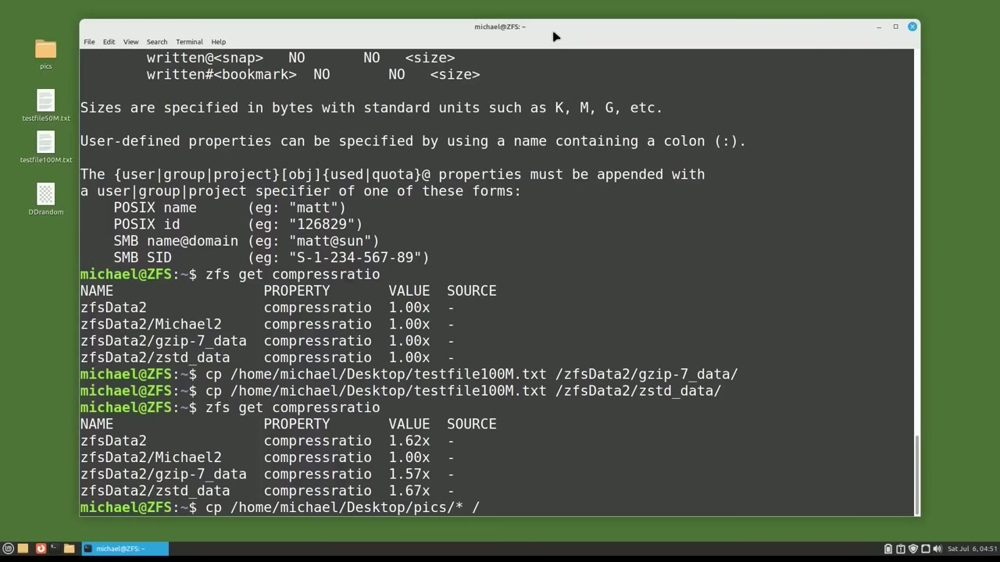

[← Course contents](../../01.md)

# 107. ZFS pt8 - SubDirectories pt 2

**Course:** [Linux Command Line - Entire Tutorial Series](https://www.youtube.com/watch?v=avg65oY7sj4)  
**Transcript:** [`Linux Command Line - Entire Tutorial Series transcript`](../../../../course_videos/Linux%20Command%20Line%20-%20Entire%20Tutorial%20Series/Linux%20Command%20Line%20-%20Entire%20Tutorial%20Series.txt)  
**Video:** 18:08:28–18:21:38 ([open at this time](https://www.youtube.com/watch?v=avg65oY7sj4&t=65308s))

## Introduction

And we see one of the Z-Pools we created in the last video. We're going to use that Z-Pool in this video. And notice we have 1.87 Gagabytes free to work with. Typing ls -lh forward slash pipe, Grip ZFS shows root as the current owner and group.

## Detailed Explanation

<details>
  <summary>Step 1 — Run `ls -lh`, `zfs`, `sudo`</summary>

### Step 1 — Run `ls -lh`, `zfs`, `sudo`

- [x] **And we see one of the Z-Pools we created in the last video**
  - And we see one of the Z-Pools we created in the last video.
  - We're going to use that Z-Pool in this video.
  - And notice we have 1.87 Gagabytes free to work with.

- [x] **Use `ls -lh`, `zfs`, `sudo`**
  - Typing `ls -lh` forward slash pipe, Grip `zfs` shows root as the current owner and group.
  - I'm going to change the owner and group to Michael with the command.
  - `sudo`, Chon, Michael, dot, slash `zfs`, Data 2.

- [x] **Use `zfs`**
  - Now I can create a new sub-directory in that Z-Pool with the MakeDirectory command.
  - And to show that worked, I will type l-s-l-l-h forward-slash z-fs Data 2.
  - The Michael directory created inside the Z-Pool called `zfs` Data.

- [x] **Use `zfs`**
  - The problem with creating a directory in a Z-Pool this way is that we cannot use any of the `zfs` tools in that directory.
  - I'm going to make another sub-directority in the `zfs` Data 2 Z-Pool, and this time I'll use the `zfs` tools.
  - SudoZFS create `zfs` Data 2 forward slash Michael 2.

```bash
ls -lh
zfs
sudo
```



</details>

<details>
  <summary>Step 2 — Run `zfs create`, `ls -lh`, `zfs`</summary>

### Step 2 — Run `zfs create`, `ls -lh`, `zfs`

- [x] **Use `zfs create`**
  - Note here that I'm using the `zfs create` and not the Z-Pool create that we're used to seeing.
  - We will also note that there is no forward slash before the Z pool name.
  - Pressing Enter, my new Michael 2 directory is created.

- [x] **Use `ls -lh`, `zfs`**
  - And we can see that with the `ls -lh` command.
  - And this shows us that the owner and group of the Michael 2 `zfs` directory is root.
  - I'll set the owner and group to Michael with the command, sudo-Chone Michael.

- [x] **Use `zfs`, `df -H`**
  - Forward slash `zfs` data to Michael 2.
  - And here we see the directory owner and group was updated to Michael.
  - I'm going to clear the screen and type `df -H`.

- [x] **Use `zfs`**
  - Here we see the Z-Pool directory, `zfs` Data 2, but we also see the `zfs` directory Michael 2.
  - And we'll note that both have 1.8 gigabytes available.
  - We will also see both directories show up when I type `zfs` list, but not when I type Z-Pool list.

- [x] **Use `zfs`**
  - And that's because the `zfs` data 2, Michael 2 directory is a directory and not a Z pool.
  - So I mentioned we can use the `zfs` tools on a `zfs` directory.
  - One of the most common things people like to do for a `zfs` directory is to set a directory quota.

```bash
zfs create
ls -lh
zfs
df -H
```



</details>

<details>
  <summary>Step 3 — Run `zfs`, `clear`, `df -h`</summary>

### Step 3 — Run `zfs`, `clear`, `df -h`

- [x] **Use `zfs`, `clear`**
  - I will set a quota on the Michael 2 directory with the command, suduzfs, set quota equal...
  - To 250M for megabytes, and we'll make that for the `zfs` data 2, Michael 2 directory.
  - And I'm going to type `clear` again.

- [x] **Use `df -h`, `zfs`, `ls -lh`**
  - And now I want to see that the quota was properly set, and I'll check that with `df -h`.
  - And here we see that the `zfs` data 2 forward slash Michael 2 directory now only has 250 megabytes available for it.
  - Typing `ls -lh` forward slash `zfs` Data 2 reminds us that we have two directories in that `zfs` data 2 directory.

- [x] **Use `zfs`**
  - If I try to assign a quota to the other directory in the `zfs` data directory, I get the message Dataset does not exist.
  - Since it was not created as a `zfs` dataset, quotas cannot be assigned to it.
  - So the Michael directory cannot be assigned a `zfs` quota, but it could potentially use up all the disk space in the `zfs` data 2 directory, leaving no space for the Michael 2 directory. We don't want that to happen. We gave the Michael 2 directory a quota of 250 megabytes,

- [x] **Use `sudo zfs`, `zfs`**
  - And we want to make sure that that directory has access to all 250 megabytes. We can do that by reserving...
  - 250 megabytes for the Michael 2 directory with the command `sudo zfs` set reservation equal 250 M for megabytes and that will be for the `zfs` data 2 forward slash Michael 2 directory and I accidentally got an uppercase A in there let's fix that Now the Michael directory cannot use any of the 250 megabytes available for the Michael 2 directory.
  - Another useful `zfs` directory tool is compression.

- [x] **If you have a lot of large text files, you may want to consider**
  - If you have a lot of large text files, you may want to consider turning on compression.
  - Some files are already compressed and cannot be compressed anymore.
  - In which case, trying to compress them a second time, will not help anything and in some cases will take up even more resources trying to compress them a second time.

- [x] **Use `zfs`, `gzip 7`**
  - In this video, we're going to test out two different `zfs` compression tools.
  - The two we're going to look at are `gzip 7` and Z standard.
  - I'm going to make two new `zfs` subdirectories, one for each compression method that we're going to test.

- [x] **Use `sudo zfs create`, `zfs`, `gzip -7`**
  - The first one is `sudo `zfs` create` `zfs` Data 2 forward slash `gzip -7` underscore data.
  - And the other one will be the same, but we're going to call this Z-Standard data.

```bash
zfs
clear
df -h
ls -lh
sudo zfs
gzip 7
sudo zfs create
gzip -7
```



</details>

<details>
  <summary>Step 4 — Run `sudo`, `zfs`, `gzip 7 compression`</summary>

### Step 4 — Run `sudo`, `zfs`, `gzip 7 compression`

- [x] **Use `sudo`, `zfs`**
  - Before I do anything else, I want to change the owner and group to Michael for these two new directories with `sudo` chon-Michael dot forward slash `zfs` Data 2.
  - GZip7 underscore data and let's do that with the Z standard as well.
  - Now that we got the data set set up, let's check the compression.

- [x] **Use `zfs`, `gzip 7 compression`, `gzip 7 data`**
  - And we do that by typing `zfs` get compression.
  - And we see the compression is turned off for all the `zfs` directories.
  - I'm going to set the `gzip 7 compression` tool for the `gzip 7 data` directory with the command.

- [x] **Use `sudo zfs`, `gzip -7`, `zfs`**
  - `sudo zfs` set and we want to set the compression equal to `gzip -7`.
  - And we want to set that for the directory, `zfs` data 2 slash `gzip -7` underscore data.
  - And we'll do the same thing for the Z-standard compression method.

- [x] **And we want to set that for the Z standard data directory**
  - And we want to set that for the Z standard data directory.
  - If we want to see all the compression methods available, we can try setting the compression method to something that doesn't exist.
  - And here we see all the compression methods in the warning that the compression must be one of on, off, or one of the methods shown.

- [x] **Use `zfs`**
  - Now that compression is set up, let's check out the compression again with the command compression and here we see the g zip 7 underscore data directory is using compression method g zip 7 and the z standard data directory is using compression method z standard
  - With nothing in the files i will check the compression ratio with the command `zfs` get compress ratio and it looks like i got an extra s in there let's take that out and run this again And we see that all of the compressed ratios are set at 1.00x, meaning nothing is being compressed because nothing is in those folders.
  - I have a 100 megabyte text file on my desktop.

- [x] **And the text file is made up of uppercase letters A through Z, just**
  - And the text file is made up of uppercase letters A through Z, just randomly put into the file.
  - I'm going to copy that text file to both of the compression directories with the commands.
  - Cp, Home, Michael, desktop test file 100m.t.

- [x] **Use `zfs`, `gzip 7`**
  - And we'll copy that to `zfs` data to `gzip 7`.
  - And we're also going to copy that to our Z standard.
  - And that went a little quicker than the `gzip 7`.

- [x] **Use `zfs`, `gzip 7 underscore`**
  - And now I will get the compress ratio again with `zfs` get Compress ratio and we see that the `gzip 7 underscore` data has a compression ratio of 1.57.
  - And the standard underscore data has a compression ratio of 1.67.
  - So in this case, it looks like the Z standard compression method is better because it compressed that 100 megabyte text file quicker and gave us a better compress ratio.

- [x] **Now let's add the pictures from the picture file on the desktop to**
  - Now let's add the pictures from the picture file on the desktop to both directories with cp, Home, Michael, Desktop, Picks, all.

```bash
sudo
zfs
gzip 7 compression
gzip 7 data
sudo zfs
gzip -7
gzip 7
gzip 7 underscore
```



</details>

<details>
  <summary>Step 5 — Run `zfs`, `gzip 7`</summary>

### Step 5 — Run `zfs`, `gzip 7`

- [x] **Use `zfs`, `gzip 7`**
  - And we want them to go into the `zfs` Data 2, `gzip 7`, and into the Z standard.
  - We see that the compression for the directory `gzip 7` has dropped down to 1.31.
  - And the compressed ratio for the z standard has dropped down to 1.35.

- [x] **This tells us that the pictures and the videos in that file were**
  - This tells us that the pictures and the videos in that file were already pretty well compressed.
  - Have one more file that I want to try moving in.
  - It has some random data that I created with the dd statement.

- [x] **Use `zfs`, `gzip 7`**
  - Let's copy that in with cp, Home, Michael, Desktop, dd Random, and we will copy that into `zfs` Data 2, `gzip 7`.
  - And we'll also copy that into the Z standard.
  - Getting that compressed ratio again, shows us that the compress ratio has dropped off even more.

- [x] **So the pictures and the dd Random file were already compressed pretty**
  - So the pictures and the dd Random file were already compressed pretty well.
  - But when we use the plain text file, we did see some benefit to the compression.
  - So if we have a lot of text files, maybe log files, we could see a benefit to using compression for this directory.

- [x] **Use `zfs`**
  - But for files other than plain text files, the `zfs` compression might not help very much.
  - Another `zfs` tool people talk about applying to their datasets is the D-dupe.
  - At the time of this recording, I just don't see a valid use case for setting up `zfs` D-D-dupe on Linux.

- [x] **Use `zfs`**
  - From what I've seen, it takes some time to set up, takes a lot of memory, and doesn't give that much of a benefit to the average Linux `zfs` user.
  - In the next video, We will continue looking at `zfs` for the Linux command line.

```bash
zfs
gzip 7
```



</details>

<details>
  <summary>Questions and Answers</summary>

## Questions and Answers

### Question 1: What does `ls -lh` do in this chapter?

<details>
<summary>Answer</summary>

- [x] Typing `ls -lh` forward slash pipe, Grip ZFS shows root as the current owner and group.

</details>

### Question 2: What does `zfs` do in this chapter?

<details>
<summary>Answer</summary>

- [x] Typing ls -lh forward slash pipe, Grip `zfs` shows root as the current owner and group.

</details>

### Question 3: What does `sudo` do in this chapter?

<details>
<summary>Answer</summary>

- [x] `sudo`, Chon, Michael, dot, slash ZFS, Data 2.

</details>

### Question 4: What does `zfs create` do in this chapter?

<details>
<summary>Answer</summary>

- [x] Note here that I'm using the `zfs create` and not the Z-Pool create that we're used to seeing.

</details>

### Question 5: What does `df -H` do in this chapter?

<details>
<summary>Answer</summary>

- [x] I'm going to clear the screen and type `df -H`.

</details>

### Question 6: What does `clear` do in this chapter?

<details>
<summary>Answer</summary>

- [x] And I'm going to type `clear` again.

</details>

### Question 7: What does `sudo zfs` do in this chapter?

<details>
<summary>Answer</summary>

- [x] 250 megabytes for the Michael 2 directory with the command `sudo zfs` set reservation equal 250 M for megabytes and that will be for the ZFS data 2 forward slash Michael 2 directory and I accidentally got an uppercase A in there let's fix that Now the Michael directory cannot use any of the 250 megabytes available for the Michael 2 directory.

</details>

### Question 8: What does `gzip 7` do in this chapter?

<details>
<summary>Answer</summary>

- [x] The two we're going to look at are `gzip 7` and Z standard.

</details>

### Question 9: What does `sudo zfs create` do in this chapter?

<details>
<summary>Answer</summary>

- [x] The first one is `sudo zfs create` ZFS Data 2 forward slash gzip -7 underscore data.

</details>

### Question 10: What does `gzip -7` do in this chapter?

<details>
<summary>Answer</summary>

- [x] The first one is Sudo ZFS create ZFS Data 2 forward slash `gzip -7` underscore data.

</details>

### Question 11: What does `gzip 7 compression` do in this chapter?

<details>
<summary>Answer</summary>

- [x] I'm going to set the `gzip 7 compression` tool for the GZip 7 data directory with the command.

</details>

### Question 12: What does `gzip 7 data` do in this chapter?

<details>
<summary>Answer</summary>

- [x] I'm going to set the GZip 7 compression tool for the `gzip 7 data` directory with the command.

</details>

</details>

## Summary

This chapter, ZFS pt8 - SubDirectories pt 2, walks through Run ls -lh, zfs, sudo; Run zfs create, ls -lh, zfs; Run zfs, clear, df -h; Run sudo, zfs, gzip 7 compression; Run zfs, gzip 7. Commands from the transcript: `ls -lh`, `zfs`, `sudo`, `zfs create`, `df -H`, `clear`, `df -h`, `sudo zfs`, `gzip 7`, `sudo zfs create`, `gzip -7`, `gzip 7 compression`, `gzip 7 data`, `gzip 7 underscore`.

## References

- [Linux Command Line - Entire Tutorial Series (YouTube)](https://www.youtube.com/watch?v=avg65oY7sj4)
- [This chapter at 18:08:28](https://www.youtube.com/watch?v=avg65oY7sj4&t=65308s)
- [Local transcript](../../../../course_videos/Linux%20Command%20Line%20-%20Entire%20Tutorial%20Series/Linux%20Command%20Line%20-%20Entire%20Tutorial%20Series.txt)
