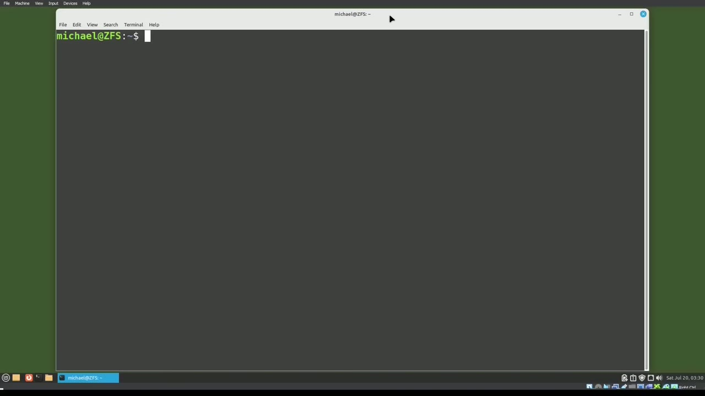
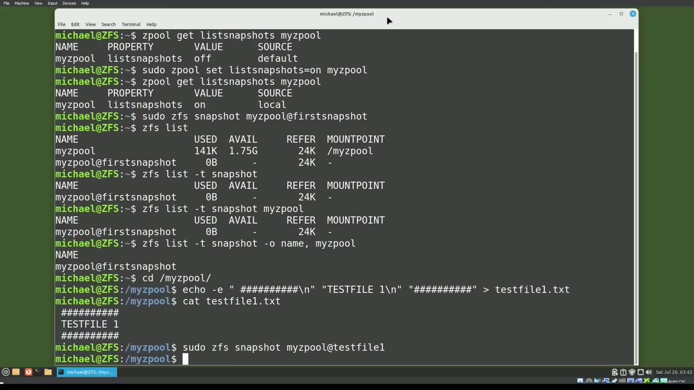
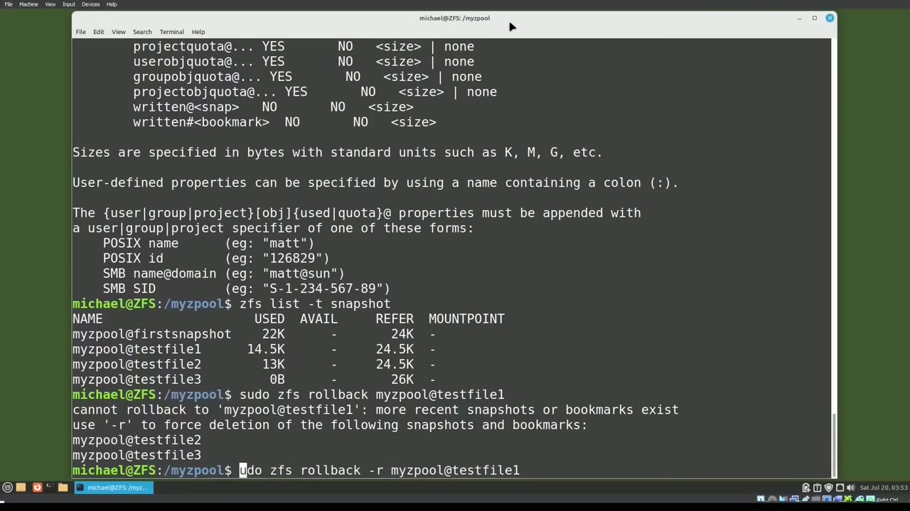
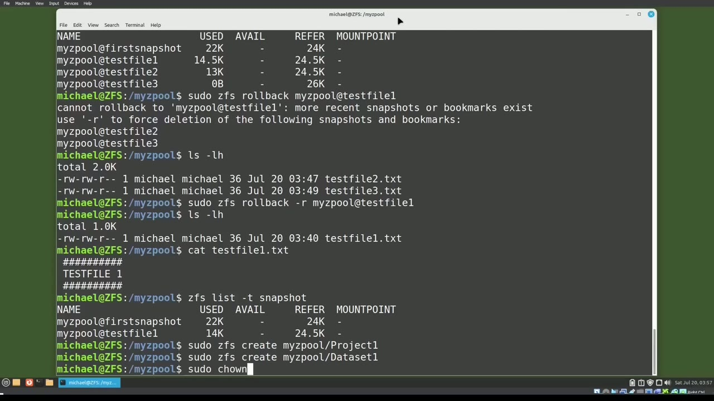

[← Course contents](../../01.md)

# 108. ZFS pt7 - Snapshots

**Course:** [Linux Command Line - Entire Tutorial Series](https://www.youtube.com/watch?v=avg65oY7sj4)  
**Transcript:** [`Linux Command Line - Entire Tutorial Series transcript`](../../../../course_videos/Linux%20Command%20Line%20-%20Entire%20Tutorial%20Series/Linux%20Command%20Line%20-%20Entire%20Tutorial%20Series.txt)  
**Video:** 18:21:38–18:31:14 ([open at this time](https://www.youtube.com/watch?v=avg65oY7sj4&t=66098s))

## Introduction

In this video, we're going to look at ZFS snapshots. I'm going to create a new ZFS pool with the command Sudo ZPool create my Zpool slash dev slash sdb. And I'm going to update the owner to Michael with the command Sudo Chon Michael, my Zpool. Now that we have the Z pool created, I will check to see if any snapshots exist for this Z pool with the command.

## Detailed Explanation

<details>
  <summary>Step 1 — Run `zfs`, `sudo zpool create`, `zpool`</summary>

### Step 1 — Run `zfs`, `sudo zpool create`, `zpool`

- [x] **Use `zfs`, `sudo zpool create`, `zpool`**
  - In this video, we're going to look at `zfs` snapshots.
  - I'm going to create a new `zfs` pool with the command `sudo `zpool` create` my `zpool` slash dev slash sdb.
  - And I'm going to update the owner to Michael with the command `sudo` Chon Michael, my `zpool`.

- [x] **Use `zpool`, `zfs`**
  - Now that we have the Z pool created, I will check to see if any snapshots exist for this Z pool with the command.
  - `zpool` get list snapshots my Z pool.
  - And we see that `zfs` is telling us that snapshots are not turned on for my Z pool.

- [x] **I'm going to set list snapshots on with the command**
  - I'm going to set list snapshots on with the command.
  - Set list snapshots equals on for my Z pool.
  - Now when I get the list snapshots, we see the value is set to on.

- [x] **Use `zfs snapshot`, `zfs`**
  - We create the snapshot with the command `zfs snapshot`.
  - Then we give it the `zfs` file name.
  - And we'll give it a snapshot name. First snapshot.

- [x] **Use `zfs`**
  - Pressing Enter and our snapshot is taken.
  - We can see the snapshot we just took with the command.
  - `zfs` List and we see the snapshot right under the Z pool.

- [x] **If we want to see just the snapshots, we can type ZFSList-T for type**
  - If we want to see just the snapshots, we can type ZFSList-T for type and then snapshot and we see only the snapshots.
  - If we have multiple Z pools and we only want to see the one Z pool, we can add the Z pool name after it.
  - And if we want to only see the name, we'll say snapshot -O name, and then the Z pool name.

- [x] **And there we see the Z pool snapshot name**
  - And there we see the Z pool snapshot name.
  - And we see that new snapshot is taking up zero bytes of storage.
  - Because at the moment, it is the same as the My Z-Pool, Z-F-S-Pool.

```bash
zfs
sudo zpool create
zpool
sudo
zfs snapshot
```



</details>

<details>
  <summary>Step 2 — Run `ls -lh`, `zfs rollback`, `zfs`</summary>

### Step 2 — Run `ls -lh`, `zfs rollback`, `zfs`

- [x] **I'm going to cd into MyZPool, and I'm going to paste in a command to**
  - I'm going to cd into MyZPool, and I'm going to paste in a command to create a file.
  - And we see that it's Test File 1, and it has Test File 1 inside.
  - I'm going to take a snapshot, souzfs snapshot.

- [x] **Use `ls -lh`**
  - And then the name I'll give it is Test File 1.
  - So we'll know that this snapshot has Test File 1 in it.
  - Oh, and if we want to see the list of snapshots, we can check that with `ls -lh`, MyZPool.z.fS.

- [x] **Use `ls -lh`, `zfs rollback`**
  - Test File 1.TXT and we'll check that with `ls -lh`.
  - And now I'm going to roll back to the most recent snapshot to get back Test File 1 with the command `zfs rollback` My Z pool at Test File 1.
  - And typing ll shows the file is back, cadding out that file.

- [x] **Shows it does have the right data inside that file**
  - Shows it does have the right data inside that file.
  - Now I'm going to remove test file one again.
  - And I'm going to paste in the command to create a test file two.

- [x] **Use `zfs`**
  - And now I'll take a snapshot and we'll call this test file two.
  - Now I'm going to list out my snapshots with `zfs` list -T snapshots.
  - And I typed `zfs` list -T snapshots with an S, but we need it without the S.

- [x] **Even though we're looking for multiple snapshots, the command is**
  - Even though we're looking for multiple snapshots, the command is snapshot.
  - So we see we've got four snapshots out there, our first snapshot and then the three test file snapshots.
  - I want to return to the snapshot with test file 1 in it.

- [x] **So I will type in suduzfs roll back my Z pool at test file 1**
  - So I will type in suduzfs roll back my Z pool at test file 1.

```bash
ls -lh
zfs rollback
zfs
```



</details>

<details>
  <summary>Step 3 — Run `ls -lh`, `zfs`</summary>

### Step 3 — Run `ls -lh`, `zfs`

- [x] **And we get the message cannot roll back to more than the most recent**
  - And we get the message cannot roll back to more than the most recent snapshot.
  - Use -R to force deletion of the following snapshots.
  - And then it lists our two snapshots, Test File 2 and Test File 3.

- [x] **Use `ls -lh`**
  - In this case, I'm okay deleting the two other snapshots.
  - So I will type SDoZFS rollback -R, my Z pool at Test File 1.
  - Actually, before I roll back, let's see what's in this directory with `ls -lh`.

- [x] **Use `ls -lh`**
  - Now I'll run the rollback and typing `ls -lh` again.
  - Shows us that test files 2 and 3 are now gone and test file 1 is back.
  - And catting that out shows that it is the data that was in file test file 1.

- [x] **Use `zfs`**
  - Typing `zfs` list -T snapshot.
  - Shows that snapshots test file 2 and test file 3 were both deleted.
  - So `zfs` had to delete them to make test file 1 the most recent snapshot because it can only restore the most recent snapshot.

- [x] **There is a way to get data off an older snapshot, and we will talk**
  - There is a way to get data off an older snapshot, and we will talk about that in the next video.
  - Let's create some data sets in our Z pool with the command.
  - And then I'm going to update the owner of both of these.

```bash
ls -lh
zfs
```



</details>

<details>
  <summary>Step 4 — Run `sudo -chon-Michael`, `zfs`, `sudo zfs snapshot -R`</summary>

### Step 4 — Run `sudo -chon-Michael`, `zfs`, `sudo zfs snapshot -R`

- [x] **Use `sudo -chon-Michael`**
  - `sudo -chon-Michael`.
  - Let's add test file 2 into Project 1 with the command.
  - Test file 2 into MyZPool, Project 1, Test File 2.T.

- [x] **And let's add Test File 3 into the Dataset 1 directory with the**
  - And let's add Test File 3 into the Dataset 1 directory with the command.
  - Echo Test File 3 into MyZPool Dataset 1.
  - Now we'll take a snapshot of Project 1 with the command suduzfs Snapshot MyZPool Project 1 at Snap one.

- [x] **Use `zfs`**
  - And let's check out our snapshots with `zfs` List -T snapshot.
  - There we see our new dataset Project 1 snapshot, snap 1, just as we expected.
  - Now, if I want to take a snapshot of the Z pool and all the data sets inside that Z pool, all at the same time, we can do that by taking a Z pool snapshot with a -R for recursively take snapshots.

- [x] **Use `sudo zfs snapshot -R`, `zpool`, `zfs`**
  - `sudo `zfs` snapshot -R` my `zpool` at and I will call this R snap 1 and we can list these out with `zfs` list -T snapshot and we see that there are now three snapshots that were made called R snap 1 one for the Z pool my Z pool One for the dataset, Dataset 1, and one for the Dataset Project 1.
  - In the next video, we're going to look at `zfs clone` for Snapshots for the Linux command line.

```bash
sudo -chon-Michael
zfs
sudo zfs snapshot -R
zpool
zfs clone
```



</details>

<details>
  <summary>Questions and Answers</summary>

## Questions and Answers

### Question 1: What does `zfs` do in this chapter?

<details>
<summary>Answer</summary>

- [x] In this video, we're going to look at `zfs` snapshots.

</details>

### Question 2: What does `sudo zpool create` do in this chapter?

<details>
<summary>Answer</summary>

- [x] I'm going to create a new ZFS pool with the command `sudo zpool create` my Zpool slash dev slash sdb.

</details>

### Question 3: What does `zpool` do in this chapter?

<details>
<summary>Answer</summary>

- [x] I'm going to create a new ZFS pool with the command Sudo `zpool` create my `zpool` slash dev slash sdb.

</details>

### Question 4: What does `sudo` do in this chapter?

<details>
<summary>Answer</summary>

- [x] And I'm going to update the owner to Michael with the command `sudo` Chon Michael, my Zpool.

</details>

### Question 5: What does `zfs snapshot` do in this chapter?

<details>
<summary>Answer</summary>

- [x] We create the snapshot with the command `zfs snapshot`.

</details>

### Question 6: What does `ls -lh` do in this chapter?

<details>
<summary>Answer</summary>

- [x] Oh, and if we want to see the list of snapshots, we can check that with `ls -lh`, MyZPool.z.fS.

</details>

### Question 7: What does `zfs rollback` do in this chapter?

<details>
<summary>Answer</summary>

- [x] And now I'm going to roll back to the most recent snapshot to get back Test File 1 with the command `zfs rollback` My Z pool at Test File 1.

</details>

### Question 8: What does `sudo -chon-Michael` do in this chapter?

<details>
<summary>Answer</summary>

- [x] `sudo -chon-Michael`.

</details>

### Question 9: What does `sudo zfs snapshot -R` do in this chapter?

<details>
<summary>Answer</summary>

- [x] `sudo zfs snapshot -R` my Zpool at and I will call this R snap 1 and we can list these out with ZFS list -T snapshot and we see that there are now three snapshots that were made called R snap 1 one for the Z pool my Z pool One for the dataset, Dataset 1, and one for the Dataset Project 1.

</details>

### Question 10: What does `zfs clone` do in this chapter?

<details>
<summary>Answer</summary>

- [x] In the next video, we're going to look at `zfs clone` for Snapshots for the Linux command line.

</details>

</details>

## Summary

This chapter, ZFS pt7 - Snapshots, walks through Run zfs, sudo zpool create, zpool; Run ls -lh, zfs rollback, zfs; Run ls -lh, zfs; Run sudo -chon-Michael, zfs, sudo zfs snapshot -R. Commands from the transcript: `zfs`, `sudo zpool create`, `zpool`, `sudo`, `zfs snapshot`, `ls -lh`, `zfs rollback`, `sudo -chon-Michael`, `sudo zfs snapshot -R`, `zfs clone`.

## References

- [Linux Command Line - Entire Tutorial Series (YouTube)](https://www.youtube.com/watch?v=avg65oY7sj4)
- [This chapter at 18:21:38](https://www.youtube.com/watch?v=avg65oY7sj4&t=66098s)
- [Local transcript](../../../../course_videos/Linux%20Command%20Line%20-%20Entire%20Tutorial%20Series/Linux%20Command%20Line%20-%20Entire%20Tutorial%20Series.txt)
