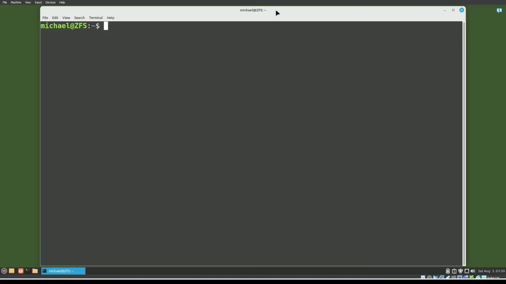
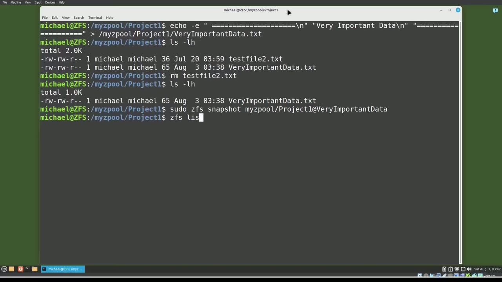
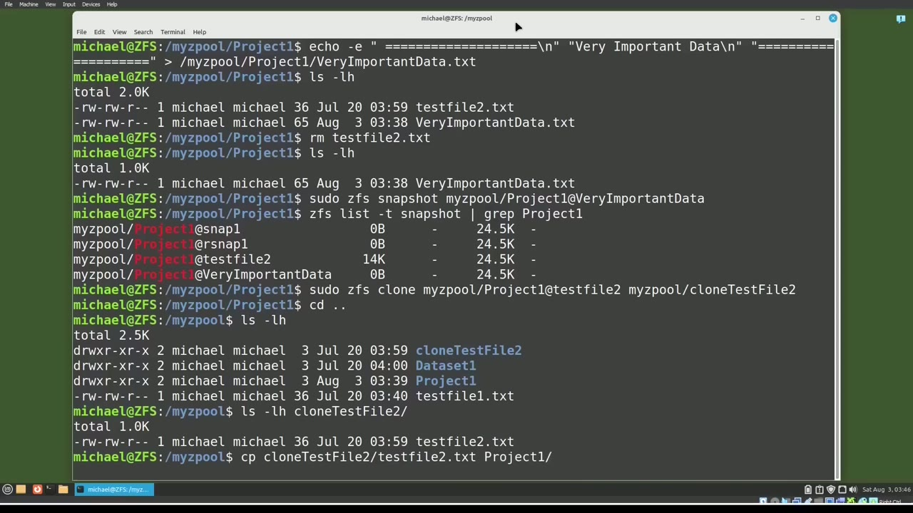
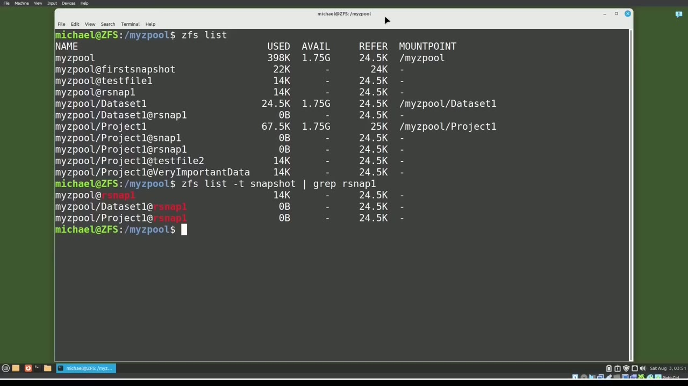

[← Course contents](../../01.md)

# 109. ZFS pt8 - Clone

**Course:** [Linux Command Line - Entire Tutorial Series](https://www.youtube.com/watch?v=avg65oY7sj4)  
**Transcript:** [`Linux Command Line - Entire Tutorial Series transcript`](../../../../course_videos/Linux%20Command%20Line%20-%20Entire%20Tutorial%20Series/Linux%20Command%20Line%20-%20Entire%20Tutorial%20Series.txt)  
**Video:** 18:31:14–18:39:36 ([open at this time](https://www.youtube.com/watch?v=avg65oY7sj4&t=66674s))

## Introduction

We're picking up from where we left off in the last video. I'm going to type ZFS list, and we see the ZFS Z pool, My Zpool, as well as the two ZFS datasets, Dataset 1. And Project 1 and the snapshots we took in the last video. I can show just the snapshots with ZFSList-T snapshot.

## Detailed Explanation

<details>
  <summary>Step 1 — Run `zfs`, `zpool`, `zfs snapshot clone`</summary>

### Step 1 — Run `zfs`, `zpool`, `zfs snapshot clone`

- [x] **Use `zfs`, `zpool`**
  - We're picking up from where we left off in the last video.
  - I'm going to type `zfs` list, and we see the `zfs` Z pool, My `zpool`, as well as the two `zfs` datasets, Dataset 1.
  - And Project 1 and the snapshots we took in the last video.

- [x] **Use `zfs snapshot clone`, `ls`**
  - I can show just the snapshots with ZFSList-T snapshot.
  - In this video we're going to use `zfs snapshot clone` to recover data from a snapshot that is not the most recent snapshot without deleting the most recent snapshots.
  - Project 1 and type `ls`. We see a single file there called TestFile2.T. I will cat out that file with cat test file 2. txt.

- [x] **Use `sudo zfs snapshot snapshot`, `zpool`**
  - And we see it says test file 2 with some at symbols above and below the text.
  - I'm going to take a snapshot of this with the command. sudo `zfs` snapshot. Snapshot.
  - My `zpool`, Project 1, at, and then we will call this snapshot Test File 2.

- [x] **Use `zfs`, `ls -lh`**
  - And then typing `zfs` list -T snapshot shows our snapshot test file 2 is created.
  - I'm going to clear the screen and now I'm going to add a new file into our Project 1 `zfs` dataset.
  - Typing `ls -lh` shows the two files and we realize we don't need TestFile2.T.

- [x] **So we will delete it with rm, testfile2.tXT**
  - So we will delete it with rm, testfile2.tXT.
  - Then we're going to add the at sign and the name will give this snapshot is very important data.
  - Everything's going well now and we realize we really need the file test file 2.TXT, but it's not the most recent snapshot.

```bash
zfs
zpool
zfs snapshot clone
ls
sudo zfs snapshot snapshot
ls -lh
```



</details>

<details>
  <summary>Step 2 — Run `zfs`, `grep project`, `zfs clone`</summary>

### Step 2 — Run `zfs`, `grep project`, `zfs clone`

- [x] **Use `zfs`, `grep project`, `zfs clone`**
  - And we don't want to remove the most recent snapshot because it has some really important data in it.
  - So I'm going to look at the snapshots I have for Project 1.
  - With `zfs` list -T snapshot `grep project` one and here we see the snapshot we want to roll back to that one is test file 2 so I want to clone the test file 2 snapshot and I will do that with the `zfs clone` command `sudo` zf sq clone my `zpool` project 1 at Test File 2.

- [x] **Use `ls -lh`**
  - And then we need to put this clone in the same Z-Pool as the snapshot, which will be my Z-Pool.
  - And then I'll create a name for my new clone.
  - Going to cd up a directory and then type `ls -lh`.

- [x] **Use `ls -lh clone`, `cp clon`**
  - And we see clone test file 2 was created just as we expected.
  - Typing `ls -lh clone` test file 2 shows us our test file 2. txt file.
  - From here I can copy the test file 2.T file into the project 1 directory with the command `cp clon` test file 2, test file 2.txtfile 2.t.txt.

```bash
zfs
grep project
zfs clone
sudo
zpool
ls -lh
ls -lh clone
cp clon
```



</details>

<details>
  <summary>Step 3 — Run `ls -lh`, `zpool`, `zfs`</summary>

### Step 3 — Run `ls -lh`, `zpool`, `zfs`

- [x] **Use `ls -lh`, `zpool`**
  - Project 1. I'll make sure it's there with `ls -lh` Project 1. Our test file 2.TXT file is back in Project 1, which we wanted.
  - So we no longer need the clone test file 2.
  - And I can remove that with suduzfs destroy My `zpool` forward slash clone test file 2.

- [x] **Use `zfs`**
  - I'm going to clear the screen again and type `zfs` List.
  - This shows all our snapshots, including the recursive snapshot that we made in the last video.
  - We can see just those snapshots with `zfs` List -T.

- [x] **Use `grep r`**
  - Snapshot. `grep r` Snap 1.
  - When we cloned the Test File 2 snapshot earlier in this video, we said that the clone had to go in the same Z pool as the snapshot.
  - Can we clone our recursive Z pool snapshot into the same Z pool?

- [x] **I would say as long as there's enough space here, but the snapshot is**
  - I would say as long as there's enough space here, but the snapshot is already taking the space up.
  - So as long as we don't add any files to that clone...

```bash
ls -lh
zpool
zfs
grep r
```



</details>

<details>
  <summary>Step 4 — Run `sudo -zfs clone`, `ls -lh`, `ls -lh clone`</summary>

### Step 4 — Run `sudo -zfs clone`, `ls -lh`, `ls -lh clone`

- [x] **Use `sudo -zfs clone`, `ls -lh`**
  - To clone the Z-Pool snapshot, I will type `sudo -`zfs` clone` my Z-Pool at R-Snap 1, and we'll put that in My Z-Pool forward slash, and we'll call this clone Clown R-Snap 1.
  - We see the clone R snap 1 clone and I will list out what's inside with `ls -lh`.
  - We see the file, test file 1 and the two datasets.

- [x] **Use `ls -lh clone`**
  - I want to make sure the files in the Project 1 dataset were restored and I'll check that with `ls -lh`, clone snap 1, Project 1.
  - To see the data in the Project 1 dataset, we will need to clone the recursive Z-Pool snapshot taken for Project 1, which is the snapshot MyZPool, Project 1 at R-Snap 1.
  - I'll clone that now with suduzfs clone My Z-Pool Project 1 at R-Snap 1.

- [x] **Use `ls -lh`**
  - And we will clone that into MyZPool, clone R-Snap1, Project 1.
  - And typing `ls -lh` shows the clone R-Snap 1 Project 1, and `ls -lh`.
  - ClownSnap 1 Project 1 shows us that the Test File 2 file is in that clone.

- [x] **Use `zfs promote`, `zfs`**
  - So now we see why we needed to create the recursive snapshot to keep the sub-directory data.
  - I will mention that you can use `zfs promote` to replace an active `zfs` file system with the clone of that file system, but that's outside the scope of this beginner's tutorial.
  - In the next tutorial, we will continue looking at `zfs` for the Linux command line.

```bash
sudo -zfs clone
ls -lh
ls -lh clone
zfs promote
zfs
```



</details>

<details>
  <summary>Questions and Answers</summary>

## Questions and Answers

### Question 1: What does `zfs` do in this chapter?

<details>
<summary>Answer</summary>

- [x] I'm going to type `zfs` list, and we see the `zfs` Z pool, My Zpool, as well as the two `zfs` datasets, Dataset 1.

</details>

### Question 2: What does `zpool` do in this chapter?

<details>
<summary>Answer</summary>

- [x] I'm going to type ZFS list, and we see the ZFS Z pool, My `zpool`, as well as the two ZFS datasets, Dataset 1.

</details>

### Question 3: What does `zfs snapshot clone` do in this chapter?

<details>
<summary>Answer</summary>

- [x] In this video we're going to use `zfs snapshot clone` to recover data from a snapshot that is not the most recent snapshot without deleting the most recent snapshots.

</details>

### Question 4: What does `ls` do in this chapter?

<details>
<summary>Answer</summary>

- [x] Project 1 and type `ls`. We see a single file there called TestFile2.T. I will cat out that file with cat test file 2. txt.

</details>

### Question 5: What does `sudo zfs snapshot snapshot` do in this chapter?

<details>
<summary>Answer</summary>

- [x] I'm going to take a snapshot of this with the command. sudo ZFS snapshot. Snapshot.

</details>

### Question 6: What does `ls -lh` do in this chapter?

<details>
<summary>Answer</summary>

- [x] Typing `ls -lh` shows the two files and we realize we don't need TestFile2.T.

</details>

### Question 7: What does `grep project` do in this chapter?

<details>
<summary>Answer</summary>

- [x] With ZFS list -T snapshot `grep project` one and here we see the snapshot we want to roll back to that one is test file 2 so I want to clone the test file 2 snapshot and I will do that with the ZFS clone command sudo zf sq clone my Zpool project 1 at Test File 2.

</details>

### Question 8: What does `zfs clone` do in this chapter?

<details>
<summary>Answer</summary>

- [x] With ZFS list -T snapshot grep project one and here we see the snapshot we want to roll back to that one is test file 2 so I want to clone the test file 2 snapshot and I will do that with the `zfs clone` command sudo zf sq clone my Zpool project 1 at Test File 2.

</details>

### Question 9: What does `sudo` do in this chapter?

<details>
<summary>Answer</summary>

- [x] With ZFS list -T snapshot grep project one and here we see the snapshot we want to roll back to that one is test file 2 so I want to clone the test file 2 snapshot and I will do that with the ZFS clone command `sudo` zf sq clone my Zpool project 1 at Test File 2.

</details>

### Question 10: What does `ls -lh clone` do in this chapter?

<details>
<summary>Answer</summary>

- [x] Typing `ls -lh clone` test file 2 shows us our test file 2. txt file.

</details>

### Question 11: What does `cp clon` do in this chapter?

<details>
<summary>Answer</summary>

- [x] From here I can copy the test file 2.T file into the project 1 directory with the command `cp clon` test file 2, test file 2.txtfile 2.t.txt.

</details>

### Question 12: What does `grep r` do in this chapter?

<details>
<summary>Answer</summary>

- [x] Snapshot. `grep r` Snap 1.

</details>

</details>

## Summary

This chapter, ZFS pt8 - Clone, walks through Run zfs, zpool, zfs snapshot clone; Run zfs, grep project, zfs clone; Run ls -lh, zpool, zfs; Run sudo -zfs clone, ls -lh, ls -lh clone. Commands from the transcript: `zfs`, `zpool`, `zfs snapshot clone`, `ls`, `sudo zfs snapshot snapshot`, `ls -lh`, `grep project`, `zfs clone`, `sudo`, `ls -lh clone`, `cp clon`, `grep r`, `sudo -zfs clone`, `zfs promote`.

## References

- [Linux Command Line - Entire Tutorial Series (YouTube)](https://www.youtube.com/watch?v=avg65oY7sj4)
- [This chapter at 18:31:14](https://www.youtube.com/watch?v=avg65oY7sj4&t=66674s)
- [Local transcript](../../../../course_videos/Linux%20Command%20Line%20-%20Entire%20Tutorial%20Series/Linux%20Command%20Line%20-%20Entire%20Tutorial%20Series.txt)
