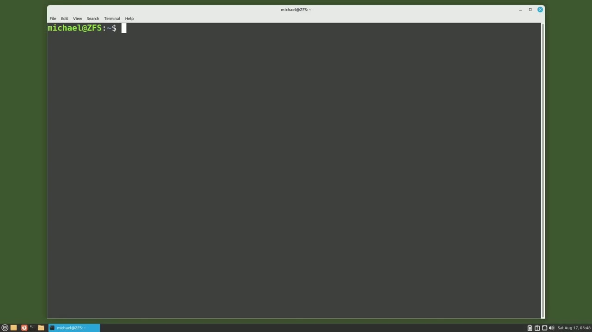
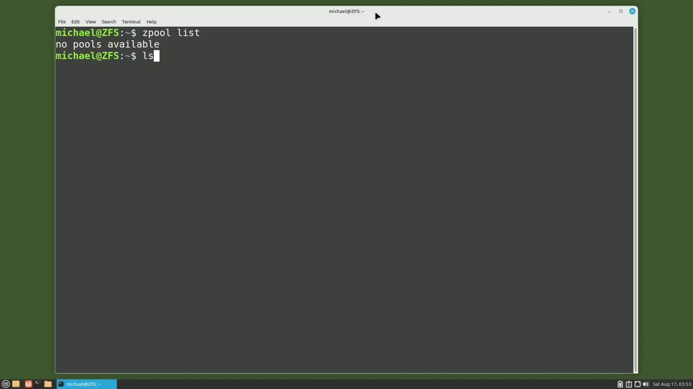
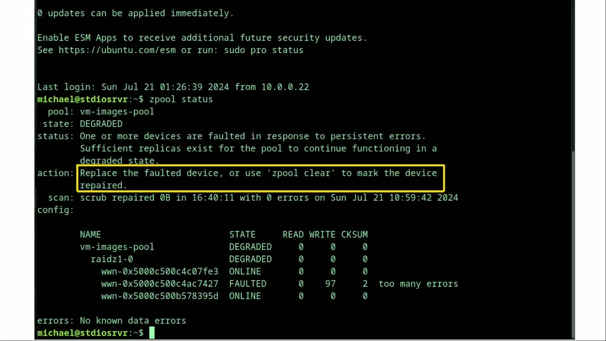
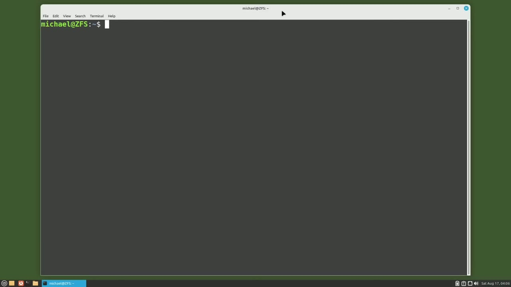

[← Course contents](../../01.md)

# 110. ZFS pt9 - Scrub

**Course:** [Linux Command Line - Entire Tutorial Series](https://www.youtube.com/watch?v=avg65oY7sj4)  
**Transcript:** [`Linux Command Line - Entire Tutorial Series transcript`](../../../../course_videos/Linux%20Command%20Line%20-%20Entire%20Tutorial%20Series/Linux%20Command%20Line%20-%20Entire%20Tutorial%20Series.txt)  
**Video:** 18:39:36–18:46:27 ([open at this time](https://www.youtube.com/watch?v=avg65oY7sj4&t=67176s))

## Introduction

In previous videos, I talked about ZFS Raid pools. I will do a quick review of a ZFS Rade 1 for those that missed that video and a reminder for those that did watch it. We said in a ZFS Rade 1, we would lose one disk space of storage, meaning if we have 3, 2 gigabyte disks in our Rade 1 using 6. 6 gigabytes of data, our RAID 1 would only have 4 gigabytes available for data.

## Detailed Explanation

<details>
  <summary>Step 1 — Run `zfs`</summary>

### Step 1 — Run `zfs`

- [x] **Use `zfs`**
  - In previous videos, I talked about `zfs` Raid pools.
  - I will do a quick review of a `zfs` Rade 1 for those that missed that video and a reminder for those that did watch it.
  - We said in a `zfs` Rade 1, we would lose one disk space of storage, meaning if we have 3, 2 gigabyte disks in our Rade 1 using 6.

- [x] **Use `zfs`**
  - 6 gigabytes of data, our RAID 1 would only have 4 gigabytes available for data.
  - But if any single drive in that `zfs` raid 1 fails, our RAID 1 could continue until that disk could be replaced.
  - We then talked about how data is stored on a `zfs` raid to handle a disc loss.

- [x] **Use `zfs`**
  - And we learned that it is not data copied around to all the disks as we might think.
  - But instead, check-sum information is available on the disks to recreate the data if one of those disks fails.
  - The advantage to having check-sum information on that disk is that when we read data from our `zfs` raid pool, `zfs` compares that data to the check-sum information for that data.

- [x] **Use `zfs`**
  - And if that data read does not match the check-sum, `zfs` can correct that data before it passes that data on.
  - So what would cause the data on that disk to go bad?
  - The most common reason for data loss is BitRot.

- [x] **Use `zfs`**
  - BitRot happens when you have data sitting on a hard drive.
  - Maybe you have a photo that you haven't looked at in years, and then you try and open it, and it doesn't show properly or doesn't open at all, because some of the bits on that hard drive, where your photo is, have gone bad.
  - With `zfs`, when we open that picture with some bit rot, the data gets compared to those checksums and gets corrected, so our photo will open as expected.

- [x] **Data that gets accessed frequently gets compared to the checksums**
  - Data that gets accessed frequently gets compared to the checksums frequently.
  - But what about the data that does not get accessed frequently?
  - A scrub will compare all the data in the Z-pool against their checksums.

- [x] **And repair any data that does not match up**
  - And repair any data that does not match up.

```bash
zfs
```



</details>

<details>
  <summary>Step 2 — Run `lsblk`, `zfs`</summary>

### Step 2 — Run `lsblk`, `zfs`

- [x] **Use `lsblk`, `zfs`**
  - And I'll type `lsblk` to show what discs we have available.
  - We see we've got the 5 2 gigabyte disks, sdb through sdf, available for `zfs`.
  - I'll create a `zfs` RAID 1 Z pool by pasting in the command.

- [x] **Sude create my Raid 1, Raid Z, on the discs sdb, sdc, and sdd**
  - Sude create my Raid 1, Raid Z, on the discs sdb, sdc, and sdd.
  - I want to force a Z-Pool scrub right now.
  - To do that, I'll type in S-Poo-ZPool scrub and then the name of the Z-Pool that I want to scrub, which in this case is my Raid 1.

- [x] **And we can check the status with Z-Pool status**
  - And we can check the status with Z-Pool status.
  - Our scrub completed and repaired 0 bytes of data.
  - And since the Z-Pool is so small, only 6 gigabytes, it finished pretty quick in one second.

- [x] **To see what it looks like running, I will append on the Z-Pool status**
  - To see what it looks like running, I will append on the Z-Pool status to our scrub command.
  - And that's what it looks like when it's running.
  - Bringing up the Z-Pool status again shows that it completed with no errors.

- [x] **Here's a picture of a Z-Pool status showing some disc errors**
  - Here's a picture of a Z-Pool status showing some disc errors.
  - We see here that our middle disk shows a faulted with too many errors.

```bash
lsblk
zfs
```



</details>

<details>
  <summary>Step 3 — Run `zfs`, `at`, `sudo`</summary>

### Step 3 — Run `zfs`, `at`, `sudo`

- [x] **Use `zfs`**
  - Under our status, we see that one or more disks are faulted and that sufficient replicas exist for our Z-Pool to continue functioning in a degraded state.
  - Then the suggested action is to replace the faulted drive or use Z-Pool Clear to mark the device as repaired.
  - So `zfs` doesn't tell us we need to replace that disk, but it does warn us that we might want to replace that disk.

- [x] **Use `at`**
  - If you see a message like this and you have important data on that disk and that disc is five or more years old, you should probably swap out that disk in question for a new one.
  - Now I want to point out that scrubs can be resource intensive.
  - You probably want to schedule the scrub to run `at` night or during low activity hours.

- [x] **Use `sudo`**
  - If you started a scrub that will run a long time, then you realize that you're about to go into a busy part of the day.
  - You can stop that scrub by adding -S to the scrub.
  - `sudo` Z-Pool Scrub-S and then the Z-Pool name.

- [x] **It is suggested that we run a scrub at least once a month or more**
  - It is suggested that we run a scrub `at` least once a month or more, depending upon how you feel about your data, and how long that scrub takes to run on your machine.

```bash
zfs
at
sudo
```



</details>

<details>
  <summary>Step 4 — Run `zfs`, `sudo`, `less /etc`</summary>

### Step 4 — Run `zfs`, `sudo`, `less /etc`

- [x] **Use `zfs`, `sudo`, `less /etc`**
  - `zfs` does have some default Cron's at run.
  - They can be found in /etc CronD `zfs` Utils -Linux.
  - Let's less into that file with `sudo`, `less /etc` Cron.D ZFSutils -Linux.

- [x] **Use `zfs`**
  - We see on the first Sunday of every month, `zfs` will perform the trim command.
  - The trim command will look for all the free space in a Z pool and reclaim that free space. Then on the second Sunday of the month, a scrub is run.
  - Another thing I should mention is that `zfs` does like to use memory, so the more memory you have, the better. I have heard people say that if you don't have a lot of memory, it doesn't matter, it will just take longer to run. Well, if you only have a couple of gig in your Z-pool,

- [x] **Use `zfs`**
  - You can probably get away with a small amount of memory, but if you're using terabytes of data, you will probably want to have as much memory as possible.
  - If you only have 4 or 6 gig of memory and you want to work with terabytes of data, you may want to consider using LVM instead of `zfs`.
  - LVM can get by with a lot less memory than `zfs`, but you do lose out on that data integrity that you get with `zfs`.

- [x] **Use `zfs`**
  - Now you may have heard that you need to use ecc memory with `zfs`.
  - Yes, it's better to use error correction code memory if you have it, but it's not required for `zfs`.
  - Wrapping up this video also wraps up this group of videos looking at `zfs`.

- [x] **In the next tutorial, we'll continue looking at the Linux command line**
  - In the next tutorial, we'll continue looking at the Linux command line.

```bash
zfs
sudo
less /etc
```



</details>

<details>
  <summary>Questions and Answers</summary>

## Questions and Answers

### Question 1: What does `zfs` do in this chapter?

<details>
<summary>Answer</summary>

- [x] In previous videos, I talked about `zfs` Raid pools.

</details>

### Question 2: What does `lsblk` do in this chapter?

<details>
<summary>Answer</summary>

- [x] And I'll type `lsblk` to show what discs we have available.

</details>

### Question 3: What does `at` do in this chapter?

<details>
<summary>Answer</summary>

- [x] You probably want to schedule the scrub to run `at` night or during low activity hours.

</details>

### Question 4: What does `sudo` do in this chapter?

<details>
<summary>Answer</summary>

- [x] `sudo` Z-Pool Scrub-S and then the Z-Pool name.

</details>

### Question 5: What does `less /etc` do in this chapter?

<details>
<summary>Answer</summary>

- [x] Let's less into that file with Sudo, `less /etc` Cron.D ZFSutils -Linux.

</details>

### Question 6: What does step 1 cover (Run zfs)?

<details>
<summary>Answer</summary>

- [x] In previous videos, I talked about `zfs` Raid pools.
- [x] I will do a quick review of a `zfs` Rade 1 for those that missed that video and a reminder for those that did watch it.
- [x] We said in a `zfs` Rade 1, we would lose one disk space of storage, meaning if we have 3, 2 gigabyte disks in our Rade 1 using 6.

</details>

### Question 7: What does step 2 cover (Run lsblk, zfs)?

<details>
<summary>Answer</summary>

- [x] And I'll type `lsblk` to show what discs we have available.
- [x] We see we've got the 5 2 gigabyte disks, sdb through sdf, available for `zfs`.
- [x] I'll create a `zfs` RAID 1 Z pool by pasting in the command.

</details>

### Question 8: What does step 3 cover (Run zfs, at, sudo)?

<details>
<summary>Answer</summary>

- [x] Under our status, we see that one or more disks are faulted and that sufficient replicas exist for our Z-Pool to continue functioning in a degraded state.
- [x] Then the suggested action is to replace the faulted drive or use Z-Pool Clear to mark the device as repaired.
- [x] So `zfs` doesn't tell us we need to replace that disk, but it does warn us that we might want to replace that disk.

</details>

### Question 9: What does step 4 cover (Run zfs, sudo, less /etc)?

<details>
<summary>Answer</summary>

- [x] `zfs` does have some default Cron's at run.
- [x] They can be found in /etc CronD `zfs` Utils -Linux.
- [x] Let's less into that file with `sudo`, `less /etc` Cron.D ZFSutils -Linux.

</details>

</details>

## Summary

This chapter, ZFS pt9 - Scrub, walks through Run zfs; Run lsblk, zfs; Run zfs, at, sudo; Run zfs, sudo, less /etc. Commands from the transcript: `zfs`, `lsblk`, `at`, `sudo`, `less /etc`.

## References

- [Linux Command Line - Entire Tutorial Series (YouTube)](https://www.youtube.com/watch?v=avg65oY7sj4)
- [This chapter at 18:39:36](https://www.youtube.com/watch?v=avg65oY7sj4&t=67176s)
- [Local transcript](../../../../course_videos/Linux%20Command%20Line%20-%20Entire%20Tutorial%20Series/Linux%20Command%20Line%20-%20Entire%20Tutorial%20Series.txt)
