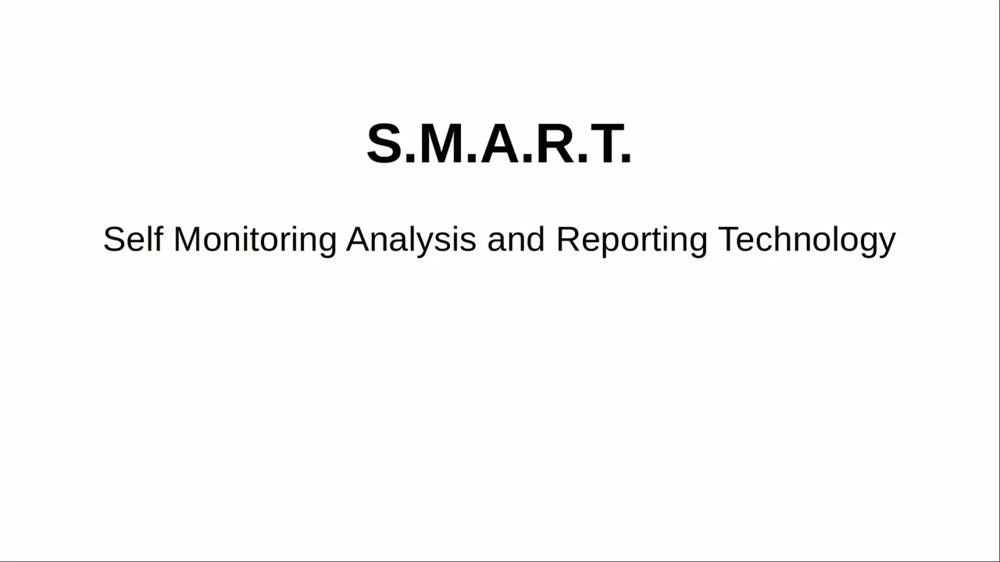
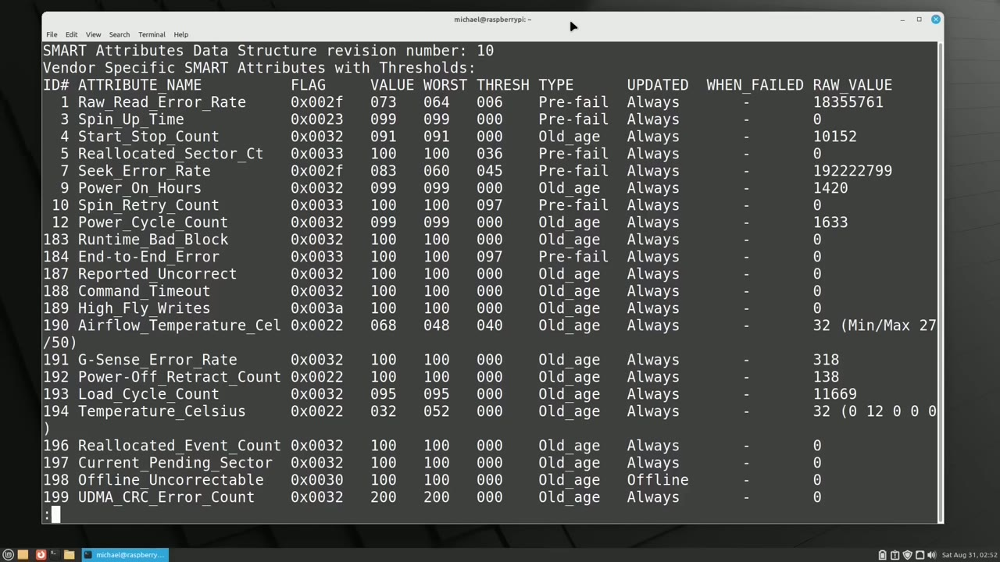
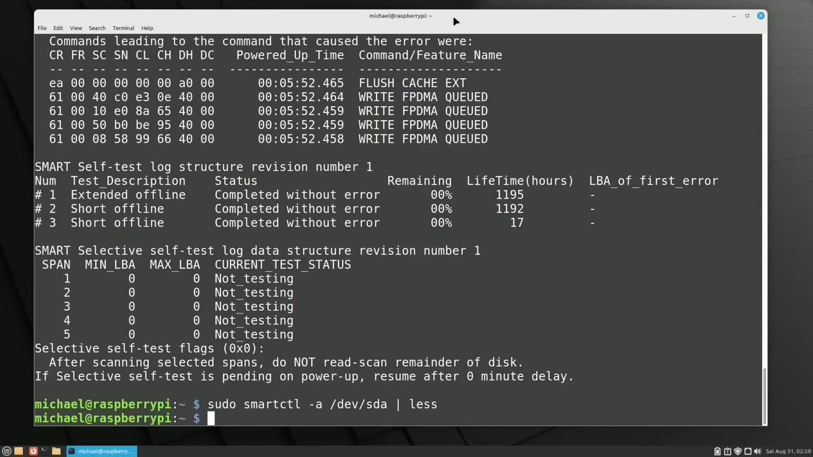
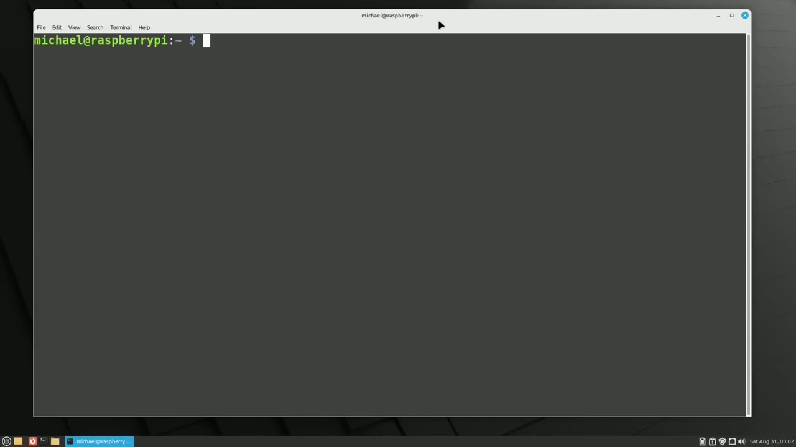
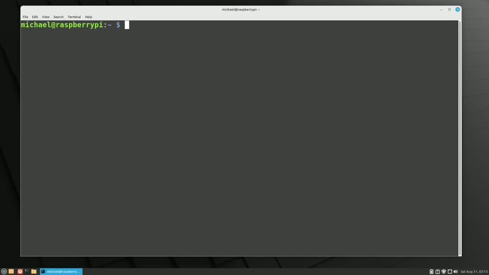

[← Course contents](../../01.md)

# 111. SMARTmonTools

**Course:** [Linux Command Line - Entire Tutorial Series](https://www.youtube.com/watch?v=avg65oY7sj4)  
**Transcript:** [`Linux Command Line - Entire Tutorial Series transcript`](../../../../course_videos/Linux%20Command%20Line%20-%20Entire%20Tutorial%20Series/Linux%20Command%20Line%20-%20Entire%20Tutorial%20Series.txt)  
**Video:** 18:46:27–19:00:05 ([open at this time](https://www.youtube.com/watch?v=avg65oY7sj4&t=67587s))

## Introduction

In this video, we're going to look at the disk tool smartmontools. Smart stands for self-monitoring analysis and reporting technology. The one will spend the most time on in this video is the smartctl, which we will run from the command line, and then there is the SmartD utility, which is a daemon that can be used to schedule the SmartMond tool. The first thing I'm going to do is to install the smartmontools with the commands, Sudo Apt Update, and then Sudo Apt install smart mon tools we see it is already installed on my computer I'll note here that the disk drive must have smart capabilities for this tool to work

## Detailed Explanation

<details>
  <summary>Step 1 — Run `smartctl`, `smartd`, `sudo apt update`</summary>

### Step 1 — Run `smartctl`, `smartd`, `sudo apt update`

- [x] **Use `smartctl`, `smartd`**
  - In this video, we're going to look at the disk tool smartmontools.
  - Smart stands for self-monitoring analysis and reporting technology.
  - The one will spend the most time on in this video is the `smartctl`, which we will run from the command line, and then there is the `smartd` utility, which is a daemon that can be used to schedule the SmartMond tool.

- [x] **Use `sudo apt update`, `sudo apt install smart`, `lsblk`**
  - The first thing I'm going to do is to install the smartmontools with the commands, `sudo apt update`, and then `sudo apt install smart` mon tools we see it is already installed on my computer I'll note here that the disk drive must have smart capabilities for this tool to work
  - Not all disks will have smart capabilities especially if you have an older disk drive fortunately most of the disks in today's computers will have smart capabilities so we've got smart tools installed I'm going to see what disks I have available on this computer with `lsblk`.
  - And we see the disks I have are Dev sda and mmc blk0.

- [x] **Use `sudo smartctl -I`**
  - I'm going to check to see if SmartMontools is activated for Dev sda with the command `sudo `smartctl` -I` slash dev slash sda.
  - And I'm looking at the bottom two lines here where we see Smart Support is available and Smart Support is enabled.
  - If the Smart Support shows as not enabled, we can enable it with the command S-S-S-T-L-S-D-SDA.

- [x] **The S is for Smart and then the value we're sending it to is on**
  - The S is for Smart and then the value we're sending it to is on.
  - For the device dev sda. Besides showing us whether or not the smart tools are enabled or not, the information section shows us a few other important things like the model family, the device model, and the serial number. The user capacity, we see this disk is 1 terabyte,
  - And the form factor showing this disk drive is 2.5 inches. And there is other useful information about the drive as well.

- [x] **Use `smartctl`, `sudo smartctl -a`**
  - `smartctl` has a short test and a long test.
  - But before we get to that, I want to show that we can see all the disk information available by typing `sudo `smartctl` -a` for all, and then the device slash dev slash sda.
  - Pressing Enter shows there's quite a lot of information there.

- [x] **So I'm going to run that command again and pipe this into less**
  - So I'm going to run that command again and pipe this into less.
  - Here at the top we see the information section that we just looked at.
  - Below that, we have the start of read smart data section.

- [x] **And scrolling down a bit, we see the short self-test estimated at two**
  - And scrolling down a bit, we see the short self-test estimated at two minutes and the extended or long self test estimated at 160 minutes.
  - If you have something larger than 1 terabyte, it may take significantly longer to run that extended or long test.
  - Scrolling down a bit more, we see the smart attributes data structure, and then the vendor-specific smart attributes with thresholds.

- [x] **The good thing about these attributes is that the attribute name and**
  - The good thing about these attributes is that the attribute name and id will be consistent across manufacturers and models.
  - So attribute 1 will always be raw read error rate.
  - The bad thing about these attributes is that the numbers for these attributes will vary by manufacture.

- [x] **It's kind of like when you buy a shirt that fits you really well from**
  - It's kind of like when you buy a shirt that fits you really well from one company, and then you buy that same size from another company, and the shirt is either way too big or way too small.

```bash
smartctl
smartd
sudo apt update
sudo apt install smart
lsblk
sudo smartctl -I
sudo smartctl -a
```



</details>

<details>
  <summary>Step 2 — that's one of the things that's going to make it a little difficult to</summary>

### Step 2 — that's one of the things that's going to make it a little difficult to

- [x] **So that's one of the things that's going to make it a little**
  - So that's one of the things that's going to make it a little difficult to know when it's time to replace your disk or not.
  - The other thing to note here is that the number of attributes showing on the screen, we see 23 of them here, for a different disk drive, it's likely to have a different number of attributes showing.
  - Even if it was the same number of attributes showing, it is likely that at least some of those attributes will be different.

- [x] **So the attributes showing is limited to the attributes the**
  - So the attributes showing is limited to the attributes the manufacturer decided were important for that disk drive.
  - A couple of things that we might want to note right away are things like the number of hours the disk drive has been powered on.
  - We see that here as number nine, power on hours.

- [x] **This one has 1,420 hours, which is not very many hours**
  - This one has 1,420 hours, which is not very many hours.
  - I've seen some disks working just fine with 50,000 hours on them.
  - Another attribute we might want to look at is the 190 airflow temperature Celsius.

- [x] **There is usually a min and max for this number, and as long as we're**
  - There is usually a min and max for this number, and as long as we're somewhere in the middle, we should be good.
  - And the number I'm looking at is that raw value of 32.
  - This disk drive also shows a temperature Celsius.

- [x] **Now this one is unique because for some Seagate discs, the worst**
  - Now this one is unique because for some Seagate discs, the worst value is the highest lifetime temperature recorded.
  - So for this drive, the highest temperature recorded is 52 degrees.



</details>

<details>
  <summary>Step 3 — Run `smartctl`, `sudo`, `smartctl -c -sysh`</summary>

### Step 3 — Run `smartctl`, `sudo`, `smartctl -c -sysh`

- [x] **Use `smartctl`**
  - You might think that this is kind of bad, but if it only happens once in the while and only for short periods of time, we should be okay.
  - I'm going to press Q to quit out of here, and let's run a self-test.
  - The `smartctl` utility has four different types of tests.

- [x] **This is a quick test, usually under five minutes, checking the most**
  - This is a quick test, usually under five minutes, checking the most common disk problems.
  - It's a more accurate version of the short test and can take hours to complete.
  - This is meant to check for damage after transporting the device.

- [x] **It will only take about 10 minutes and is only available for ata**
  - It will only take about 10 minutes and is only available for ata devices.
  - And then we've got the Select Self-Test.
  - This is meant to check a specified range of lba's logical block addresses and is only available for ata devices.

- [x] **Ata stands for Advanced Technology Attachment**
  - Ata stands for Advanced Technology Attachment.
  - Sat is one of the most common disk drives used today.
  - Before we run a self-test, we might want to check how long the self-test will take to run.

- [x] **Use `sudo`, `smartctl -c -sysh`**
  - To see how much time that self-test will take to run, I will type `sudo`.
  - `smartctl -c -sysh` slash dev slash sda.
  - And we see it takes about two minutes to run the short self-test and about 160 minutes to complete the long self-test for this disk.

- [x] **Use `smartctl -a`**
  - And if you're thinking, didn't we just see this in the `smartctl -a` command?
  - The A is for all the smart data available.

```bash
smartctl
sudo
smartctl -c -sysh
smartctl -a
```



</details>

<details>
  <summary>Step 4 — Run `sudo`, `smartctl -T`, `sudo smartctl -L`</summary>

### Step 4 — Run `sudo`, `smartctl -T`, `sudo smartctl -L`

- [x] **Use `sudo`, `smartctl -T`, `sudo smartctl -L`**
  - To run the short self-test, I will type `sudo`...
  - `smartctl -T` for test short slash dev slash sda and if we want to run the long test we would just replace the short here with long and it will run the long or extended test.
  - Pressing enter gets the test going. To see information about a running self test, I will type `sudo smartctl -L` self-test slash dev slash sda.

- [x] **This shows how far long our self-test is**
  - This shows how far long our self-test is.
  - We still have 90% of the self-test to go.
  - And it's going to keep going down until it gets to zero.

- [x] **And then the self-test will be complete**
  - And then the self-test will be complete.
  - I do want to mention that running the long and short self-test will not harm any data on that hard drive.
  - I'm running this one on my Raspberry Pi just so I can test some bigger disks that I don't have in computers, and I can run that test for hours without tying up any resources on my main computer.

- [x] **Use `sudo`**
  - So we see that our self-test is complete.
  - To see the quick results of the self-test, I will type `sudo`.
  - Smartctl-UppercaseH slash dev slash sda.

- [x] **And we see the overall health of our self-assessment test shows we**
  - And we see the overall health of our self-assessment test shows we passed.
  - Now does this mean our disc is really healthy?
  - But as I mentioned earlier, there's a lot of inconsistency between vendors.

- [x] **Use `sudo smartctl -A`**
  - So a self-test result of past does not guarantee that your disc is...
  - All that healthy. So let's go back to those attributes we were looking at earlier with the `sudo smartctl -A` dev sda and I pipe that into less and then we go down a bit till we bring up the smart attributes. One of the values here that I want to pay a special
  - Attention to is number five, the reallocated sector count.

- [x] **This is the count of sectors on the block drive which cannot be used**
  - This is the count of sectors on the block drive which cannot be used correctly.
  - When a sector like that is found, it's remapped to one of the available spare sectors of storage and the data is reallocated.
  - If this number is something greater than zero, and then the number on this line I'm looking at is the raw value, which we see here is zero.

- [x] **If that raw number value is something greater than zero, this may be**
  - If that raw number value is something greater than zero, this may be an indicator that our disk is having problems.
  - Another attribute that I want to pay specific attention to is number 197, current pending sector.
  - The current pending sector attribute is the count of bad sectors that are still waiting to be remapped.

- [x] **If we have some sectors still waiting to be remapped, we may want to**
  - If we have some sectors still waiting to be remapped, we may want to back up that important data from this disk drive.
  - And the number we're looking at for this attribute is under raw value, which again we have zero, which is a good sign.
  - One other one that I might want to look at is number 10, spin retry count.

- [x] **This is the number of retries during disk spin-up**
  - This is the number of retries during disk spin-up.

```bash
sudo
smartctl -T
sudo smartctl -L
sudo smartctl -A
```



</details>

<details>
  <summary>Step 5 — Run `sudo apt install g`, `smartd`</summary>

### Step 5 — Run `sudo apt install g`, `smartd`

- [x] **A growing number may be a sign of an upcoming mechanical value**
  - A growing number may be a sign of an upcoming mechanical value.
  - And again, I'm looking at the raw value of zero.
  - And then we also have the temperature values that we already talked about.

- [x] **Use `sudo apt install g`**
  - Even if all these things look okay, there's still no guarantee your drive is good.
  - Sometimes disks just die with no warning.
  - For smartmontools. It's called G Smart Control and can be installed with the command `sudo apt install g` Smart Control. And we see here it's already installed.

- [x] **To open it, I'm going to go down to System Tools G Smart Control**
  - To open it, I'm going to go down to System Tools G Smart Control. There's our two discs.
  - Most of this is what we've already seen. We've got the general. We've got the attributes. We can look at the self-tests.
  - And to view a self-test, we would click view output. And there's the output from the self-test.

- [x] **Use `smartd`**
  - The last thing I want to mention in this video is the `smartd` Comp file.
  - I will less into that file now with SudoLess at C `smartd`.comph.
  - And to find the line we want to un-comment.

- [x] **We could uncomment that and then change this device to the one that**
  - We could uncomment that and then change this device to the one that we want to test.
  - So I haven't looked into the SmartMondi tool very far, but I know that it can send you an email alert.
  - After it runs if there's any warnings but you will have to have an email service set up on that computer to send out emails if you want to receive those email alerts In the next video, we will continue looking at the Linux command line.

```bash
sudo apt install g
smartd
```



</details>

<details>
  <summary>Questions and Answers</summary>

## Questions and Answers

### Question 1: What does `smartctl` do in this chapter?

<details>
<summary>Answer</summary>

- [x] The one will spend the most time on in this video is the `smartctl`, which we will run from the command line, and then there is the SmartD utility, which is a daemon that can be used to schedule the SmartMond tool.

</details>

### Question 2: What does `smartd` do in this chapter?

<details>
<summary>Answer</summary>

- [x] The one will spend the most time on in this video is the smartctl, which we will run from the command line, and then there is the `smartd` utility, which is a daemon that can be used to schedule the SmartMond tool.

</details>

### Question 3: What does `sudo apt update` do in this chapter?

<details>
<summary>Answer</summary>

- [x] The first thing I'm going to do is to install the smartmontools with the commands, `sudo apt update`, and then Sudo Apt install smart mon tools we see it is already installed on my computer I'll note here that the disk drive must have smart capabilities for this tool to work

</details>

### Question 4: What does `sudo apt install smart` do in this chapter?

<details>
<summary>Answer</summary>

- [x] The first thing I'm going to do is to install the smartmontools with the commands, Sudo Apt Update, and then `sudo apt install smart` mon tools we see it is already installed on my computer I'll note here that the disk drive must have smart capabilities for this tool to work

</details>

### Question 5: What does `lsblk` do in this chapter?

<details>
<summary>Answer</summary>

- [x] Not all disks will have smart capabilities especially if you have an older disk drive fortunately most of the disks in today's computers will have smart capabilities so we've got smart tools installed I'm going to see what disks I have available on this computer with `lsblk`.

</details>

### Question 6: What does `sudo smartctl -I` do in this chapter?

<details>
<summary>Answer</summary>

- [x] I'm going to check to see if SmartMontools is activated for Dev sda with the command `sudo smartctl -I` slash dev slash sda.

</details>

### Question 7: What does `sudo smartctl -a` do in this chapter?

<details>
<summary>Answer</summary>

- [x] But before we get to that, I want to show that we can see all the disk information available by typing `sudo smartctl -a` for all, and then the device slash dev slash sda.

</details>

### Question 8: What does `sudo` do in this chapter?

<details>
<summary>Answer</summary>

- [x] To see how much time that self-test will take to run, I will type `sudo`.

</details>

### Question 9: What does `smartctl -c -sysh` do in this chapter?

<details>
<summary>Answer</summary>

- [x] `smartctl -c -sysh` slash dev slash sda.

</details>

### Question 10: What does `smartctl -a` do in this chapter?

<details>
<summary>Answer</summary>

- [x] And if you're thinking, didn't we just see this in the `smartctl -a` command?

</details>

### Question 11: What does `smartctl -T` do in this chapter?

<details>
<summary>Answer</summary>

- [x] `smartctl -T` for test short slash dev slash sda and if we want to run the long test we would just replace the short here with long and it will run the long or extended test.

</details>

### Question 12: What does `sudo smartctl -L` do in this chapter?

<details>
<summary>Answer</summary>

- [x] Pressing enter gets the test going. To see information about a running self test, I will type `sudo smartctl -L` self-test slash dev slash sda.

</details>

</details>

## Summary

This chapter, SMARTmonTools, walks through Run smartctl, smartd, sudo apt update; that's one of the things that's going to make it a little difficult to; Run smartctl, sudo, smartctl -c -sysh; Run sudo, smartctl -T, sudo smartctl -L; Run sudo apt install g, smartd. Commands from the transcript: `smartctl`, `smartd`, `sudo apt update`, `sudo apt install smart`, `lsblk`, `sudo smartctl -I`, `sudo smartctl -a`, `sudo`, `smartctl -c -sysh`, `smartctl -a`, `smartctl -T`, `sudo smartctl -L`, `sudo smartctl -A`, `sudo apt install g`.

## References

- [Linux Command Line - Entire Tutorial Series (YouTube)](https://www.youtube.com/watch?v=avg65oY7sj4)
- [This chapter at 18:46:27](https://www.youtube.com/watch?v=avg65oY7sj4&t=67587s)
- [Local transcript](../../../../course_videos/Linux%20Command%20Line%20-%20Entire%20Tutorial%20Series/Linux%20Command%20Line%20-%20Entire%20Tutorial%20Series.txt)
