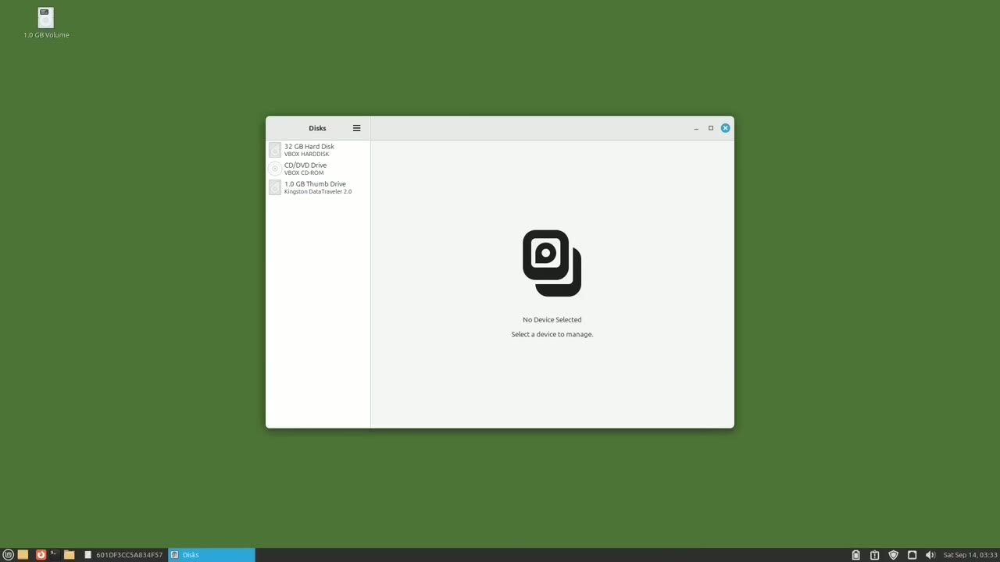
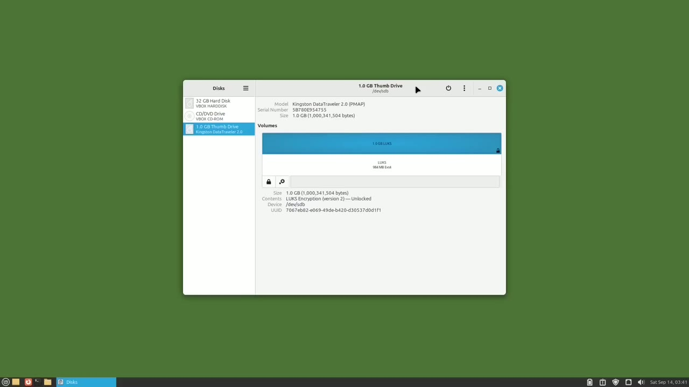
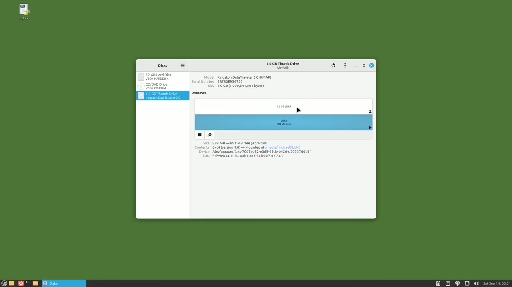
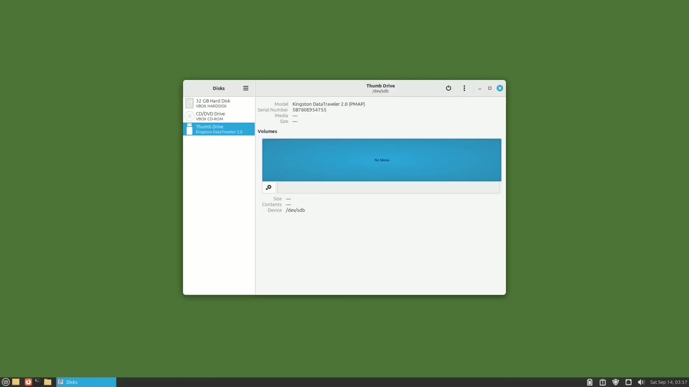

[← Course contents](../../01.md)

# 112. LUKS pt1

**Course:** [Linux Command Line - Entire Tutorial Series](https://www.youtube.com/watch?v=avg65oY7sj4)  
**Transcript:** [`Linux Command Line - Entire Tutorial Series transcript`](../../../../course_videos/Linux%20Command%20Line%20-%20Entire%20Tutorial%20Series/Linux%20Command%20Line%20-%20Entire%20Tutorial%20Series.txt)  
**Video:** 19:00:05–19:08:24 ([open at this time](https://www.youtube.com/watch?v=avg65oY7sj4&t=68405s))

## Introduction

In this group of videos, we're going to look at LUKS. And LUKS stands for Linux Unified Key Setup. LUKS is based on the kernel module DMCrypt. And we'll see what that's all about in a moment.

## Detailed Explanation

  
Step 1 — In this group of videos, we're going to look at LUKS

### Step 1 — In this group of videos, we're going to look at LUKS

- [x] **In this group of videos, we're going to look at LUKS**
  - In this group of videos, we're going to look at LUKS.
  - And LUKS stands for Linux Unified Key Setup.
  - LUKS is based on the kernel module DMCrypt.

- [x] **And we'll see what that's all about in a moment**
  - And we'll see what that's all about in a moment.
  - In short, LUKS is a disk encryption tool for Linux devices.
  - Like disks and partitions. Can LUKS be used on Windows?

- [x] **Maybe, I don't think so, at least not easily used on Windows**
  - Maybe, I don't think so, at least not easily used on Windows.
  - LUKS is mainly for Linux operated systems.
  - It's in the name Linux Unified Key Setup.

- [x] **I know this is a Linux command line tutorial series, but to show how**
  - I know this is a Linux command line tutorial series, but to show how LUKS works in this first video of a group of videos on LUKS, we're going to do everything in this video using the Linux GUI.
  - This is to make sure that we understand how LUKS works.
  - It's easier to see what's going on using the Linux GUI.

- [x] **Then in the next video, we'll do the same thing as this video, only**
  - Then in the next video, we'll do the same thing as this video, only in the Linux command line.
  - To start things off, I've got the Discs app opened, and then I have a USB drive plugged into my computer.
  - It's this one here, the 1.0 gigabyte thumb drive.

- [x] **I have selected that drive and to secure this drive with LUKS**
  - I have selected that drive and to secure this drive with LUKS encryption, we will have to reformat it.
  - Meaning we will lose everything currently on that drive.
  - I don't have anything on this drive at the moment so I can safely wipe this drive.

- [x] **I'm going to click here on this gear and then select Format Partition**
  - I'm going to click here on this gear and then select Format Partition.
  - It's asking me for a volume name. I don't have to type anything here, but I'm going to type in LUKS.
  - Then I'll choose this radio button for internal disk for use with Linux systems only, ExtE4.

- [x] **And I'm also going to click this checkbox, password protect volume**
  - And I'm also going to click this checkbox, password protect volume with LUKS.
  - I'll type in a password and confirm that password and click next.
  - I'm getting a warning that everything on this volume will be lost.

- [x] **So I'll double check, make sure that I'm on the 1.0 gigabyte thumb**
  - So I'll double check, make sure that I'm on the 1.0 gigabyte thumb drive.
  - It will take a moment or two to format the encryption.
  - So it's formatted pretty quick, but it is a 1.0 disc.

- [x] **If you have something a lot larger, like in the terabytes range, it**
  - If you have something a lot larger, like in the terabytes range, it could take a long time to complete.

  
Step 2 — The LUKS encryption formatting is complete

### Step 2 — The LUKS encryption formatting is complete

- [x] **The LUKS encryption formatting is complete**
  - The LUKS encryption formatting is complete.
  - It looks like we have two partitions on the drive, one on top of the other.
  - The partition on the top is showing a little lock, and that shows as unlocked.

- [x] **The partition on the bottom does not have a lock**
  - The partition on the bottom does not have a lock.
  - I'm clicking on the top device, the one with the lock, and we'll notice it shows as device sdb. That's our actual LUKS encrypted USB drive plugged into this computer.
  - When I click on the lower device, it shows as dev mapper LUKS and then a bunch of numbers, letters, and some hyphens. Remember earlier when I said LUKS was based on the dm Crypt kernel module? Now we see where the dm comes from. It's DevMapper.

- [x] **This dev mapper device that I'm on is a virtual unencrypted or**
  - This dev mapper device that I'm on is a virtual unencrypted or decrypted version of our LUKS device.
  - And this virtual device is created by the kernel.
  - It's done this way so we don't have to worry about encrypting and decrypting data every time we want to read or write something from the encrypted device.

- [x] **So we just read and write everything from the virtual unencrypted dev**
  - So we just read and write everything from the virtual unencrypted dev mapper device.
  - Then when we're ready to encrypt everything, we can click the lock or eject the device and LUKS will encrypt that data.
  - I'm going to open the file manager and go to the LUKS Drive.

- [x] **And then I'm going to open another window from the file manager for**
  - And then I'm going to open another window from the file manager for some pictures.
  - And I'll add these into our encrypted LUKS drive.

  
Step 3 — To our unencrypted virtual dev mapper partition

### Step 3 — To our unencrypted virtual dev mapper partition

- [x] **To our unencrypted virtual dev mapper partition**
  - To our unencrypted virtual dev mapper partition.
  - I'm going to click on the LUKS sdb version and watch what happens here on the left.
  - Our stop or unmount button becomes a lock.

- [x] **I'm going to click this lock and LUKS encrypted our data and wrote it**
  - I'm going to click this lock and LUKS encrypted our data and wrote it out to the LUKS partition.
  - So our LUKS device is now closed and our data is securely encrypted.
  - So if I lose this flash drive, no one can read what I have here, unless they plug this into a Linux computer and they know my password.

- [x] **It is important to mention that when the unencrypted DevMapper device**
  - It is important to mention that when the unencrypted DevMapper device is available to me, that data is unencrypted, so it's just like any other unencrypted file on my computer at that time.
  - Right now we see our LUKS partition is closed, so we do not see that DevMapper device anymore.
  - Over here on the left, our lock has become an unlock, and I can click this and unlock the selected encrypted partition.

- [x] **I'll click on it, and I'm prompted for the password**
  - I'll click on it, and I'm prompted for the password.
  - I'll click unlock, and we see it as decrypting my data in creating that dev mapper unencrypted virtual drive again.
  - Clicking on the file manager and then our LUKS device, we see the images that I copied in there.

- [x] **That's that name I gave it when we created that partition**
  - That's that name I gave it when we created that partition.
  - I'm going to close this dev mapper drive again, this time by clicking the eject button in the file manager.

  
Step 4 — We see that we've ejected the disc and the drive shows as no media

### Step 4 — We see that we've ejected the disc and the drive shows as no media

- [x] **We see that we've ejected the disc and the drive shows as no media**
  - We see that we've ejected the disc and the drive shows as no media because it's already ejected.
  - I'm going to close discs and pull out my USB drive.
  - Now I'm going to put the USB drive in again and we get a login pop-up window.

- [x] **This one's giving me three choices. Forget password immediately**
  - This one's giving me three choices. Forget password immediately.
  - Remember until I log out or remember forever.
  - Remember forever means I will type in the password one time now and then every time I plug in this USB drive to this computer I won't need to type in the password.

- [x] **Remember until I log out means I can unplug and plug in this USB**
  - Remember until I log out means I can unplug and plug in this USB drive as many times as I like without having to type in my password until I log out or shut down the computer.
  - Then I will get this login pop-up screen once again.
  - And forget immediately means ask for the password every time I plug in this USB drive.

- [x] **Different versions of Linux will offer different pop-up login options**
  - Different versions of Linux will offer different pop-up login options.
  - But almost all Linux computers will recognize LUKS.
  - Here I'll use the default remember password until I log out.

- [x] **And I'll type in the password and then click Connect**
  - And I'll type in the password and then click Connect.
  - In the next video, we'll look at creating a password protected LUKS partition using the Linux command line.

  
Questions and Answers

## Questions and Answers

### Question 1: What does step 1 cover (In this group of videos, we're going to look at LUKS)?

Answer

- [x] In this group of videos, we're going to look at LUKS.
- [x] And LUKS stands for Linux Unified Key Setup.
- [x] LUKS is based on the kernel module DMCrypt.

### Question 2: What does step 2 cover (The LUKS encryption formatting is complete)?

Answer

- [x] The LUKS encryption formatting is complete.
- [x] It looks like we have two partitions on the drive, one on top of the other.
- [x] The partition on the top is showing a little lock, and that shows as unlocked.

### Question 3: What does step 3 cover (To our unencrypted virtual dev mapper partition)?

Answer

- [x] To our unencrypted virtual dev mapper partition.
- [x] I'm going to click on the LUKS sdb version and watch what happens here on the left.
- [x] Our stop or unmount button becomes a lock.

### Question 4: What does step 4 cover (We see that we've ejected the disc and the drive shows as no media)?

Answer

- [x] We see that we've ejected the disc and the drive shows as no media because it's already ejected.
- [x] I'm going to close discs and pull out my USB drive.
- [x] Now I'm going to put the USB drive in again and we get a login pop-up window.

## Summary

This chapter, LUKS pt1, walks through In this group of videos, we're going to look at LUKS; The LUKS encryption formatting is complete; To our unencrypted virtual dev mapper partition; We see that we've ejected the disc and the drive shows as no media.

## References

- [Linux Command Line - Entire Tutorial Series (YouTube)](https://www.youtube.com/watch?v=avg65oY7sj4)
- [This chapter at 19:00:05](https://www.youtube.com/watch?v=avg65oY7sj4&t=68405s)
- [Local transcript](../../../../course_videos/Linux%20Command%20Line%20-%20Entire%20Tutorial%20Series/Linux%20Command%20Line%20-%20Entire%20Tutorial%20Series.txt)
