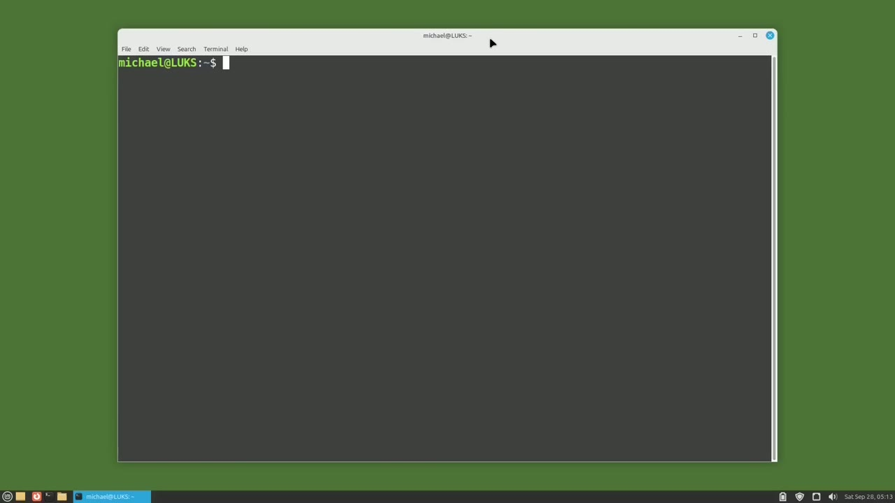
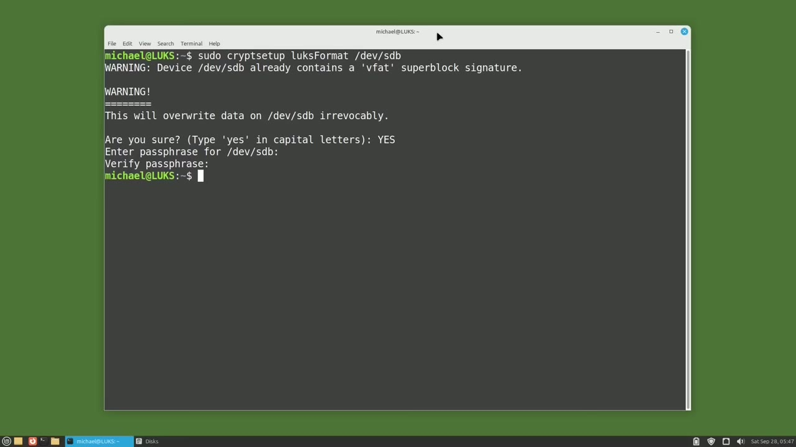
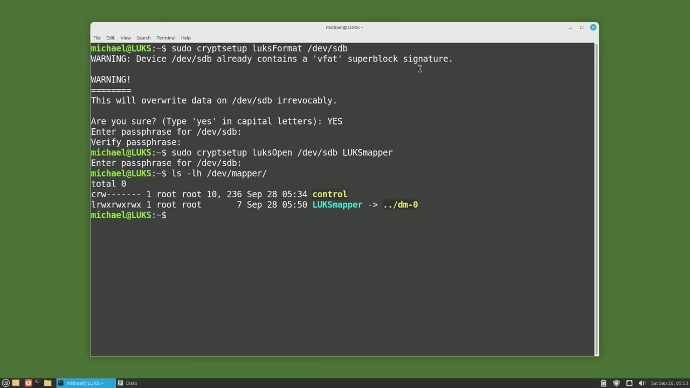
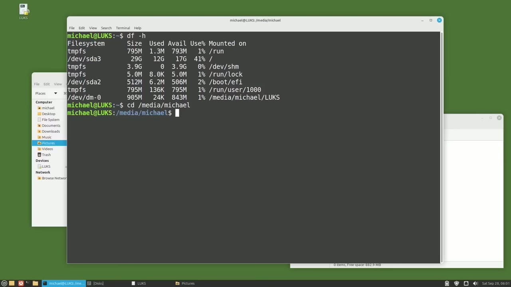

[← Course contents](../../01.md)

# 113. LUKS pt2 - LUKS from CLI

**Course:** [Linux Command Line - Entire Tutorial Series](https://www.youtube.com/watch?v=avg65oY7sj4)  
**Transcript:** [`Linux Command Line - Entire Tutorial Series transcript`](../../../../course_videos/Linux%20Command%20Line%20-%20Entire%20Tutorial%20Series/Linux%20Command%20Line%20-%20Entire%20Tutorial%20Series.txt)  
**Video:** 19:08:24–19:17:49 ([open at this time](https://www.youtube.com/watch?v=avg65oY7sj4&t=68904s))

## Introduction

In this video, we're going to set up a USB drive secured with LUKS encryption using the Linux command line. The first thing I'm going to do is make sure LUKS is installed on my computer by typing Soudou apt install cryptsetup and we see it's already installed and at the most recent version. Now I'm going to type lsblk to see what drives are on this computer. We've got an sda and the sro is the dvd drive.

## Detailed Explanation

<details>
  <summary>Step 1 — Run `cryptsetup`, `lsblk`, `sudo -u-Mount`</summary>

### Step 1 — Run `cryptsetup`, `lsblk`, `sudo -u-Mount`

- [x] **Use `cryptsetup`, `lsblk`**
  - In this video, we're going to set up a USB drive secured with LUKS encryption using the Linux command line.
  - The first thing I'm going to do is make sure LUKS is installed on my computer by typing Soudou apt install `cryptsetup` and we see it's already installed and at the most recent version.
  - Now I'm going to type `lsblk` to see what drives are on this computer.

- [x] **We've got an sda and the sro is the dvd drive**
  - We've got an sda and the sro is the dvd drive.
  - And I'm going to insert a standard Windows formatted USB drive into this computer.
  - We see the File Manager opens it up in a window and we see there's nothing on this USB drive.

- [x] **Use `lsblk`, `sudo -u-Mount`**
  - I'm going to type `lsblk` again and we see our USB drives shows up as sdb and is mounted on Media Michael.
  - I want to unmount the sdb drive so I'll do that with `sudo -u-Mount`.
  - And typing `lsblk` again shows that our sdb drive is unmounted.

- [x] **Use `sudo cryptsetup`**
  - And now I'm going to format our device for LUKS with the command, Sudo, `cryptsetup`, LUKS Format, DevSD.
  - And if I had a partition here I would add that partition number after the sdb but I'm encrypting the entire device so we're just leaving it with sdb I also want to make a note here that when using LUKS we see that I'm starting with `sudo cryptsetup` that will be pretty
  - Much the standard for the LUKS commands then our actual LUKS command will follow standard camel case which means the first word is all lowercase Then every word that follows at begins with an uppercase letter.

- [x] **So the word LUKS is all lowercase and the word format starts with an**
  - So the word LUKS is all lowercase and the word format starts with an uppercase F.
  - Then the last part is the device we want to apply this command to.
  - Pressing Enter. Now LUKS is checking with us, letting us know that we're going to overwrite a v-fat super block signature and that it will overwrite everything on this disk.

- [x] **Use `yes`**
  - We already saw that there is nothing on this device, so I'm good with that.
  - LUKS wants us to confirm that we're okay with all this by typing `yes` in all uppercase letters.
  - Now LUKS is asking me for a passphrase, meaning it's looking for a password that's longer than a normal password.

- [x] **I'll create a password and I will verify the password**
  - I'll create a password and I will verify the password.
  - Now it takes a moment or two to reformat the disk for LUKS.
  - We now have our prompt back showing us that the LUKS format is complete.

- [x] **I'm going to open up disks now to show you we have formatted our LUKS**
  - I'm going to open up disks now to show you we have formatted our LUKS device.
  - We now see a lock in the lower right corner showing that our device is secured by LUKS.
  - We also have this unlock here that when I hover over shows us unlock selected encrypted partition.

- [x] **I'm not going to click that because we're doing this all in the**
  - I'm not going to click that because we're doing this all in the command line.
  - I'm just showing that for visual reference.
  - Now what I want to do is open up our LUKS partition to the Dev Mapper.

```bash
cryptsetup
lsblk
sudo -u-Mount
sudo cryptsetup
yes
```



</details>

<details>
  <summary>Step 2 — Run `sudo cryptsetup`, `ls -lh`</summary>

### Step 2 — Run `sudo cryptsetup`, `ls -lh`

- [x] **Use `sudo cryptsetup`**
  - For those that watched the last video, we'll remember that LUKS creates a virtual drive as a dev mapper device.
  - And we're going to do that now in the command line.
  - To do that, I'm going to start off the command like we already talked about with `sudo cryptsetup`.

- [x] **The LUKS partition. So our Camelcase command will be LUKS Open**
  - The LUKS partition. So our Camelcase command will be LUKS Open.
  - And then the device we want this to be on is Dev sdb.
  - And I still have one more thing I want to add to this command.

- [x] **And that is the name we want to show in the Dev Mapper**
  - And that is the name we want to show in the Dev Mapper.
  - And the Dev Mapper name I want to give this is LUKS Mapper.
  - Now LUKS is asking me for the password we just created.

- [x] **Use `ls -lh`**
  - And we just created our DevMapper unencrypted version of our LUKS Drive.
  - We can see that by typing `ls -lh` dev Mapper.
  - And there's the LUKS Mapper that we just created.

- [x] **And now what we see are it looks like two partitions**
  - And now what we see are it looks like two partitions.
  - The top one has a lock, the bottom one, without the lock.

```bash
sudo cryptsetup
ls -lh
```



</details>

<details>
  <summary>Step 3 — Run `sudo`, `sudo cryptsetup`, `df -h`</summary>

### Step 3 — Run `sudo`, `sudo cryptsetup`, `df -h`

- [x] **Clicking on the top one with the lock, we see that this is device**
  - Clicking on the top one with the lock, we see that this is device sdb, and that is the actual LUKS encrypted device.
  - Clicking on the lower one shows this one is the DevMapper LUKS Mapper.
  - The one important thing to note here is that we don't have a file system on that partition.

- [x] **Use `sudo`**
  - We'll take care of that right now by adding a file system to our dev mapper device with the command, `sudo`, makeFS for make file system. Then I'm adding a period and we want this to be an Exti4 file system. We want this to go on DevMapper, LUKS Mapper.
  - And then I want to give this partition a label. So I will add a -uppercase L.
  - LUKS and pressing Enter shows us that it's making the file system for us right now.

- [x] **Use `sudo cryptsetup`**
  - Going back to the Discs app, now we see a file system, ExtT4.
  - Now what I want to do is close the dev mapper.
  - And I'll do that by typing `sudo cryptsetup`, LUKS close, Luxmapper.

- [x] **And checking disk again shows us that our disk is now secured and**
  - And checking disk again shows us that our disk is now secured and locked up.
  - I'm going to unplug the drive now and plug it back in.
  - And Linux is now asking me to authenticate the USB drive with the password.

- [x] **I'm going to change the radio button to forget password immediately**
  - I'm going to change the radio button to forget password immediately.
  - And Linux opens up a window with the dev Mapper unencrypted content of that drive.
  - Let's move that over here and then I want to add in some photos just like we did in the last video.

- [x] **Use `df -h`**
  - Let's grab these pictures and put them onto the new drive.
  - And we get an error. The error is permissions denied.
  - I'm going to type `df -h`.

- [x] **And that will show us where the LUKS Drive is mounted and we see it's**
  - And that will show us where the LUKS Drive is mounted and we see it's mounted on Media Michael.
  - So I will grab this, copy and cd to that.

```bash
sudo
sudo cryptsetup
df -h
```



</details>

<details>
  <summary>Step 4 — Run `ls -lh`, `sudo`</summary>

### Step 4 — Run `ls -lh`, `sudo`

- [x] **Use `ls -lh`, `sudo`**
  - And let's check out what the permissions are with `ls -lh`.
  - So now we see what the problem is. When I created the LUKS partition, I created it as the root user, so only root has access to this partition.
  - I'm going to update the partition owner right now to Michael with the command, `sudo`, Chon, Michael, colon, and the colon will change the owner and the group to Michael.

- [x] **And that will be for Media, Michael, LUKS**
  - And that will be for Media, Michael, LUKS.
  - There we see, I'm the owner, so we should be able to move these files in now without a problem.
  - And there are my photos just as we expect.

- [x] **In the next video, we will continue looking at LUKS for the Linux**
  - In the next video, we will continue looking at LUKS for the Linux command line.

```bash
ls -lh
sudo
```



</details>

<details>
  <summary>Questions and Answers</summary>

## Questions and Answers

### Question 1: What does `cryptsetup` do in this chapter?

<details>
<summary>Answer</summary>

- [x] The first thing I'm going to do is make sure LUKS is installed on my computer by typing Soudou apt install `cryptsetup` and we see it's already installed and at the most recent version.

</details>

### Question 2: What does `lsblk` do in this chapter?

<details>
<summary>Answer</summary>

- [x] Now I'm going to type `lsblk` to see what drives are on this computer.

</details>

### Question 3: What does `sudo -u-Mount` do in this chapter?

<details>
<summary>Answer</summary>

- [x] I want to unmount the sdb drive so I'll do that with `sudo -u-Mount`.

</details>

### Question 4: What does `sudo cryptsetup` do in this chapter?

<details>
<summary>Answer</summary>

- [x] And now I'm going to format our device for LUKS with the command, Sudo, cryptsetup, LUKS Format, DevSD.

</details>

### Question 5: What does `yes` do in this chapter?

<details>
<summary>Answer</summary>

- [x] LUKS wants us to confirm that we're okay with all this by typing `yes` in all uppercase letters.

</details>

### Question 6: What does `ls -lh` do in this chapter?

<details>
<summary>Answer</summary>

- [x] We can see that by typing `ls -lh` dev Mapper.

</details>

### Question 7: What does `sudo` do in this chapter?

<details>
<summary>Answer</summary>

- [x] We'll take care of that right now by adding a file system to our dev mapper device with the command, `sudo`, makeFS for make file system. Then I'm adding a period and we want this to be an Exti4 file system. We want this to go on DevMapper, LUKS Mapper.

</details>

### Question 8: What does `df -h` do in this chapter?

<details>
<summary>Answer</summary>

- [x] I'm going to type `df -h`.

</details>

</details>

## Summary

This chapter, LUKS pt2 - LUKS from CLI, walks through Run cryptsetup, lsblk, sudo -u-Mount; Run sudo cryptsetup, ls -lh; Run sudo, sudo cryptsetup, df -h; Run ls -lh, sudo. Commands from the transcript: `cryptsetup`, `lsblk`, `sudo -u-Mount`, `sudo cryptsetup`, `yes`, `ls -lh`, `sudo`, `df -h`.

## References

- [Linux Command Line - Entire Tutorial Series (YouTube)](https://www.youtube.com/watch?v=avg65oY7sj4)
- [This chapter at 19:08:24](https://www.youtube.com/watch?v=avg65oY7sj4&t=68904s)
- [Local transcript](../../../../course_videos/Linux%20Command%20Line%20-%20Entire%20Tutorial%20Series/Linux%20Command%20Line%20-%20Entire%20Tutorial%20Series.txt)
