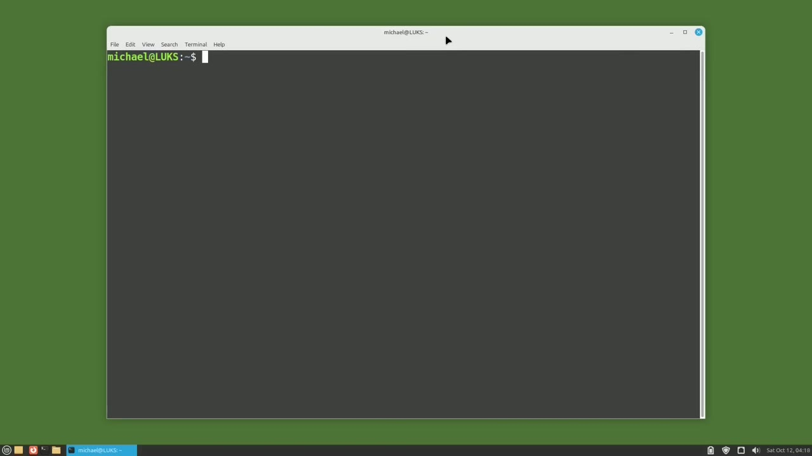
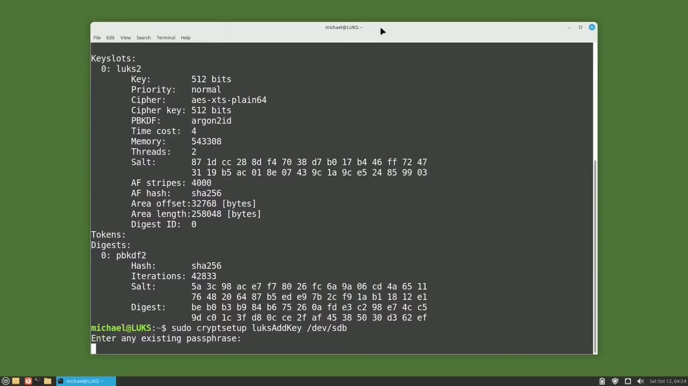
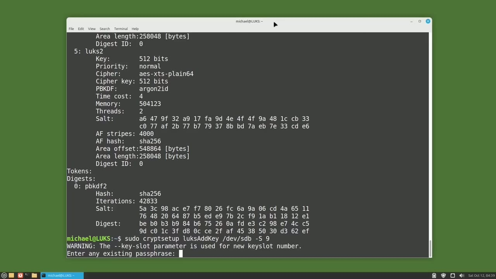
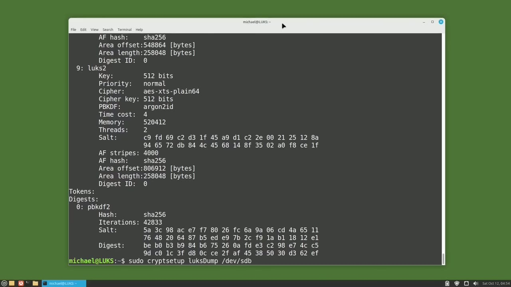

[← Course contents](../../01.md)

# 114. LUKS pt3 - Add, Remove, Change Password

**Course:** [Linux Command Line - Entire Tutorial Series](https://www.youtube.com/watch?v=avg65oY7sj4)  
**Transcript:** [`Linux Command Line - Entire Tutorial Series transcript`](../../../../course_videos/Linux%20Command%20Line%20-%20Entire%20Tutorial%20Series/Linux%20Command%20Line%20-%20Entire%20Tutorial%20Series.txt)  
**Video:** 19:17:49–19:25:11 ([open at this time](https://www.youtube.com/watch?v=avg65oY7sj4&t=69469s))

## Introduction

In this video, we're going to look at adding, changing, and deleting LUKS Passwords. I have the LUKS Encrypted Password USB drive that we created in the previous video, and I'm plugging that into my computer. I get prompted to authenticate the LUKS Encrypted USB Drive. You can type in the password here, but you don't have to.

## Detailed Explanation

<details>
  <summary>Step 1 — Run `sudo`</summary>

### Step 1 — Run `sudo`

- [x] **In this video, we're going to look at adding, changing, and deleting**
  - In this video, we're going to look at adding, changing, and deleting LUKS Passwords.
  - I have the LUKS Encrypted Password USB drive that we created in the previous video, and I'm plugging that into my computer.
  - I get prompted to authenticate the LUKS Encrypted USB Drive.

- [x] **Use `sudo`**
  - You can type in the password here, but you don't have to.
  - When adding, deleting, or changing passwords, it doesn't matter if the DevMap or Drive is created or not.
  - We can see the number of LUKS passwords assigned by typing `sudo` CryptS setup, LUKS dump slash dev slash sdb.

- [x] **Scrolling up a little bit, we can see all of the output here, but the**
  - Scrolling up a little bit, we can see all of the output here, but the part I'm interested in right now is the Key Slots section.
  - That shows us the number of password keys in use.
  - That's the only password key assigned at this time.

- [x] **This is the password I created in the last video when I created the**
  - This is the password I created in the last video when I created the LUKS Encrypted Partition.
  - I'm going to add a new LUKS password key with the command SudoCrypt Setup LUKS add key on device sdb.
  - LUKS is asking me to confirm that I know the current key before I can add a new one.

```bash
sudo
```



</details>

<details>
  <summary>Step 2 — I will type in the password key that we created in the last video</summary>

### Step 2 — I will type in the password key that we created in the last video

- [x] **I will type in the password key that we created in the last video**
  - I will type in the password key that we created in the last video.
  - Now LUKS is asking me for the new password and I will add a new password.
  - And I will type in that new password again to verify it.

- [x] **I will run the LUKS dump command again and scrolling up a little bit**
  - I will run the LUKS dump command again and scrolling up a little bit.
  - Bit we see we've got two password keys we have the zero that was already created and now we have the one key slot as well so when we created the new password the way we did it just placed the new password key in the next slot available which in this case was key slot one we can pick a specific key
  - Slot to assign a password I'll choose key slot five by adding a -s5 to the end of the add key command.

- [x] **I need to enter any one of the existing passphrases**
  - I need to enter any one of the existing passphrases.
  - And now I'll type in the new password for slot 5.
  - And we have just added a password to slot number 5.

- [x] **Let's check that with the LUKS dump command**
  - Let's check that with the LUKS dump command.
  - Here we see slot 5 has been created and scrolling up.
  - We see slots 1 and 2 are still there as well.

- [x] **So now we see keys in slots 0, 1, and 5**
  - So now we see keys in slots 0, 1, and 5.
  - I'm going to add a key to key slot 9 with the command.



</details>

<details>
  <summary>Step 3 — going to enter in one of the existing pass phrases</summary>

### Step 3 — going to enter in one of the existing pass phrases

- [x] **I'm going to enter in one of the existing pass phrases**
  - I'm going to enter in one of the existing pass phrases.
  - And what I'm going to type in here is the same password as I used for key slot one.
  - So LUKS will allow us to type in the same passphrase for different key slots.

- [x] **Let's check to make sure it was added okay by going back to the LUKS**
  - Let's check to make sure it was added okay by going back to the LUKS dump.
  - And there we see key slot nine was added and I typed in the same password as key slot one.
  - Now we're going to look at how to remove a key that we no longer want.

- [x] **We can do that with the sudo-cryptsetup, LUKS Remove key devSDB**
  - We can do that with the sudo-cryptsetup, LUKS Remove key devSDB.
  - LUKS is asking me for the password for the key slot I want to remove.
  - And remember this password is the same password I used for KeySlot 1.

- [x] **And then scrolling up a bit, we see KeySlot 5 is still there**
  - And then scrolling up a bit, we see KeySlot 5 is still there.
  - And Key slot 0 is still there, but Key slot 1 is missing.
  - Remember, I made the key slot passwords for 1 and 9 the same.

- [x] **So LUKS just removed the first occurrence of the password it found**
  - So LUKS just removed the first occurrence of the password it found.
  - Now let's say we've forgotten a password for a key slot.



</details>

<details>
  <summary>Step 4 — Run `sudo cryptsetup`</summary>

### Step 4 — Run `sudo cryptsetup`

- [x] **If we have forgotten the password key or don't know it, we cannot use**
  - If we have forgotten the password key or don't know it, we cannot use the LUKS Remove key command.
  - Instead of using the LUKS Remove key command, we can use the LUKS Kill Slot command.
  - I'll use the LUKS Kill Slot command to remove the passphrase from KeySlot 9.

- [x] **Use `sudo cryptsetup`**
  - By typing `sudo cryptsetup`, LUKS, kill slot dev, sdb, and I want to kill slot 9.
  - I'll type in one of the remaining pass phrases. Now going back to the LUKS dump command, we see the key slot 9 is gone, leaving us only with key slots 0 and 5.
  - Let's do that now for KeySlot 5 by typing SuduCrip Setup, LUKS, Change Key for DevSdb.

- [x] **LUKS is asking us for the passphrase we want to change**
  - LUKS is asking us for the passphrase we want to change.
  - I'm going to type in the passphrase for Key Slot 5 and then give it the new passphrase.
  - And now our password for Key Slot 5 is changed.

- [x] **In the next video, I have one more video about LUKS for the Linux**
  - In the next video, I have one more video about LUKS for the Linux command line.

```bash
sudo cryptsetup
```



</details>

<details>
  <summary>Questions and Answers</summary>

## Questions and Answers

### Question 1: What does `sudo` do in this chapter?

<details>
<summary>Answer</summary>

- [x] We can see the number of LUKS passwords assigned by typing `sudo` CryptS setup, LUKS dump slash dev slash sdb.

</details>

### Question 2: What does `sudo cryptsetup` do in this chapter?

<details>
<summary>Answer</summary>

- [x] By typing `sudo cryptsetup`, LUKS, kill slot dev, sdb, and I want to kill slot 9.

</details>

### Question 3: What does step 1 cover (Run sudo)?

<details>
<summary>Answer</summary>

- [x] In this video, we're going to look at adding, changing, and deleting LUKS Passwords.
- [x] I have the LUKS Encrypted Password USB drive that we created in the previous video, and I'm plugging that into my computer.
- [x] I get prompted to authenticate the LUKS Encrypted USB Drive.

</details>

### Question 4: What does step 2 cover (I will type in the password key that we created in the last video)?

<details>
<summary>Answer</summary>

- [x] I will type in the password key that we created in the last video.
- [x] Now LUKS is asking me for the new password and I will add a new password.
- [x] And I will type in that new password again to verify it.

</details>

### Question 5: What does step 3 cover (going to enter in one of the existing pass phrases)?

<details>
<summary>Answer</summary>

- [x] I'm going to enter in one of the existing pass phrases.
- [x] And what I'm going to type in here is the same password as I used for key slot one.
- [x] So LUKS will allow us to type in the same passphrase for different key slots.

</details>

### Question 6: What does step 4 cover (Run sudo cryptsetup)?

<details>
<summary>Answer</summary>

- [x] If we have forgotten the password key or don't know it, we cannot use the LUKS Remove key command.
- [x] Instead of using the LUKS Remove key command, we can use the LUKS Kill Slot command.
- [x] I'll use the LUKS Kill Slot command to remove the passphrase from KeySlot 9.

</details>

</details>

## Summary

This chapter, LUKS pt3 - Add, Remove, Change Password, walks through Run sudo; I will type in the password key that we created in the last video; going to enter in one of the existing pass phrases; Run sudo cryptsetup. Commands from the transcript: `sudo`, `sudo cryptsetup`.

## References

- [Linux Command Line - Entire Tutorial Series (YouTube)](https://www.youtube.com/watch?v=avg65oY7sj4)
- [This chapter at 19:17:49](https://www.youtube.com/watch?v=avg65oY7sj4&t=69469s)
- [Local transcript](../../../../course_videos/Linux%20Command%20Line%20-%20Entire%20Tutorial%20Series/Linux%20Command%20Line%20-%20Entire%20Tutorial%20Series.txt)
