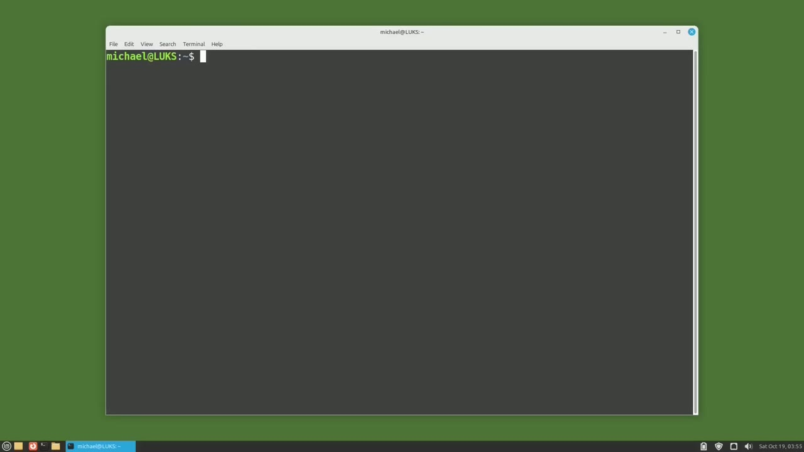
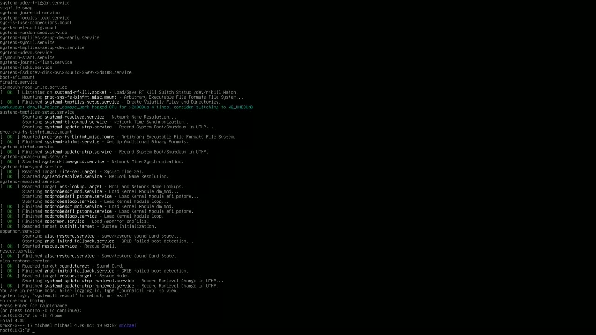
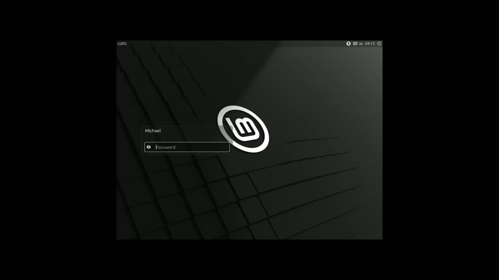
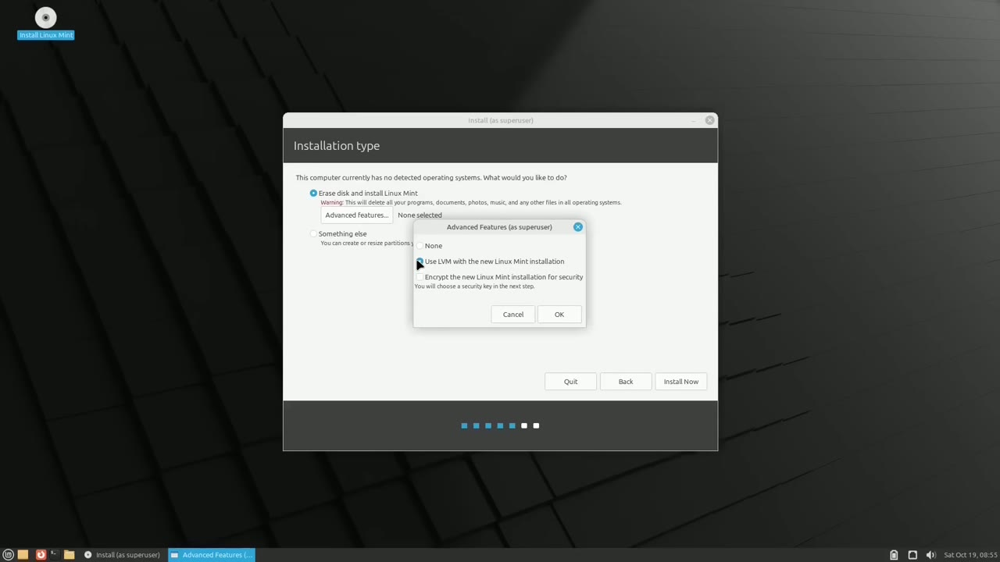
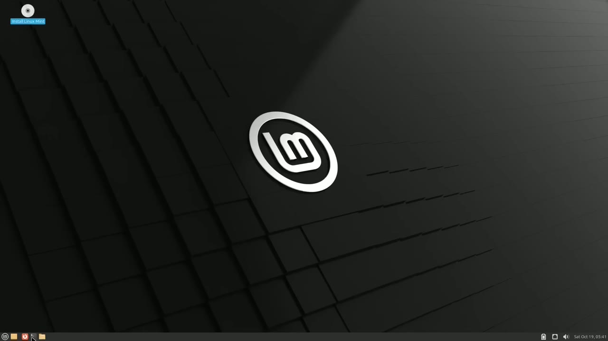

[← Course contents](../../01.md)

# 115. LUKS pt4 - Secure from Single Boot

**Course:** [Linux Command Line - Entire Tutorial Series](https://www.youtube.com/watch?v=avg65oY7sj4)  
**Transcript:** [`Linux Command Line - Entire Tutorial Series transcript`](../../../../course_videos/Linux%20Command%20Line%20-%20Entire%20Tutorial%20Series/Linux%20Command%20Line%20-%20Entire%20Tutorial%20Series.txt)  
**Video:** 19:25:11–19:35:19 ([open at this time](https://www.youtube.com/watch?v=avg65oY7sj4&t=69911s))

## Introduction

In this video, we're going to look at using LUKS to protect against someone single booting into your computer. Now this will have to be done with a new install of an Ubuntu derivative, in this case Linux Mint. Let's first take a look at how someone can single boot into your Linux system as root. The first thing the single boot attacker has to do is get physical access to your Linux machine.

## Detailed Explanation

<details>
  <summary>Step 1 — Run `ls -lhfh-H-home`</summary>

### Step 1 — Run `ls -lhfh-H-home`

- [x] **In this video, we're going to look at using LUKS to protect against**
  - In this video, we're going to look at using LUKS to protect against someone single booting into your computer.
  - Now this will have to be done with a new install of an Ubuntu derivative, in this case Linux Mint.
  - Let's first take a look at how someone can single boot into your Linux system as root.

- [x] **The first thing the single boot attacker has to do is get physical**
  - The first thing the single boot attacker has to do is get physical access to your Linux machine.
  - I'm going to restart the machine to show how someone can single boot into your Linux computer as root.
  - I'm pressing the right shift key, which brings up the GRUB screen.

- [x] **From here, I'm going to make sure I'm on the Linux Mint 22 Mate**
  - From here, I'm going to make sure I'm on the Linux Mint 22 Mate, which I am.
  - Now I'm using the down arrow to look for the line that begins with Linux.
  - There it is. I'm going to use the right arrow now to get to the end of this line.

- [x] **And just passed here where it has ro quiet splash**
  - And just passed here where it has ro quiet splash.
  - And then I'm going to press Ctrl+X or f10 to boot. I'll press f10.
  - Here we see at the bottom of the screen, press Enter for maintenance, or press Ctrl+D to continue.

- [x] **Use `ls -lhfh-H-home`**
  - Now we see I am Root at LUKS. LUKS is the name of this computer.
  - And then we see the pound sign or hashtag symbol, showing us that we are logged in as root.
  - To see what users are on this computer, I'll type `ls -lhfh-H-home`.

- [x] **And we see there's only one user on this computer, Michael**
  - And we see there's only one user on this computer, Michael.
  - Since I'd be an attacker in this case, I would not know the password.
  - So I will change the password for the Michael user to something I know.

- [x] **I'll use the command p-a-s-s-w-d, Michael to change the password for**
  - I'll use the command p-a-s-s-w-d, Michael to change the password for Michael.
  - I'll type in a new password that I know and re-typing that password.

```bash
ls -lhfh-H-home
```





</details>

<details>
  <summary>Step 2 — Run `reboot`</summary>

### Step 2 — Run `reboot`

- [x] **Use `reboot`**
  - Now I want to `reboot` so I can log in as the Michael user.
  - I can just go in now and look at the different files in the folders, but I want to get the full GUI experience.
  - And now we're at the Linux Mint login screen where I can type in that new password that I just set it to.

- [x] **We are now logged in as the Michael user and we have total control of**
  - We are now logged in as the Michael user and we have total control of this computer.
  - Now, there are multiple ways to prevent against this type of attack.
  - The way we're going to do that in this video is to install LUKS when we install a new Ubuntu derivative.

- [x] **So let's look at that install process right now**
  - So let's look at that install process right now.
  - We're going to do a fresh installation of Linux Mint.
  - I'm going to right click and open the install Linux Mint.

- [x] **I'm going to use the default of English and click Continue and the**
  - I'm going to use the default of English and click Continue and the keyboard layout of English us.
  - I'll continue on those defaults as well.
  - This is the screen that we want to make some changes.

- [x] **I'm going to click on the advanced features**
  - I'm going to click on the advanced features.
  - And now I'm clicking on Use LVM with the new Linux Mint installation.

```bash
reboot
```



</details>

<details>
  <summary>Step 3 — we've already looked at LVM in videos 91 through 101, but you won't</summary>

### Step 3 — we've already looked at LVM in videos 91 through 101, but you won't

- [x] **And we've already looked at LVM in videos 91 through 101, but you**
  - And we've already looked at LVM in videos 91 through 101, but you won't need to know anything about LVM to use it.
  - And then I'm going to click the Checkbox.
  - To encrypt the new Linuxman installation for security you will choose a security key in the next step so i'll click okay and then install now.

- [x] **I'm now at the screen where we need to choose a security key**
  - I'm now at the screen where we need to choose a security key.
  - And this will be a different password than the Linux Mint password.
  - So you'll know exactly which password I'm typing when we come to the password screens.

- [x] **This security key password I will call LUKS Pass 1**
  - This security key password I will call LUKS Pass 1.
  - Pass 1. Then it's asking us if we want to enable a recovery key. I'll check that.
  - And we can take a look at the key. It's a bunch of numbers. If we want to change those numbers, I can click this here. It gets us a new password. Or I can type in our own password.

- [x] **I'll type in my own and we'll call this my LUKS Recovery Pass. And**
  - I'll type in my own and we'll call this my LUKS Recovery Pass. And I'll type that again on the next line.
  - And Linux Mint is going to write this password in a file in home mint recovery.
  - We can change that location if we like clicking here.

- [x] **If we lose this security key, all data will be lost**
  - If we lose this security key, all data will be lost.
  - We do not want to overwrite the empty disk.



</details>

<details>
  <summary>Step 4 — Run `ls -lh`</summary>

### Step 4 — Run `ls -lh`

- [x] **We're asked if we want to confirm these changes**
  - We're asked if we want to confirm these changes.
  - The computer name will be LUKS encrypted.
  - And I said I'd share this password with you as well so we know which password we're typing where.

- [x] **So this password will be Linux Mint Pass 2**
  - So this password will be Linux Mint Pass 2.
  - I'll pause until it completes installation and we'll pick it up from there.
  - Linux Mint installation is complete and now we're asked if we want to continue testing or restart now.

- [x] **Use `ls -lh`**
  - I want to click Continue Testing because we want to cat out our recovery key.
  - So let's open up a terminal and I'll type `ls -lh` and make this a little bigger.
  - There's our recovery key in home mint just as they told us.

- [x] **And there it tells us it's my LUKS recovery pass we may want to save**
  - And there it tells us it's my LUKS recovery pass we may want to save that file to a USB drive or the like since we typed in our own key we should be able to remember it once we restart this recovery key will be gone because it's in the home mint directory which will disappear when we
  - Restart let's close this and restart Now we've restarted and Linux Mint is asking me for the LUKS key.
  - That was the password we set as LUKS Pass 1.

- [x] **We see that Crypt is set up successfully**
  - We see that Crypt is set up successfully.
  - After we type in the LUKS password, we go to the GRUB screen.
  - So LUKS password will prevent someone from being able to single boot into our system.

- [x] **Now we're at the Linux login page where I will type in our Linux Mint**
  - Now we're at the Linux login page where I will type in our Linux Mint password, which was Linux Mint Pass 2.
  - And now we're logged into a new Linux Mint operating system protected by LUKS.
  - So that recovery key that we saved, we can type that in instead of that LUKS Pass 1.

- [x] **Basically, that recovery key is just a second LUKS password key**
  - Basically, that recovery key is just a second LUKS password key.
  - And we learned about LUKS Password keys in the previous video.
  - This is the last video in the group of LUKS videos, and this is also the last video in the Linux Command Line series.

- [x] **Thank you all for watching. I hope you learned a lot, and I'll be**
  - Thank you all for watching. I hope you learned a lot, and I'll be back next time with a new video tutorial series on something that is not Linux related.

```bash
ls -lh
```



</details>

<details>
  <summary>Questions and Answers</summary>

## Questions and Answers

### Question 1: What does `ls -lhfh-H-home` do in this chapter?

<details>
<summary>Answer</summary>

- [x] To see what users are on this computer, I'll type `ls -lhfh-H-home`.

</details>

### Question 2: What does `reboot` do in this chapter?

<details>
<summary>Answer</summary>

- [x] Now I want to `reboot` so I can log in as the Michael user.

</details>

### Question 3: What does `ls -lh` do in this chapter?

<details>
<summary>Answer</summary>

- [x] So let's open up a terminal and I'll type `ls -lh` and make this a little bigger.

</details>

### Question 4: What does step 1 cover (Run ls -lhfh-H-home)?

<details>
<summary>Answer</summary>

- [x] In this video, we're going to look at using LUKS to protect against someone single booting into your computer.
- [x] Now this will have to be done with a new install of an Ubuntu derivative, in this case Linux Mint.
- [x] Let's first take a look at how someone can single boot into your Linux system as root.

</details>

### Question 5: What does step 2 cover (Run reboot)?

<details>
<summary>Answer</summary>

- [x] Now I want to `reboot` so I can log in as the Michael user.
- [x] I can just go in now and look at the different files in the folders, but I want to get the full GUI experience.
- [x] And now we're at the Linux Mint login screen where I can type in that new password that I just set it to.

</details>

### Question 6: What does step 3 cover (we've already looked at LVM in videos 91 through 101, but you won't)?

<details>
<summary>Answer</summary>

- [x] And we've already looked at LVM in videos 91 through 101, but you won't need to know anything about LVM to use it.
- [x] And then I'm going to click the Checkbox.
- [x] To encrypt the new Linuxman installation for security you will choose a security key in the next step so i'll click okay and then install now.

</details>

### Question 7: What does step 4 cover (Run ls -lh)?

<details>
<summary>Answer</summary>

- [x] We're asked if we want to confirm these changes.
- [x] The computer name will be LUKS encrypted.
- [x] And I said I'd share this password with you as well so we know which password we're typing where.

</details>

</details>

## Summary

This chapter, LUKS pt4 - Secure from Single Boot, walks through Run ls -lhfh-H-home; Run reboot; we've already looked at LVM in videos 91 through 101, but you won't; Run ls -lh. Commands from the transcript: `ls -lhfh-H-home`, `reboot`, `ls -lh`.

## References

- [Linux Command Line - Entire Tutorial Series (YouTube)](https://www.youtube.com/watch?v=avg65oY7sj4)
- [This chapter at 19:25:11](https://www.youtube.com/watch?v=avg65oY7sj4&t=69911s)
- [Local transcript](../../../../course_videos/Linux%20Command%20Line%20-%20Entire%20Tutorial%20Series/Linux%20Command%20Line%20-%20Entire%20Tutorial%20Series.txt)
