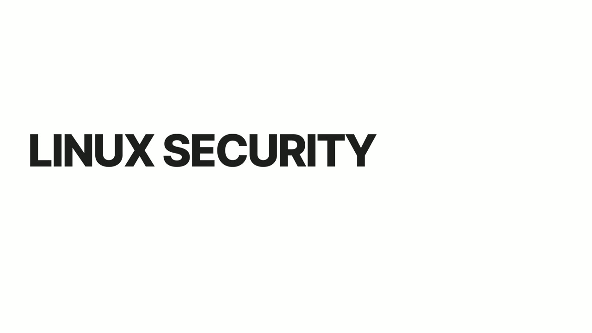
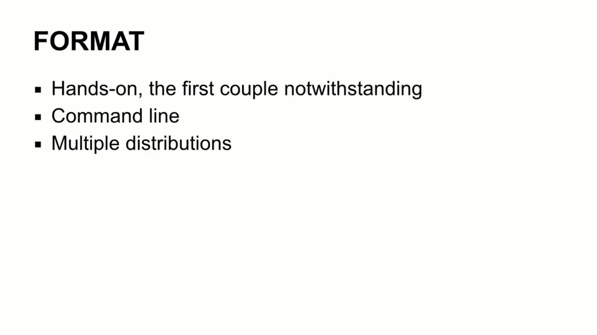

[← Course contents](../../02.md)

# 1. Introduction

**Course:** [Linux Security & Administration From Boot Process to Firewalls](https://www.youtube.com/watch?v=_WB3evmgxYA)  
**Transcript:** [`Linux Security & Administration From Boot Process to Firewalls transcript`](../../../../course_videos/Linux%20Security%20%26%20Administration%20From%20Boot%20Process%20to%20Firewalls/Linux%20Security%20%26%20Administration%20From%20Boot%20Process%20to%20Firewalls.txt)  
**Video:** 00:00:00–00:01:24 ([open at this time](https://www.youtube.com/watch?v=_WB3evmgxYA&t=0s))

## Introduction

We're going to be spending quite a bit of time together over the next several lessons, and I hope that we can give you a little bit of insight into what Linux security is and how you go about securing a Linux system. First of all, Linux is an operating system. Primarily, what we're talking about is hardening that operating system against attack or compromise. We'll be looking at some tools and we'll be looking at a number of different methods that you can use to actually harden your operating system and the services that are running on it.

## Detailed Explanation

  
Step 1 — going to be spending quite a bit of time together over the next several

### Step 1 — going to be spending quite a bit of time together over the next several

- [x] **We're going to be spending quite a bit of time together over the next**
  - We're going to be spending quite a bit of time together over the next several lessons, and I hope that we can give you a little bit of insight into what Linux security is and how you go about securing a Linux system.
  - First of all, Linux is an operating system.
  - Primarily, what we're talking about is hardening that operating system against attack or compromise.

- [x] **We'll be looking at some tools and we'll be looking at a number of**
  - We'll be looking at some tools and we'll be looking at a number of different methods that you can use to actually harden your operating system and the services that are running on it.
  - What we're going to be doing is a lot of hands-on work.
  - We're going to be doing a lot with command line.

- [x] **So you're going to get really familiar with doing command line**
  - So you're going to get really familiar with doing command line.

  
Step 2 — In my opinion, command line work is really the heart of systems

### Step 2 — In my opinion, command line work is really the heart of systems

- [x] **In my opinion, command line work is really the heart of systems**
  - In my opinion, command line work is really the heart of systems administration and security administration on a Linux system. If you are really hardening your Linux system, you won't have a graphical user interface. You will be stuck with the command line. So really getting comfortable
  - With the command line is helpful. We're going to be working with multiple distributions and again continuing to get a lot of hands-on work.
  - I hope that you really enjoy getting your hands dirty and playing around with Linux and learning Linux security.

  
Questions and Answers

## Questions and Answers

### Question 1: What does step 1 cover (going to be spending quite a bit of time together over the next several)?

Answer

- [x] We're going to be spending quite a bit of time together over the next several lessons, and I hope that we can give you a little bit of insight into what Linux security is and how you go about securing a Linux system.
- [x] First of all, Linux is an operating system.
- [x] Primarily, what we're talking about is hardening that operating system against attack or compromise.

### Question 2: What does step 2 cover (In my opinion, command line work is really the heart of systems)?

Answer

- [x] In my opinion, command line work is really the heart of systems administration and security administration on a Linux system. If you are really hardening your Linux system, you won't have a graphical user interface. You will be stuck with the command line. So really getting comfortable
- [x] With the command line is helpful. We're going to be working with multiple distributions and again continuing to get a lot of hands-on work.
- [x] I hope that you really enjoy getting your hands dirty and playing around with Linux and learning Linux security.

## Summary

This chapter, Introduction, walks through going to be spending quite a bit of time together over the next several; In my opinion, command line work is really the heart of systems.

## References

- [Linux Security & Administration From Boot Process to Firewalls (YouTube)](https://www.youtube.com/watch?v=_WB3evmgxYA)
- [This chapter at 00:00:00](https://www.youtube.com/watch?v=_WB3evmgxYA&t=0s)
- [Local transcript](../../../../course_videos/Linux%20Security%20%26%20Administration%20From%20Boot%20Process%20to%20Firewalls/Linux%20Security%20%26%20Administration%20From%20Boot%20Process%20to%20Firewalls.txt)
