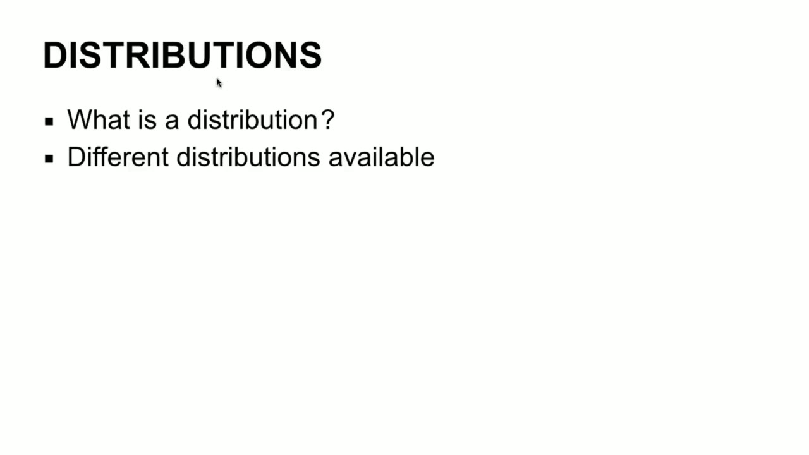
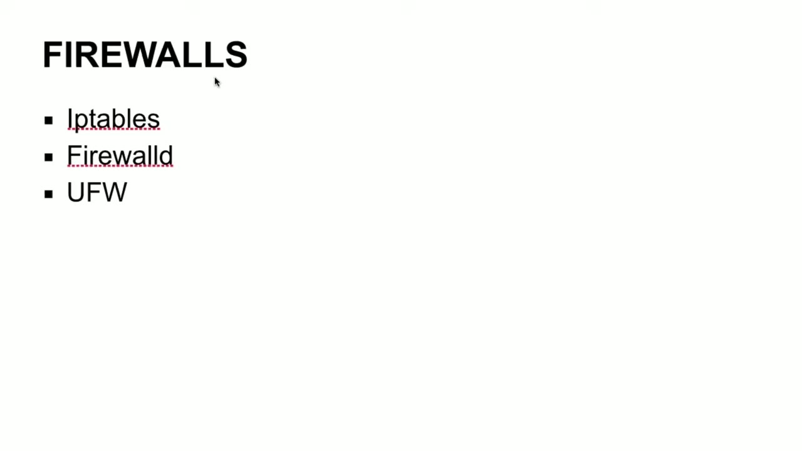

[← Course contents](../../02.md)

# 2. What you will learn in this Module

**Course:** [Linux Security & Administration From Boot Process to Firewalls](https://www.youtube.com/watch?v=_WB3evmgxYA)  
**Transcript:** [`Linux Security & Administration From Boot Process to Firewalls transcript`](../../../../course_videos/Linux%20Security%20%26%20Administration%20From%20Boot%20Process%20to%20Firewalls/Linux%20Security%20%26%20Administration%20From%20Boot%20Process%20to%20Firewalls.txt)  
**Video:** 00:01:24–00:04:11 ([open at this time](https://www.youtube.com/watch?v=_WB3evmgxYA&t=84s))

## Introduction

I'm sure you're probably wondering what we're going to be covering. First of all, we're going to be talking about distributions. Different distributions that are available. Centos, Red Hat Enterprise, Linux, Ubuntu, Linux Mint, Fedora Corp.

## Detailed Explanation

<details>
  <summary>Step 1 — sure you're probably wondering what we're going to be covering</summary>

### Step 1 — sure you're probably wondering what we're going to be covering

- [x] **I'm sure you're probably wondering what we're going to be covering**
  - I'm sure you're probably wondering what we're going to be covering.
  - First of all, we're going to be talking about distributions.
  - Different distributions that are available.

- [x] **Centos, Red Hat Enterprise, Linux, Ubuntu, Linux Mint, Fedora Corp**
  - Centos, Red Hat Enterprise, Linux, Ubuntu, Linux Mint, Fedora Corp.
  - There are lots of different distributions that are available.
  - We're going to be working with a couple of them, primarily Red Hat Enterprise Linux by way of Centos, and we'll be using Ubuntu as well as a specialized Linux distribution called Kali Linux, which is really useful if you're doing security testing work or things related to forensics.

- [x] **We're going to talk about the boot process, the different boot**
  - We're going to talk about the boot process, the different boot loaders, and how you can protect the boot process.



</details>

<details>
  <summary>Step 2 — Against attack and making sure that people aren't getting into your</summary>

### Step 2 — Against attack and making sure that people aren't getting into your

- [x] **Against attack and making sure that people aren't getting into your**
  - Against attack and making sure that people aren't getting into your system when you don't want them to.
  - So what are services? We're going to be talking about what services are, how to manage those services, and mostly we're going to be talking about hardening the different services.
  - So the Apache Web Server, for example, a couple of different Java application servers.

- [x] **We're going to be talking about mail servers**
  - We're going to be talking about mail servers.
  - So we're going to be going through the process of hardening your servers against attack.
  - Logging is a critical component of a Linux system.

- [x] **We're going to be talking about logging using syslog, how to manage**
  - We're going to be talking about logging using syslog, how to manage your logs, and how to send your logs off to remote systems so that you've got them somewhere else, just in case something happens to the system that you're doing the logging on.


</details>

<details>
  <summary>Step 3 — Run `iptables`</summary>

### Step 3 — Run `iptables`

- [x] **We're going to be looking at some intrusion detection, both**
  - We're going to be looking at some intrusion detection, both host-based and network-based, and also how to manage IDS and the alerts that you are going to get from your IDS products.
  - Adding users, setting password policies.
  - We're going to be talking about mandatory access controls by way of the use of app, armor, and SELinux.

- [x] **And we're also talk about using plugable authentication modules**
  - And we're also talk about using plugable authentication modules.
  - A lot of utilities, networking, security-related, we'll be talking about a couple of vulnerability scanners and looking at how those work.
  - What are modules, kernel modules, how to make use of kernel modules, configuring the kernel, building the kernel.

- [x] **Use `iptables`**
  - We'll also get into firewalls, `iptables`, firewalld, and the uncomplicated firewall that Ubuntu has.
  - So you can see we're going to cover a lot of ground.
  - As I have said previously, it's really hands-on.

- [x] **So you're going to actually see how to do the work of hardening your**
  - So you're going to actually see how to do the work of hardening your operating system and actually see how the tools work when you're running them, what you can do with them, and how to make use of them.

```bash
iptables
```



</details>

<details>
  <summary>Questions and Answers</summary>

## Questions and Answers

### Question 1: What does `iptables` do in this chapter?

<details>
<summary>Answer</summary>

- [x] We'll also get into firewalls, `iptables`, firewalld, and the uncomplicated firewall that Ubuntu has.

</details>

### Question 2: What does step 1 cover (sure you're probably wondering what we're going to be covering)?

<details>
<summary>Answer</summary>

- [x] I'm sure you're probably wondering what we're going to be covering.
- [x] First of all, we're going to be talking about distributions.
- [x] Different distributions that are available.

</details>

### Question 3: What does step 2 cover (Against attack and making sure that people aren't getting into your)?

<details>
<summary>Answer</summary>

- [x] Against attack and making sure that people aren't getting into your system when you don't want them to.
- [x] So what are services? We're going to be talking about what services are, how to manage those services, and mostly we're going to be talking about hardening the different services.
- [x] So the Apache Web Server, for example, a couple of different Java application servers.

</details>

### Question 4: What does step 3 cover (Run iptables)?

<details>
<summary>Answer</summary>

- [x] We're going to be looking at some intrusion detection, both host-based and network-based, and also how to manage IDS and the alerts that you are going to get from your IDS products.
- [x] Adding users, setting password policies.
- [x] We're going to be talking about mandatory access controls by way of the use of app, armor, and SELinux.

</details>

</details>

## Summary

This chapter, What you will learn in this Module, walks through sure you're probably wondering what we're going to be covering; Against attack and making sure that people aren't getting into your; Run iptables. Commands from the transcript: `iptables`.

## References

- [Linux Security & Administration From Boot Process to Firewalls (YouTube)](https://www.youtube.com/watch?v=_WB3evmgxYA)
- [This chapter at 00:01:24](https://www.youtube.com/watch?v=_WB3evmgxYA&t=84s)
- [Local transcript](../../../../course_videos/Linux%20Security%20%26%20Administration%20From%20Boot%20Process%20to%20Firewalls/Linux%20Security%20%26%20Administration%20From%20Boot%20Process%20to%20Firewalls.txt)
