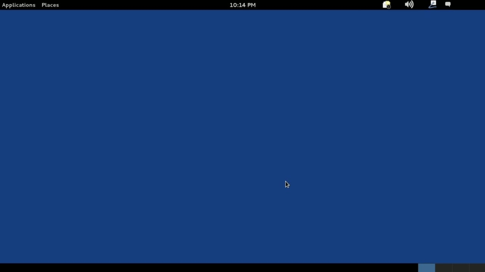
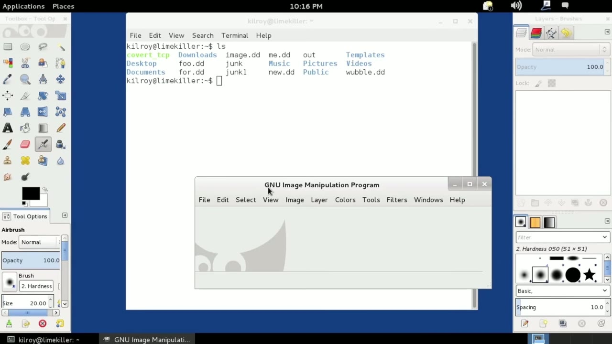
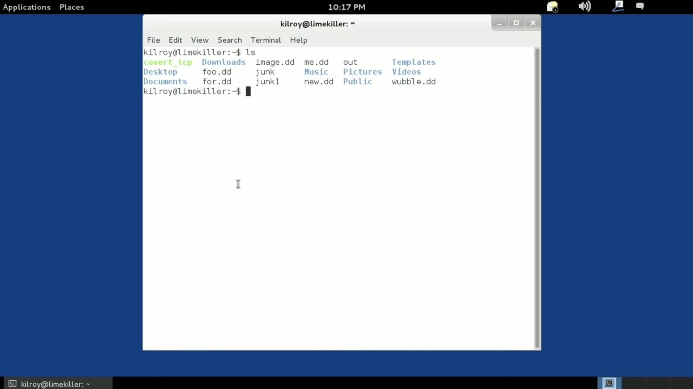

[← Course contents](../../02.md)

# 3. What Is Linux

**Course:** [Linux Security & Administration From Boot Process to Firewalls](https://www.youtube.com/watch?v=_WB3evmgxYA)  
**Transcript:** [`Linux Security & Administration From Boot Process to Firewalls transcript`](../../../../course_videos/Linux%20Security%20%26%20Administration%20From%20Boot%20Process%20to%20Firewalls/Linux%20Security%20%26%20Administration%20From%20Boot%20Process%20to%20Firewalls.txt)  
**Video:** 00:04:11–00:08:02 ([open at this time](https://www.youtube.com/watch?v=_WB3evmgxYA&t=251s))

## Introduction

Before we really get underway, let's talk about what Linux is. Linux is actually really the core operating system of this thing that you're looking at here. When you start adding the user interface on top of the core operating system, what you end up with is really an operating environment. The operating system is actually the kernel. It's the thing that interfaces between the hardware, make sure that all of your programs get enough memory and get into and out of the CPU so that they actually run. And Between that hardware and the programs that you actually use, so for example, this terminal window here,

## Detailed Explanation

  
Step 1 — Before we really get underway, let's talk about what Linux is

### Step 1 — Before we really get underway, let's talk about what Linux is

- [x] **Before we really get underway, let's talk about what Linux is**
  - Before we really get underway, let's talk about what Linux is.
  - Linux is actually really the core operating system of this thing that you're looking at here. When you start adding the user interface on top of the core operating system, what you end up with is really an operating environment.
  - The operating system is actually the kernel. It's the thing that interfaces between the hardware, make sure that all of your programs get enough memory and get into and out of the CPU so that they actually run. And Between that hardware and the programs that you actually use, so for example, this terminal window here,

- [x] **We need some software that's going to manage that hardware and make**
  - We need some software that's going to manage that hardware and make sure your programs are run, get memory, and are well taken care of. And just in case you've got, for example, disk drives, we need software that's going to interface with those disk drives. So we've got the operating system or the kernel,
  - When you start adding in all of the other components, like the user interface that we're looking at here, or the desktop environment that we're looking at, you actually get an operating environment, but you get a Linux distribution.
  - So different Linux distributions are going to have different packages that are installed with them, meaning different software.

- [x] **It's going to potentially do things in slightly different ways, but**
  - It's going to potentially do things in slightly different ways, but at the bottom of it all is this kernel or operating system that we call Linux.

  
Step 2 — you'll see that this says GNU image manipulation program

### Step 2 — you'll see that this says GNU image manipulation program

- [x] **So you'll see that this says GNU image manipulation program**
  - So you'll see that this says GNU image manipulation program.
  - Some people actually like to refer to the complete package as GNU Linux.
  - I think that's just as misleading as saying Linux when you're talking about the whole package because Gnu is not the only project that contributes software to the entire distribution.

- [x] **There are a variety of other projects and we'll talk about some of**
  - There are a variety of other projects and we'll talk about some of them through the course of these lessons.
  - And those different projects all contribute software.
  - It's not just Gnu that contributes software to Linux distributions in addition to the Linux kernel. But ultimately what we're talking about is a collection of software that gives us an operating environment that is different from Windows, different from Mac osx. It's really got

- [x] **The heritage of an operating system that's almost 50 years old now**
  - The heritage of an operating system that's almost 50 years old now.

  
Step 3 — It's really kind of based around Unix, the operating system, which was

### Step 3 — It's really kind of based around Unix, the operating system, which was

- [x] **It's really kind of based around Unix, the operating system, which**
  - It's really kind of based around Unix, the operating system, which was created in the late 1960s by at&T Bell Labs.
  - So Linux kind of takes a lot of the components and functionality and features in ways of working that Unix had and does it in some slightly different ways with some newer technology and of course, you know, a different take on it because it's got a completely different set of programmers
  - Implementing those features and that functionality. So when we're talking about Linux, Linux itself technically is really just the kernel or the operating system. The operating environment includes pieces of software from kde for example and Apache and of course Gnu as well.

- [x] **So there are a lot of different groups that contribute software to**
  - So there are a lot of different groups that contribute software to these Linux distributions and we'll talk about the different distributions that are available and how they are different from one another in an upcoming lesson. Now that we've talked about what Linux actually is,

  
Questions and Answers

## Questions and Answers

### Question 1: What does step 1 cover (Before we really get underway, let's talk about what Linux is)?

Answer

- [x] Before we really get underway, let's talk about what Linux is.
- [x] Linux is actually really the core operating system of this thing that you're looking at here. When you start adding the user interface on top of the core operating system, what you end up with is really an operating environment.
- [x] The operating system is actually the kernel. It's the thing that interfaces between the hardware, make sure that all of your programs get enough memory and get into and out of the CPU so that they actually run. And Between that hardware and the programs that you actually use, so for example, this terminal window here,

### Question 2: What does step 2 cover (you'll see that this says GNU image manipulation program)?

Answer

- [x] So you'll see that this says GNU image manipulation program.
- [x] Some people actually like to refer to the complete package as GNU Linux.
- [x] I think that's just as misleading as saying Linux when you're talking about the whole package because Gnu is not the only project that contributes software to the entire distribution.

### Question 3: What does step 3 cover (It's really kind of based around Unix, the operating system, which was)?

Answer

- [x] It's really kind of based around Unix, the operating system, which was created in the late 1960s by at&T Bell Labs.
- [x] So Linux kind of takes a lot of the components and functionality and features in ways of working that Unix had and does it in some slightly different ways with some newer technology and of course, you know, a different take on it because it's got a completely different set of programmers
- [x] Implementing those features and that functionality. So when we're talking about Linux, Linux itself technically is really just the kernel or the operating system. The operating environment includes pieces of software from kde for example and Apache and of course Gnu as well.

## Summary

This chapter, What Is Linux, walks through Before we really get underway, let's talk about what Linux is; you'll see that this says GNU image manipulation program; It's really kind of based around Unix, the operating system, which was.

## References

- [Linux Security & Administration From Boot Process to Firewalls (YouTube)](https://www.youtube.com/watch?v=_WB3evmgxYA)
- [This chapter at 00:04:11](https://www.youtube.com/watch?v=_WB3evmgxYA&t=251s)
- [Local transcript](../../../../course_videos/Linux%20Security%20%26%20Administration%20From%20Boot%20Process%20to%20Firewalls/Linux%20Security%20%26%20Administration%20From%20Boot%20Process%20to%20Firewalls.txt)
