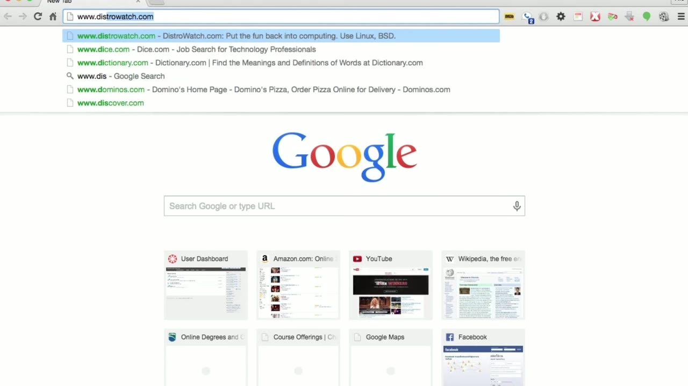
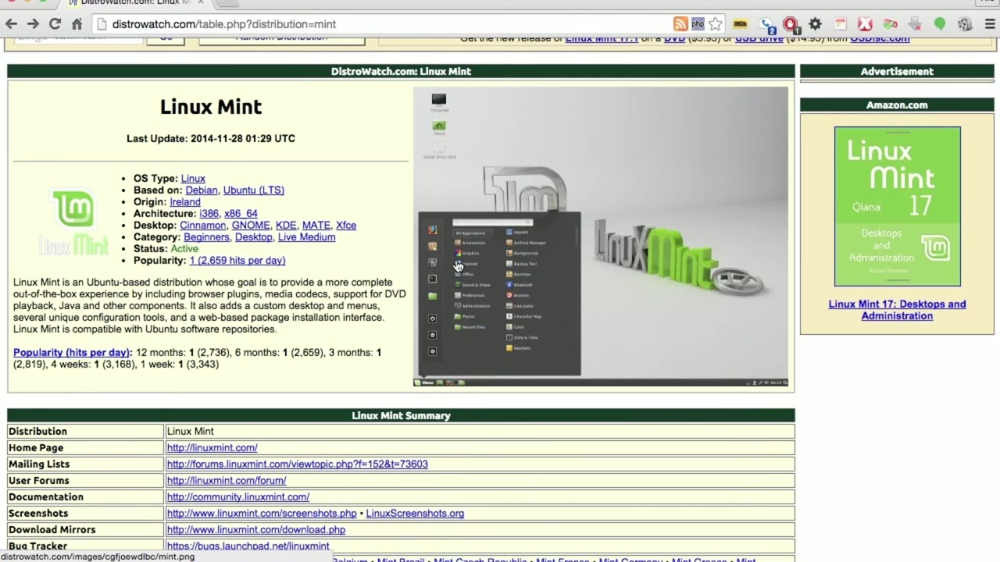
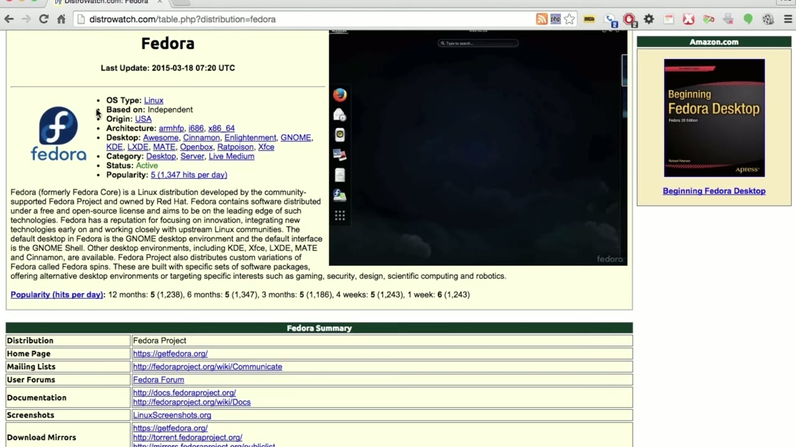

[← Course contents](../../02.md)

# 4. Distributions

**Course:** [Linux Security & Administration From Boot Process to Firewalls](https://www.youtube.com/watch?v=_WB3evmgxYA)  
**Transcript:** [`Linux Security & Administration From Boot Process to Firewalls transcript`](../../../../course_videos/Linux%20Security%20%26%20Administration%20From%20Boot%20Process%20to%20Firewalls/Linux%20Security%20%26%20Administration%20From%20Boot%20Process%20to%20Firewalls.txt)  
**Video:** 00:08:02–00:12:04 ([open at this time](https://www.youtube.com/watch?v=_WB3evmgxYA&t=482s))

## Introduction

Let's talk about the different flavors or distributions of Linux. One of the best places to go if you want to look at different distributions that are available is DistroWatch. Distrawatch keeps track of the latest releases for all of the different distributions. So let's talk about before we get into some of the different distributions, what a distribution actually is. A distribution is a collection of software that is packaged together to make it easy for you to run Linux.

## Detailed Explanation

<details>
  <summary>Step 1 — Let's talk about the different flavors or distributions of Linux. One</summary>

### Step 1 — Let's talk about the different flavors or distributions of Linux. One

- [x] **Let's talk about the different flavors or distributions of Linux. One**
  - Let's talk about the different flavors or distributions of Linux. One of the best places to go if you want to look at different distributions that are available is DistroWatch.
  - Distrawatch keeps track of the latest releases for all of the different distributions.
  - So let's talk about before we get into some of the different distributions, what a distribution actually is.

- [x] **A distribution is a collection of software that is packaged together**
  - A distribution is a collection of software that is packaged together to make it easy for you to run Linux.
  - So Linux again is the kernel or the operating system, and a distribution collects a user interface on top of the kernel as well as a lot of other user programs, including those from the GNU project. So we've got a lot of software that you could potentially use, including some different office suites. You've got a number of different
  - Desktop environments like kde or Gnome or xfce for example. Different distributions may use different desktop environments as their default.

- [x] **which doesn't mean you can't get the other desktop environments for**
  - which doesn't mean you can't get the other desktop environments for that distribution.
  - It just means the default may be Gnome, for example, or maybe kde, or it may be xfce.
  - Now, different distributions also have different ways of installing software.

- [x] **That's done with package managers and packages are ways that you**
  - That's done with package managers and packages are ways that you would collect all of the executables and the libraries and configuration files for and you would put all of that together.
  - The package manager would make sure that everything got into the right place on your system.
  - So currently, the top distribution is Linux Mint.

- [x] **Linux Mint is actually based on another very popular distribution**
  - Linux Mint is actually based on another very popular distribution called Ubuntu.
  - And Ubuntu is actually based on another distribution called Debian.



</details>

<details>
  <summary>Step 2 — One of the primary differences between Linux Mint and Ubuntu is the</summary>

### Step 2 — One of the primary differences between Linux Mint and Ubuntu is the

- [x] **One of the primary differences between Linux Mint and Ubuntu is the**
  - One of the primary differences between Linux Mint and Ubuntu is the user interface.
  - Linux Mint packages a couple of different desktop environments, one of which is called cinnamon and the other is called mate.
  - But they look different than most other Gnome-based desktop environments will look.

- [x] **So they've created a different look and feel for Linux Mint, even**
  - So they've created a different look and feel for Linux Mint, even though the package management is going to be the same as Ubuntu and Debian, which you can see are numbers two and three.
  - Another very popular distribution is Fedora, and that is managed by Red Hat, although it's community developed.
  - A distribution that feeds into the Red Hat distribution Red Hat Enterprise Linux.

- [x] **So this is where a lot of the development effort for Fedora goes in**
  - So this is where a lot of the development effort for Fedora goes in.



</details>

<details>
  <summary>Step 3 — Run `rpm`</summary>

### Step 3 — Run `rpm`

- [x] **Use `rpm`**
  - Now, where Debian and Ubuntu use the apt set of utilities for package management, Fedora and Red Hat Enterprise Linux use the Red Hat package manager, which is `rpm`.
  - So again, you've got different ways of doing package management.
  - Across the different distributions of Linux.

- [x] **So you can see there's actually a fairly large number of different**
  - So you can see there's actually a fairly large number of different distributions that are available.
  - There's actually several hundred that are available.
  - And you can certainly start digging really deep into the list and start playing around with a lot of the really smaller distributions just to see how they differ.

- [x] **But the top distributions are, again, the Debian-based ones, Mint**
  - But the top distributions are, again, the Debian-based ones, Mint Ubuntu and Debian, there's also Fedora.
  - There are a couple of distributions where all of the software is built when you need to install it.
  - And we'll talk about those types of distributions coming up.

```bash
rpm
```



</details>

<details>
  <summary>Questions and Answers</summary>

## Questions and Answers

### Question 1: What does `rpm` do in this chapter?

<details>
<summary>Answer</summary>

- [x] Now, where Debian and Ubuntu use the apt set of utilities for package management, Fedora and Red Hat Enterprise Linux use the Red Hat package manager, which is `rpm`.

</details>

### Question 2: What does step 1 cover (Let's talk about the different flavors or distributions of Linux. One)?

<details>
<summary>Answer</summary>

- [x] Let's talk about the different flavors or distributions of Linux. One of the best places to go if you want to look at different distributions that are available is DistroWatch.
- [x] Distrawatch keeps track of the latest releases for all of the different distributions.
- [x] So let's talk about before we get into some of the different distributions, what a distribution actually is.

</details>

### Question 3: What does step 2 cover (One of the primary differences between Linux Mint and Ubuntu is the)?

<details>
<summary>Answer</summary>

- [x] One of the primary differences between Linux Mint and Ubuntu is the user interface.
- [x] Linux Mint packages a couple of different desktop environments, one of which is called cinnamon and the other is called mate.
- [x] But they look different than most other Gnome-based desktop environments will look.

</details>

### Question 4: What does step 3 cover (Run rpm)?

<details>
<summary>Answer</summary>

- [x] Now, where Debian and Ubuntu use the apt set of utilities for package management, Fedora and Red Hat Enterprise Linux use the Red Hat package manager, which is `rpm`.
- [x] So again, you've got different ways of doing package management.
- [x] Across the different distributions of Linux.

</details>

</details>

## Summary

This chapter, Distributions, walks through Let's talk about the different flavors or distributions of Linux. One; One of the primary differences between Linux Mint and Ubuntu is the; Run rpm. Commands from the transcript: `rpm`.

## References

- [Linux Security & Administration From Boot Process to Firewalls (YouTube)](https://www.youtube.com/watch?v=_WB3evmgxYA)
- [This chapter at 00:08:02](https://www.youtube.com/watch?v=_WB3evmgxYA&t=482s)
- [Local transcript](../../../../course_videos/Linux%20Security%20%26%20Administration%20From%20Boot%20Process%20to%20Firewalls/Linux%20Security%20%26%20Administration%20From%20Boot%20Process%20to%20Firewalls.txt)
