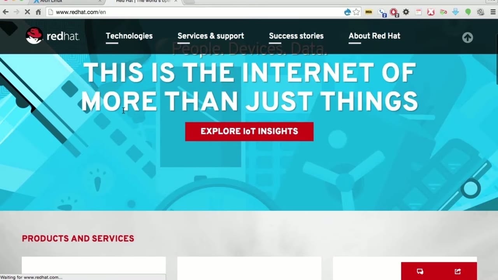
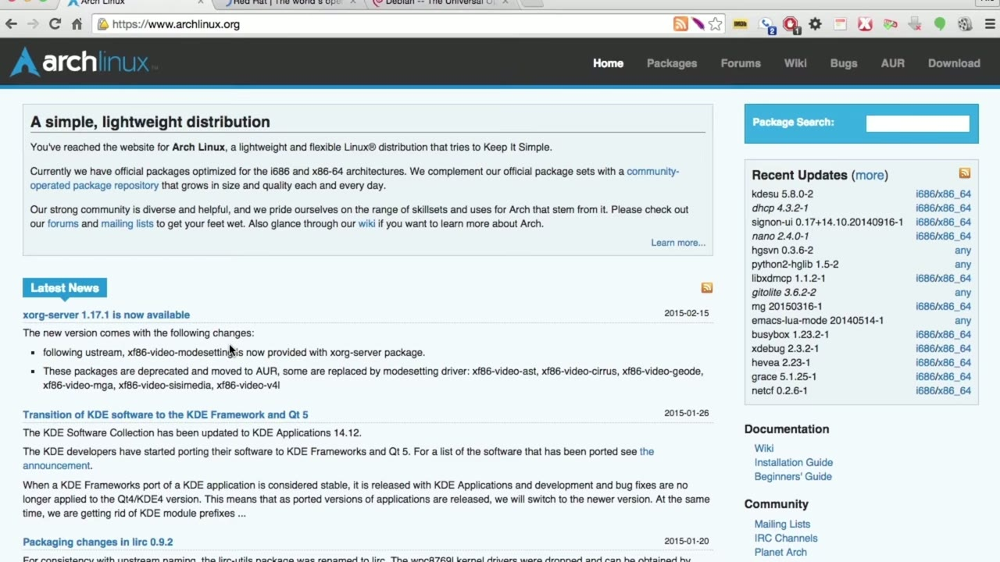
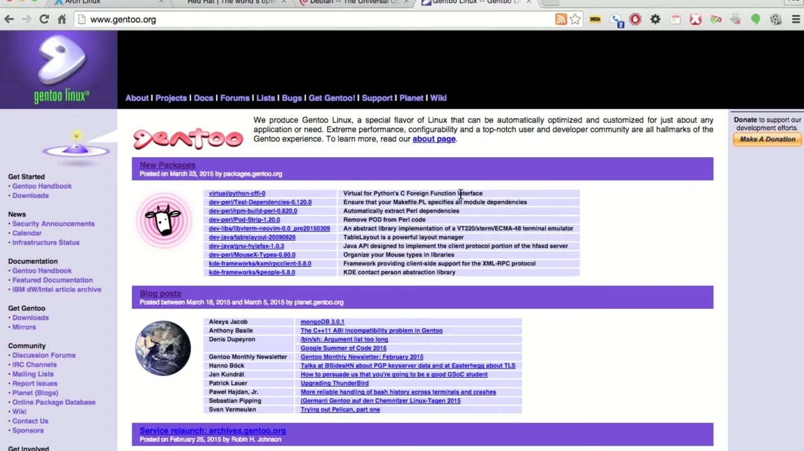

[← Course contents](../../02.md)

# 5. Scratch Versus Binary

**Course:** [Linux Security & Administration From Boot Process to Firewalls](https://www.youtube.com/watch?v=_WB3evmgxYA)  
**Transcript:** [`Linux Security & Administration From Boot Process to Firewalls transcript`](../../../../course_videos/Linux%20Security%20%26%20Administration%20From%20Boot%20Process%20to%20Firewalls/Linux%20Security%20%26%20Administration%20From%20Boot%20Process%20to%20Firewalls.txt)  
**Video:** 00:12:04–00:16:03 ([open at this time](https://www.youtube.com/watch?v=_WB3evmgxYA&t=724s))

## Introduction

There's a couple of different ways to think about Linux distributions. One of them is comparing binary-based distributions to source-based distributions. Now, a source-based distribution is one where all of the packages are actually built from source when you are ready to install them. A binary-based distribution is one where somebody else does all of the compilation, puts them together, and then all you have to do is install them.

## Detailed Explanation

<details>
  <summary>Step 1 — Run `rpm`</summary>

### Step 1 — Run `rpm`

- [x] **There's a couple of different ways to think about Linux distributions**
  - There's a couple of different ways to think about Linux distributions.
  - One of them is comparing binary-based distributions to source-based distributions.
  - Now, a source-based distribution is one where all of the packages are actually built from source when you are ready to install them.

- [x] **A binary-based distribution is one where somebody else does all of**
  - A binary-based distribution is one where somebody else does all of the compilation, puts them together, and then all you have to do is install them.
  - Now, the advantage to a binary-based distribution, of course, is the ease of use.
  - There are a number of binary-based distributions.

- [x] **Use `rpm`**
  - Red Hat provides all of its packages in the Red Hat package manager format `rpm`.
  - And of course, there's also, we've got Debian, for example, which is another binary-based distribution.
  - You've got all of the packages that are created and all you've got to do is install them.

- [x] **You don't have to actually create anything or compile anything when**
  - You don't have to actually create anything or compile anything when you want to install something.
  - The disadvantage to the binary-based distribution is that they determine what all of the dependencies that are going to be installed are.
  - Many packages have the ability to either include or not include a number of other packages based on what you're looking for.

- [x] **So distributions like Red Hat, Debbie and Ubuntu, various other**
  - So distributions like Red Hat, Debbie and Ubuntu, various other binary-based distributions actually make those determinations for you.

```bash
rpm
```



</details>

<details>
  <summary>Step 2 — Determine that the majority of people are going to use a particular set</summary>

### Step 2 — Determine that the majority of people are going to use a particular set

- [x] **Determine that the majority of people are going to use a particular**
  - Determine that the majority of people are going to use a particular set of packages and they are going to actually use those as dependencies.
  - A distribution like Arch, for example, does give you the ability to build your own packages depending on the dependencies and the specific subsystems and packages you want to install.
  - which will actually install packages for you.

- [x] **Now, Arch will do either build your own or they do have some binary**
  - Now, Arch will do either build your own or they do have some binary packages as well that you can install.
  - Another Linux distribution that is source-based is Gen 2.
  - Now, Gen 2 is very much a Linux from scratch distribution.

- [x] **So you start off with a very, very basic subset of Linux**
  - So you start off with a very, very basic subset of Linux.



</details>

<details>
  <summary>Step 3 — that is what you use to layer all of the other packages and subsystems</summary>

### Step 3 — that is what you use to layer all of the other packages and subsystems

- [x] **And that is what you use to layer all of the other packages and**
  - And that is what you use to layer all of the other packages and subsystems on top of so that when you're done, you've got exactly the distribution that you want based on different sets of dependencies, different packages that you want to install.
  - You've got a lot more control doing it this way.
  - Of course, the downside to doing a from scratch distribution like Gen 2 here is that it's going to take a lot longer to install because you are compiling everything from source.

- [x] **And there may be a lot of underlying dependencies that need to**
  - And there may be a lot of underlying dependencies that need to actually be compiled before you get the one that you really want to install and make use of.
  - So you get a lot more flexibility, control, and power with a scratch-based Linux distribution like Gen 2 or Arch.
  - Or you can also give up some of the control and the customization possibilities by using a binary-based distribution like Red Hat or Debian.

- [x] **Really is up to you to determine which direction you want to go in**
  - Really is up to you to determine which direction you want to go in where you're going to feel more comfortable.
  - You're going to learn an awful lot more using a scratch-based distribution like Gen 2 or Arch.
  - You're going to be able to hit the ground running a lot faster with something like Debbie and Ubuntu, Red Hat, or one of the other binary-based distributions.



</details>

<details>
  <summary>Questions and Answers</summary>

## Questions and Answers

### Question 1: What does `rpm` do in this chapter?

<details>
<summary>Answer</summary>

- [x] Red Hat provides all of its packages in the Red Hat package manager format `rpm`.

</details>

### Question 2: What does step 1 cover (Run rpm)?

<details>
<summary>Answer</summary>

- [x] There's a couple of different ways to think about Linux distributions.
- [x] One of them is comparing binary-based distributions to source-based distributions.
- [x] Now, a source-based distribution is one where all of the packages are actually built from source when you are ready to install them.

</details>

### Question 3: What does step 2 cover (Determine that the majority of people are going to use a particular set)?

<details>
<summary>Answer</summary>

- [x] Determine that the majority of people are going to use a particular set of packages and they are going to actually use those as dependencies.
- [x] A distribution like Arch, for example, does give you the ability to build your own packages depending on the dependencies and the specific subsystems and packages you want to install.
- [x] which will actually install packages for you.

</details>

### Question 4: What does step 3 cover (that is what you use to layer all of the other packages and subsystems)?

<details>
<summary>Answer</summary>

- [x] And that is what you use to layer all of the other packages and subsystems on top of so that when you're done, you've got exactly the distribution that you want based on different sets of dependencies, different packages that you want to install.
- [x] You've got a lot more control doing it this way.
- [x] Of course, the downside to doing a from scratch distribution like Gen 2 here is that it's going to take a lot longer to install because you are compiling everything from source.

</details>

</details>

## Summary

This chapter, Scratch Versus Binary, walks through Run rpm; Determine that the majority of people are going to use a particular set; that is what you use to layer all of the other packages and subsystems. Commands from the transcript: `rpm`.

## References

- [Linux Security & Administration From Boot Process to Firewalls (YouTube)](https://www.youtube.com/watch?v=_WB3evmgxYA)
- [This chapter at 00:12:04](https://www.youtube.com/watch?v=_WB3evmgxYA&t=724s)
- [Local transcript](../../../../course_videos/Linux%20Security%20%26%20Administration%20From%20Boot%20Process%20to%20Firewalls/Linux%20Security%20%26%20Administration%20From%20Boot%20Process%20to%20Firewalls.txt)
