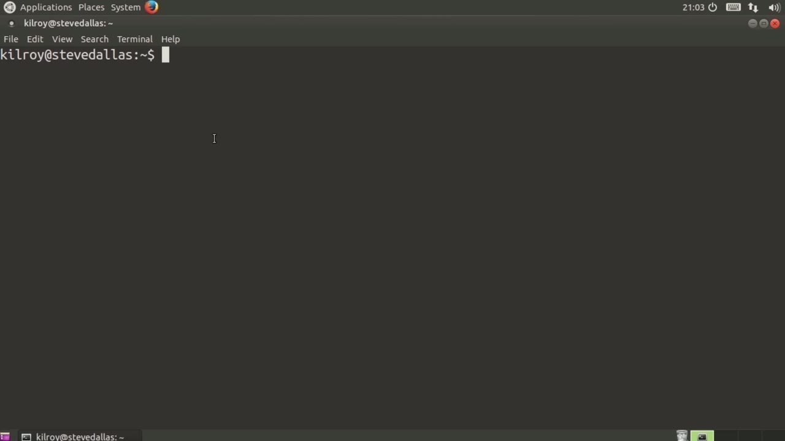
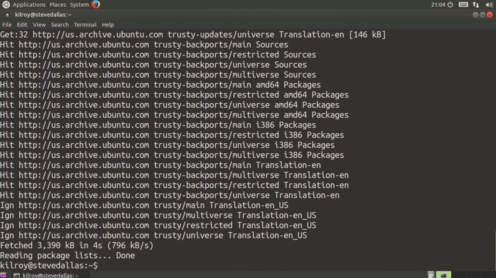
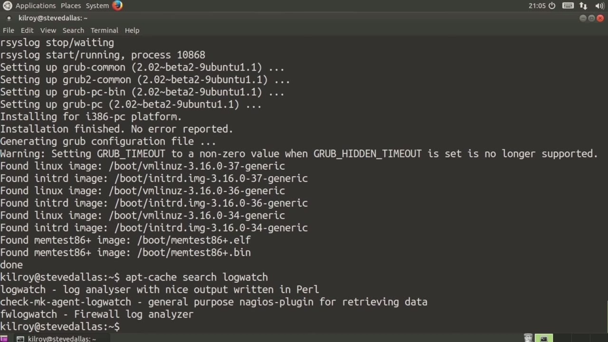

[← Course contents](../../02.md)

# 6. Ubuntu Package Management

**Course:** [Linux Security & Administration From Boot Process to Firewalls](https://www.youtube.com/watch?v=_WB3evmgxYA)  
**Transcript:** [`Linux Security & Administration From Boot Process to Firewalls transcript`](../../../../course_videos/Linux%20Security%20%26%20Administration%20From%20Boot%20Process%20to%20Firewalls/Linux%20Security%20%26%20Administration%20From%20Boot%20Process%20to%20Firewalls.txt)  
**Video:** 00:16:03–00:19:22 ([open at this time](https://www.youtube.com/watch?v=_WB3evmgxYA&t=963s))

## Introduction

Before we get started, we're going to be installing a number of packages and we'll also be talking about keeping your system up to date over the course of these lessons. We want to talk a little bit about how to manage package installations and updates on your Ubuntu system. Now, Ubuntu uses a package manager called Apt. Commonly, you're going to use something called apt-get. And apt-get has a number of different purposes. So I could, for example, install a piece of software. So I could say, install, and then I'm just going to install vim here.

## Detailed Explanation

<details>
  <summary>Step 1 — Run `apt-get`, `apt-get install vim`, `apt-get update`</summary>

### Step 1 — Run `apt-get`, `apt-get install vim`, `apt-get update`

- [x] **Use `apt-get`**
  - Before we get started, we're going to be installing a number of packages and we'll also be talking about keeping your system up to date over the course of these lessons.
  - We want to talk a little bit about how to manage package installations and updates on your Ubuntu system.
  - Now, Ubuntu uses a package manager called Apt. Commonly, you're going to use something called `apt-get`.

- [x] **Use `apt-get`, `apt-get install vim`**
  - And `apt-get` has a number of different purposes. So I could, for example, install a piece of software. So I could say, install, and then I'm just going to install vim here.
  - Now you can see it's going to download and then it's going to do the installation.
  - Now, `apt-get` is actually going to check for dependencies and then install the dependencies that are necessary as well.

- [x] **Use `apt-get update`**
  - So another thing that you want to do is you want to keep your tree of packages up to date.
  - We're going to say `apt-get update`.
  - And that's going to download all of the latest versions that are available.

```bash
apt-get
apt-get install vim
apt-get update
```



</details>

<details>
  <summary>Step 2 — Run `apt-get upgrade`, `apt-cache`</summary>

### Step 2 — Run `apt-get upgrade`, `apt-cache`

- [x] **Use `apt-get upgrade`**
  - Once I have done an update, I can say `apt-get upgrade`, then that will tell me what software I need to actually update to the latest version.
  - This keeps my system up to date with everything.
  - So I can do an update, which is going to download all of the latest versions.

- [x] **Use `apt-cache`**
  - And it's going to tell my system what the latest version is.
  - And then if I run Upgrade, what it will do is check to see whether I have the latest versions installed.
  - So another piece of software that you can use is `apt-cache`.

- [x] **Use `apt-cache`**
  - `apt-cache` allows you to do things like search.
  - And let's say we want to search for logwatch.
  - So I've got a couple of different answers here.

- [x] **I've got CheckMK Agent logwatch and then I've got fwlogwatch**
  - I've got CheckMK Agent logwatch and then I've got fwlogwatch.
  - I can do searches for pieces of software.

```bash
apt-get upgrade
apt-cache
```



</details>

<details>
  <summary>Step 3 — Run `apt-cache search`, `apt-get install fwlogwatch`, `apt-get remove fwlogwatch`</summary>

### Step 3 — Run `apt-cache search`, `apt-get install fwlogwatch`, `apt-get remove fwlogwatch`

- [x] **Use `apt-cache search`, `apt-get install fwlogwatch`, `apt-get remove fwlogwatch`**
  - If I don't remember the specific package name, what I can do is I can use `apt-cache search` and then I can get the package name so that I can go do the install.
  - So now once I know a name here, I can do `apt-get` install, fwlogwatch.
  - If I want to remove a piece of software, I can say `apt-get`, remove, fwlogwatch.

- [x] **Use `apt-get`, `apt-cache`**
  - So now it's going to uninstall that piece of software.
  - So `apt-get` is going to be what you're going to use pretty commonly.
  - If you want to search for specific software packages, you can use `apt-cache`.

- [x] **That you would use on a Debian-based Linux distribution**
  - That you would use on a Debian-based Linux distribution.
  - So that would include Ubuntu, that would include Linux Mint, it would include Debian, it would include any Ubuntu derivative.

```bash
apt-cache search
apt-get install fwlogwatch
apt-get remove fwlogwatch
apt-get
apt-cache
```



</details>

<details>
  <summary>Questions and Answers</summary>

## Questions and Answers

### Question 1: What does `apt-get` do in this chapter?

<details>
<summary>Answer</summary>

- [x] Now, Ubuntu uses a package manager called Apt. Commonly, you're going to use something called `apt-get`.

</details>

### Question 2: What does `apt-get install vim` do in this chapter?

<details>
<summary>Answer</summary>

- [x] And apt-get has a number of different purposes. So I could, for example, install a piece of software. So I could say, install, and then I'm just going to install vim here.

</details>

### Question 3: What does `apt-get update` do in this chapter?

<details>
<summary>Answer</summary>

- [x] We're going to say `apt-get update`.

</details>

### Question 4: What does `apt-get upgrade` do in this chapter?

<details>
<summary>Answer</summary>

- [x] Once I have done an update, I can say `apt-get upgrade`, then that will tell me what software I need to actually update to the latest version.

</details>

### Question 5: What does `apt-cache` do in this chapter?

<details>
<summary>Answer</summary>

- [x] So another piece of software that you can use is `apt-cache`.

</details>

### Question 6: What does `apt-cache search` do in this chapter?

<details>
<summary>Answer</summary>

- [x] If I don't remember the specific package name, what I can do is I can use `apt-cache search` and then I can get the package name so that I can go do the install.

</details>

### Question 7: What does `apt-get install fwlogwatch` do in this chapter?

<details>
<summary>Answer</summary>

- [x] So now once I know a name here, I can do apt-get install, fwlogwatch.

</details>

### Question 8: What does `apt-get remove fwlogwatch` do in this chapter?

<details>
<summary>Answer</summary>

- [x] If I want to remove a piece of software, I can say apt-get, remove, fwlogwatch.

</details>

</details>

## Summary

This chapter, Ubuntu Package Management, walks through Run apt-get, apt-get install vim, apt-get update; Run apt-get upgrade, apt-cache; Run apt-cache search, apt-get install fwlogwatch, apt-get remove fwlogwatch. Commands from the transcript: `apt-get`, `apt-get install vim`, `apt-get update`, `apt-get upgrade`, `apt-cache`, `apt-cache search`, `apt-get install fwlogwatch`, `apt-get remove fwlogwatch`.

## References

- [Linux Security & Administration From Boot Process to Firewalls (YouTube)](https://www.youtube.com/watch?v=_WB3evmgxYA)
- [This chapter at 00:16:03](https://www.youtube.com/watch?v=_WB3evmgxYA&t=963s)
- [Local transcript](../../../../course_videos/Linux%20Security%20%26%20Administration%20From%20Boot%20Process%20to%20Firewalls/Linux%20Security%20%26%20Administration%20From%20Boot%20Process%20to%20Firewalls.txt)
