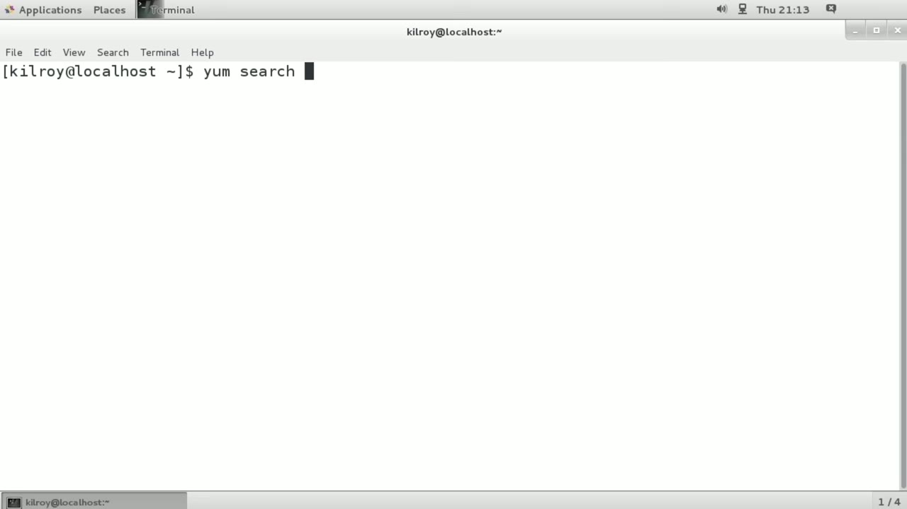
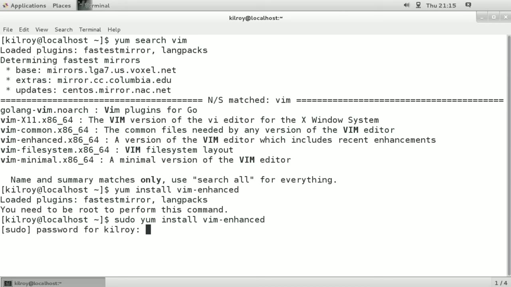
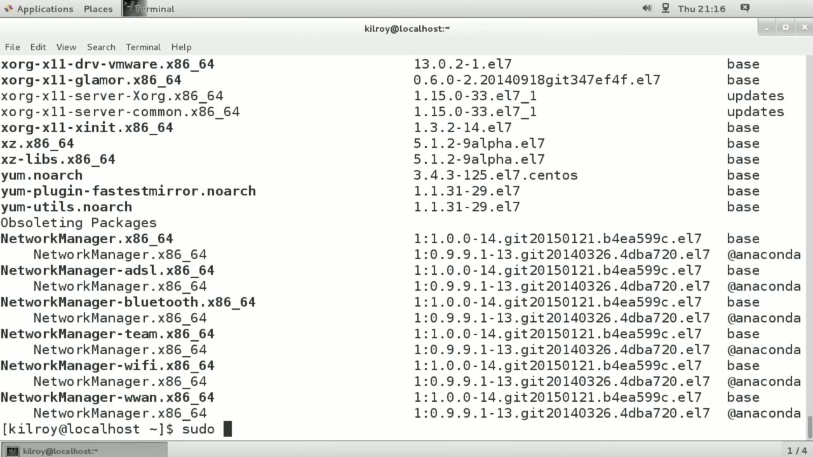

[← Course contents](../../02.md)

# 7. RedHat Package Management

**Course:** [Linux Security & Administration From Boot Process to Firewalls](https://www.youtube.com/watch?v=_WB3evmgxYA)  
**Transcript:** [`Linux Security & Administration From Boot Process to Firewalls transcript`](../../../../course_videos/Linux%20Security%20%26%20Administration%20From%20Boot%20Process%20to%20Firewalls/Linux%20Security%20%26%20Administration%20From%20Boot%20Process%20to%20Firewalls.txt)  
**Video:** 00:19:22–00:24:03 ([open at this time](https://www.youtube.com/watch?v=_WB3evmgxYA&t=1162s))

## Introduction

On a Red Hat system, we're going to use a different set of utilities in order to do package management, which is going to allow us to install packages and keep them up to date as well as search for packages. That we may want to install. What I'm going to do now is I'm going to search for a package here. So I'm going to run Yum. Yum actually stands for Yellow Dog Updator modified and it relates to a Linux distribution called Yellow Dog that was related to Red Hat. Red Hat picked up this YUM piece of software because what YUM will do, which RPM will not do, is it will check for dependencies.

## Detailed Explanation

<details>
  <summary>Step 1 — Run `yum`, `rpm`, `yum install vim-enhanced`</summary>

### Step 1 — Run `yum`, `rpm`, `yum install vim-enhanced`

- [x] **Use `yum`, `rpm`**
  - On a Red Hat system, we're going to use a different set of utilities in order to do package management, which is going to allow us to install packages and keep them up to date as well as search for packages.
  - That we may want to install. What I'm going to do now is I'm going to search for a package here.
  - So I'm going to run `yum`. `yum` actually stands for Yellow Dog Updator modified and it relates to a Linux distribution called Yellow Dog that was related to Red Hat. Red Hat picked up this `yum` piece of software because what `yum` will do, which `rpm` will not do, is it will check for dependencies.

- [x] **Use `rpm`, `yum`**
  - Now `rpm` is not only the package management format, it's also the utility that you would use to install an `rpm` package.
  - So going to do `yum` and we're going to search for piece of software called vim.
  - So every time you run `yum`, one thing that it does is it checks your mirrors to see whether everything is loaded and all of the latest versions are there.

- [x] **Use `yum install vim-enhanced`**
  - So these are the different packages that match vim.
  - Let's just say I wanted to install vim-enhanced.
  - So I'm going to say `yum install vim-enhanced`.

- [x] **Now, the piece on the end, the dot x86 underscore 64, is actually the**
  - Now, the piece on the end, the dot x86 underscore 64, is actually the architecture version.

```bash
yum
rpm
yum install vim-enhanced
```



</details>

<details>
  <summary>Step 2 — Run `sudo`, `yum`, `sudo yum`</summary>

### Step 2 — Run `sudo`, `yum`, `sudo yum`

- [x] **Use `sudo`, `yum`**
  - I do, however, need to be root, so I need to run `sudo` rather than just `yum`.
  - I can, of course, do a search without being `sudo` because all I'm doing is looking for software.
  - If I want to install something, I'm making changes to the system.

- [x] **Use `yum`**
  - And so I need to be root, so I have to do `yum`.
  - So in this case, vim is actually the latest version and it's up to date, it's installed, so there's nothing actually to do there.
  - `yum` will check to make sure whether the piece of software you're trying to install is already installed.

- [x] **Use `sudo yum`**
  - If it is not installed, it will install it.
  - If it is installed, as you can see, it will tell you.
  - So what I want to do now is I want to say `sudo yum` check update.

- [x] **And this is going to see if there are any updates that are available**
  - And this is going to see if there are any updates that are available.
  - So we're checking our mirror sites and we're going to be downloading the latest set of packages that are available.
  - And it looks like we actually have a number of packages that need to be updated.

```bash
sudo
yum
sudo yum
```



</details>

<details>
  <summary>Step 3 — Run `yum update`, `rpm`, `yum`</summary>

### Step 3 — Run `yum update`, `rpm`, `yum`

- [x] **Use `yum update`**
  - So now what I would do would be to say, `yum`, update.
  - And now it's going to check and list all of the packages that need to be updated.
  - It should show me the list at this point and then ask me whether I want to install or not.

- [x] **And I mistakenly hit the enter key there which was no, so let me just**
  - And I mistakenly hit the enter key there which was no, so let me just run that again.
  - And it should come back up and say, do you want to do this or not?
  - And then we'll take a quick look at what it's asking me for.

- [x] **Use `rpm`**
  - So you can see by the capital N here, that the default is going to be no.
  - And so it's going to go download the packages, and then it's going to install them.
  - And you can see as it's going here, what it's downloading are `rpm` files.

- [x] **Use `rpm`, `yum`, `yum remove`**
  - This is the Red Hat Package Manager package format, and it's going to install these `rpm` files, which are all updates in this particular case.
  - With `yum`, I can search for packages, I can check for updates, I can do updates.
  - Of course, I can also do removes if I were to say `yum remove`, and then a particular package name it would remove the specified package.

- [x] **Use `yum erase`, `yum remove`, `yum update`**
  - I can also say `yum erase`. It's the same thing as `yum remove`.
  - And we've been talking about doing `yum update`, which is what's finishing right here, and that's going to...
  - Update all of the packages if you just run `yum update`, I can run `yum update` against a particular package.

- [x] **Use `yum update`**
  - So if I say `yum update` and then the package name, what it's going to do is it's going to just check for updates on that one particular package.
  - We're going to talk about the boot process. Now you can see that I've got a virtual machine here and I've got Ubuntu Linux and I'm ready to start it up.

```bash
yum update
rpm
yum
yum remove
yum erase
```



</details>

<details>
  <summary>Questions and Answers</summary>

## Questions and Answers

### Question 1: What does `yum` do in this chapter?

<details>
<summary>Answer</summary>

- [x] So I'm going to run `yum`. `yum` actually stands for Yellow Dog Updator modified and it relates to a Linux distribution called Yellow Dog that was related to Red Hat. Red Hat picked up this `yum` piece of software because what `yum` will do, which RPM will not do, is it will check for dependencies.

</details>

### Question 2: What does `rpm` do in this chapter?

<details>
<summary>Answer</summary>

- [x] So I'm going to run Yum. Yum actually stands for Yellow Dog Updator modified and it relates to a Linux distribution called Yellow Dog that was related to Red Hat. Red Hat picked up this YUM piece of software because what YUM will do, which `rpm` will not do, is it will check for dependencies.

</details>

### Question 3: What does `yum install vim-enhanced` do in this chapter?

<details>
<summary>Answer</summary>

- [x] Let's just say I wanted to install vim-enhanced.

</details>

### Question 4: What does `sudo` do in this chapter?

<details>
<summary>Answer</summary>

- [x] I do, however, need to be root, so I need to run `sudo` rather than just yum.

</details>

### Question 5: What does `sudo yum` do in this chapter?

<details>
<summary>Answer</summary>

- [x] So what I want to do now is I want to say `sudo yum` check update.

</details>

### Question 6: What does `yum update` do in this chapter?

<details>
<summary>Answer</summary>

- [x] So now what I would do would be to say, yum, update.

</details>

### Question 7: What does `yum remove` do in this chapter?

<details>
<summary>Answer</summary>

- [x] Of course, I can also do removes if I were to say `yum remove`, and then a particular package name it would remove the specified package.

</details>

### Question 8: What does `yum erase` do in this chapter?

<details>
<summary>Answer</summary>

- [x] I can also say `yum erase`. It's the same thing as YUM remove.

</details>

</details>

## Summary

This chapter, RedHat Package Management, walks through Run yum, rpm, yum install vim-enhanced; Run sudo, yum, sudo yum; Run yum update, rpm, yum. Commands from the transcript: `yum`, `rpm`, `yum install vim-enhanced`, `sudo`, `sudo yum`, `yum update`, `yum remove`, `yum erase`.

## References

- [Linux Security & Administration From Boot Process to Firewalls (YouTube)](https://www.youtube.com/watch?v=_WB3evmgxYA)
- [This chapter at 00:19:22](https://www.youtube.com/watch?v=_WB3evmgxYA&t=1162s)
- [Local transcript](../../../../course_videos/Linux%20Security%20%26%20Administration%20From%20Boot%20Process%20to%20Firewalls/Linux%20Security%20%26%20Administration%20From%20Boot%20Process%20to%20Firewalls.txt)
