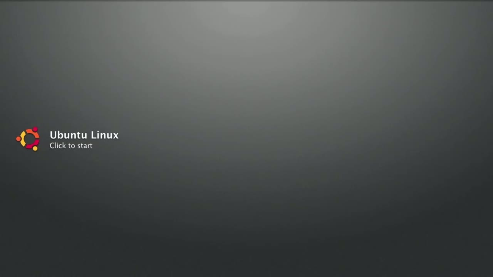
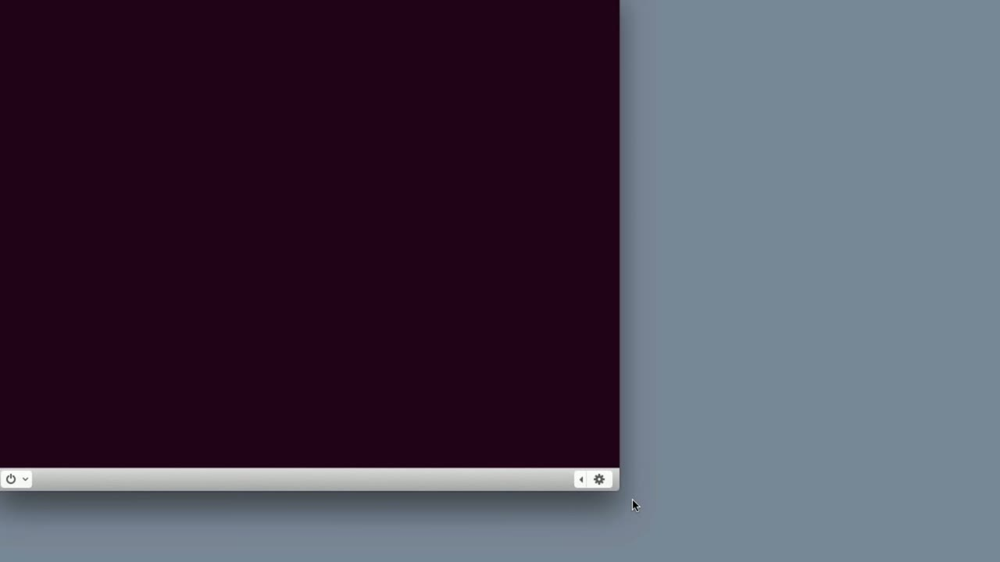
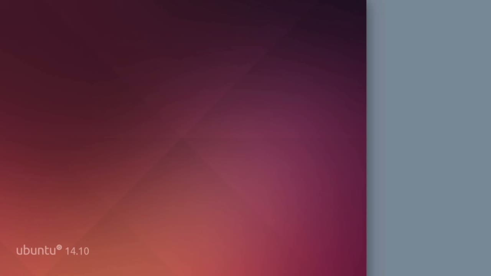

[← Course contents](../../02.md)

# 8. What you will learn in this Module

**Course:** [Linux Security & Administration From Boot Process to Firewalls](https://www.youtube.com/watch?v=_WB3evmgxYA)  
**Transcript:** [`Linux Security & Administration From Boot Process to Firewalls transcript`](../../../../course_videos/Linux%20Security%20%26%20Administration%20From%20Boot%20Process%20to%20Firewalls/Linux%20Security%20%26%20Administration%20From%20Boot%20Process%20to%20Firewalls.txt)  
**Video:** 00:24:03–00:27:47 ([open at this time](https://www.youtube.com/watch?v=_WB3evmgxYA&t=1443s))

## Introduction

Since this is a virtual machine, it's going to go really quickly, and I want to talk a little bit about what's going to happen before it actually happens. When you start a computer up, the very first thing that happens is it runs a power on self-test or a post. Now, the power on self-test, just make sure that basically all of the internal hardware to the system is actually operating correctly. The other thing that it does is it transfers control to the firmware.

## Detailed Explanation

  
Step 1 — Since this is a virtual machine, it's going to go really quickly, and I

### Step 1 — Since this is a virtual machine, it's going to go really quickly, and I

- [x] **Since this is a virtual machine, it's going to go really quickly, and**
  - Since this is a virtual machine, it's going to go really quickly, and I want to talk a little bit about what's going to happen before it actually happens.
  - When you start a computer up, the very first thing that happens is it runs a power on self-test or a post.
  - Now, the power on self-test, just make sure that basically all of the internal hardware to the system is actually operating correctly.

- [x] **The other thing that it does is it transfers control to the firmware**
  - The other thing that it does is it transfers control to the firmware.
  - That is then going to look for a specific portion of the hard drive.
  - Now, what it's looking for is the master boot record, or it may be looking for the Guit partition table.

- [x] **The master boot record is a much older data structure on the disk**
  - The master boot record is a much older data structure on the disk, and that data structure is going to be associated with basically a dos system.

  
Step 2 — the master boot record includes, but not limited to the partition table

### Step 2 — the master boot record includes, but not limited to the partition table

- [x] **And the master boot record includes, but not limited to the partition**
  - And the master boot record includes, but not limited to the partition table that tells it where all of the disks are, but it also includes about 440 bytes of boot code.
  - So with the Guit partition table, we're doing things a little bit differently.
  - It's still got a partition table that's associated with it, but there's also a much larger chunk of boot code.

- [x] **And that refers to another piece of the disk if you are using a guid**
  - And that refers to another piece of the disk if you are using a guid partition table that's actually got more of the boot code that's associated with it.
  - Now, in the case of Ubuntu Linux, and actually you didn't really see much of anything other than it's starting up, we are using the Grand Unified Bootloader or GRUB.
  - There are other bootloaders that you can use, including the Linux loader, which is LILO.

- [x] **You can use either of those bootloaders, but basically the point of**
  - You can use either of those bootloaders, but basically the point of the bootloader is to actually boot the operating system from the hard disk.

  
Step 3 — it does this by reading the first section of the hard drive

### Step 3 — it does this by reading the first section of the hard drive

- [x] **And it does this by reading the first section of the hard drive**
  - And it does this by reading the first section of the hard drive.
  - So with the master boot record, it is the first 512 bytes, which is the first sector of the hard drive, or the first block of the hard drive.
  - And with the guid partition table, we're talking about a much larger section.

- [x] **We've got larger partition identifiers and a lot more of them with**
  - We've got larger partition identifiers and a lot more of them with the guid partition table.
  - But basically, we are looking at the very first blocks on the hard drive in order to not only look for the partitions or volumes that are associated with a particular operating system, but also where the boot code is located.
  - Now the boot code of course is different from the operating system.

- [x] **The boot code is really just there to locate the operating system and**
  - The boot code is really just there to locate the operating system and then read that into memory.
  - So when we start a computer system up, what we are doing is we are doing a power on self-test, and I'm just going to restart this now, and we should be able to see very quickly what's happening.
  - That was the power on self-test that ran by really quickly.

- [x] **And what is being hidden from us here is the bootloader**
  - And what is being hidden from us here is the bootloader.
  - We don't actually get the menu because that's being hidden.
  - That goes and reads the kernel or the operating system.

- [x] **And then the operating system runs through its initialization**
  - And then the operating system runs through its initialization process, bringing up all of the services that are necessary and eventually the graphical login that you see right here.

  
Questions and Answers

## Questions and Answers

### Question 1: What does step 1 cover (Since this is a virtual machine, it's going to go really quickly, and I)?

Answer

- [x] Since this is a virtual machine, it's going to go really quickly, and I want to talk a little bit about what's going to happen before it actually happens.
- [x] When you start a computer up, the very first thing that happens is it runs a power on self-test or a post.
- [x] Now, the power on self-test, just make sure that basically all of the internal hardware to the system is actually operating correctly.

### Question 2: What does step 2 cover (the master boot record includes, but not limited to the partition table)?

Answer

- [x] And the master boot record includes, but not limited to the partition table that tells it where all of the disks are, but it also includes about 440 bytes of boot code.
- [x] So with the Guit partition table, we're doing things a little bit differently.
- [x] It's still got a partition table that's associated with it, but there's also a much larger chunk of boot code.

### Question 3: What does step 3 cover (it does this by reading the first section of the hard drive)?

Answer

- [x] And it does this by reading the first section of the hard drive.
- [x] So with the master boot record, it is the first 512 bytes, which is the first sector of the hard drive, or the first block of the hard drive.
- [x] And with the guid partition table, we're talking about a much larger section.

## Summary

This chapter, What you will learn in this Module, walks through Since this is a virtual machine, it's going to go really quickly, and I; the master boot record includes, but not limited to the partition table; it does this by reading the first section of the hard drive.

## References

- [Linux Security & Administration From Boot Process to Firewalls (YouTube)](https://www.youtube.com/watch?v=_WB3evmgxYA)
- [This chapter at 00:24:03](https://www.youtube.com/watch?v=_WB3evmgxYA&t=1443s)
- [Local transcript](../../../../course_videos/Linux%20Security%20%26%20Administration%20From%20Boot%20Process%20to%20Firewalls/Linux%20Security%20%26%20Administration%20From%20Boot%20Process%20to%20Firewalls.txt)
