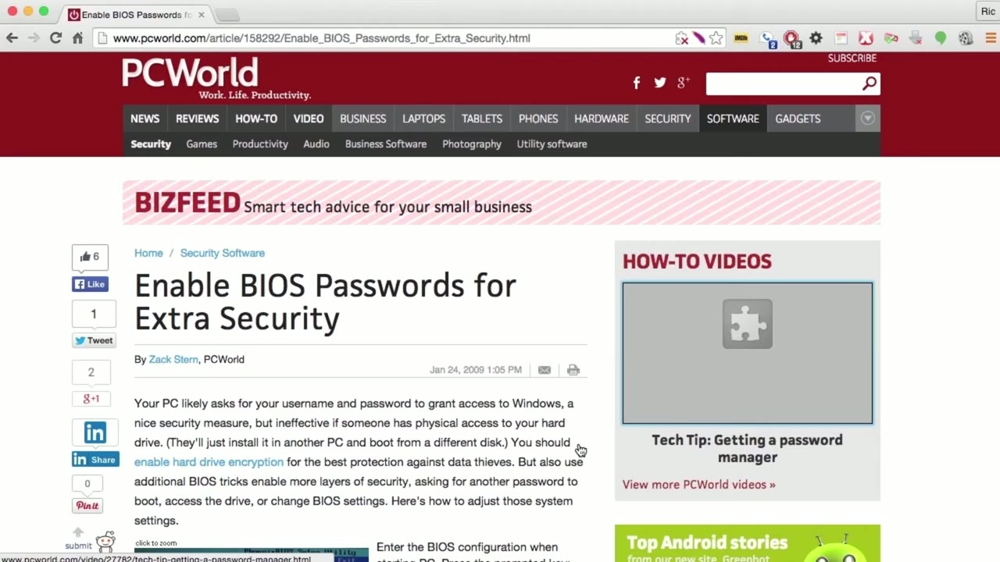
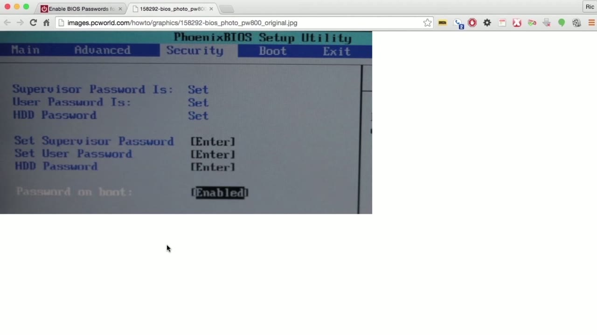
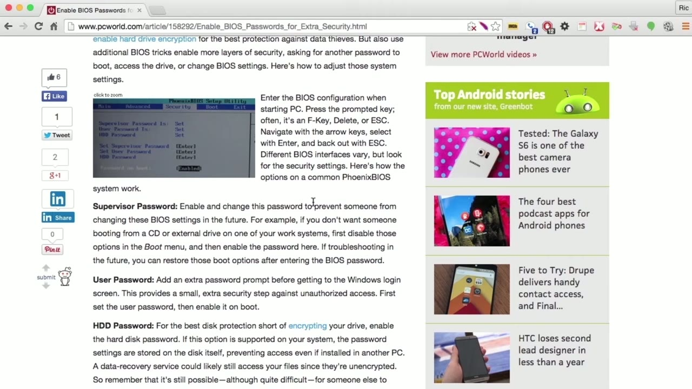

[← Course contents](../../02.md)

# 9. Physical Protections

**Course:** [Linux Security & Administration From Boot Process to Firewalls](https://www.youtube.com/watch?v=_WB3evmgxYA)  
**Transcript:** [`Linux Security & Administration From Boot Process to Firewalls transcript`](../../../../course_videos/Linux%20Security%20%26%20Administration%20From%20Boot%20Process%20to%20Firewalls/Linux%20Security%20%26%20Administration%20From%20Boot%20Process%20to%20Firewalls.txt)  
**Video:** 00:27:47–00:31:15 ([open at this time](https://www.youtube.com/watch?v=_WB3evmgxYA&t=1667s))

## Introduction

There are some things that you can do to protect your computer in case somebody can get physical access to it. The thing is, if I can get physical access to your system, I don't need to know your passwords, I don't need to know much of anything about the system at all, because I could install a boot disk, like a cd or a USB stick. I could boot to whatever operating system I have, so I've got some distribution of Linux on either a cd or a USB stick.

## Detailed Explanation

  
Step 1 — There are some things that you can do to protect your computer in case

### Step 1 — There are some things that you can do to protect your computer in case

- [x] **There are some things that you can do to protect your computer in**
  - There are some things that you can do to protect your computer in case somebody can get physical access to it.
  - The thing is, if I can get physical access to your system, I don't need to know your passwords, I don't need to know much of anything about the system at all, because I could install a boot disk, like a cd or a USB stick.
  - I could boot to whatever operating system I have, so I've got some distribution of Linux on either a cd or a USB stick.

- [x] **I can boot from that Linux distribution**
  - I can boot from that Linux distribution.
  - And gain access to your system in that way.
  - If I can get physical access to your system, I can get control of it.

- [x] **Well, there are a handful of things you can do**
  - Well, there are a handful of things you can do.
  - One of the things you can do is you can turn on BIOS passwords.
  - Your system has some configuration settings.

- [x] **Typically, this has been called the basic input output system, and it**
  - Typically, this has been called the basic input output system, and it is a way of doing a number of configuration settings or providing a number of configuration settings regarding your system.
  - So here's an image of a pretty standard BIOS setup utility. Now different computers have different BIOS firmware and that firmware is going to present different menu settings.
  - Basically what you're doing is you're looking for the security setting so that you can set a password.

- [x] **You can see the supervisor password is set, there's a user password**
  - You can see the supervisor password is set, there's a user password that's also set, and there are some other configuration parameters.
  - So password on boot. When the system first boots up, it is going to prompt for a password.

  
Step 2 — This is before any operating system actually executes

### Step 2 — This is before any operating system actually executes

- [x] **This is before any operating system actually executes**
  - This is before any operating system actually executes.
  - Before the operating system bootloader, anything happens at all, we're going to ask for a password.
  - If the password is correct, the system will boot up.

- [x] **Now, there are some other things that you can do as well**
  - Now, there are some other things that you can do as well.
  - Of course, you can enable hard drive encryption.
  - We'll talk about that later on, and that's going to protect you against somebody.

- [x] **Removing your hard drive and extracting the data from him**
  - Removing your hard drive and extracting the data from him.

  
Step 3 — If I want to protect against somebody actually doing something to my

### Step 3 — If I want to protect against somebody actually doing something to my

- [x] **If I want to protect against somebody actually doing something to my**
  - If I want to protect against somebody actually doing something to my system like booting a different operating system temporarily to change passwords or extract data, of course the encryption settings are going to help there, but other things that I can do are just simple physical access controls.
  - If I've got a server, I may want to actually lock the server into a rack.
  - So I may have a cage around the rack, for example.

- [x] **I probably want to put locks on the doors where the servers are**
  - I probably want to put locks on the doors where the servers are actually located.
  - If it's a desktop system, I can lock it to the desk using chains or cables, something along those lines. So there are a number of physical protections you can take as well.
  - You can lock the system into place, making it much harder for somebody to remove the system or gain access to it.

- [x] **In order to do some temporary boot thing. You can encrypt the hard**
  - In order to do some temporary boot thing. You can encrypt the hard disks.
  - And of course you can also set a BIOS password in order to present anybody from doing any booting at all unless they know the password that is necessary. At this point,

  
Questions and Answers

## Questions and Answers

### Question 1: What does step 1 cover (There are some things that you can do to protect your computer in case)?

Answer

- [x] There are some things that you can do to protect your computer in case somebody can get physical access to it.
- [x] The thing is, if I can get physical access to your system, I don't need to know your passwords, I don't need to know much of anything about the system at all, because I could install a boot disk, like a cd or a USB stick.
- [x] I could boot to whatever operating system I have, so I've got some distribution of Linux on either a cd or a USB stick.

### Question 2: What does step 2 cover (This is before any operating system actually executes)?

Answer

- [x] This is before any operating system actually executes.
- [x] Before the operating system bootloader, anything happens at all, we're going to ask for a password.
- [x] If the password is correct, the system will boot up.

### Question 3: What does step 3 cover (If I want to protect against somebody actually doing something to my)?

Answer

- [x] If I want to protect against somebody actually doing something to my system like booting a different operating system temporarily to change passwords or extract data, of course the encryption settings are going to help there, but other things that I can do are just simple physical access controls.
- [x] If I've got a server, I may want to actually lock the server into a rack.
- [x] So I may have a cage around the rack, for example.

## Summary

This chapter, Physical Protections, walks through There are some things that you can do to protect your computer in case; This is before any operating system actually executes; If I want to protect against somebody actually doing something to my.

## References

- [Linux Security & Administration From Boot Process to Firewalls (YouTube)](https://www.youtube.com/watch?v=_WB3evmgxYA)
- [This chapter at 00:27:47](https://www.youtube.com/watch?v=_WB3evmgxYA&t=1667s)
- [Local transcript](../../../../course_videos/Linux%20Security%20%26%20Administration%20From%20Boot%20Process%20to%20Firewalls/Linux%20Security%20%26%20Administration%20From%20Boot%20Process%20to%20Firewalls.txt)
