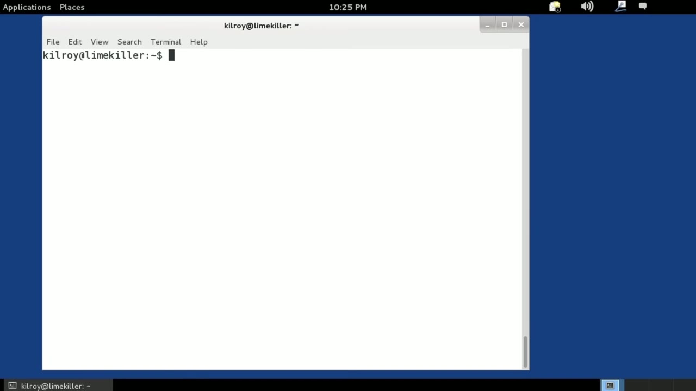
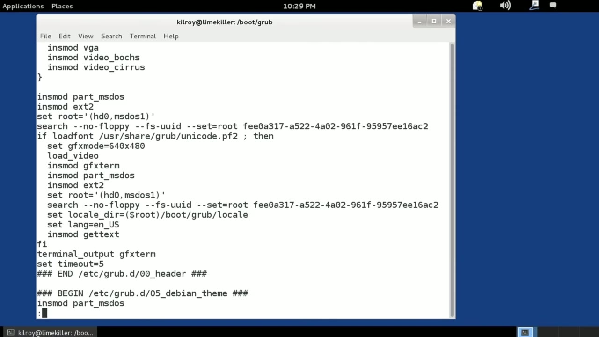
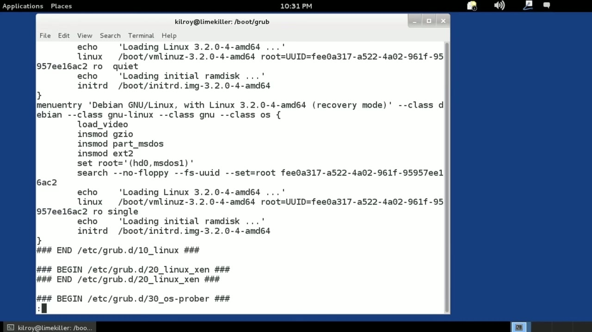

[← Course contents](../../02.md)

# 10. The Boot Manager (GRUB)

**Course:** [Linux Security & Administration From Boot Process to Firewalls](https://www.youtube.com/watch?v=_WB3evmgxYA)  
**Transcript:** [`Linux Security & Administration From Boot Process to Firewalls transcript`](../../../../course_videos/Linux%20Security%20%26%20Administration%20From%20Boot%20Process%20to%20Firewalls/Linux%20Security%20%26%20Administration%20From%20Boot%20Process%20to%20Firewalls.txt)  
**Video:** 00:31:15–00:37:11 ([open at this time](https://www.youtube.com/watch?v=_WB3evmgxYA&t=1875s))

## Introduction

Probably the most common bootloader is the Grand Unified Bootloader, commonly called GRUB. GRUB is actually a piece of software that has a number of stages. So the first stage, is the one that goes into the master boot record, or if you're using a guid partition table, it's going to go into a different place on the disk. And the first stage is responsible for actually loading up additional stages before we get to the point where we are loading the kernel. So we've got GRUB, and it loads up to the place on the hard drive, and it's responsible for loading up the kernel eventually.

## Detailed Explanation

  
Step 1 — Probably the most common bootloader is the Grand Unified Bootloader

### Step 1 — Probably the most common bootloader is the Grand Unified Bootloader

- [x] **Probably the most common bootloader is the Grand Unified Bootloader**
  - Probably the most common bootloader is the Grand Unified Bootloader, commonly called GRUB.
  - GRUB is actually a piece of software that has a number of stages. So the first stage, is the one that goes into the master boot record, or if you're using a guid partition table, it's going to go into a different place on the disk.
  - And the first stage is responsible for actually loading up additional stages before we get to the point where we are loading the kernel.

- [x] **So we've got GRUB, and it loads up to the place on the hard drive**
  - So we've got GRUB, and it loads up to the place on the hard drive, and it's responsible for loading up the kernel eventually.
  - Now we can do a lot of different things with GRUB and depending on the operating system or Linux distribution that you are using, you may configure it slightly differently.
  - So on some Linux distributions you're going to go to Boot GRUB and you're going to see a file that may be called menu.lst.

- [x] **In this case, we're using a slightly different system. So if I were**
  - In this case, we're using a slightly different system. So if I were to actually be using one of the older versions of GRUB, I would be looking at menu.lST. In this case, what we're going to do is we're going to go to /etc/grub.d and we're going to look at the different configuration settings. So
  - Basically some scripts that tell us what to do about creating the actual configuration file.
  - When we run the make config, first of all, I need to be the super user or root user.

- [x] **And make config is going to take all of the configuration files that**
  - And make config is going to take all of the configuration files that we have created here all of these scripts and it's going to generate a single configuration file.
  - That configuration file is actually in Boot GRUB, which is where we started.
  - And I can take a look at that with GRUB.cg.

- [x] **Now, of course, it says, do not edit this file. It's going to be**
  - Now, of course, it says, do not edit this file. It's going to be generated automatically.
  - And this is actually a script rather than something that used to be in place, which was just a simple configuration file.

  
Step 2 — That specified the different operating systems that you may be loading

### Step 2 — That specified the different operating systems that you may be loading

- [x] **That specified the different operating systems that you may be**
  - That specified the different operating systems that you may be loading up.
  - So in this case we're going to be installing some modules and we're going to be looking for a number of configuration settings. Now down here we're actually going to be generating the menus. So this one right here, this is menu entry Debbie and Gnu Linux with Linux 3.2.0-4.
  - This is actually one of the kernels that I have installed on the system.

- [x] **So when I boot up, it's going to give me this menu option**
  - So when I boot up, it's going to give me this menu option.
  - And I could choose this one or down below where it says menu entry.
  - And the settings are a little bit different.

- [x] **You can actually see here the recovery mode is really just booting it**
  - You can actually see here the recovery mode is really just booting it up in single user mode.
  - So this is different from the line up here.
  - What this line here that says Linux specifies is that's where the actual kernel is located.

- [x] **That's where the operating system is. That's the file that the**
  - That's where the operating system is. That's the file that the bootloader is ultimately going to load into memory.
  - There are a number of parameters that can be configured for the kernel.
  - So for example, we are passing the root disk image in with a UUID and We're also going to initially load it up as read only, and we're going to do a quiet load, which means we're not going to spit out a lot of messages while the operating system is loading up.

- [x] **So down below here, you can see we've again got Linux and it's**
  - So down below here, you can see we've again got Linux and it's located in /boot, and the kernel name is actually the same. The difference here is that we're doing it in single user mode and we've also removed the quiet option. So same kernel, different parameters is going to get us slightly different behavior.
  - So we've got our GRUB configuration here.

  
Step 3 — It's going to give us the ability to boot a particular operating system

### Step 3 — It's going to give us the ability to boot a particular operating system

- [x] **It's going to give us the ability to boot a particular operating**
  - It's going to give us the ability to boot a particular operating system.
  - And the other thing about GRUB is that when we actually boot it up, we have the ability to go into the menu and make some edits to each line of the menu entry.
  - Effectively a language as much as it is a bootloader.

- [x] **So when we boot up into the operating system, we get to the**
  - So when we boot up into the operating system, we get to the bootloader or GRUB menu.
  - We can stop the boot process there, make some changes, and add, for example, single to any of the lines that show up and boot up into single user mode.
  - Any change that we make there on the fly dynamically will not be stored to the configuration file.

- [x] **It's just for that one time that we actually boot up**
  - It's just for that one time that we actually boot up.
  - So GRUB is the primary bootloader that is used with most distributions of Linux at the moment.
  - It's a very powerful bootloader, gives us a lot of capabilities for doing a variety of things, including protecting itself, and we'll get into how it can protect itself coming up in subsequent lessons.

  
Questions and Answers

## Questions and Answers

### Question 1: What does step 1 cover (Probably the most common bootloader is the Grand Unified Bootloader)?

Answer

- [x] Probably the most common bootloader is the Grand Unified Bootloader, commonly called GRUB.
- [x] GRUB is actually a piece of software that has a number of stages. So the first stage, is the one that goes into the master boot record, or if you're using a guid partition table, it's going to go into a different place on the disk.
- [x] And the first stage is responsible for actually loading up additional stages before we get to the point where we are loading the kernel.

### Question 2: What does step 2 cover (That specified the different operating systems that you may be loading)?

Answer

- [x] That specified the different operating systems that you may be loading up.
- [x] So in this case we're going to be installing some modules and we're going to be looking for a number of configuration settings. Now down here we're actually going to be generating the menus. So this one right here, this is menu entry Debbie and Gnu Linux with Linux 3.2.0-4.
- [x] This is actually one of the kernels that I have installed on the system.

### Question 3: What does step 3 cover (It's going to give us the ability to boot a particular operating system)?

Answer

- [x] It's going to give us the ability to boot a particular operating system.
- [x] And the other thing about GRUB is that when we actually boot it up, we have the ability to go into the menu and make some edits to each line of the menu entry.
- [x] Effectively a language as much as it is a bootloader.

## Summary

This chapter, The Boot Manager (GRUB), walks through Probably the most common bootloader is the Grand Unified Bootloader; That specified the different operating systems that you may be loading; It's going to give us the ability to boot a particular operating system.

## References

- [Linux Security & Administration From Boot Process to Firewalls (YouTube)](https://www.youtube.com/watch?v=_WB3evmgxYA)
- [This chapter at 00:31:15](https://www.youtube.com/watch?v=_WB3evmgxYA&t=1875s)
- [Local transcript](../../../../course_videos/Linux%20Security%20%26%20Administration%20From%20Boot%20Process%20to%20Firewalls/Linux%20Security%20%26%20Administration%20From%20Boot%20Process%20to%20Firewalls.txt)
