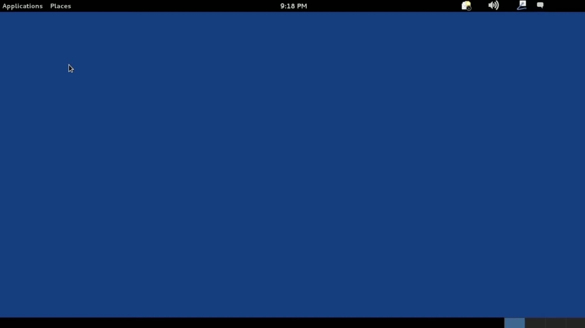
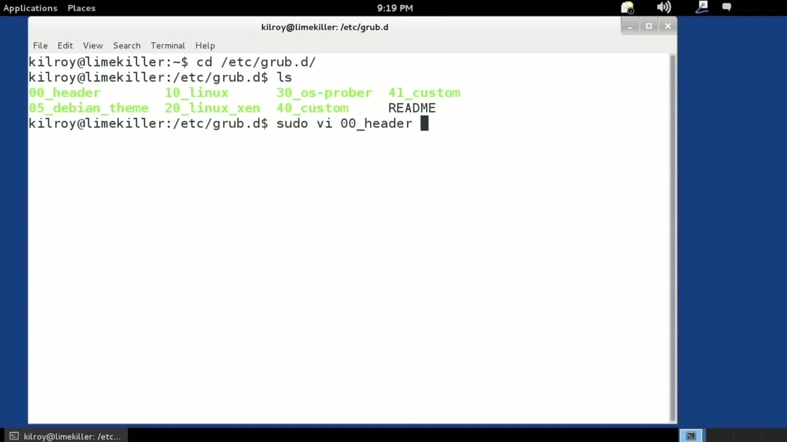
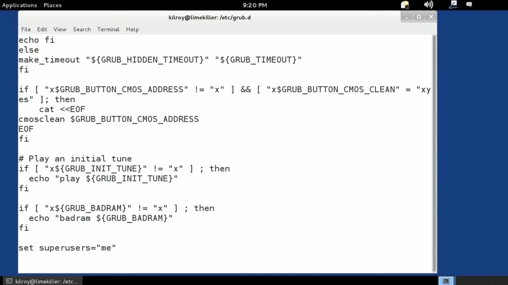
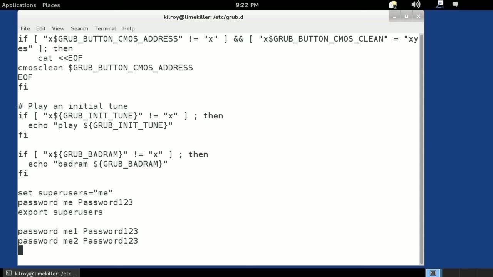

[← Course contents](../../02.md)

# 11. Protecting The Boot Manager

**Course:** [Linux Security & Administration From Boot Process to Firewalls](https://www.youtube.com/watch?v=_WB3evmgxYA)  
**Transcript:** [`Linux Security & Administration From Boot Process to Firewalls transcript`](../../../../course_videos/Linux%20Security%20%26%20Administration%20From%20Boot%20Process%20to%20Firewalls/Linux%20Security%20%26%20Administration%20From%20Boot%20Process%20to%20Firewalls.txt)  
**Video:** 00:37:11–00:41:13 ([open at this time](https://www.youtube.com/watch?v=_WB3evmgxYA&t=2231s))

## Introduction

In addition to using BIOS passwords, you can also set a password on the bootloader. Now, as we've mentioned before, the bootloader that you're probably going to be using is GRUB. And so let's talk about setting some passwords on GRUB. So the first thing I want to do, first of all, let me zoom in a little bit so you can see this a little bit better.

## Detailed Explanation

<details>
  <summary>Step 1 — Run `nano`, `vi`</summary>

### Step 1 — Run `nano`, `vi`

- [x] **In addition to using BIOS passwords, you can also set a password on**
  - In addition to using BIOS passwords, you can also set a password on the bootloader.
  - Now, as we've mentioned before, the bootloader that you're probably going to be using is GRUB.
  - And so let's talk about setting some passwords on GRUB.

- [x] **So the first thing I want to do, first of all, let me zoom in a**
  - So the first thing I want to do, first of all, let me zoom in a little bit so you can see this a little bit better.
  - And that's where all of the different configuration files that get pulled together.
  - To create the final GRUB configuration that is used to load the bootstrap program.

- [x] **And that's used to boot the operating system**
  - And that's used to boot the operating system.
  - I need to be a super user or a root user in order to give me temporary administrative privileges.
  - So I'm going to edit, and I happen to like the `vi` editor.

- [x] **Use `nano`, `vi`**
  - I've been using it for decades now, so it's fairly comfortable for me.
  - Feel free to use `nano` or G-Edit or whatever you feel like using.
  - So I'm going to use `vi` here.

- [x] **And first thing I'm going to do is skip to the bottom of the file**
  - And first thing I'm going to do is skip to the bottom of the file.
  - And then I'm going to add a couple of lines.
  - So I'm going to say set super users equals and let's just say the username is me.

```bash
nano
vi
```





</details>

<details>
  <summary>Step 2 — Run `bash`</summary>

### Step 2 — Run `bash`

- [x] **Use `bash`**
  - And you can see this is actually a `bash` script that we are looking at.
  - So this file here is used to create the final configuration, but this is really a script.
  - And so what I'm doing here is I'm setting a variable that I'm going to use in a little bit.

- [x] **And this is actually an environment variable**
  - And this is actually an environment variable.
  - And I'm going to say password me is, let's mix case it and pretend it's something a little bit more than it is.
  - This is just for demonstration purposes.

- [x] **If you were to set a password, obviously, you would be using a**
  - If you were to set a password, obviously, you would be using a stronger password, and ideally you wouldn't be using a clear text password here.

```bash
bash
```



</details>

<details>
  <summary>Step 3 — Run `update-grub`</summary>

### Step 3 — Run `update-grub`

- [x] **We'll fix the clear text in a subsequent lesson, but for now, we're**
  - We'll fix the clear text in a subsequent lesson, but for now, we're just going to set a super user, and the super user is going to be allowed to edit the configuration menu when the system boots up.
  - They're going to be allowed to boot any operating system that the bootloader specifies.
  - And here we're going to actually export the environment variable super users that we had just created.

- [x] **Use `update-grub`**
  - So if I were to have other users, what I could do would be to...
  - Set passwords and here I could say password me one password me two and the reason I'm adding additional users here is I may want to authorize only specific users to be able to boot specific operating systems out of the boot menu and the super users can, as I said, boot anything and also do editing of the GRUB menu while the system is booting.
  - So I've got multiple users now, and in this case, I'm going to save this out, and then all I would need to do would be to run `update-grub`, and that's going to read all of these configuration files, and then it's going to pull together a complete GRUB configuration.

- [x] **Use `update-grub`**
  - In this case, I'm going to edit the header file, which is where I'm going to set users up.
  - And then once I have added the configuration lines for the users, all I have to do is run `update-grub` that's going to update the configuration for me automatically.

```bash
update-grub
```



</details>

<details>
  <summary>Questions and Answers</summary>

## Questions and Answers

### Question 1: What does `nano` do in this chapter?

<details>
<summary>Answer</summary>

- [x] Feel free to use `nano` or G-Edit or whatever you feel like using.

</details>

### Question 2: What does `vi` do in this chapter?

<details>
<summary>Answer</summary>

- [x] So I'm going to use `vi` here.

</details>

### Question 3: What does `bash` do in this chapter?

<details>
<summary>Answer</summary>

- [x] And you can see this is actually a `bash` script that we are looking at.

</details>

### Question 4: What does `update-grub` do in this chapter?

<details>
<summary>Answer</summary>

- [x] So I've got multiple users now, and in this case, I'm going to save this out, and then all I would need to do would be to run `update-grub`, and that's going to read all of these configuration files, and then it's going to pull together a complete GRUB configuration.

</details>

### Question 5: What does step 1 cover (Run nano, vi)?

<details>
<summary>Answer</summary>

- [x] In addition to using BIOS passwords, you can also set a password on the bootloader.
- [x] Now, as we've mentioned before, the bootloader that you're probably going to be using is GRUB.
- [x] And so let's talk about setting some passwords on GRUB.

</details>

### Question 6: What does step 2 cover (Run bash)?

<details>
<summary>Answer</summary>

- [x] And you can see this is actually a `bash` script that we are looking at.
- [x] So this file here is used to create the final configuration, but this is really a script.
- [x] And so what I'm doing here is I'm setting a variable that I'm going to use in a little bit.

</details>

### Question 7: What does step 3 cover (Run update-grub)?

<details>
<summary>Answer</summary>

- [x] We'll fix the clear text in a subsequent lesson, but for now, we're just going to set a super user, and the super user is going to be allowed to edit the configuration menu when the system boots up.
- [x] They're going to be allowed to boot any operating system that the bootloader specifies.
- [x] And here we're going to actually export the environment variable super users that we had just created.

</details>

</details>

## Summary

This chapter, Protecting The Boot Manager, walks through Run nano, vi; Run bash; Run update-grub. Commands from the transcript: `nano`, `vi`, `bash`, `update-grub`.

## References

- [Linux Security & Administration From Boot Process to Firewalls (YouTube)](https://www.youtube.com/watch?v=_WB3evmgxYA)
- [This chapter at 00:37:11](https://www.youtube.com/watch?v=_WB3evmgxYA&t=2231s)
- [Local transcript](../../../../course_videos/Linux%20Security%20%26%20Administration%20From%20Boot%20Process%20to%20Firewalls/Linux%20Security%20%26%20Administration%20From%20Boot%20Process%20to%20Firewalls.txt)
