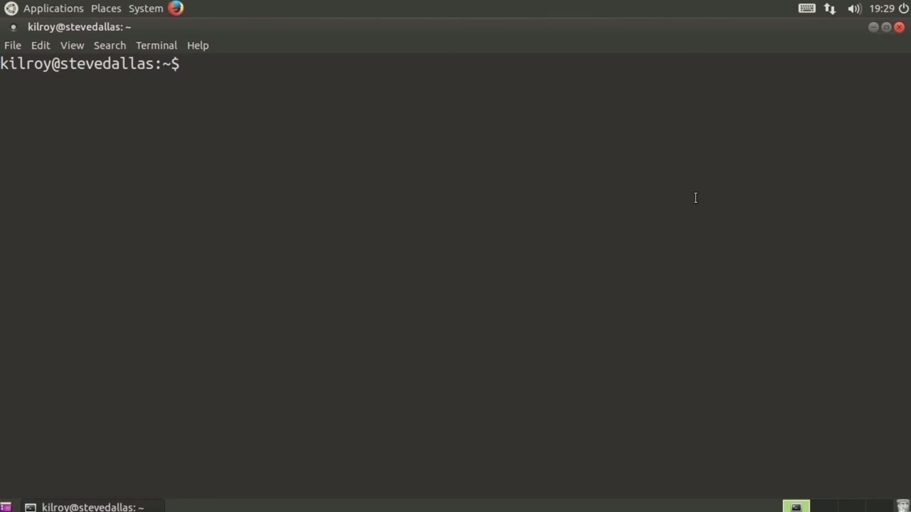
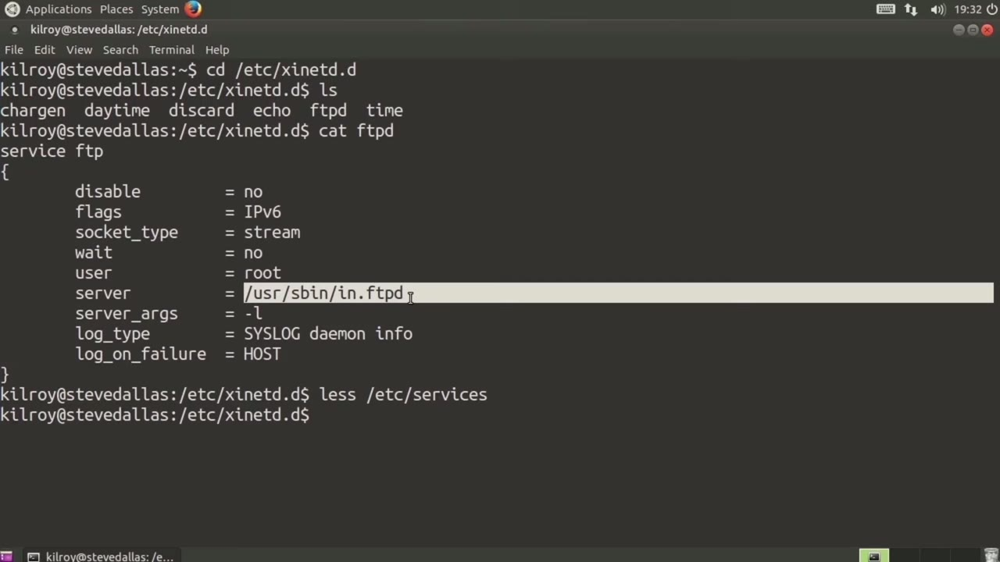
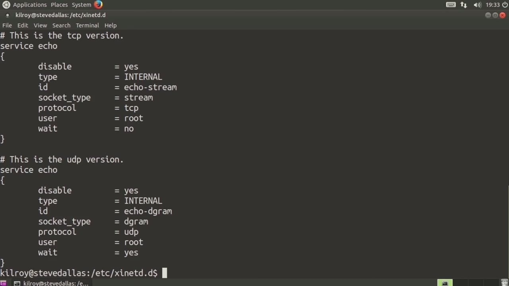

[← Course contents](../../02.md)

# 12. xinetd

**Course:** [Linux Security & Administration From Boot Process to Firewalls](https://www.youtube.com/watch?v=_WB3evmgxYA)  
**Transcript:** [`Linux Security & Administration From Boot Process to Firewalls transcript`](../../../../course_videos/Linux%20Security%20%26%20Administration%20From%20Boot%20Process%20to%20Firewalls/Linux%20Security%20%26%20Administration%20From%20Boot%20Process%20to%20Firewalls.txt)  
**Video:** 00:41:13–00:45:27 ([open at this time](https://www.youtube.com/watch?v=_WB3evmgxYA&t=2473s))

## Introduction

One way to have network services on a Linux system is to make use of the Internet Super Server. Now the Internet Super Server is actually a process called inatd or more recently it's a process called X-I-Net-D. And that is the more recent version of the Internet Super Server. Now we've got a directory on here because I've got x-i-n-d installed on this installation of Linux.

## Detailed Explanation

  
Step 1 — One way to have network services on a Linux system is to make use of

### Step 1 — One way to have network services on a Linux system is to make use of

- [x] **One way to have network services on a Linux system is to make use of**
  - One way to have network services on a Linux system is to make use of the Internet Super Server.
  - Now the Internet Super Server is actually a process called inatd or more recently it's a process called X-I-Net-D.
  - And that is the more recent version of the Internet Super Server.

- [x] **Now we've got a directory on here because I've got x-i-n-d installed**
  - Now we've got a directory on here because I've got x-i-n-d installed on this installation of Linux.
  - And x-i-n-d is controlled by a number of...
  - service configuration files. So we've got a character generator which is car gen or charge n, we've got daytime, we've got discard echo time, and ftpd.

- [x] **So some versions of ftpd have actually been developed in order to run**
  - So some versions of ftpd have actually been developed in order to run out of the internet super server or XinetD. So let's just take a look here at ftpd the configuration file.
  - For XinetD, we have a configuration file that says service and then gives the service name.
  - What that does is it tells the internet super server the actual port number that is going to be listening.

- [x] **And the way it knows that is actually from a file called /etc/Services**
  - And the way it knows that is actually from a file called /etc/Services.
  - So we can look at /etc/Services and if I go to FTP, It tells me that the port here is Port 21 and the protocol is TCP.
  - So now I know that I'm going to be listening on Port 21.

- [x] **XinNetD knows that that is a port that it is going to be listening on**
  - XinNetD knows that that is a port that it is going to be listening on.
  - It's going to be a stream socket, which means it's going to be TCP.

  
Step 2 — No weight. The user is going to be root

### Step 2 — No weight. The user is going to be root

- [x] **No weight. The user is going to be root**
  - No weight. The user is going to be root.
  - And then right here is the server and that tells X-inet-D which process to actually launch. So we're going to use this log as our log type and we're going to put them into those facilities and in case the program or the Demon program needs to have arguments, you can provide them here. In this case we're going to pass in minus
  - L to in dot ftpd. I can show you the configuration file.

- [x] **Now, what this does is it just gives some basics here**
  - Now, what this does is it just gives some basics here.
  - For example, I might set a log type as my default.
  - And then what it says is it includes all of the other configuration files in the directory that we were just in.

- [x] **Let's just take a look at the Echo server, for example**
  - Let's just take a look at the Echo server, for example.

  
Step 3 — This is something that's sometimes called a simple TCP service

### Step 3 — This is something that's sometimes called a simple TCP service

- [x] **This is something that's sometimes called a simple TCP service**
  - This is something that's sometimes called a simple TCP service.
  - If you've got the port open, you're actually going to just get a response back that is exactly what you send.
  - If you send something to an echo service, you're going to get the same thing back.

- [x] **Again, we've got the service, so I can take a look at services and**
  - Again, we've got the service, so I can take a look at services and then look for Echo.
  - And Echo is going to be on Port 7, both TCP and UDP in this case.
  - The services file is what is used to determine the actual service port that's going to be listened to with x-i-n-d, and then the rest of the configuration just tells x-i-n-d how to actually handle any connection that comes in on that particular port. So the reason it's called a super

- [x] **That actually manages a number of applications that sit behind it**
  - That actually manages a number of applications that sit behind it.
  - So we've got the Echo Service, for example, we've got the FTP service.
  - It is one program that actually manages all of the listening and communication and passes those communications off to the service program.

- [x] **In the case of FTP, for example, it would be this user sbin in dot**
  - In the case of FTP, for example, it would be this user sbin in dot ftpd.

  
Questions and Answers

## Questions and Answers

### Question 1: What does step 1 cover (One way to have network services on a Linux system is to make use of)?

Answer

- [x] One way to have network services on a Linux system is to make use of the Internet Super Server.
- [x] Now the Internet Super Server is actually a process called inatd or more recently it's a process called X-I-Net-D.
- [x] And that is the more recent version of the Internet Super Server.

### Question 2: What does step 2 cover (No weight. The user is going to be root)?

Answer

- [x] No weight. The user is going to be root.
- [x] And then right here is the server and that tells X-inet-D which process to actually launch. So we're going to use this log as our log type and we're going to put them into those facilities and in case the program or the Demon program needs to have arguments, you can provide them here. In this case we're going to pass in minus
- [x] L to in dot ftpd. I can show you the configuration file.

### Question 3: What does step 3 cover (This is something that's sometimes called a simple TCP service)?

Answer

- [x] This is something that's sometimes called a simple TCP service.
- [x] If you've got the port open, you're actually going to just get a response back that is exactly what you send.
- [x] If you send something to an echo service, you're going to get the same thing back.

## Summary

This chapter, xinetd, walks through One way to have network services on a Linux system is to make use of; No weight. The user is going to be root; This is something that's sometimes called a simple TCP service.

## References

- [Linux Security & Administration From Boot Process to Firewalls (YouTube)](https://www.youtube.com/watch?v=_WB3evmgxYA)
- [This chapter at 00:41:13](https://www.youtube.com/watch?v=_WB3evmgxYA&t=2473s)
- [Local transcript](../../../../course_videos/Linux%20Security%20%26%20Administration%20From%20Boot%20Process%20to%20Firewalls/Linux%20Security%20%26%20Administration%20From%20Boot%20Process%20to%20Firewalls.txt)
