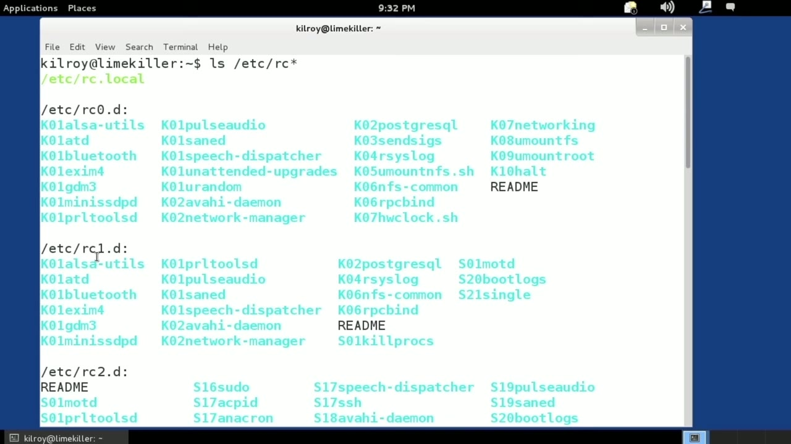
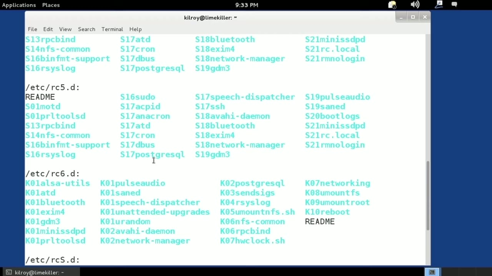
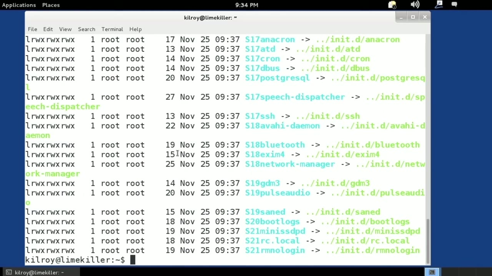
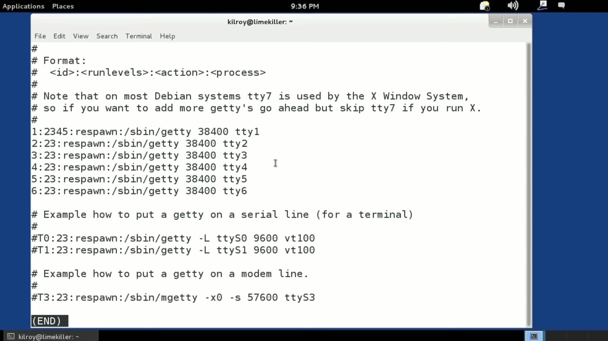

[← Course contents](../../02.md)

# 13. Runlevels

**Course:** [Linux Security & Administration From Boot Process to Firewalls](https://www.youtube.com/watch?v=_WB3evmgxYA)  
**Transcript:** [`Linux Security & Administration From Boot Process to Firewalls transcript`](../../../../course_videos/Linux%20Security%20%26%20Administration%20From%20Boot%20Process%20to%20Firewalls/Linux%20Security%20%26%20Administration%20From%20Boot%20Process%20to%20Firewalls.txt)  
**Video:** 00:45:27–00:50:00 ([open at this time](https://www.youtube.com/watch?v=_WB3evmgxYA&t=2727s))

## Introduction

In this lesson, we're going to be talking about run levels. Run levels are ways of grouping services together. You specify a particular way of booting so that you get specifically the services that you are looking for. So I'm going to take a look at the different run-level startup directories.

## Detailed Explanation

<details>
  <summary>Step 1 — Run `reboot`</summary>

### Step 1 — Run `reboot`

- [x] **In this lesson, we're going to be talking about run levels**
  - In this lesson, we're going to be talking about run levels.
  - Run levels are ways of grouping services together.
  - You specify a particular way of booting so that you get specifically the services that you are looking for.

- [x] **So I'm going to take a look at the different run-level startup**
  - So I'm going to take a look at the different run-level startup directories.
  - What we've got here is rc0 or run level zero is going to be stopping the operating system or shutting the machine down.
  - Run level one is going to be single user mode and we start adding additional services as we go up in run levels until we get all the way up to run level 5, which is a full graphical user interface plus networking and everything that you could possibly hope to want.

- [x] **Use `reboot`**
  - Now, rc6 you'll see there is actually `reboot`.
  - So you'll notice here in these different run levels that we've got S and we've got K.
  - So let me just pick a directory here and I'll show you at crc3.d for example.

- [x] **These are all links to startup scripts for services that are in the**
  - These are all links to startup scripts for services that are in the init.d directory, /etc init.d.
  - If you go all the way back here to run level zero, for example, you'll see that they are all K scripts.
  - And that's because rc0 or run level zero is when we're shutting the system down.

- [x] **They run in ascy order, meaning k-01 is going to run before k-0-9**
  - They run in ascy order, meaning k-01 is going to run before k-0-9, and k-0-9 is going to run before k-10.

```bash
reboot
```





</details>

<details>
  <summary>Step 2 — Run `less`</summary>

### Step 2 — Run `less`

- [x] **The order that they run in is actually influenced by the name**
  - The order that they run in is actually influenced by the name.
  - So how do we determine what run level we are in?
  - There's another file here that I want to show you.

- [x] **Use `less`**
  - And actually, let's use `less` here.
  - Init tab is a tab file, and tab files are generally tabular files.
  - What this really is is a configuration file for the Init system.

- [x] **Init is actually the very first program that is not the operating**
  - Init is actually the very first program that is not the operating system itself that runs.
  - You can see we have set the default run level.
  - Now, when Init starts up, it determines what actually gets started by run level.

- [x] **It is going to start everything in Etsyinit.d slash rc.3**
  - It is going to start everything in Etsyinit.d slash rc.3.
  - So it's going to start up everything there.
  - Now there are a number of other settings here for things to do.

- [x] **For example, when Control Alt, delete is pressed, and it needs to**
  - For example, when Control Alt, delete is pressed, and it needs to know about that because it's paying attention to all of those things.
  - Now it's all virtual terminals because I've got the console, of course, but in the case of a graphical interface, I've got a number of virtual terminals.

```bash
less
```



</details>

<details>
  <summary>Step 3 — for example, Right here I'm running on a virtual terminal</summary>

### Step 3 — for example, Right here I'm running on a virtual terminal

- [x] **So for example, Right here I'm running on a virtual terminal**
  - So for example, Right here I'm running on a virtual terminal.
  - And all of the physical terminals that the system likes to know about are all configured in this as well.
  - But the one thing that we're really concerned about is the run level that the system is set to.

- [x] **So again, run level zero is halt, run level one single user, two**
  - So again, run level zero is halt, run level one single user, two through five or a multi-user with different variations of settings.
  - So some of them have network, some of them don't have network.
  - Some of them have the graphical interface like 5 is networking plus graphical user interface plus multi-user.

- [x] **Run level 2 is simply multi-user. So you've got the different run**
  - Run level 2 is simply multi-user. So you've got the different run levels and this file here on many Linux distributions controls what run level you are actually going to boot up into. So that's /etc Init tab.
  - And again, all of the services that you are going to be looking at are all in here. These are the startup and kill scripts for all of the services that are installed on your Linux operating system.
  - And if you look into rc asterisk here, it's going to show you all of the different directories and all of the scripts that are starting up in each individual run level.



</details>

<details>
  <summary>Questions and Answers</summary>

## Questions and Answers

### Question 1: What does `reboot` do in this chapter?

<details>
<summary>Answer</summary>

- [x] Now, rc6 you'll see there is actually `reboot`.

</details>

### Question 2: What does `less` do in this chapter?

<details>
<summary>Answer</summary>

- [x] And actually, let's use `less` here.

</details>

### Question 3: What does step 1 cover (Run reboot)?

<details>
<summary>Answer</summary>

- [x] In this lesson, we're going to be talking about run levels.
- [x] Run levels are ways of grouping services together.
- [x] You specify a particular way of booting so that you get specifically the services that you are looking for.

</details>

### Question 4: What does step 2 cover (Run less)?

<details>
<summary>Answer</summary>

- [x] The order that they run in is actually influenced by the name.
- [x] So how do we determine what run level we are in?
- [x] There's another file here that I want to show you.

</details>

### Question 5: What does step 3 cover (for example, Right here I'm running on a virtual terminal)?

<details>
<summary>Answer</summary>

- [x] So for example, Right here I'm running on a virtual terminal.
- [x] And all of the physical terminals that the system likes to know about are all configured in this as well.
- [x] But the one thing that we're really concerned about is the run level that the system is set to.

</details>

</details>

## Summary

This chapter, Runlevels, walks through Run reboot; Run less; for example, Right here I'm running on a virtual terminal. Commands from the transcript: `reboot`, `less`.

## References

- [Linux Security & Administration From Boot Process to Firewalls (YouTube)](https://www.youtube.com/watch?v=_WB3evmgxYA)
- [This chapter at 00:45:27](https://www.youtube.com/watch?v=_WB3evmgxYA&t=2727s)
- [Local transcript](../../../../course_videos/Linux%20Security%20%26%20Administration%20From%20Boot%20Process%20to%20Firewalls/Linux%20Security%20%26%20Administration%20From%20Boot%20Process%20to%20Firewalls.txt)
