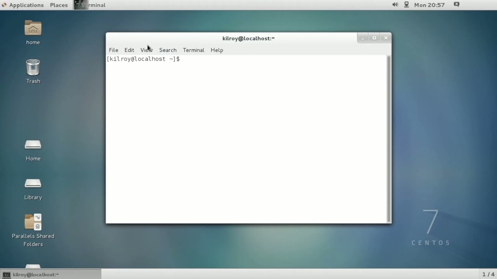
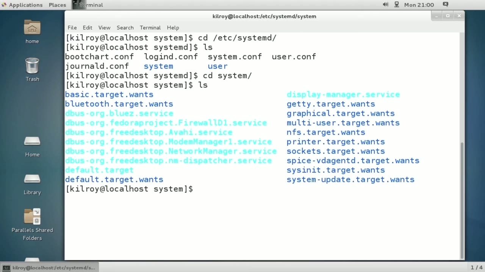
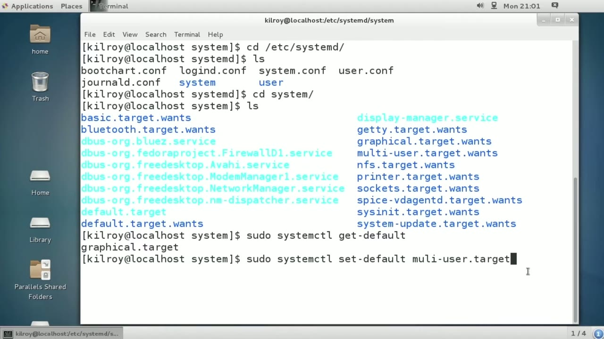

[← Course contents](../../02.md)

# 14. Setting Default Runlevels

**Course:** [Linux Security & Administration From Boot Process to Firewalls](https://www.youtube.com/watch?v=_WB3evmgxYA)  
**Transcript:** [`Linux Security & Administration From Boot Process to Firewalls transcript`](../../../../course_videos/Linux%20Security%20%26%20Administration%20From%20Boot%20Process%20to%20Firewalls/Linux%20Security%20%26%20Administration%20From%20Boot%20Process%20to%20Firewalls.txt)  
**Video:** 00:50:00–00:54:38 ([open at this time](https://www.youtube.com/watch?v=_WB3evmgxYA&t=3000s))

## Introduction

Red Hat 7 is one of the operating systems that is actually using a different way of starting the system up. And I'm actually in a Cento system here, which is binary identical to Red Hat Enterprise Linux. It's going to look exactly like a Red Hat Enterprise Linux system. I'm doing this to demonstrate one of the different ways of managing the system startup and services startup.

## Detailed Explanation

<details>
  <summary>Step 1 — Red Hat 7 is one of the operating systems that is actually using a</summary>

### Step 1 — Red Hat 7 is one of the operating systems that is actually using a

- [x] **Red Hat 7 is one of the operating systems that is actually using a**
  - Red Hat 7 is one of the operating systems that is actually using a different way of starting the system up.
  - And I'm actually in a Cento system here, which is binary identical to Red Hat Enterprise Linux.
  - It's going to look exactly like a Red Hat Enterprise Linux system.

- [x] **I'm doing this to demonstrate one of the different ways of managing**
  - I'm doing this to demonstrate one of the different ways of managing the system startup and services startup.
  - With Red Hat Enterprise Linux, rather than the old In-It system, Red Hat is now using a different system called System D.
  - System D manages run levels differently, it manages services differently.

- [x] **Lots of things change under System D as compared to Init**
  - Lots of things change under System D as compared to Init.
  - The directory where all of the files are is in /etc System D.
  - And if I were to go into System, you could see some more of the configuration settings here.

- [x] **What we've got rather than run level 0, 1, 2, 3, 4, 5, 6, with System**
  - What we've got rather than run level 0, 1, 2, 3, 4, 5, 6, with System D, we have targets instead.
  - So you'll see, for example, graphical target.
  - And you'll see multi-user target, and you'll see the nfs target.

- [x] **All of those targets, they are equivalent to different run levels**
  - All of those targets, they are equivalent to different run levels.
  - So the graphical target, for example, is equivalent to run level five.



</details>

<details>
  <summary>Step 2 — Run `systemctl`, `sudo systemctl isolate`</summary>

### Step 2 — Run `systemctl`, `sudo systemctl isolate`

- [x] **Use `systemctl`**
  - The multi-user target is equivalent to run level three.
  - Rather than just setting the run level using in it, what we're going to do is use the command `systemctl`.
  - So I could run `systemctl`.

- [x] **And this is going to tell me the default run level for this**
  - And this is going to tell me the default run level for this particular system.
  - In this case, the default is the graphical target.
  - Not surprising, I'm in the graphical user interface.

- [x] **Use `sudo systemctl isolate`**
  - I can change the target similar to what we did under Init.
  - I could do `sudo `systemctl` isolate` graphical.
  - Now, this is going to switch me over to the graphical target where I already am.

- [x] **Use `systemctl`**
  - And I'll show you switching over to the multi-user target in a second, but since it's going to boot me out of the graphical interface, let me just show you one other thing first.
  - I can do `systemctl` set default, and then I could say multi-user dot target.
  - And that would actually set the default to be the multi-user target.

```bash
systemctl
sudo systemctl isolate
```



</details>

<details>
  <summary>Step 3 — Run `reboot`, `systemctl isolate`, `systemctl`</summary>

### Step 3 — Run `reboot`, `systemctl isolate`, `systemctl`

- [x] **Use `reboot`, `systemctl isolate`**
  - So whenever I boot it up, so if I were to `reboot`, it would bring me into the multi-user, and if I were to type multi-user correctly, it would help.
  - So multi-user target, and let me just show you what the multi-user target looks like.
  - It's going to boot me out here of the graphical user interface, and let me just show you what it looks like to change using `systemctl isolate`.

- [x] **Use `systemctl`**
  - So you're going to see the screen change here when this actually runs.
  - And we are dropping back to just a plain console interface.
  - So I can still run `systemctl` and get default.

- [x] **Use `systemctl`**
  - And you will see that the default has remained the same graphical target.
  - So this is how I would change the run level.
  - Rather than running in it, I would run `systemctl`.

- [x] **Use `init 3`**
  - And it's going to switch the run level, just as running `init 3` did.
  - I would be running isolate graphical dot target for run level 5, multi-user target for run level 3.
  - If I wanted to switch to single user mode, I could do the target for single user mode. You've got a different way of managing run levels under System D as we did under Init and of course the service management changes as well.

- [x] **Use `systemctl`**
  - The way of getting the list of services we're going to use `systemctl` for that.
  - So run levels are still run levels but rather than calling them run levels we call them targets under the System D setup that manages the boot and service startup of a Linux system, specifically the Red Hat distributions like Red Hat Enterprise Linux and Fedora Core.

```bash
reboot
systemctl isolate
systemctl
init 3
```



</details>

<details>
  <summary>Questions and Answers</summary>

## Questions and Answers

### Question 1: What does `systemctl` do in this chapter?

<details>
<summary>Answer</summary>

- [x] Rather than just setting the run level using in it, what we're going to do is use the command `systemctl`.

</details>

### Question 2: What does `sudo systemctl isolate` do in this chapter?

<details>
<summary>Answer</summary>

- [x] I could do `sudo systemctl isolate` graphical.

</details>

### Question 3: What does `reboot` do in this chapter?

<details>
<summary>Answer</summary>

- [x] So whenever I boot it up, so if I were to `reboot`, it would bring me into the multi-user, and if I were to type multi-user correctly, it would help.

</details>

### Question 4: What does `systemctl isolate` do in this chapter?

<details>
<summary>Answer</summary>

- [x] It's going to boot me out here of the graphical user interface, and let me just show you what it looks like to change using `systemctl isolate`.

</details>

### Question 5: What does `init 3` do in this chapter?

<details>
<summary>Answer</summary>

- [x] And it's going to switch the run level, just as running `init 3` did.

</details>

### Question 6: What does step 1 cover (Red Hat 7 is one of the operating systems that is actually using a)?

<details>
<summary>Answer</summary>

- [x] Red Hat 7 is one of the operating systems that is actually using a different way of starting the system up.
- [x] And I'm actually in a Cento system here, which is binary identical to Red Hat Enterprise Linux.
- [x] It's going to look exactly like a Red Hat Enterprise Linux system.

</details>

### Question 7: What does step 2 cover (Run systemctl, sudo systemctl isolate)?

<details>
<summary>Answer</summary>

- [x] The multi-user target is equivalent to run level three.
- [x] Rather than just setting the run level using in it, what we're going to do is use the command `systemctl`.
- [x] So I could run `systemctl`.

</details>

### Question 8: What does step 3 cover (Run reboot, systemctl isolate, systemctl)?

<details>
<summary>Answer</summary>

- [x] So whenever I boot it up, so if I were to `reboot`, it would bring me into the multi-user, and if I were to type multi-user correctly, it would help.
- [x] So multi-user target, and let me just show you what the multi-user target looks like.
- [x] It's going to boot me out here of the graphical user interface, and let me just show you what it looks like to change using `systemctl isolate`.

</details>

</details>

## Summary

This chapter, Setting Default Runlevels, walks through Red Hat 7 is one of the operating systems that is actually using a; Run systemctl, sudo systemctl isolate; Run reboot, systemctl isolate, systemctl. Commands from the transcript: `systemctl`, `sudo systemctl isolate`, `reboot`, `systemctl isolate`, `init 3`.

## References

- [Linux Security & Administration From Boot Process to Firewalls (YouTube)](https://www.youtube.com/watch?v=_WB3evmgxYA)
- [This chapter at 00:50:00](https://www.youtube.com/watch?v=_WB3evmgxYA&t=3000s)
- [Local transcript](../../../../course_videos/Linux%20Security%20%26%20Administration%20From%20Boot%20Process%20to%20Firewalls/Linux%20Security%20%26%20Administration%20From%20Boot%20Process%20to%20Firewalls.txt)
