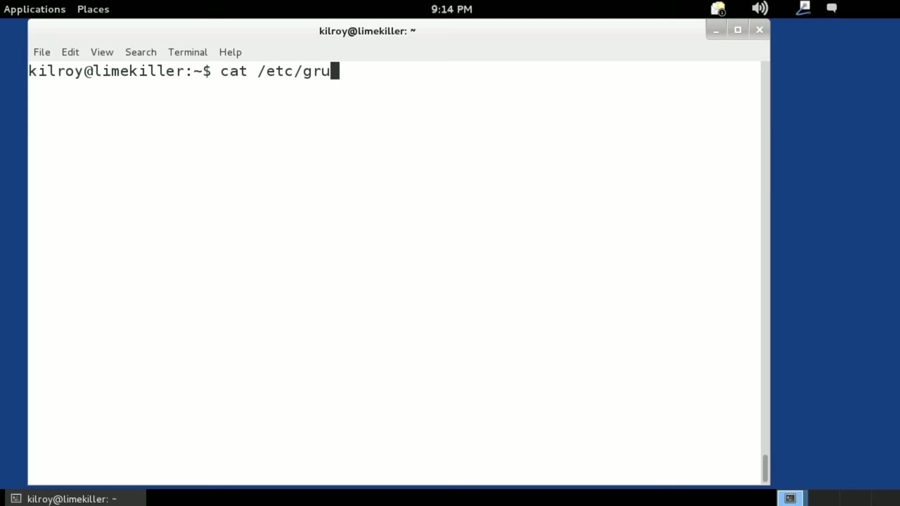
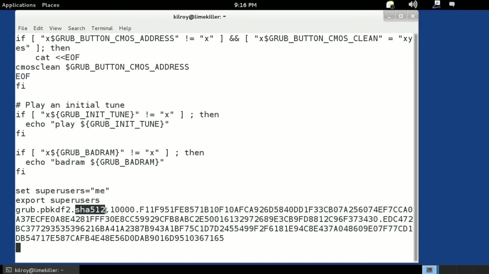
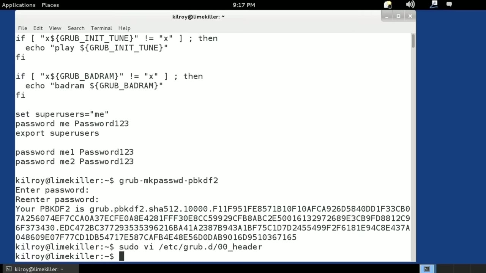

[← Course contents](../../02.md)

# 15. GRUB2

**Course:** [Linux Security & Administration From Boot Process to Firewalls](https://www.youtube.com/watch?v=_WB3evmgxYA)  
**Transcript:** [`Linux Security & Administration From Boot Process to Firewalls transcript`](../../../../course_videos/Linux%20Security%20%26%20Administration%20From%20Boot%20Process%20to%20Firewalls/Linux%20Security%20%26%20Administration%20From%20Boot%20Process%20to%20Firewalls.txt)  
**Video:** 00:54:38–00:57:51 ([open at this time](https://www.youtube.com/watch?v=_WB3evmgxYA&t=3278s))

## Introduction

Now we've talked about setting passwords on GRUB and let's just take a look again at what we did in the password setting. We've got a super user and we've got a password set on that. Now the problem there is that that password is in clear text, meaning that anybody can read it if they can get access to this file. You never know when somebody is actually going to get access to this that shouldn't have it. That's really something that we should avoid at all cost.

## Detailed Explanation

<details>
  <summary>Step 1 — we've talked about setting passwords on GRUB and let's just take a look</summary>

### Step 1 — we've talked about setting passwords on GRUB and let's just take a look

- [x] **Now we've talked about setting passwords on GRUB and let's just take**
  - Now we've talked about setting passwords on GRUB and let's just take a look again at what we did in the password setting. We've got a super user and we've got a password set on that.
  - Now the problem there is that that password is in clear text, meaning that anybody can read it if they can get access to this file.
  - You never know when somebody is actually going to get access to this that shouldn't have it.

- [x] **That's really something that we should avoid at all cost**
  - That's really something that we should avoid at all cost.
  - Let's take a look at this little utility here.
  - And what this is going to do is it's going to ask me for a password and I'm just going to put in a password here and what it's going to do is it's going to generate a string here that we can use in our file so I'm just going to copy this if I right click there I can copy the text and then what I can do

- [x] **The file that we were just looking at where we had set the password**
  - The file that we were just looking at where we had set the password, and I can go down to the bottom, and I'm going to delete this password here, and I'm going to insert the string that we've created.



</details>

<details>
  <summary>Step 2 — You can see the hashing algorithm that is used here is the secure hash</summary>

### Step 2 — You can see the hashing algorithm that is used here is the secure hash

- [x] **You can see the hashing algorithm that is used here is the secure**
  - You can see the hashing algorithm that is used here is the secure hash algorithm, and that's going to be 512 bit.
  - We've got a really large hash space that we are using for this hashed password.
  - Now, if anybody gets a look at this, all they can see is the hash.

- [x] **It's going to be very, very difficult for anybody to try to reverse**
  - It's going to be very, very difficult for anybody to try to reverse and get that hash.
  - Of course, they can run brute force attacks on it.
  - There are some other things they can do.

- [x] **But certainly, this is going to protect against casual and even**
  - But certainly, this is going to protect against casual and even semi-dedicated attackers.



</details>

<details>
  <summary>Step 3 — Run `update-grub`</summary>

### Step 3 — Run `update-grub`

- [x] **Use `update-grub`**
  - Again, all I've got to do is run the `update-grub` command, and I'm going to update the configuration file.
  - It's going to have that encrypted password in there.
  - Now, one thing to keep in mind here is it's helpful to have another user that you can actually get into the configuration with or get into the system with.

- [x] **So it would be nice to have a second super user that has maybe a**
  - So it would be nice to have a second super user that has maybe a non-hash password.
  - The reason for that is until you've tested it and made sure that the password you used worked, it's entirely possible. It's not likely, but it's entirely possible.
  - You may have done a fat finger on the password twice or may not have typed it quite as you thought you did.

- [x] **So it's just safer to have a second super user that doesn't have the**
  - So it's just safer to have a second super user that doesn't have the hash password until you have tested the password that you have got here.
  - Make sure that it works and then of course you can go and fix all of the other users to have hashed passwords as well we're going to talk about a different bootloader now i've got the bootloader

```bash
update-grub
```



</details>

<details>
  <summary>Questions and Answers</summary>

## Questions and Answers

### Question 1: What does `update-grub` do in this chapter?

<details>
<summary>Answer</summary>

- [x] Again, all I've got to do is run the `update-grub` command, and I'm going to update the configuration file.

</details>

### Question 2: What does step 1 cover (we've talked about setting passwords on GRUB and let's just take a look)?

<details>
<summary>Answer</summary>

- [x] Now we've talked about setting passwords on GRUB and let's just take a look again at what we did in the password setting. We've got a super user and we've got a password set on that.
- [x] Now the problem there is that that password is in clear text, meaning that anybody can read it if they can get access to this file.
- [x] You never know when somebody is actually going to get access to this that shouldn't have it.

</details>

### Question 3: What does step 2 cover (You can see the hashing algorithm that is used here is the secure hash)?

<details>
<summary>Answer</summary>

- [x] You can see the hashing algorithm that is used here is the secure hash algorithm, and that's going to be 512 bit.
- [x] We've got a really large hash space that we are using for this hashed password.
- [x] Now, if anybody gets a look at this, all they can see is the hash.

</details>

### Question 4: What does step 3 cover (Run update-grub)?

<details>
<summary>Answer</summary>

- [x] Again, all I've got to do is run the `update-grub` command, and I'm going to update the configuration file.
- [x] It's going to have that encrypted password in there.
- [x] Now, one thing to keep in mind here is it's helpful to have another user that you can actually get into the configuration with or get into the system with.

</details>

</details>

## Summary

This chapter, GRUB2, walks through we've talked about setting passwords on GRUB and let's just take a look; You can see the hashing algorithm that is used here is the secure hash; Run update-grub. Commands from the transcript: `update-grub`.

## References

- [Linux Security & Administration From Boot Process to Firewalls (YouTube)](https://www.youtube.com/watch?v=_WB3evmgxYA)
- [This chapter at 00:54:38](https://www.youtube.com/watch?v=_WB3evmgxYA&t=3278s)
- [Local transcript](../../../../course_videos/Linux%20Security%20%26%20Administration%20From%20Boot%20Process%20to%20Firewalls/Linux%20Security%20%26%20Administration%20From%20Boot%20Process%20to%20Firewalls.txt)
