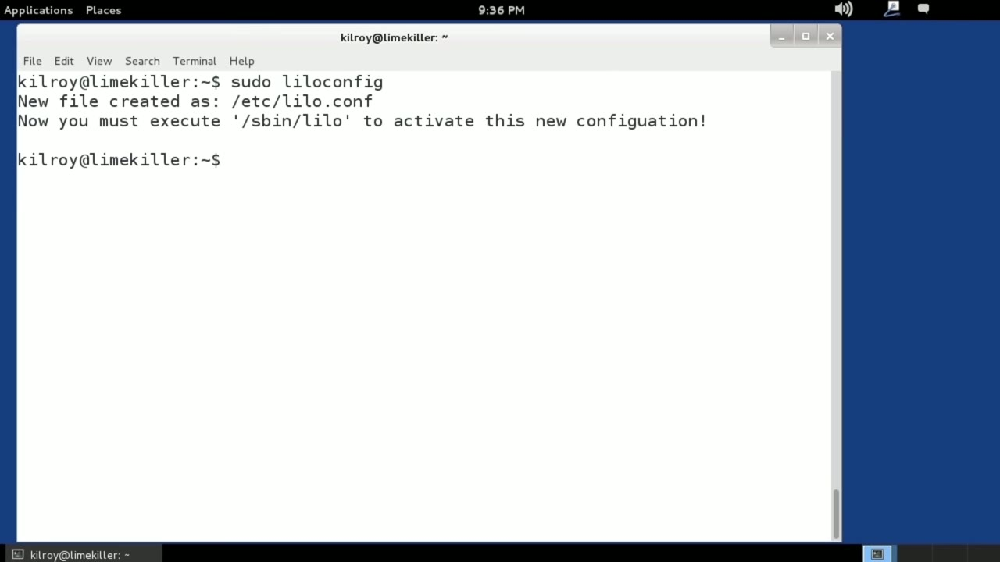
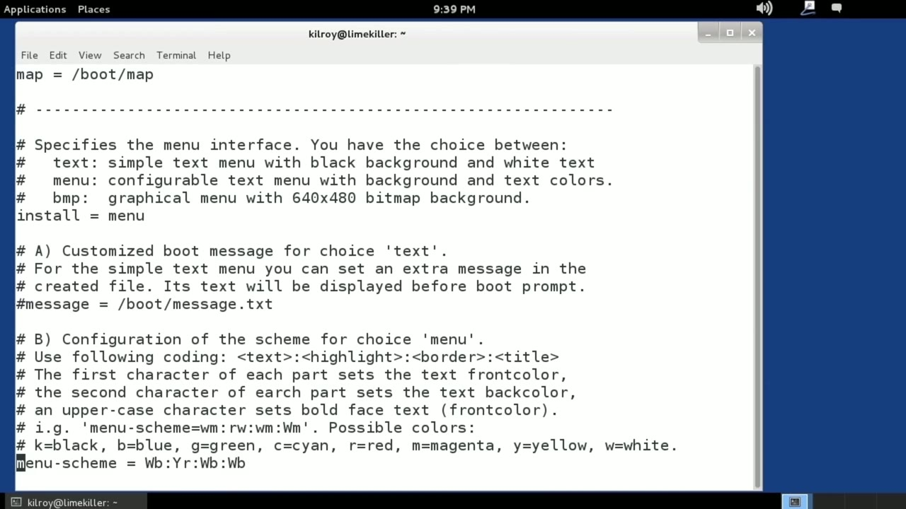
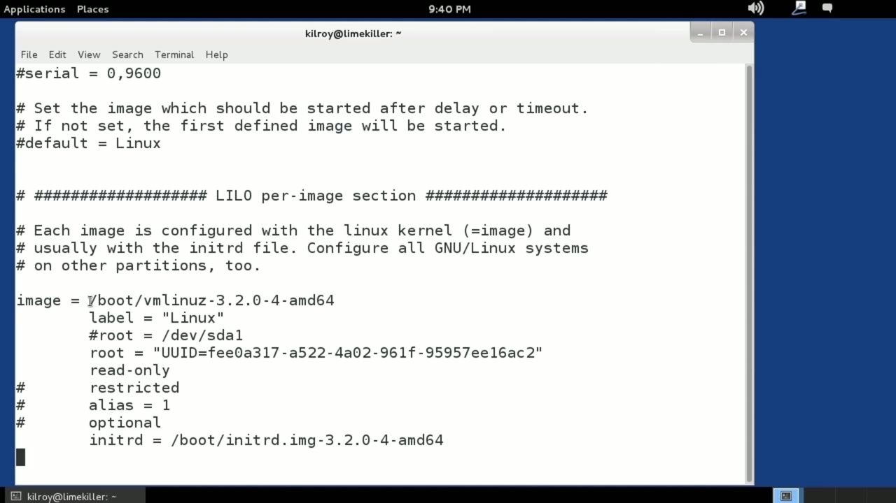

[← Course contents](../../02.md)

# 16. LILO

**Course:** [Linux Security & Administration From Boot Process to Firewalls](https://www.youtube.com/watch?v=_WB3evmgxYA)  
**Transcript:** [`Linux Security & Administration From Boot Process to Firewalls transcript`](../../../../course_videos/Linux%20Security%20%26%20Administration%20From%20Boot%20Process%20to%20Firewalls/Linux%20Security%20%26%20Administration%20From%20Boot%20Process%20to%20Firewalls.txt)  
**Video:** 00:57:51–01:02:41 ([open at this time](https://www.youtube.com/watch?v=_WB3evmgxYA&t=3471s))

## Introduction

LILO installed here and the first thing i need to do is run LILO config LILO config is going to generate a basic LILO configuration file for me and in order to get that configuration and install LILO as the bootloader into the master boot record, I would have to run LILO. But let's take a look at the LILO configuration file that we've got here. LILO.conf. LILO is a bit of an older boot manager, and it's a little bit less configurable than GRUB is, and it's certainly not as dynamic as GRUB is. One thing about LILO is, if I change the configuration, I need to run LILO again, where GRUB if I change a configuration, it gets picked up automatically,

## Detailed Explanation

  
Step 1 — LILO installed here and the first thing i need to do is run LILO config

### Step 1 — LILO installed here and the first thing i need to do is run LILO config

- [x] **LILO installed here and the first thing i need to do is run LILO**
  - LILO installed here and the first thing i need to do is run LILO config LILO config is going to generate a basic LILO configuration file for me and in order to get that configuration and install LILO as the bootloader into the master boot record, I would have to run LILO.
  - But let's take a look at the LILO configuration file that we've got here.
  - LILO.conf. LILO is a bit of an older boot manager, and it's a little bit less configurable than GRUB is, and it's certainly not as dynamic as GRUB is. One thing about LILO is, if I change the configuration, I need to run LILO again, where GRUB if I change a configuration, it gets picked up automatically,

- [x] **And I don't actually have to reinstall the bootloader in order to get**
  - And I don't actually have to reinstall the bootloader in order to get the configuration updated and loading correctly.
  - So this is a bit of an older bootloader, and so you'll see some settings here that we don't worry about so much anymore, but for a while definitely were a problem.
  - Logical block addressing or lba and we had to kind of force the use of logical block addressing.

- [x] **And you can see there's also a setting for large memory**
  - And you can see there's also a setting for large memory.
  - With LILO, I specify a boot. This is actually the boot device.
  - So this is the drive where all of the bits and pieces that we need are going to be located.

- [x] **In this case, we are using a disk identifier rather than something**
  - In this case, we are using a disk identifier rather than something like sda, which would be the first SCSI device on the system.
  - So lots of settings here, and you can see there are details around what all of the different settings are.
  - In this case, we set the boot map, and then we are going to use...

- [x] **We can use a configurable menu with different background colors**
  - We can use a configurable menu with different background colors.
  - And of course, there's a graphical menu as well.

  
Step 2 — In this case, we're going to use just a basic text menu that has text

### Step 2 — In this case, we're going to use just a basic text menu that has text

- [x] **In this case, we're going to use just a basic text menu that has text**
  - In this case, we're going to use just a basic text menu that has text colors and some different color schemes that we can use.
  - So here's where we set the color scheme.
  - We will eventually get to the point where we are configuring the boot that we actually want to do.

- [x] **We've got image equals /boot slash VM Linus -3.2.0-4 -amd 64**
  - We've got image equals /boot slash VM Linus -3.2.0-4 -amd 64.
  - The Linus here, the Z right here, indicates that this is a compressed kernel.
  - This means that it has to be decompressed before it runs.

- [x] **The very first thing that happens after the kernel has been loaded**
  - The very first thing that happens after the kernel has been loaded into memory is it has to get decompressed.

  
Step 3 — we've got the kernel image and remember we specified the disk that this

### Step 3 — we've got the kernel image and remember we specified the disk that this

- [x] **So we've got the kernel image and remember we specified the disk that**
  - So we've got the kernel image and remember we specified the disk that this could be located on earlier.
  - So we know the disc, we know that it's in the boot directory, and then after that is the file name.
  - Underneath that, of course, we specify a label. This is what gets set in the menu.

- [x] **We've got our root device, which is a UUID device, and then we've got**
  - We've got our root device, which is a UUID device, and then we've got the initial RAM disk, and it specifies the file name for the initial RAM disk.
  - So this is what was generated by LILO config.
  - It determined the correct boot image that we are going to be using.

- [x] **And of course, it also detected the correct device that we are going**
  - And of course, it also detected the correct device that we are going to be booting from.
  - The initial RAM disk as well. So as I said earlier, if I want to actually install LILO and use LILO rather than GRUB, all I would have to do would be to run LILO, it would go read the configuration file, and then install LILO in place of GRUB in the Master Boot
  - Record. I'm not going to do that here. I do generally prefer GRUB at this point. There was a time a better bootloader, but GRUB is just more configurable.

- [x] **Everybody, of course, is going to have their preferences**
  - Everybody, of course, is going to have their preferences.
  - GRUB is the default in most Linux instances, but LILO is certainly available, if that's something that you felt like you wanted to do in place of GRUB.

  
Questions and Answers

## Questions and Answers

### Question 1: What does step 1 cover (LILO installed here and the first thing i need to do is run LILO config)?

Answer

- [x] LILO installed here and the first thing i need to do is run LILO config LILO config is going to generate a basic LILO configuration file for me and in order to get that configuration and install LILO as the bootloader into the master boot record, I would have to run LILO.
- [x] But let's take a look at the LILO configuration file that we've got here.
- [x] LILO.conf. LILO is a bit of an older boot manager, and it's a little bit less configurable than GRUB is, and it's certainly not as dynamic as GRUB is. One thing about LILO is, if I change the configuration, I need to run LILO again, where GRUB if I change a configuration, it gets picked up automatically,

### Question 2: What does step 2 cover (In this case, we're going to use just a basic text menu that has text)?

Answer

- [x] In this case, we're going to use just a basic text menu that has text colors and some different color schemes that we can use.
- [x] So here's where we set the color scheme.
- [x] We will eventually get to the point where we are configuring the boot that we actually want to do.

### Question 3: What does step 3 cover (we've got the kernel image and remember we specified the disk that this)?

Answer

- [x] So we've got the kernel image and remember we specified the disk that this could be located on earlier.
- [x] So we know the disc, we know that it's in the boot directory, and then after that is the file name.
- [x] Underneath that, of course, we specify a label. This is what gets set in the menu.

## Summary

This chapter, LILO, walks through LILO installed here and the first thing i need to do is run LILO config; In this case, we're going to use just a basic text menu that has text; we've got the kernel image and remember we specified the disk that this.

## References

- [Linux Security & Administration From Boot Process to Firewalls (YouTube)](https://www.youtube.com/watch?v=_WB3evmgxYA)
- [This chapter at 00:57:51](https://www.youtube.com/watch?v=_WB3evmgxYA&t=3471s)
- [Local transcript](../../../../course_videos/Linux%20Security%20%26%20Administration%20From%20Boot%20Process%20to%20Firewalls/Linux%20Security%20%26%20Administration%20From%20Boot%20Process%20to%20Firewalls.txt)
