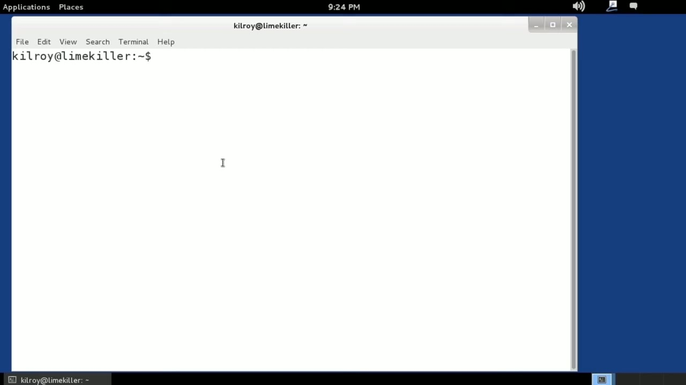
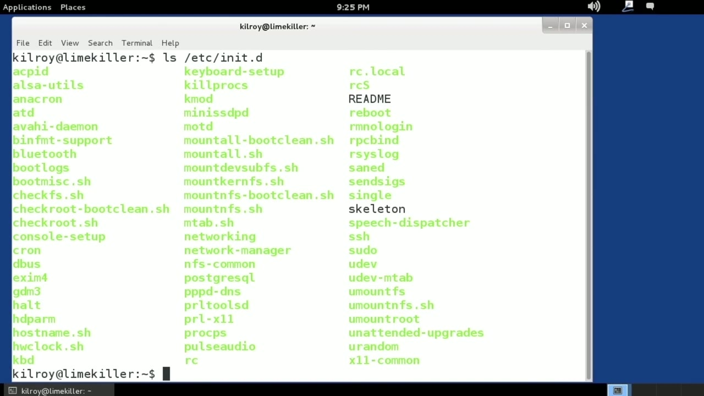
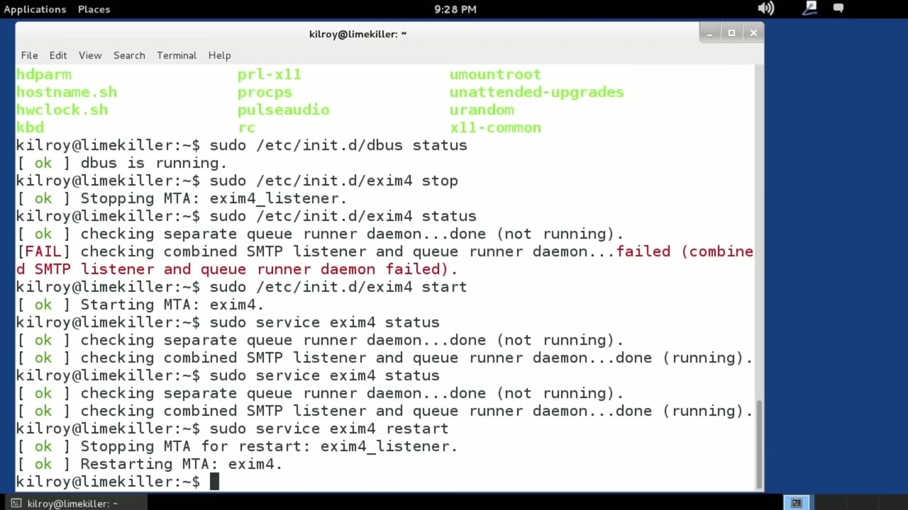

[← Course contents](../../02.md)

# 17. What you will learn in this Module

**Course:** [Linux Security & Administration From Boot Process to Firewalls](https://www.youtube.com/watch?v=_WB3evmgxYA)  
**Transcript:** [`Linux Security & Administration From Boot Process to Firewalls transcript`](../../../../course_videos/Linux%20Security%20%26%20Administration%20From%20Boot%20Process%20to%20Firewalls/Linux%20Security%20%26%20Administration%20From%20Boot%20Process%20to%20Firewalls.txt)  
**Video:** 01:02:41–01:05:34 ([open at this time](https://www.youtube.com/watch?v=_WB3evmgxYA&t=3761s))

## Introduction

First of all, let's talk about what a service actually is. A service is generally a program that is started up and then immediately goes to the background and just kind of runs there waiting for requests. This may be a web server, it may be an FTP server, it may be a service like debus that manages inter-process communication. There are a number of services that are running on your system at any given point. So there's a directory that I want to look at first here. That's Etsyinit.d.

## Detailed Explanation

<details>
  <summary>Step 1 — First of all, let's talk about what a service actually is</summary>

### Step 1 — First of all, let's talk about what a service actually is

- [x] **First of all, let's talk about what a service actually is**
  - First of all, let's talk about what a service actually is.
  - A service is generally a program that is started up and then immediately goes to the background and just kind of runs there waiting for requests.
  - This may be a web server, it may be an FTP server, it may be a service like debus that manages inter-process communication. There are a number of services that are running on your system at any given point.

- [x] **So there's a directory that I want to look at first here. That's**
  - So there's a directory that I want to look at first here. That's Etsyinit.d.
  - And Etsyinit.D is where on most Linux systems you will find the scripts that actually manage the services on your particular system.



</details>

<details>
  <summary>Step 2 — Run `bash`</summary>

### Step 2 — Run `bash`

- [x] **Use `bash`**
  - Now, these are generally `bash` scripts, and they take a number of parameters depending on what you want to do.
  - Now, I can also stop and start services, so let's just stop and start one.
  - And I'm not going to stop and start debus.

- [x] **The reason for that is because if I were to try to restart it, it**
  - The reason for that is because if I were to try to restart it, it would actually kill my interface session here.
  - The GUI would just stop working altogether.
  - So let's do xm4, which is a mail server, and I can stop that.

- [x] **And then I can, let's just check the status before we start it back**
  - And then I can, let's just check the status before we start it back up again.

```bash
bash
```



</details>

<details>
  <summary>Step 3 — Run `service`</summary>

### Step 3 — Run `service`

- [x] **Now I want to start it back up again, and we have started the service**
  - Now I want to start it back up again, and we have started the `service`.
  - I can also use the `service` utility and then say xm4 status, and that's going to give me a status on the `service`.
  - So basically what I just did was bypass the whole calling the script through /etc init.D, and I just used the `service` utility, which is effectively the same thing.

- [x] **Fewer characters and I could do something like a restart on it as well**
  - Fewer characters and I could do something like a restart on it as well.
  - So same idea rather than going directly to the script, I'm calling it through the `service` utility.
  - There are other things that we can do with services we can set up whether they are running or not and what run levels they are in.

- [x] **Use `service`**
  - There are different utilities that you can use on different Linux distributions in order to manage that.
  - But in terms of starting and stopping them, you can go to the EtsyInit.D directory, start the script directly, or you could, of course, use the `service` command in order to manage whether your services are running or not and what the status actually is for them.

```bash
service
```



</details>

<details>
  <summary>Questions and Answers</summary>

## Questions and Answers

### Question 1: What does `bash` do in this chapter?

<details>
<summary>Answer</summary>

- [x] Now, these are generally `bash` scripts, and they take a number of parameters depending on what you want to do.

</details>

### Question 2: What does `service` do in this chapter?

<details>
<summary>Answer</summary>

- [x] But in terms of starting and stopping them, you can go to the EtsyInit.D directory, start the script directly, or you could, of course, use the `service` command in order to manage whether your services are running or not and what the status actually is for them.

</details>

### Question 3: What does step 1 cover (First of all, let's talk about what a service actually is)?

<details>
<summary>Answer</summary>

- [x] First of all, let's talk about what a service actually is.
- [x] A service is generally a program that is started up and then immediately goes to the background and just kind of runs there waiting for requests.
- [x] This may be a web server, it may be an FTP server, it may be a service like debus that manages inter-process communication. There are a number of services that are running on your system at any given point.

</details>

### Question 4: What does step 2 cover (Run bash)?

<details>
<summary>Answer</summary>

- [x] Now, these are generally `bash` scripts, and they take a number of parameters depending on what you want to do.
- [x] Now, I can also stop and start services, so let's just stop and start one.
- [x] And I'm not going to stop and start debus.

</details>

### Question 5: What does step 3 cover (Run service)?

<details>
<summary>Answer</summary>

- [x] Now I want to start it back up again, and we have started the `service`.
- [x] I can also use the `service` utility and then say xm4 status, and that's going to give me a status on the `service`.
- [x] So basically what I just did was bypass the whole calling the script through /etc init.D, and I just used the `service` utility, which is effectively the same thing.

</details>

</details>

## Summary

This chapter, What you will learn in this Module, walks through First of all, let's talk about what a service actually is; Run bash; Run service. Commands from the transcript: `bash`, `service`.

## References

- [Linux Security & Administration From Boot Process to Firewalls (YouTube)](https://www.youtube.com/watch?v=_WB3evmgxYA)
- [This chapter at 01:02:41](https://www.youtube.com/watch?v=_WB3evmgxYA&t=3761s)
- [Local transcript](../../../../course_videos/Linux%20Security%20%26%20Administration%20From%20Boot%20Process%20to%20Firewalls/Linux%20Security%20%26%20Administration%20From%20Boot%20Process%20to%20Firewalls.txt)
