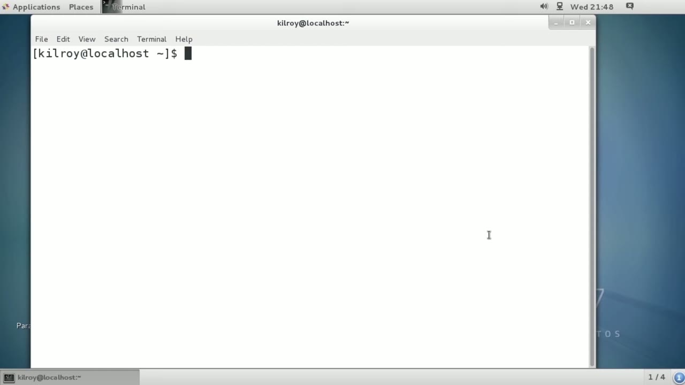
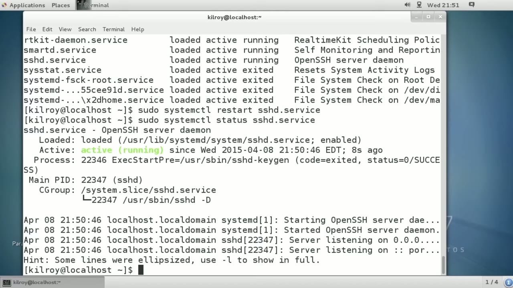
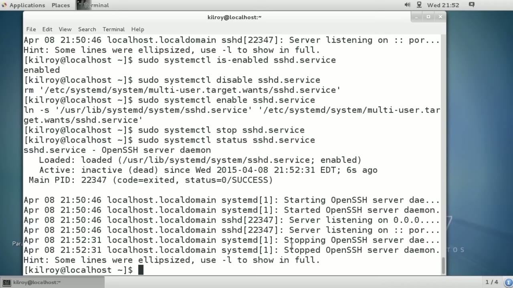

[← Course contents](../../02.md)

# 18. Service Management With RHEL7

**Course:** [Linux Security & Administration From Boot Process to Firewalls](https://www.youtube.com/watch?v=_WB3evmgxYA)  
**Transcript:** [`Linux Security & Administration From Boot Process to Firewalls transcript`](../../../../course_videos/Linux%20Security%20%26%20Administration%20From%20Boot%20Process%20to%20Firewalls/Linux%20Security%20%26%20Administration%20From%20Boot%20Process%20to%20Firewalls.txt)  
**Video:** 01:05:34–01:09:10 ([open at this time](https://www.youtube.com/watch?v=_WB3evmgxYA&t=3934s))

## Introduction

Now, the Red Hat operating systems like Fedora and Red Hat Enterprise Linux use a different system to manage their services. So we're going to use the utility systemctl. And if I just run systemctl, of course it's going to ask me for my password here. And you can see we've got a list of all of the services that are running on This particular system. So let's just skim through here and let's just pick a service that isn't going to cause too much damage if we play with it. So I'm going to take a look at the SSHD service.

## Detailed Explanation

<details>
  <summary>Step 1 — Run `systemctl`, `sshd service`, `sshd`</summary>

### Step 1 — Run `systemctl`, `sshd service`, `sshd`

- [x] **Use `systemctl`, `sshd service`, `sshd`**
  - Now, the Red Hat operating systems like Fedora and Red Hat Enterprise Linux use a different system to manage their services. So we're going to use the utility `systemctl`. And if I just run `systemctl`, of course it's going to ask me for my password here. And you can see we've got a list of all of the services that are running on
  - This particular system. So let's just skim through here and let's just pick a service that isn't going to cause too much damage if we play with it. So I'm going to take a look at the `sshd service`.
  - You'll see rather than just `sshd`, it's `sshd`.Servis.

- [x] **Use `sshd`, `systemctl restart`**
  - That's to distinguish itself from a device, for example, as here, or a mount as in here. So service ctl manages all of those, and again, we're going to be playing around with `sshd`.
  - So I can say `systemctl restart` `sshd`.shd. service.
  - Now it's been restarted and we can just take a look at the status on it.

- [x] **And it's going to tell me that it's actually loaded**
  - And it's going to tell me that it's actually loaded.
  - So you can see this is much more detailed than I was previously getting with the older service scripts on different Linux distributions that used like the old Init.
  - System for starting up the system and managing services.

```bash
systemctl
sshd service
sshd
systemctl restart
```



</details>

<details>
  <summary>Step 2 — Run `systemctl`, `sshd`</summary>

### Step 2 — Run `systemctl`, `sshd`

- [x] **Use `systemctl`**
  - So I've got `systemctl`.
  - Now what I want to do is I want to see whether a service has actually been enabled to start up at boot.
  - So I can do `systemctl` and I can say is enabled.

- [x] **Use `sshd`**
  - And I could actually disable it if I wanted to saying disable `sshd`.
  - Service. So it's removing the entry that's going to start the service up in order to turn it back on.
  - I can enable it and now we've created a SIM link here to actually start it back up.

- [x] **So I can enable, I can stop, I can start**
  - So I can enable, I can stop, I can start.

```bash
systemctl
sshd
```



</details>

<details>
  <summary>Step 3 — Run `systemctl`</summary>

### Step 3 — Run `systemctl`

- [x] **We can just take a look at stopping the service here**
  - We can just take a look at stopping the service here.
  - We did a restart if I were to stop it at this point, and then I do a status.
  - It should tell me that it's actually stopped.

- [x] **Use `systemctl`**
  - And sure enough, it says it's been loaded, but it's inactive.
  - I do get some log output as I did previously, and it does say stopping the server demon, and then that it's actually stopped.
  - `systemctl` does all of the stuff that we were able to do previously with the Init scripts as well as quite a bit more, and it does take into account more than simply the services that are on the system.

- [x] **Use `systemctl`**
  - It also handles devices and the drivers associated with it.
  - And it's a pretty powerful tool to be able to use.
  - We can do a lot of querying of the services and manage them using the `systemctl` utility.

```bash
systemctl
```



</details>

<details>
  <summary>Questions and Answers</summary>

## Questions and Answers

### Question 1: What does `systemctl` do in this chapter?

<details>
<summary>Answer</summary>

- [x] Now, the Red Hat operating systems like Fedora and Red Hat Enterprise Linux use a different system to manage their services. So we're going to use the utility `systemctl`. And if I just run `systemctl`, of course it's going to ask me for my password here. And you can see we've got a list of all of the services that are running on

</details>

### Question 2: What does `sshd service` do in this chapter?

<details>
<summary>Answer</summary>

- [x] This particular system. So let's just skim through here and let's just pick a service that isn't going to cause too much damage if we play with it. So I'm going to take a look at the `sshd service`.

</details>

### Question 3: What does `sshd` do in this chapter?

<details>
<summary>Answer</summary>

- [x] You'll see rather than just `sshd`, it's `sshd`.Servis.

</details>

### Question 4: What does `systemctl restart` do in this chapter?

<details>
<summary>Answer</summary>

- [x] So I can say `systemctl restart` sshd.shd. service.

</details>

### Question 5: What does step 1 cover (Run systemctl, sshd service, sshd)?

<details>
<summary>Answer</summary>

- [x] Now, the Red Hat operating systems like Fedora and Red Hat Enterprise Linux use a different system to manage their services. So we're going to use the utility `systemctl`. And if I just run `systemctl`, of course it's going to ask me for my password here. And you can see we've got a list of all of the services that are running on
- [x] This particular system. So let's just skim through here and let's just pick a service that isn't going to cause too much damage if we play with it. So I'm going to take a look at the `sshd service`.
- [x] You'll see rather than just `sshd`, it's `sshd`.Servis.

</details>

### Question 6: What does step 2 cover (Run systemctl, sshd)?

<details>
<summary>Answer</summary>

- [x] So I've got `systemctl`.
- [x] Now what I want to do is I want to see whether a service has actually been enabled to start up at boot.
- [x] So I can do `systemctl` and I can say is enabled.

</details>

### Question 7: What does step 3 cover (Run systemctl)?

<details>
<summary>Answer</summary>

- [x] We can just take a look at stopping the service here.
- [x] We did a restart if I were to stop it at this point, and then I do a status.
- [x] It should tell me that it's actually stopped.

</details>

</details>

## Summary

This chapter, Service Management With RHEL7, walks through Run systemctl, sshd service, sshd; Run systemctl, sshd; Run systemctl. Commands from the transcript: `systemctl`, `sshd service`, `sshd`, `systemctl restart`.

## References

- [Linux Security & Administration From Boot Process to Firewalls (YouTube)](https://www.youtube.com/watch?v=_WB3evmgxYA)
- [This chapter at 01:05:34](https://www.youtube.com/watch?v=_WB3evmgxYA&t=3934s)
- [Local transcript](../../../../course_videos/Linux%20Security%20%26%20Administration%20From%20Boot%20Process%20to%20Firewalls/Linux%20Security%20%26%20Administration%20From%20Boot%20Process%20to%20Firewalls.txt)
