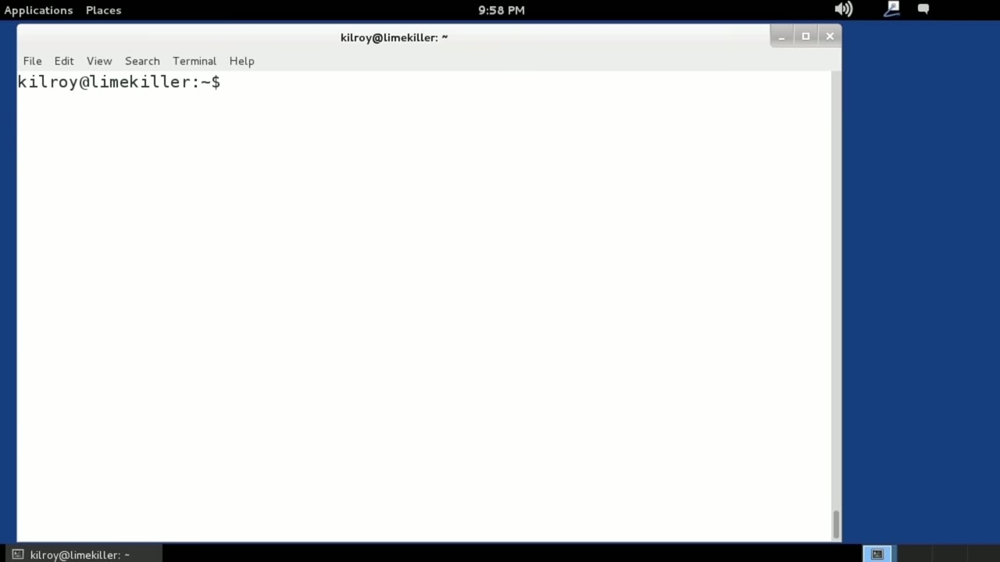
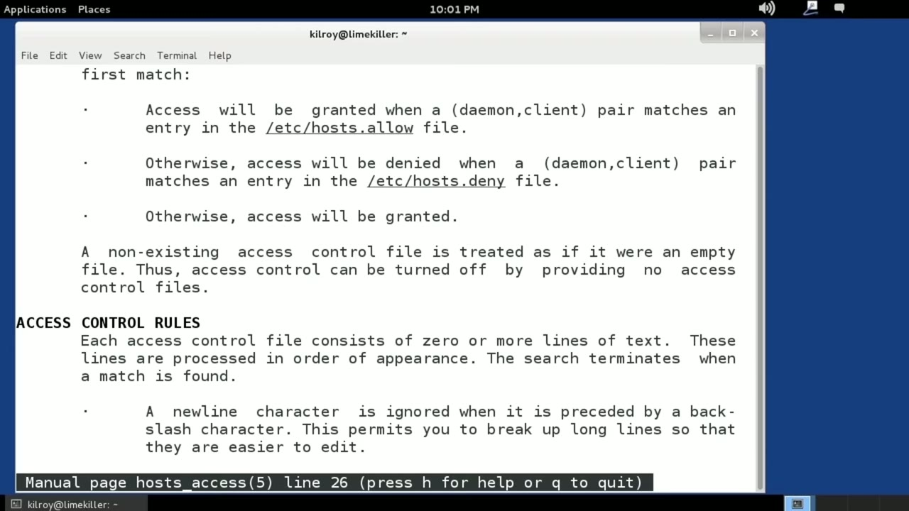

[← Course contents](../../02.md)

# 19. TCP Wrappers

**Course:** [Linux Security & Administration From Boot Process to Firewalls](https://www.youtube.com/watch?v=_WB3evmgxYA)  
**Transcript:** [`Linux Security & Administration From Boot Process to Firewalls transcript`](../../../../course_videos/Linux%20Security%20%26%20Administration%20From%20Boot%20Process%20to%20Firewalls/Linux%20Security%20%26%20Administration%20From%20Boot%20Process%20to%20Firewalls.txt)  
**Video:** 01:09:10–01:11:44 ([open at this time](https://www.youtube.com/watch?v=_WB3evmgxYA&t=4150s))

## Introduction

I'm going to introduce a concept here and then we'll get into the use of it in subsequent lessons. But I did want to talk about TCP wrappers. TCP wrappers is actually a program that is designed to wrap a service program. So you might use this for Telnet or FTP or one of the R services or some other...

## Detailed Explanation

  
Step 1 — going to introduce a concept here and then we'll get into the use of it

### Step 1 — going to introduce a concept here and then we'll get into the use of it

- [x] **I'm going to introduce a concept here and then we'll get into the use**
  - I'm going to introduce a concept here and then we'll get into the use of it in subsequent lessons.
  - But I did want to talk about TCP wrappers.
  - TCP wrappers is actually a program that is designed to wrap a service program.

- [x] **So you might use this for Telnet or FTP or one of the R services or**
  - So you might use this for Telnet or FTP or one of the R services or some other...
  - Maybe a potentially fragile service that doesn't have its own ability to manage whether somebody is going to be allowed to get access to it or not.
  - So we've got TCP wrappers that will actually protect that service by giving us the ability to do some configuration on who.

- [x] **Gets allowed to make use of that particular service. So for example**
  - Gets allowed to make use of that particular service. So for example, Telnet, I may specify a configuration line using TCP wrappers that says, I'm only allowing Telnet to people on my local network. So we're going to make use of a couple of files that are going to give us that

  
Step 2 — Access control. And one of them is the Hosts. Allow file in the /etc

### Step 2 — Access control. And one of them is the Hosts. Allow file in the /etc

- [x] **Access control. And one of them is the Hosts. Allow file in the /etc**
  - Access control. And one of them is the Hosts. Allow file in the /etc directory and the other is in the hosts.deny file. With the hosts.
  - Dot allow file we are using a white list. This is a list of access controls where we are allowing access to a particular service. The hosts. deny file is a blacklist where we are actually denying access. It's pretty straightforward.
  - So we've got hosts. allow and hosts.deny. If something isn't in we will actually just grant access.

- [x] **So basically it's a default allow configuration**
  - So basically it's a default allow configuration.
  - So you have to allow some and then deny everything else unless you really just want everything to get access, in which case you may not want to be using TCP wrappers to begin with.
  - So TCP wrappers give us the ability to protect potentially fragile services like Telnet or FTP that are plain text and we may not want everybody in the world getting access to them.

- [x] **Now TCP wrappers are used in conjunction with other programs like**
  - Now TCP wrappers are used in conjunction with other programs like ined or xinetd and we will be talking about XINetD in a subsequent lesson.

  
Questions and Answers

## Questions and Answers

### Question 1: What does step 1 cover (going to introduce a concept here and then we'll get into the use of it)?

Answer

- [x] I'm going to introduce a concept here and then we'll get into the use of it in subsequent lessons.
- [x] But I did want to talk about TCP wrappers.
- [x] TCP wrappers is actually a program that is designed to wrap a service program.

### Question 2: What does step 2 cover (Access control. And one of them is the Hosts. Allow file in the /etc)?

Answer

- [x] Access control. And one of them is the Hosts. Allow file in the /etc directory and the other is in the hosts.deny file. With the hosts.
- [x] Dot allow file we are using a white list. This is a list of access controls where we are allowing access to a particular service. The hosts. deny file is a blacklist where we are actually denying access. It's pretty straightforward.
- [x] So we've got hosts. allow and hosts.deny. If something isn't in we will actually just grant access.

## Summary

This chapter, TCP Wrappers, walks through going to introduce a concept here and then we'll get into the use of it; Access control. And one of them is the Hosts. Allow file in the /etc.

## References

- [Linux Security & Administration From Boot Process to Firewalls (YouTube)](https://www.youtube.com/watch?v=_WB3evmgxYA)
- [This chapter at 01:09:10](https://www.youtube.com/watch?v=_WB3evmgxYA&t=4150s)
- [Local transcript](../../../../course_videos/Linux%20Security%20%26%20Administration%20From%20Boot%20Process%20to%20Firewalls/Linux%20Security%20%26%20Administration%20From%20Boot%20Process%20to%20Firewalls.txt)
