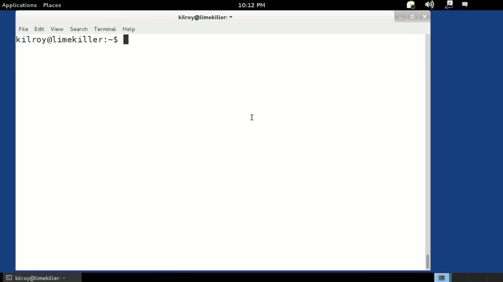
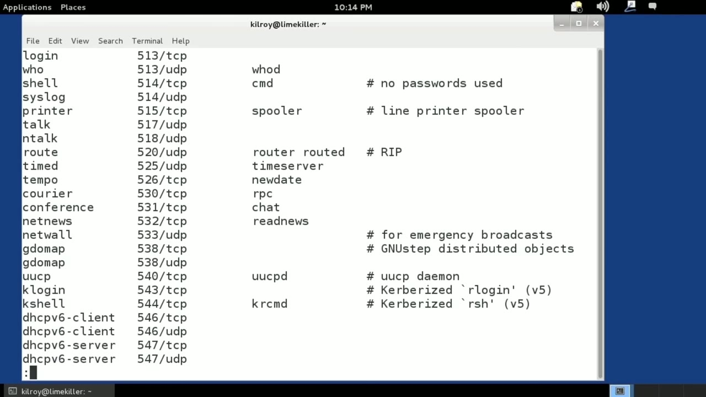
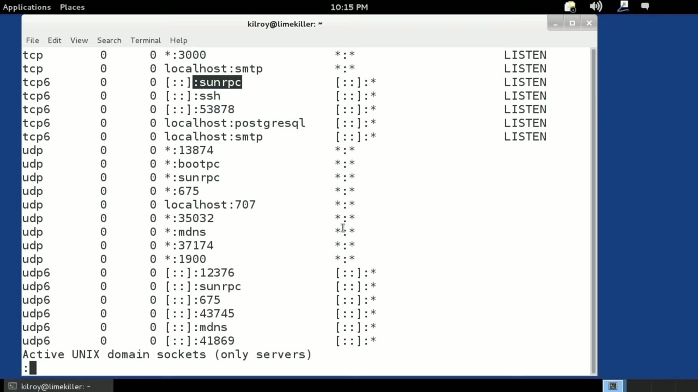

[← Course contents](../../02.md)

# 20. Listening Ports

**Course:** [Linux Security & Administration From Boot Process to Firewalls](https://www.youtube.com/watch?v=_WB3evmgxYA)  
**Transcript:** [`Linux Security & Administration From Boot Process to Firewalls transcript`](../../../../course_videos/Linux%20Security%20%26%20Administration%20From%20Boot%20Process%20to%20Firewalls/Linux%20Security%20%26%20Administration%20From%20Boot%20Process%20to%20Firewalls.txt)  
**Video:** 01:11:44–01:17:25 ([open at this time](https://www.youtube.com/watch?v=_WB3evmgxYA&t=4304s))

## Introduction

If a service is doing something with the network, it's going to have a port that's associated with it. A port is a local address that a program or application connects to. When we are talking about network services, you have an IP address and a port. And the port is associated with the particular transport protocol, whether it's TCP or UDP or maybe something else. The port is associated with one of those protocols, and it differentiates the different programs that are running on a system. So, for example, let's take a look at the

## Detailed Explanation

<details>
  <summary>Step 1 — If a service is doing something with the network, it's going to have a</summary>

### Step 1 — If a service is doing something with the network, it's going to have a

- [x] **If a service is doing something with the network, it's going to have**
  - If a service is doing something with the network, it's going to have a port that's associated with it.
  - A port is a local address that a program or application connects to.
  - When we are talking about network services, you have an IP address and a port.

- [x] **And the port is associated with the particular transport protocol**
  - And the port is associated with the particular transport protocol, whether it's TCP or UDP or maybe something else. The port is associated with one of those protocols, and it differentiates the different programs that are running on a system. So, for example, let's take a look at the
  - Services file. This is a file that exists on Most Unix-like operating systems like Linux.
  - And actually, let's do this a little bit differently.

- [x] **Less will allow us to look at them a little block at a time or a page**
  - Less will allow us to look at them a little block at a time or a page at a time.
  - So you can see these are the different services that Linux is aware of and the different port numbers that are associated with them.
  - Telnet typically operates on port 23, that's TCP.

- [x] **So for example, the character generator application right here that**
  - So for example, the character generator application right here that runs on port 19, and that's UDP. Of course, it also has a TCP component as well.
  - So lots of services, these are all of the well-known services.
  - There are other programs and applications.

- [x] **That you may run that may not run on a well-known port**
  - That you may run that may not run on a well-known port.



</details>

<details>
  <summary>Step 2 — Run `netstat`</summary>

### Step 2 — Run `netstat`

- [x] **Use `netstat`**
  - It may not be a well-known service, but we can get lists of the services that are listening on particular ports just by using the `netstat` command.
  - So for example, I could say `netstat` listening, and let's actually pipe this into Les.
  - I'm using the pipe command to send it off to the Les program.

- [x] **So that we get a page at a time here. Now what I've got is all of the**
  - So that we get a page at a time here. Now what I've got is all of the ports that are listening, what I don't have is the service that is associated with them. But I do have, this is my local port, this is running on the SSH port that happens to be Port 22, and I've got a PostgreSQL server,
  - I've got an SMTP server, you can see the different ports that are listening. In this case, We are listening to every remote address.
  - We haven't nailed it down to a specific remote address or a set of remote addresses.

- [x] **You can actually see the state over here**
  - You can actually see the state over here.
  - I don't have any programs that are communicating with remote systems based on this.
  - If I did, I would see an entry here, and rather than listen, it would say, something like established over in the state column.

- [x] **Now we've got all of the stream listeners there and not going to go**
  - Now we've got all of the stream listeners there and not going to go into any detail there.
  - These are the ones really that we are interested in.

```bash
netstat
```



</details>

<details>
  <summary>Step 3 — Run `netstat`, `stat d`, `sshd`</summary>

### Step 3 — Run `netstat`, `stat d`, `sshd`

- [x] **Use `netstat`, `stat d`, `sshd`**
  - Now I can also do `netstat` so that I get the program that is listening.
  - And this is actually going to get me the process id.
  - As well as the process itself. So we've got SunRPC and that's the rpc bind service and we've got port 54097, that's rpc. `stat d` and of course the SSH port is `sshd`.

- [x] **If I wanted to get a list of all of the network communications, all**
  - If I wanted to get a list of all of the network communications, all of the ports that were anything happening on any of them I would use -A.
  - And then I'm going to say P is going to give me the process information.
  - So I could do -ap and we are going to get the same information basically that we had before.

- [x] **Use `netstat`**
  - We're going to get all of the process identifier.
  - So `netstat` has a lot of different command line switches.
  - The information for me about what the name of the service was, I could put an N in there which just says don't look up.

- [x] **So instead of SSH here, it says 22, as an example**
  - So instead of SSH here, it says 22, as an example.
  - What it really does is it lets nets that run a little bit faster, so it's not doing name resolution.
  - If you actually had programs that had communications open with other systems, the -N is going to help Nets that run faster because it's not going to try to look up the remote addresses and do a DNS reverse lookup on them.

- [x] **Use `netstat`**
  - For just the services, which is really what we're talking about here, the -N really isn't going to speed anything up.
  - It's a quick lookup in the /etc/services file in order to determine that Port 25, for example, is the SMTP port.
  - `netstat` is how you can see what ports are open and listening on your system, and you can also figure out what process is associated with that particular port.

```bash
netstat
stat d
sshd
```



</details>

<details>
  <summary>Questions and Answers</summary>

## Questions and Answers

### Question 1: What does `netstat` do in this chapter?

<details>
<summary>Answer</summary>

- [x] It may not be a well-known service, but we can get lists of the services that are listening on particular ports just by using the `netstat` command.

</details>

### Question 2: What does `stat d` do in this chapter?

<details>
<summary>Answer</summary>

- [x] As well as the process itself. So we've got SunRPC and that's the rpc bind service and we've got port 54097, that's rpc. `stat d` and of course the SSH port is SSHD.

</details>

### Question 3: What does `sshd` do in this chapter?

<details>
<summary>Answer</summary>

- [x] As well as the process itself. So we've got SunRPC and that's the rpc bind service and we've got port 54097, that's rpc. Stat D and of course the SSH port is `sshd`.

</details>

### Question 4: What does step 1 cover (If a service is doing something with the network, it's going to have a)?

<details>
<summary>Answer</summary>

- [x] If a service is doing something with the network, it's going to have a port that's associated with it.
- [x] A port is a local address that a program or application connects to.
- [x] When we are talking about network services, you have an IP address and a port.

</details>

### Question 5: What does step 2 cover (Run netstat)?

<details>
<summary>Answer</summary>

- [x] It may not be a well-known service, but we can get lists of the services that are listening on particular ports just by using the `netstat` command.
- [x] So for example, I could say `netstat` listening, and let's actually pipe this into Les.
- [x] I'm using the pipe command to send it off to the Les program.

</details>

### Question 6: What does step 3 cover (Run netstat, stat d, sshd)?

<details>
<summary>Answer</summary>

- [x] Now I can also do `netstat` so that I get the program that is listening.
- [x] And this is actually going to get me the process id.
- [x] As well as the process itself. So we've got SunRPC and that's the rpc bind service and we've got port 54097, that's rpc. `stat d` and of course the SSH port is `sshd`.

</details>

</details>

## Summary

This chapter, Listening Ports, walks through If a service is doing something with the network, it's going to have a; Run netstat; Run netstat, stat d, sshd. Commands from the transcript: `netstat`, `stat d`, `sshd`.

## References

- [Linux Security & Administration From Boot Process to Firewalls (YouTube)](https://www.youtube.com/watch?v=_WB3evmgxYA)
- [This chapter at 01:11:44](https://www.youtube.com/watch?v=_WB3evmgxYA&t=4304s)
- [Local transcript](../../../../course_videos/Linux%20Security%20%26%20Administration%20From%20Boot%20Process%20to%20Firewalls/Linux%20Security%20%26%20Administration%20From%20Boot%20Process%20to%20Firewalls.txt)
