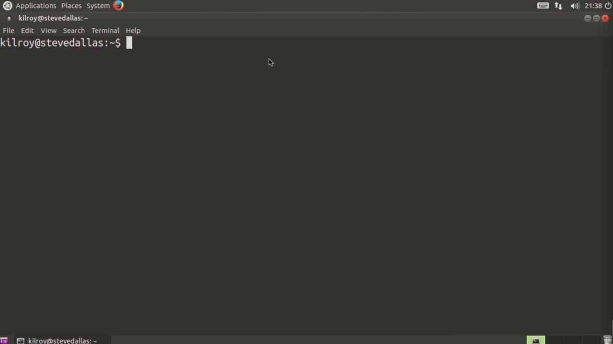
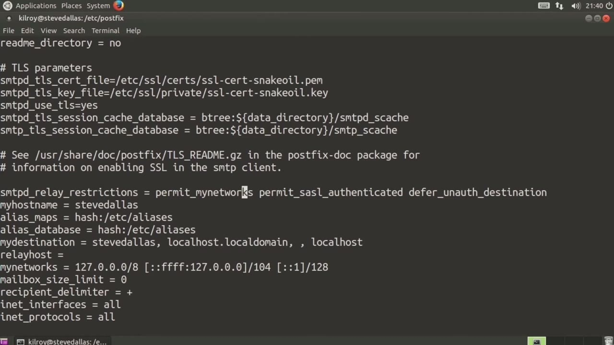
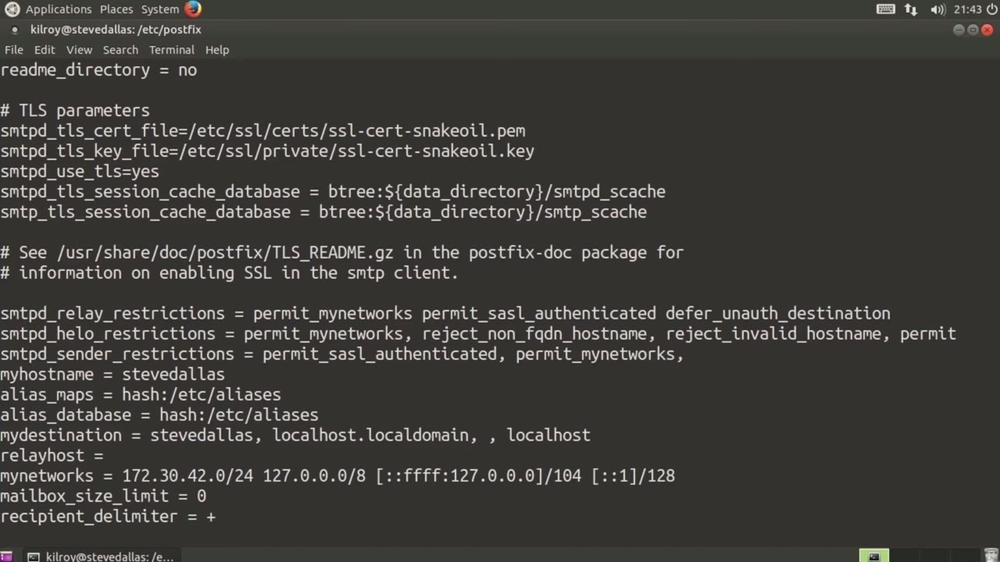

[← Course contents](../../02.md)

# 21. Standard Postfix Configuration

**Course:** [Linux Security & Administration From Boot Process to Firewalls](https://www.youtube.com/watch?v=_WB3evmgxYA)  
**Transcript:** [`Linux Security & Administration From Boot Process to Firewalls transcript`](../../../../course_videos/Linux%20Security%20%26%20Administration%20From%20Boot%20Process%20to%20Firewalls/Linux%20Security%20%26%20Administration%20From%20Boot%20Process%20to%20Firewalls.txt)  
**Video:** 01:17:25–01:23:31 ([open at this time](https://www.youtube.com/watch?v=_WB3evmgxYA&t=4645s))

## Introduction

One mail server that's pretty common on Linux systems is PostFix. Now PostFix is a mail server that was designed pretty specifically to be far more secure than some of the other options that were out there. It's designed to be considerably simpler to configure with a number of facilities that are really targeted at preventing abuse of the mail server. So let's take a look at the configuration file for PostFix.

## Detailed Explanation

  
Step 1 — One mail server that's pretty common on Linux systems is PostFix

### Step 1 — One mail server that's pretty common on Linux systems is PostFix

- [x] **One mail server that's pretty common on Linux systems is PostFix**
  - One mail server that's pretty common on Linux systems is PostFix.
  - Now PostFix is a mail server that was designed pretty specifically to be far more secure than some of the other options that were out there.
  - It's designed to be considerably simpler to configure with a number of facilities that are really targeted at preventing abuse of the mail server.

- [x] **So let's take a look at the configuration file for PostFix**
  - So let's take a look at the configuration file for PostFix.
  - The first thing that you want to do is give your system a name so that it can identify itself.
  - If I do an install on a Debian-based system like Ubuntu or one of the Ubuntu derivatives, it's going to do some of the configuration for me.

- [x] **And actually, what I want to do here is I want to edit this**
  - And actually, what I want to do here is I want to edit this.
  - There's a couple of changes that I want to make.
  - And one of them is going to be right here.

- [x] **Give an attacker any more information that I absolutely have to**
  - Give an attacker any more information that I absolutely have to.
  - So I'm not going to tell him that it's Ubuntu.
  - It's going to give the attacker information about the package, so it's going to say post-vix, but it's not going to say this is on an Ubuntu system. So try to limit the amount of information as much as possible.

- [x] **Now we've got an alias database, and we can use that to set up a**
  - Now we've got an alias database, and we can use that to set up a number of mailboxes that are pretty common.
  - So you'll need a postmaster mailbox and an abuse mailbox is something that you are supposed to have as well by way of best practice. So there are a couple of things that we can do here.

  
Step 2 — The first thing that we want to do is prevent relaying through us

### Step 2 — The first thing that we want to do is prevent relaying through us

- [x] **The first thing that we want to do is prevent relaying through us**
  - The first thing that we want to do is prevent relaying through us.
  - So we're going to allow my networks and my networks here you can see right now is just limited to my local host.
  - So I could also do this, and I could add 172.

- [x] **42.4.0 slash 24, which is my local network**
  - .42.4.0 slash 24, which is my local network.
  - So basically anybody on my local network is going to be able to use this mail server to communicate with.
  - Permit sasl authenticated. This allows us to do SMTP off, and there are some additional settings that we need to have here as well. So the first thing that I want to set up is an smtbd hello restrictions. So smtpd hello restrictions. This is going to give us a way to

- [x] **cut down on people who are allowed to communicate with us. So any**
  - cut down on people who are allowed to communicate with us. So any system that tries to send mail to this one, has to start with a hello, either helo or ehlo, depending on whether they're using SMTP or esmtp.
  - So I'm going to do, again, permit my networks, and then I'm going to say, reject non-fully qualified domain name, host name. If you are not using a fully qualified domain name, I'm going to suspect that you are not a properly configured mail server.
  - Another thing I can do is reject invalid host name, and that again is going to cut down on bad people trying to communicate through me.

- [x] **And then I got to do a permit, which is basically reject everybody**
  - And then I got to do a permit, which is basically reject everybody, and then if you don't fall into those categories, you can actually be allowed through.
  - Now another configuration is smtpd, sender restrictions.
  - And again, I'm going to do permit s-a-s-l authenticated.

- [x] **So this is going to allow anybody who has authenticated with us**
  - So this is going to allow anybody who has authenticated with us.
  - And again, I'm going to also do permit my networks.

  
Step 3 — Now, the sender restriction is basically anybody who has gotten through

### Step 3 — Now, the sender restriction is basically anybody who has gotten through

- [x] **Now, the sender restriction is basically anybody who has gotten**
  - Now, the sender restriction is basically anybody who has gotten through the hello now becomes a sender, and now I can do some additional configuration.
  - If you were to try to send from root at local host, for example.
  - Well, that's not a fully qualified domain name, so I'm just going to bounce that.

- [x] **In this case, I'm just going to do a permit**
  - In this case, I'm just going to do a permit.
  - And then another thing that I can do here is smtbd recipient restrictions.
  - Permissions that I would need to do here. So I could do, for example, permit my networks again, permit sasl authenticated, reject on-off destination. I can do a reject rbl client. This is a black hole list that is maintained by a couple of different organizations. So here's one, for example.

- [x] **And then I could do another reject rbl client again**
  - And then I could do another reject rbl client again.
  - I can have a bunch of these, and this is a different black hole list, dsbl.org.
  - And then again, I'm going to do a permit here.

- [x] **You can see that we've got a handful of settings here that we can use**
  - You can see that we've got a handful of settings here that we can use to try to limit the people who are communicating with our mail server so we can stop spam and we can stop unauthorized use of our mail server.
  - Now there are a number of other things that we can do, for example, gray listing and using a sender policy framework, and we're going to cover those in an upcoming lesson. While there are certainly other web servers that you can make use of on a Linux system,

  
Questions and Answers

## Questions and Answers

### Question 1: What does step 1 cover (One mail server that's pretty common on Linux systems is PostFix)?

Answer

- [x] One mail server that's pretty common on Linux systems is PostFix.
- [x] Now PostFix is a mail server that was designed pretty specifically to be far more secure than some of the other options that were out there.
- [x] It's designed to be considerably simpler to configure with a number of facilities that are really targeted at preventing abuse of the mail server.

### Question 2: What does step 2 cover (The first thing that we want to do is prevent relaying through us)?

Answer

- [x] The first thing that we want to do is prevent relaying through us.
- [x] So we're going to allow my networks and my networks here you can see right now is just limited to my local host.
- [x] So I could also do this, and I could add 172.

### Question 3: What does step 3 cover (Now, the sender restriction is basically anybody who has gotten through)?

Answer

- [x] Now, the sender restriction is basically anybody who has gotten through the hello now becomes a sender, and now I can do some additional configuration.
- [x] If you were to try to send from root at local host, for example.
- [x] Well, that's not a fully qualified domain name, so I'm just going to bounce that.

## Summary

This chapter, Standard Postfix Configuration, walks through One mail server that's pretty common on Linux systems is PostFix; The first thing that we want to do is prevent relaying through us; Now, the sender restriction is basically anybody who has gotten through.

## References

- [Linux Security & Administration From Boot Process to Firewalls (YouTube)](https://www.youtube.com/watch?v=_WB3evmgxYA)
- [This chapter at 01:17:25](https://www.youtube.com/watch?v=_WB3evmgxYA&t=4645s)
- [Local transcript](../../../../course_videos/Linux%20Security%20%26%20Administration%20From%20Boot%20Process%20to%20Firewalls/Linux%20Security%20%26%20Administration%20From%20Boot%20Process%20to%20Firewalls.txt)
