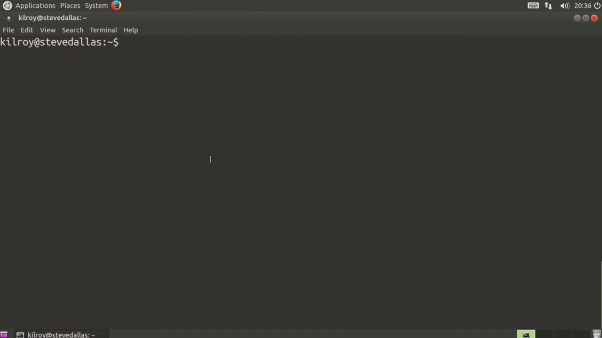
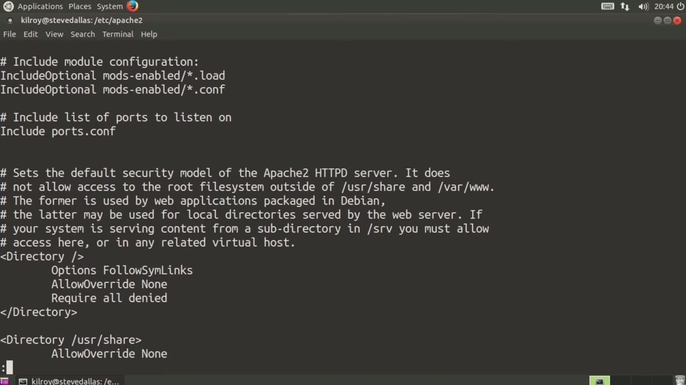
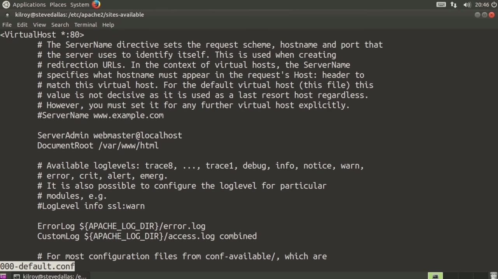
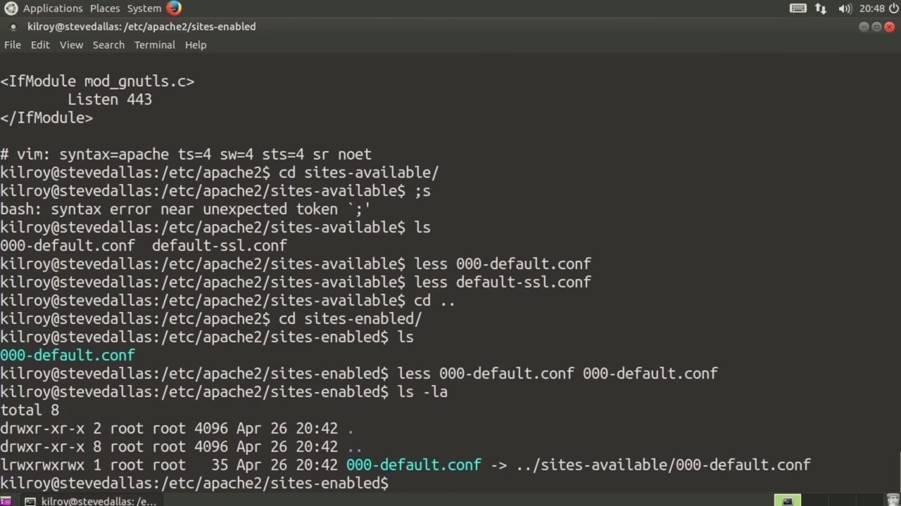

[← Course contents](../../02.md)

# 22. Apache Configuration

**Course:** [Linux Security & Administration From Boot Process to Firewalls](https://www.youtube.com/watch?v=_WB3evmgxYA)  
**Transcript:** [`Linux Security & Administration From Boot Process to Firewalls transcript`](../../../../course_videos/Linux%20Security%20%26%20Administration%20From%20Boot%20Process%20to%20Firewalls/Linux%20Security%20%26%20Administration%20From%20Boot%20Process%20to%20Firewalls.txt)  
**Video:** 01:23:31–01:30:34 ([open at this time](https://www.youtube.com/watch?v=_WB3evmgxYA&t=5011s))

## Introduction

The most predominant one probably by far is Apache. So let's take a look at the Apache configuration setup. Now, Apache configuration has changed over the years. It used to be much more straightforward than it is now. And the reason for that is because Apache simply has become more feature rich and it allows more in the way of plugins and virtual sites, virtual servers.

## Detailed Explanation

  
Step 1 — The most predominant one probably by far is Apache. So let's take a

### Step 1 — The most predominant one probably by far is Apache. So let's take a

- [x] **The most predominant one probably by far is Apache. So let's take a**
  - The most predominant one probably by far is Apache. So let's take a look at the Apache configuration setup.
  - Now, Apache configuration has changed over the years.
  - It used to be much more straightforward than it is now.

- [x] **And the reason for that is because Apache simply has become more**
  - And the reason for that is because Apache simply has become more feature rich and it allows more in the way of plugins and virtual sites, virtual servers.
  - And it's much more configurable in a broader sense.
  - Than it used to be. As a result, what you end up with is a much more complicated directory structure than we had previously. Now, typically where you will find the configuration settings is in /etc/apache2 2. In /etc/apache2 2, you will see there are some files and there are some directories. Now, the first thing that we want to pay

- [x] **I'm going to take a quick look at this. This is the first place that**
  - I'm going to take a quick look at this. This is the first place that you're going to start for configuration settings.
  - The thing about this is there's not going to be an awful lot here, but it does provide you some documentation.
  - So you can see that the configuration is actually split into several files.

- [x] **This is the main configuration file, and what it really does is it**
  - This is the main configuration file, and what it really does is it...
  - Has some global configuration and it also pulls all of the other configuration files together.
  - So you can see that we can set the server route. That tells Apache where the server is actually located and we've got a number of other settings that you may or may not want to change.

- [x] **So let's just skim through some of these and we'll get into more**
  - So let's just skim through some of these and we'll get into more details around specific configurations that you may want to change coming up later on.
  - One thing to note here is it says include ports.com.

  
Step 2 — As I said, Apache has become a much larger server entity than it used

### Step 2 — As I said, Apache has become a much larger server entity than it used

- [x] **As I said, Apache has become a much larger server entity than it used**
  - As I said, Apache has become a much larger server entity than it used to be.
  - So I could actually have it listening on a number of different ports, and each port may actually point to a different virtual server or offer a different service up.
  - I've got a configuration file specifically for the ports that I want to listen to.

- [x] **Now we've got some directory settings here, and then we've got the**
  - Now we've got some directory settings here, and then we've got the log format, and this tells us how we are actually going to log.
  - So we are using a custom log directive, which uses an extended log format rather than the simpler ncsa common log format.
  - With the extended log format, you end up with a custom log, meaning that you can actually specify what you want your log entries to look like.

- [x] **So you can see we've got log formats there, and that's going to tell**
  - So you can see we've got log formats there, and that's going to tell us how we are actually going to generate log files.
  - So this is really the Apache2.com, and as they said, there are other ones, for example, the ports.com.
  - This tells us we're going to listen on Port 80.

- [x] **If we've got the SSL module installed, we're going to listen on Port**
  - If we've got the SSL module installed, we're going to listen on Port 443.
  - So the other thing to look at here is the sites available and sites enabled.
  - So let's take a look at sites available.

- [x] **And you can see we've got a default configuration file here**
  - And you can see we've got a default configuration file here.
  - And this is going to be really the primary server here.

  
Step 3 — we've got a virtual host that says basically every IP address on this

### Step 3 — we've got a virtual host that says basically every IP address on this

- [x] **So we've got a virtual host that says basically every IP address on**
  - So we've got a virtual host that says basically every IP address on this system that's listening on Port 80 is going to use this configuration.
  - So we've got a server admin tells us where the document route is.
  - The document route is where all of your html pages, all of your php, anything that is actually going to be served up by your web server is going to be located somewhere underneath your document route.

- [x] **Now, if you wanted to use SSL, we could look at the default SSL**
  - Now, if you wanted to use SSL, we could look at the default SSL configuration file.
  - If we've actually enabled SSL, here are some settings that we're going to use.
  - And this sets up the certificate file, the key file, and turns the SSL engine on, as well as sets a number of other SSL parameters.

- [x] **What you can have is a number of sites available that may not**
  - What you can have is a number of sites available that may not actually be turned on.
  - In order to make use of a configuration, you need to go into sites enabled.
  - What we have here is just the one configuration file, and this is going to be the same one that we looked at before.

- [x] **It's just it's been moved into the sites enabled. And honestly, it**
  - It's just it's been moved into the sites enabled. And honestly, it hasn't even been moved here.
  - I can tell by the light blue that this is actually a pointer.
  - To the configuration file that's in sites available.

- [x] **So what I do is I maintain the site configuration in sites available**
  - So what I do is I maintain the site configuration in sites available, and then I generate a link to it in my sites enabled.
  - It's only the sites enabled that the configuration will be read into.

  
Step 4 — you want to turn on a site that is available on your system

### Step 4 — you want to turn on a site that is available on your system

- [x] **So you want to turn on a site that is available on your system**
  - So you want to turn on a site that is available on your system.
  - You can either copy it into sites enabled or better.
  - You can just link to it from sites enabled into sites available.

- [x] **And then anytime you do an update, it's going to update the sites**
  - And then anytime you do an update, it's going to update the sites available configuration.
  - And then that will automatically get picked up because of the link that you have set up in sites enabled.
  - So as you can see, there is a lot of configuration that you can be doing here.

- [x] **We've got mods that are enabled and mods that are available**
  - We've got mods that are enabled and mods that are available.
  - If we were to look into mods that were enabled, you would see these are all of the module files.
  - And the light blue actually tells me that these are linked to the configurations and modules.

- [x] **So we've got our Apache configuration where everything is located**
  - So we've got our Apache configuration where everything is located.
  - You could see in our configuration file that var www html is going to be the place where our document route is.
  - All of the other configuration files are in /etc/apache2 2.

- [x] **Configuration files and modules are typically going to be under**
  - Configuration files and modules are typically going to be under /etc/apache2 2 as well.

  
Questions and Answers

## Questions and Answers

### Question 1: What does step 1 cover (The most predominant one probably by far is Apache. So let's take a)?

Answer

- [x] The most predominant one probably by far is Apache. So let's take a look at the Apache configuration setup.
- [x] Now, Apache configuration has changed over the years.
- [x] It used to be much more straightforward than it is now.

### Question 2: What does step 2 cover (As I said, Apache has become a much larger server entity than it used)?

Answer

- [x] As I said, Apache has become a much larger server entity than it used to be.
- [x] So I could actually have it listening on a number of different ports, and each port may actually point to a different virtual server or offer a different service up.
- [x] I've got a configuration file specifically for the ports that I want to listen to.

### Question 3: What does step 3 cover (we've got a virtual host that says basically every IP address on this)?

Answer

- [x] So we've got a virtual host that says basically every IP address on this system that's listening on Port 80 is going to use this configuration.
- [x] So we've got a server admin tells us where the document route is.
- [x] The document route is where all of your html pages, all of your php, anything that is actually going to be served up by your web server is going to be located somewhere underneath your document route.

### Question 4: What does step 4 cover (you want to turn on a site that is available on your system)?

Answer

- [x] So you want to turn on a site that is available on your system.
- [x] You can either copy it into sites enabled or better.
- [x] You can just link to it from sites enabled into sites available.

## Summary

This chapter, Apache Configuration, walks through The most predominant one probably by far is Apache. So let's take a; As I said, Apache has become a much larger server entity than it used; we've got a virtual host that says basically every IP address on this; you want to turn on a site that is available on your system.

## References

- [Linux Security & Administration From Boot Process to Firewalls (YouTube)](https://www.youtube.com/watch?v=_WB3evmgxYA)
- [This chapter at 01:23:31](https://www.youtube.com/watch?v=_WB3evmgxYA&t=5011s)
- [Local transcript](../../../../course_videos/Linux%20Security%20%26%20Administration%20From%20Boot%20Process%20to%20Firewalls/Linux%20Security%20%26%20Administration%20From%20Boot%20Process%20to%20Firewalls.txt)
