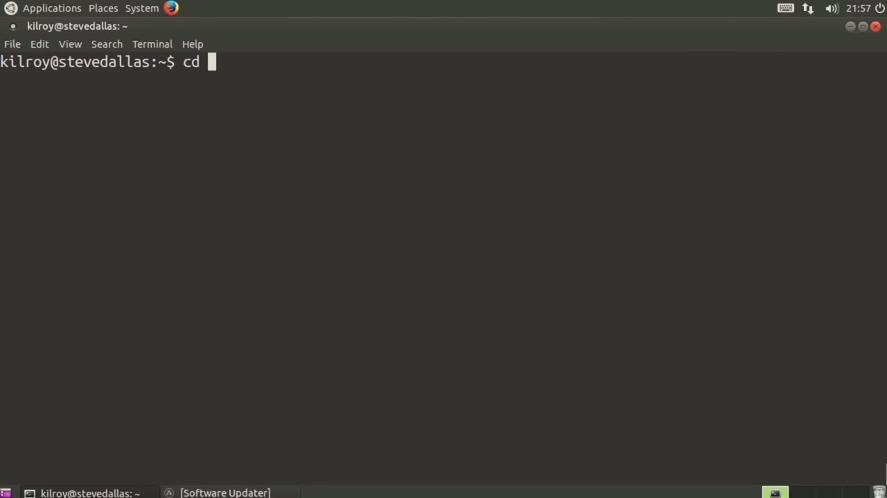
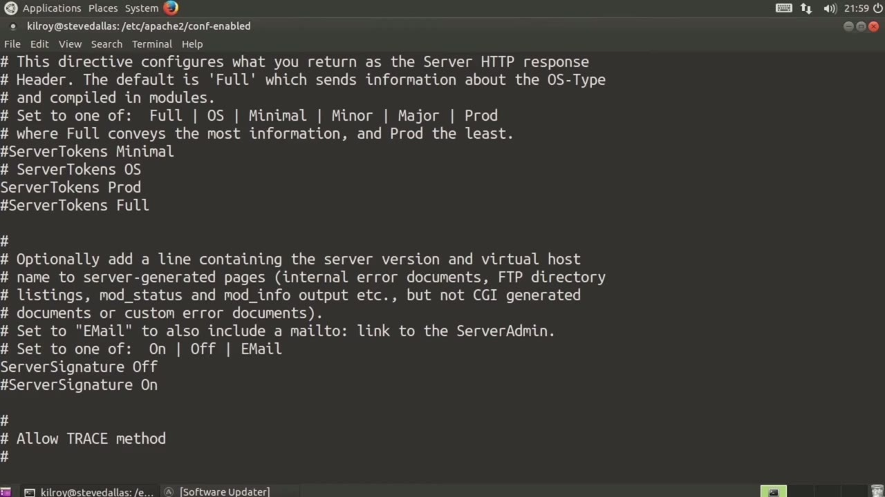
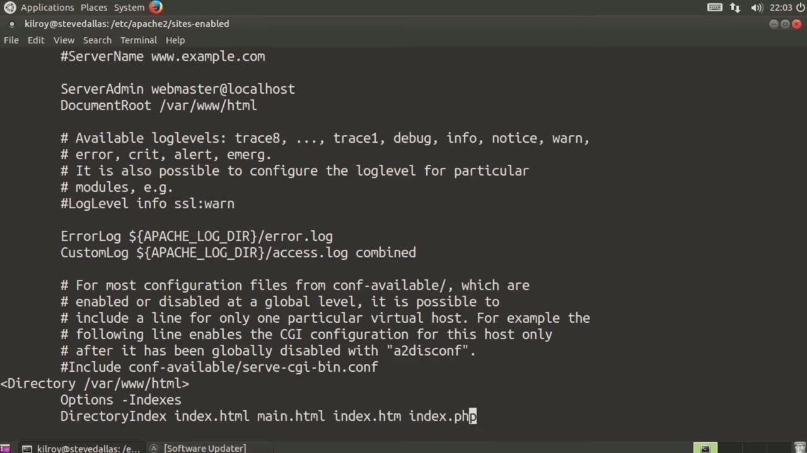
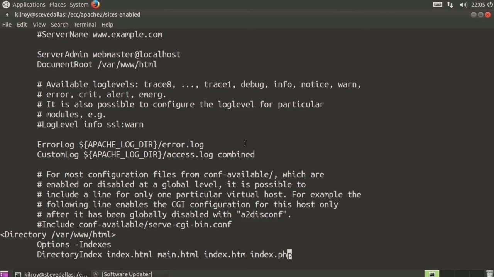

[← Course contents](../../02.md)

# 23. Hardening Apache

**Course:** [Linux Security & Administration From Boot Process to Firewalls](https://www.youtube.com/watch?v=_WB3evmgxYA)  
**Transcript:** [`Linux Security & Administration From Boot Process to Firewalls transcript`](../../../../course_videos/Linux%20Security%20%26%20Administration%20From%20Boot%20Process%20to%20Firewalls/Linux%20Security%20%26%20Administration%20From%20Boot%20Process%20to%20Firewalls.txt)  
**Video:** 01:30:34–01:37:46 ([open at this time](https://www.youtube.com/watch?v=_WB3evmgxYA&t=5434s))

## Introduction

We're going to talk about some additional steps that you can take in order to harden your Apache installation. So we're going to go back into the Apache directory here. Now we're going to talk about some configuration directives and they're going to be in specific locations on this particular System. However, no matter where they are these directives will actually work. So I'm going to go into the config enabled directory or ConfDash enabled. Again, this is where they happen to be on this particular system.

## Detailed Explanation

  
Step 1 — going to talk about some additional steps that you can take in order to

### Step 1 — going to talk about some additional steps that you can take in order to

- [x] **We're going to talk about some additional steps that you can take in**
  - We're going to talk about some additional steps that you can take in order to harden your Apache installation. So we're going to go back into the Apache directory here. Now we're going to talk about some configuration directives and they're going to be in specific locations on this particular
  - System. However, no matter where they are these directives will actually work.
  - So I'm going to go into the config enabled directory or ConfDash enabled.

- [x] **Again, this is where they happen to be on this particular system**
  - Again, this is where they happen to be on this particular system.
  - Other systems may use different configuration files.
  - They're broken out this way so they're a little bit more modular and easier to deal with.

- [x] **So we've got a Security.com file and let's just take a look at that**
  - So we've got a Security.com file and let's just take a look at that because there are not surprisingly some configuration settings that are related to security.
  - This is where you determine how much you want to tell somebody connecting to your system.
  - So right here it's set to server tokens OS.

- [x] **Considered to be a good idea from a security perspective. We don't**
  - Considered to be a good idea from a security perspective. We don't want to give attackers any more information than we absolutely can. So instead what we say is server tokens prod.
  - Then that means product only. Rather than giving information about the operating system, which is what OS would do, this is simply going to say Apache and it's not even going to give a version number.
  - And here's another case where we can talk about the version number.

- [x] **Server signature is on here, and what I want to do is turn it off**
  - Server signature is on here, and what I want to do is turn it off.
  - With the server signature, what it gives is information about the server version, what modules may be installed, far more information than we want to give out.

  
Step 2 — We don't want to give attackers information about the versions because

### Step 2 — We don't want to give attackers information about the versions because

- [x] **We don't want to give attackers information about the versions**
  - We don't want to give attackers information about the versions because then...
  - That may give information about what we may potentially be vulnerable to.
  - So gives them opportunities to attack us with very specific targeted attacks rather than just potentially blasting everything at us, which would be more time consuming and potentially less lucrative on their part.

- [x] **So here's another one, trace method enabled**
  - So here's another one, trace method enabled.
  - This is not something that you should have turned on on a production system.
  - So we turn trace off. You could forbid access to version control directories, so that would be a directory match, and then you could say require all denied. And then what I want to do next is there are some other ones here that you could turn on or off depending on what it is that you're

- [x] **Doing. What I'm going to do now is jump into a different directory**
  - Doing. What I'm going to do now is jump into a different directory here, and we're going to go into Sites -enabled in this case here.
  - And I'm going to edit 0.00 -default.conf.
  - Now we've got server name, server admin, document, route, so on and so forth.

- [x] **And here's where I could specify some particular settings**
  - And here's where I could specify some particular settings.
  - That I wanted to. So html is going to be my directory. And now here's where I could turn on some options. What I could do would be to say indexes. That would say if there was not an index file in the directory that would turn on a directory listing. And I don't want to do that. So what I
  - Want to do here is actually say -indexes. And In order to make sure that my Apache installation picks up the correct directory indices or index pages, what I need to do is specify a directory index.

- [x] **So I want to say index.html, I could say main.html**
  - So I want to say index.html, I could say main.html.
  - I could say basically anything I wanted to add as a potential index page here, I could certainly do that.

  
Step 3 — I would add a directory index, make sure that I include all of the

### Step 3 — I would add a directory index, make sure that I include all of the

- [x] **I would add a directory index, make sure that I include all of the**
  - I would add a directory index, make sure that I include all of the index pages that I might possibly have, so that I would have an index page when I go to a particular website that I don't specify a specific page for.
  - For example, let me just show you what this looks like.
  - If I open up a web browser and I just go to Google.com.

- [x] **Since I didn't specify an actual page that I wanted to go to, the web**
  - Since I didn't specify an actual page that I wanted to go to, the web server at Google actually defaulted to the default directory index for the primary directory at their website.
  - So I could go to Microsoft.com and get the same sort of thing, and Microsoft may actually redirect me to something different here.
  - So what you can see here is we actually got default. aspx.

- [x] **That's the default index page for Microsoft**
  - That's the default index page for Microsoft.

  
Step 4 — I didn't specify a specific page, and so the server took care of that

### Step 4 — I didn't specify a specific page, and so the server took care of that

- [x] **I didn't specify a specific page, and so the server took care of that**
  - I didn't specify a specific page, and so the server took care of that for me.
  - That's really what I'm doing here with the directory index.
  - I'm having the server determine what page should be used if there is no specific page that is actually requested, and it's just really a directory.

- [x] **That somebody goes to. So one other place that you want to look at**
  - That somebody goes to. So one other place that you want to look at here when you're talking about hardening Apache is you want to look at your modules. So you want to go to your mods -enabled.
  - For example, if you had php installed and you weren't using php, you'd want to make sure that you had removed that if you weren't using whatever other module here may be installed. If you're not using it, it's best to actually remove it from your configuration, so it doesn't have the potential to hurt you by being exploitable by an adversary.
  - So there are a number of ways that you could go about hardening. There are a number of configuration directives, whether it's preventing information leakage in terms of of the Apache server you're using. You want to talk about directory indices, you want to talk about removing the index option from your directories, and certainly the modules

- [x] **Are always going to be some sort of concern for you when they are**
  - Are always going to be some sort of concern for you when they are installed and actually loaded up inside Apache. One feature the Apache Web server supports is this concept of

  
Questions and Answers

## Questions and Answers

### Question 1: What does step 1 cover (going to talk about some additional steps that you can take in order to)?

Answer

- [x] We're going to talk about some additional steps that you can take in order to harden your Apache installation. So we're going to go back into the Apache directory here. Now we're going to talk about some configuration directives and they're going to be in specific locations on this particular
- [x] System. However, no matter where they are these directives will actually work.
- [x] So I'm going to go into the config enabled directory or ConfDash enabled.

### Question 2: What does step 2 cover (We don't want to give attackers information about the versions because)?

Answer

- [x] We don't want to give attackers information about the versions because then...
- [x] That may give information about what we may potentially be vulnerable to.
- [x] So gives them opportunities to attack us with very specific targeted attacks rather than just potentially blasting everything at us, which would be more time consuming and potentially less lucrative on their part.

### Question 3: What does step 3 cover (I would add a directory index, make sure that I include all of the)?

Answer

- [x] I would add a directory index, make sure that I include all of the index pages that I might possibly have, so that I would have an index page when I go to a particular website that I don't specify a specific page for.
- [x] For example, let me just show you what this looks like.
- [x] If I open up a web browser and I just go to Google.com.

### Question 4: What does step 4 cover (I didn't specify a specific page, and so the server took care of that)?

Answer

- [x] I didn't specify a specific page, and so the server took care of that for me.
- [x] That's really what I'm doing here with the directory index.
- [x] I'm having the server determine what page should be used if there is no specific page that is actually requested, and it's just really a directory.

## Summary

This chapter, Hardening Apache, walks through going to talk about some additional steps that you can take in order to; We don't want to give attackers information about the versions because; I would add a directory index, make sure that I include all of the; I didn't specify a specific page, and so the server took care of that.

## References

- [Linux Security & Administration From Boot Process to Firewalls (YouTube)](https://www.youtube.com/watch?v=_WB3evmgxYA)
- [This chapter at 01:30:34](https://www.youtube.com/watch?v=_WB3evmgxYA&t=5434s)
- [Local transcript](../../../../course_videos/Linux%20Security%20%26%20Administration%20From%20Boot%20Process%20to%20Firewalls/Linux%20Security%20%26%20Administration%20From%20Boot%20Process%20to%20Firewalls.txt)
