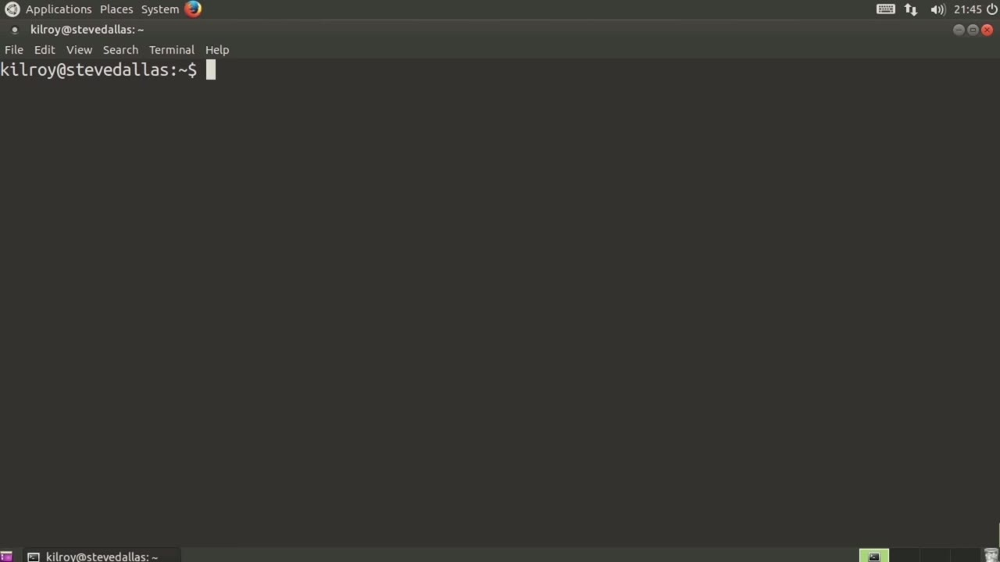
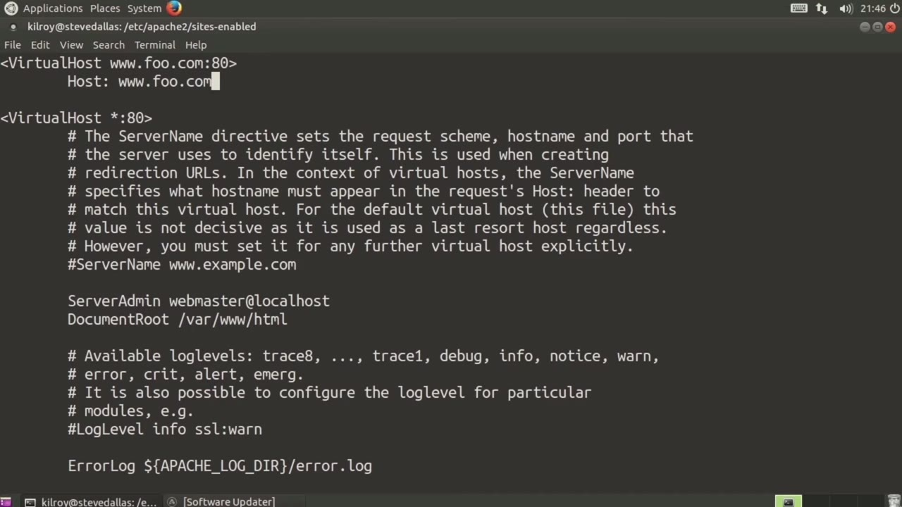
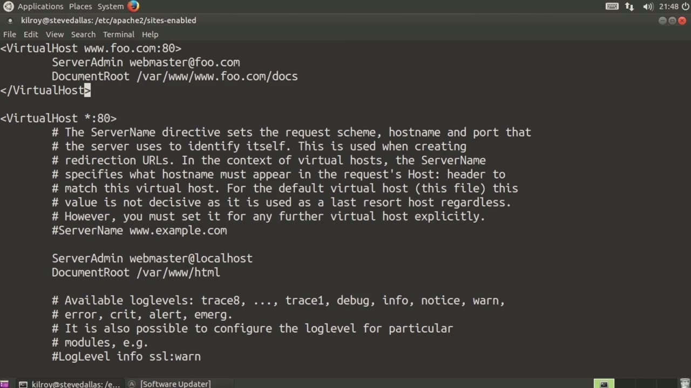

[← Course contents](../../02.md)

# 24. Virtual Hosts In Apache

**Course:** [Linux Security & Administration From Boot Process to Firewalls](https://www.youtube.com/watch?v=_WB3evmgxYA)  
**Transcript:** [`Linux Security & Administration From Boot Process to Firewalls transcript`](../../../../course_videos/Linux%20Security%20%26%20Administration%20From%20Boot%20Process%20to%20Firewalls/Linux%20Security%20%26%20Administration%20From%20Boot%20Process%20to%20Firewalls.txt)  
**Video:** 01:37:46–01:41:41 ([open at this time](https://www.youtube.com/watch?v=_WB3evmgxYA&t=5866s))

## Introduction

Virtual hosts. So if we were to go into the Apache Configuration Directory and let's just go into the sites enabled and we'll take a look at the configuration file. I'm going to use vi to edit the configuration file. Now you can see here we've got this virtual host directive. So if I wanted to create a new virtual host, what I could do And then if I wanted to bind it to a particular IP address, what I could do would be to say 172.30.42. Let's say 19 is one of the IP addresses on my system.

## Detailed Explanation

<details>
  <summary>Step 1 — Run `vi`</summary>

### Step 1 — Run `vi`

- [x] **Use `vi`**
  - Virtual hosts. So if we were to go into the Apache Configuration Directory and let's just go into the sites enabled and we'll take a look at the configuration file. I'm going to use `vi` to edit the configuration file. Now you can see here we've got this virtual host directive. So if I wanted to create a new virtual host, what I could do
  - And then if I wanted to bind it to a particular IP address, what I could do would be to say 172.30.42.
  - Let's say 19 is one of the IP addresses on my system.

- [x] **I could also specify, let's say, www. and we'll just use foo.com**
  - I could also specify, let's say, www. and we'll just use foo.com.
  - So when you connect to a web server, one of the headers that actually gets sent is this host header.
  - And the host header will tell the server which host that you want to connect to, which is part of what enables this particular functionality.

- [x] **So if I were to say this is the host that I'm actually looking for**
  - So if I were to say this is the host that I'm actually looking for, because what you can have is multiple host names running on a particular web server instance.

```bash
vi
```



</details>

<details>
  <summary>Step 2 — I could have a lot of different domain names that were bound to a</summary>

### Step 2 — I could have a lot of different domain names that were bound to a

- [x] **So I could have a lot of different domain names that were bound to a**
  - So I could have a lot of different domain names that were bound to a particular IP address.
  - And then I could have my Apache configuration file here, say my virtual host, and then I've got a set of directives here. So I could say server admin, and then I could give it a different document route, because I probably don't want to use the same document route across multiple virtual hosts
  - Because probably I want different content for each virtual host. So let's say var slash www slash www.foo.com.

- [x] **Slash docs for example and now I could set log directives here or I**
  - Slash docs for example and now I could set log directives here or I could set some other variables or other options within this virtual host and then when I'm all done I just close out this set of directives and I have a new virtual host So virtual hosts allow me to have a number of different hosts or domain names that are bound to a particular server,
  - which would have maybe a single IP address.
  - And then I could have a number of different security settings for each of my domain, so I could have different document routes, different settings, for example, I might have It would probably be unwise to do this, but I might have directory listings enabled on one where I wouldn't on another.

- [x] **Or I might allow script execution on one where I might not on another**
  - Or I might allow script execution on one where I might not on another.



</details>

<details>
  <summary>Step 3 — I can have a lot of different settings for each virtual host entry that</summary>

### Step 3 — I can have a lot of different settings for each virtual host entry that

- [x] **So I can have a lot of different settings for each virtual host entry**
  - So I can have a lot of different settings for each virtual host entry that I have.
  - And of course, virtual hosting is one of the things that we can do with Apache.
  - I could have actually created a whole separate...

- [x] **Configuration file here and I could have done something like zero one**
  - Configuration file here and I could have done something like zero one -foo.com.conf.
  - And then when Apache loaded up it would read all of the configuration files that were in my sites enabled directory and then I would get the configuration for that particular file that would include maybe just the configuration for that one virtual host. One way to protect your DNS server



</details>

<details>
  <summary>Questions and Answers</summary>

## Questions and Answers

### Question 1: What does `vi` do in this chapter?

<details>
<summary>Answer</summary>

- [x] Virtual hosts. So if we were to go into the Apache Configuration Directory and let's just go into the sites enabled and we'll take a look at the configuration file. I'm going to use `vi` to edit the configuration file. Now you can see here we've got this virtual host directive. So if I wanted to create a new virtual host, what I could do

</details>

### Question 2: What does step 1 cover (Run vi)?

<details>
<summary>Answer</summary>

- [x] Virtual hosts. So if we were to go into the Apache Configuration Directory and let's just go into the sites enabled and we'll take a look at the configuration file. I'm going to use `vi` to edit the configuration file. Now you can see here we've got this virtual host directive. So if I wanted to create a new virtual host, what I could do
- [x] And then if I wanted to bind it to a particular IP address, what I could do would be to say 172.30.42.
- [x] Let's say 19 is one of the IP addresses on my system.

</details>

### Question 3: What does step 2 cover (I could have a lot of different domain names that were bound to a)?

<details>
<summary>Answer</summary>

- [x] So I could have a lot of different domain names that were bound to a particular IP address.
- [x] And then I could have my Apache configuration file here, say my virtual host, and then I've got a set of directives here. So I could say server admin, and then I could give it a different document route, because I probably don't want to use the same document route across multiple virtual hosts
- [x] Because probably I want different content for each virtual host. So let's say var slash www slash www.foo.com.

</details>

### Question 4: What does step 3 cover (I can have a lot of different settings for each virtual host entry that)?

<details>
<summary>Answer</summary>

- [x] So I can have a lot of different settings for each virtual host entry that I have.
- [x] And of course, virtual hosting is one of the things that we can do with Apache.
- [x] I could have actually created a whole separate...

</details>

</details>

## Summary

This chapter, Virtual Hosts In Apache, walks through Run vi; I could have a lot of different domain names that were bound to a; I can have a lot of different settings for each virtual host entry that. Commands from the transcript: `vi`.

## References

- [Linux Security & Administration From Boot Process to Firewalls (YouTube)](https://www.youtube.com/watch?v=_WB3evmgxYA)
- [This chapter at 01:37:46](https://www.youtube.com/watch?v=_WB3evmgxYA&t=5866s)
- [Local transcript](../../../../course_videos/Linux%20Security%20%26%20Administration%20From%20Boot%20Process%20to%20Firewalls/Linux%20Security%20%26%20Administration%20From%20Boot%20Process%20to%20Firewalls.txt)
