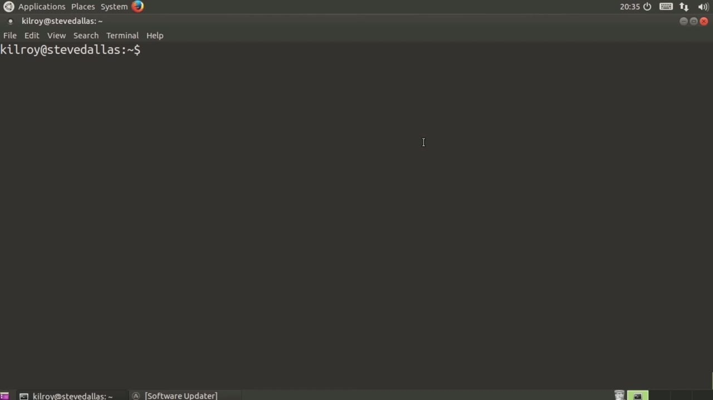
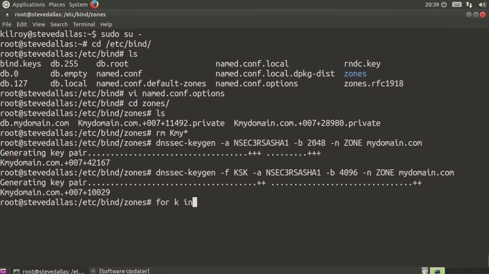
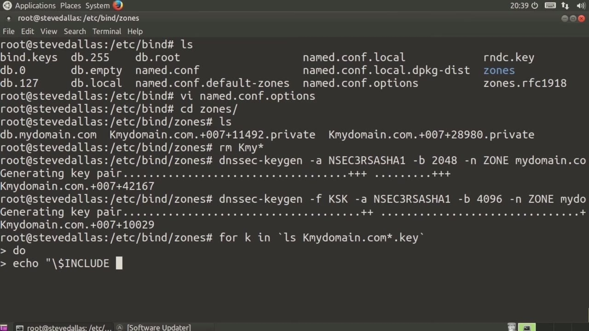

[← Course contents](../../02.md)

# 25. DNSSec

**Course:** [Linux Security & Administration From Boot Process to Firewalls](https://www.youtube.com/watch?v=_WB3evmgxYA)  
**Transcript:** [`Linux Security & Administration From Boot Process to Firewalls transcript`](../../../../course_videos/Linux%20Security%20%26%20Administration%20From%20Boot%20Process%20to%20Firewalls/Linux%20Security%20%26%20Administration%20From%20Boot%20Process%20to%20Firewalls.txt)  
**Video:** 01:41:41–01:47:57 ([open at this time](https://www.youtube.com/watch?v=_WB3evmgxYA&t=6101s))

## Introduction

And that's going to enable you to sign your zone using an encryption key so that you now have an encryption key so that you can exchange your keys with other DNS servers and you can actually have a more secure DNS setup. The first thing I want to do is I'm going to hop over to root temporarily. And then I need to go into my bind directory for my configuration files. So I'm going to edit namede.comf.opt options.

## Detailed Explanation

<details>
  <summary>Step 1 — that's going to enable you to sign your zone using an encryption key so</summary>

### Step 1 — that's going to enable you to sign your zone using an encryption key so

- [x] **And that's going to enable you to sign your zone using an encryption**
  - And that's going to enable you to sign your zone using an encryption key so that you now have an encryption key so that you can exchange your keys with other DNS servers and you can actually have a more secure DNS setup.
  - The first thing I want to do is I'm going to hop over to root temporarily.
  - And then I need to go into my bind directory for my configuration files.

- [x] **So I'm going to edit namede.comf.opt options**
  - So I'm going to edit namede.comf.opt options.
  - And we're going to take a look at the DNSSec settings here.
  - The first thing you need to do is enable DNSSEC.

- [x] **And then we're going to turn on validation**
  - And then we're going to turn on validation.
  - DNS set look aside, we are going to set to auto.
  - So we need to turn all of those on in order to enable DNS sec.

- [x] **Now, the other thing that we need to do here is to create some keys**
  - Now, the other thing that we need to do here is to create some keys.
  - So I'm going to go into my zones directory here where my one zone file is.
  - And those are some spare keys from some playing I was doing earlier.

- [x] **So let's just start over here with some fresh keys**
  - So let's just start over here with some fresh keys.
  - So we're going to say DNSSEC -keygen and then we need to use nssec 3 and RSA is going to be our algorithm.



</details>

<details>
  <summary>Step 2 — Run `ls k`, `ls`</summary>

### Step 2 — Run `ls k`, `ls`

- [x] **Shaw 1 is going to be our hashing algorithm for validation**
  - Shaw 1 is going to be our hashing algorithm for validation.
  - We're going to use 2048 as our number of bits.
  - And then we're going to say mydomain.com because that's our domain.

- [x] **Have ged, which enables us to generate these keys much faster**
  - Have ged, which enables us to generate these keys much faster, otherwise it would be a very, very slow process.
  - So now that I've got my zone signing key, I need to create a key signing key.
  - So we're going to say DNSSEC dash key gen again.

- [x] **And I need to do, first of all, -F is going to be a key signing key**
  - And I need to do, first of all, -F is going to be a key signing key.
  - We're going to again use nsec 3, or say, Shaw 1.
  - In this case, we're going to do 4096 is the number of bits that we are using.

- [x] **Use `ls k`**
  - And then what we need to do is say, again, -n, zone, my domain.com.
  - Now we've created another set of keys. So now we need to include these keys into our zone file.
  - So we're going to say for K in `ls`, K my domain.com asterisk.key.

- [x] **Use `ls`**
  - What this is going to do is it's going to populate the variable K with the output from `ls` and then Kmydomain.com asterisk.
  - So we're going to get a couple of keys here.
  - And then with that, we are going to echo.

- [x] **We're going to say backslash dollar include**
  - We're going to say backslash dollar include.

```bash
ls k
ls
```



</details>

<details>
  <summary>Step 3 — Run `ls`</summary>

### Step 3 — Run `ls`

- [x] **Use `ls`**
  - We're escaping the dollar sign here because we want it to say dollar include and then we're going to say dollar k that's going to be our variable so what it's going to do is it's going to say dollar include and then the file name that we get out of the `ls` so now i want to dump that into db.midomain.com
  - And then we're done so now i can cat db.midomidombe.
  - And you can see the two lines of the bottom dollar include and then we've got the key so now we're going to sign the zone so i'm going to say dns sec -sign zone now i need to include assault now normally you would use a random number here in this case just for simplicity i'm going to

- [x] **Use these numbers so i need 16 characters here There are a number of**
  - Use these numbers so i need 16 characters here There are a number of ways you could generate random numbers and get 16 characters out of it.
  - As I said, just for simplicity's sake, I am using just these 16 numbers.
  - So -O is going to be my zone name, which is my domain.com.

- [x] **And then my zone file name is going to be db.midomain.com**
  - And then my zone file name is going to be db.midomain.com.
  - We need to go into another configuration file and say name d.conf.local.
  - This is where we have created the zone, the zone mydomain.com, and I've got my file.

- [x] **signed onto the end of this because I now have a signed file in my**
  - . signed onto the end of this because I now have a signed file in my zone directory.
  - So you can see I've got db.mydomain.com.
  - So now all I have to do is say dig at 127.0.0.1, which is my local host.

- [x] **So I'm going to be talking to my DNS server here**
  - So I'm going to be talking to my DNS server here.
  - And then I'm going to say DNS key and then my domain.com.
  - So now you can see these are the keys that are associated with the domain, mydomain.com.

- [x] **So I've got my DNS keys associated here, and I can use those keys to**
  - So I've got my DNS keys associated here, and I can use those keys to offer better security to my DNS server and its communication with other systems.

```bash
ls
```



</details>

<details>
  <summary>Questions and Answers</summary>

## Questions and Answers

### Question 1: What does `ls k` do in this chapter?

<details>
<summary>Answer</summary>

- [x] So we're going to say for K in Ls, K my domain.com asterisk.key.

</details>

### Question 2: What does `ls` do in this chapter?

<details>
<summary>Answer</summary>

- [x] What this is going to do is it's going to populate the variable K with the output from `ls` and then Kmydomain.com asterisk.

</details>

### Question 3: What does step 1 cover (that's going to enable you to sign your zone using an encryption key so)?

<details>
<summary>Answer</summary>

- [x] And that's going to enable you to sign your zone using an encryption key so that you now have an encryption key so that you can exchange your keys with other DNS servers and you can actually have a more secure DNS setup.
- [x] The first thing I want to do is I'm going to hop over to root temporarily.
- [x] And then I need to go into my bind directory for my configuration files.

</details>

### Question 4: What does step 2 cover (Run ls k, ls)?

<details>
<summary>Answer</summary>

- [x] Shaw 1 is going to be our hashing algorithm for validation.
- [x] We're going to use 2048 as our number of bits.
- [x] And then we're going to say mydomain.com because that's our domain.

</details>

### Question 5: What does step 3 cover (Run ls)?

<details>
<summary>Answer</summary>

- [x] We're escaping the dollar sign here because we want it to say dollar include and then we're going to say dollar k that's going to be our variable so what it's going to do is it's going to say dollar include and then the file name that we get out of the `ls` so now i want to dump that into db.midomain.com
- [x] And then we're done so now i can cat db.midomidombe.
- [x] And you can see the two lines of the bottom dollar include and then we've got the key so now we're going to sign the zone so i'm going to say dns sec -sign zone now i need to include assault now normally you would use a random number here in this case just for simplicity i'm going to

</details>

</details>

## Summary

This chapter, DNSSec, walks through that's going to enable you to sign your zone using an encryption key so; Run ls k, ls; Run ls. Commands from the transcript: `ls k`, `ls`.

## References

- [Linux Security & Administration From Boot Process to Firewalls (YouTube)](https://www.youtube.com/watch?v=_WB3evmgxYA)
- [This chapter at 01:41:41](https://www.youtube.com/watch?v=_WB3evmgxYA&t=6101s)
- [Local transcript](../../../../course_videos/Linux%20Security%20%26%20Administration%20From%20Boot%20Process%20to%20Firewalls/Linux%20Security%20%26%20Administration%20From%20Boot%20Process%20to%20Firewalls.txt)
