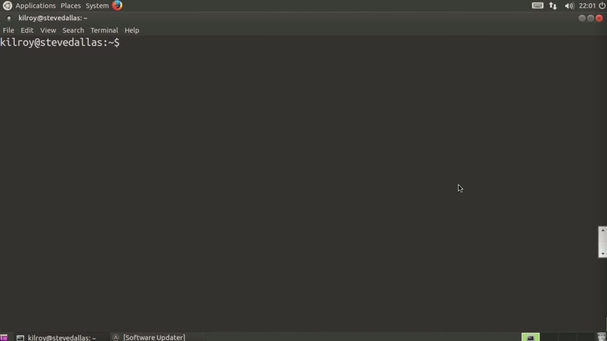
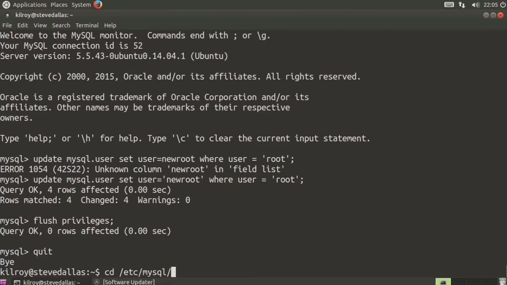
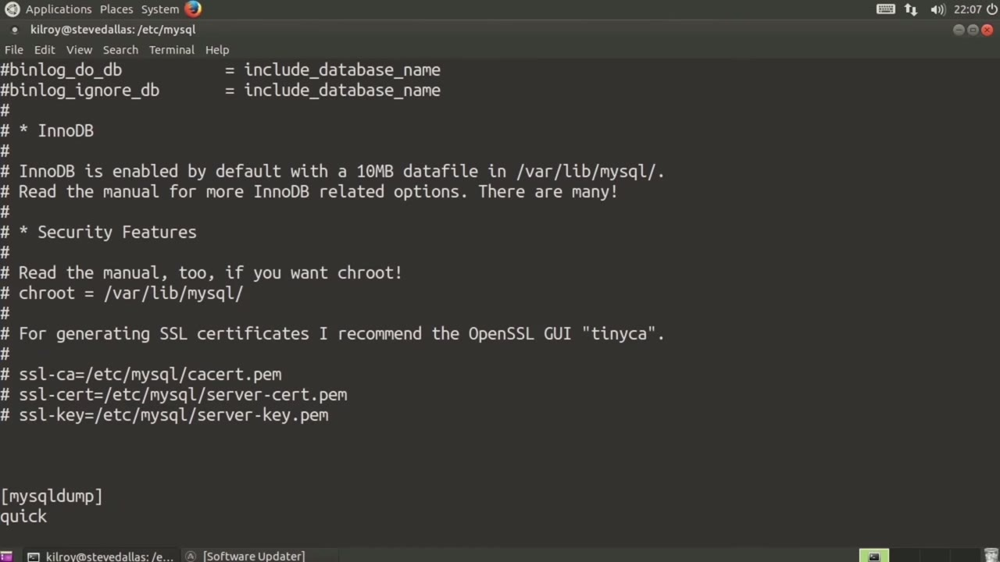

[← Course contents](../../02.md)

# 26. MySQL

**Course:** [Linux Security & Administration From Boot Process to Firewalls](https://www.youtube.com/watch?v=_WB3evmgxYA)  
**Transcript:** [`Linux Security & Administration From Boot Process to Firewalls transcript`](../../../../course_videos/Linux%20Security%20%26%20Administration%20From%20Boot%20Process%20to%20Firewalls/Linux%20Security%20%26%20Administration%20From%20Boot%20Process%20to%20Firewalls.txt)  
**Video:** 01:47:57–01:53:10 ([open at this time](https://www.youtube.com/watch?v=_WB3evmgxYA&t=6477s))

## Introduction

Now you may end up with a database server on your system. One of the common database servers is MySQL. There are a handful of things that you can do to protect your MySQL server. One of the things is making sure that you've got a good password.

## Detailed Explanation

<details>
  <summary>Step 1 — Run `mysql`</summary>

### Step 1 — Run `mysql`

- [x] **Use `mysql`**
  - Now you may end up with a database server on your system.
  - One of the common database servers is `mysql`.
  - There are a handful of things that you can do to protect your `mysql` server.

- [x] **One of the things is making sure that you've got a good password**
  - One of the things is making sure that you've got a good password.
  - So for demonstration purposes, I'm going to set it to this.
  - It's going to ask me for the existing password of the root user so that we can get access to the database.

- [x] **Use `mysql`**
  - And we can update the appropriate tables.
  - I'm going to use the root user and then going to have it prompt me for the password that I just set.
  - We can actually change the username for the root user because root is a pretty common username for the primary system administrator on a `mysql` system.

- [x] **Use `mysql`**
  - Particularly ones that are running on Linux.
  - So what I want to change is the `mysql`. User table.
  - I'm going to set user equals new root where user equals root.

- [x] **So anywhere we find the user is equal to the word root, I'm going to**
  - So anywhere we find the user is equal to the word root, I'm going to change it to the word new root.
  - And now I'm just going to say flush privileges and we've just changed the user.

```bash
mysql
```



</details>

<details>
  <summary>Step 2 — the other thing is you want to make sure that you are not listening on</summary>

### Step 2 — the other thing is you want to make sure that you are not listening on

- [x] **So the other thing is you want to make sure that you are not**
  - So the other thing is you want to make sure that you are not listening on any network interfaces, particularly if you don't have to be.
  - So let's take a look at the configuration files here.
  - We've got my.cnf and we can take a quick look at that.

- [x] **To change. The client is going to be trying to connect on port 3306**
  - To change. The client is going to be trying to connect on port 3306 and then the server we're telling it the port is 3306. In this case what we are doing is only listening on the local system. So that's 127.0.0.1 that's generally considered safe. You can't get to it remotely. So if this were to say bind dash
  - Asterisk or have an external IP address, that would be considered something that wouldn't be a great idea.
  - Most of the rest of these are going to be okay.

- [x] **Of course, you can make logging changes if you want to get more log**
  - Of course, you can make logging changes if you want to get more log entries so that you can do auditing, for example, or if you want to be looking at things like doing logwatch, or maybe having a longer historical view of what's going on.



</details>

<details>
  <summary>Step 3 — Run `mysql`</summary>

### Step 3 — Run `mysql`

- [x] **Use `mysql`**
  - On your `mysql` system. So of course you can use SSL in order to protect your network.
  - You could also use a shrewd if you wanted to lock your `mysql` server instance down to a particular interface that's not always necessary, particularly if you're only listening on your local host network.
  - So right here we've actually set a password and this is going to override the other configuration file here.

- [x] **Use `mysql`**
  - So we're going to use Debian.cNF for our configuration. Host is local host. Client is going to specify a different user and it's going to have that for our password. Of course, the password is in clear text. That's not always a great idea, but it is a strong password and as you can see
  - To that particular configuration file. So we finally have the configuration directory, and in this case we've got a safe syslog configuration, and right here all it says is it's got a cislog configuration setting. So for the safe MySQLD, we're going to do syslog,
  - And for others we're going to use `mysql` as its own log entity. So You can see we've got some configuration settings again.

- [x] **One thing that you want to do is you want to change your route user**
  - One thing that you want to do is you want to change your route user to something that somebody's not going to be doing brute force password attacks against.
  - If I've already got a username, all I've got to do is continue to try passwords against it and eventually I may be able to guess your password.
  - Of course, listening on only the local host or preferably only doing a socket listener is a good idea.

- [x] **If you're listening on any external interface, of course, you are**
  - If you're listening on any external interface, of course, you are exposing yourself to the wider network where things like brute force attacks or any type of known vulnerability or exploit could potentially bite you.

```bash
mysql
```



</details>

<details>
  <summary>Questions and Answers</summary>

## Questions and Answers

### Question 1: What does `mysql` do in this chapter?

<details>
<summary>Answer</summary>

- [x] One of the common database servers is `mysql`.

</details>

### Question 2: What does step 1 cover (Run mysql)?

<details>
<summary>Answer</summary>

- [x] Now you may end up with a database server on your system.
- [x] One of the common database servers is `mysql`.
- [x] There are a handful of things that you can do to protect your `mysql` server.

</details>

### Question 3: What does step 2 cover (the other thing is you want to make sure that you are not listening on)?

<details>
<summary>Answer</summary>

- [x] So the other thing is you want to make sure that you are not listening on any network interfaces, particularly if you don't have to be.
- [x] So let's take a look at the configuration files here.
- [x] We've got my.cnf and we can take a quick look at that.

</details>

### Question 4: What does step 3 cover (Run mysql)?

<details>
<summary>Answer</summary>

- [x] On your `mysql` system. So of course you can use SSL in order to protect your network.
- [x] You could also use a shrewd if you wanted to lock your `mysql` server instance down to a particular interface that's not always necessary, particularly if you're only listening on your local host network.
- [x] So right here we've actually set a password and this is going to override the other configuration file here.

</details>

</details>

## Summary

This chapter, MySQL, walks through Run mysql; the other thing is you want to make sure that you are not listening on; Run mysql. Commands from the transcript: `mysql`.

## References

- [Linux Security & Administration From Boot Process to Firewalls (YouTube)](https://www.youtube.com/watch?v=_WB3evmgxYA)
- [This chapter at 01:47:57](https://www.youtube.com/watch?v=_WB3evmgxYA&t=6477s)
- [Local transcript](../../../../course_videos/Linux%20Security%20%26%20Administration%20From%20Boot%20Process%20to%20Firewalls/Linux%20Security%20%26%20Administration%20From%20Boot%20Process%20to%20Firewalls.txt)
