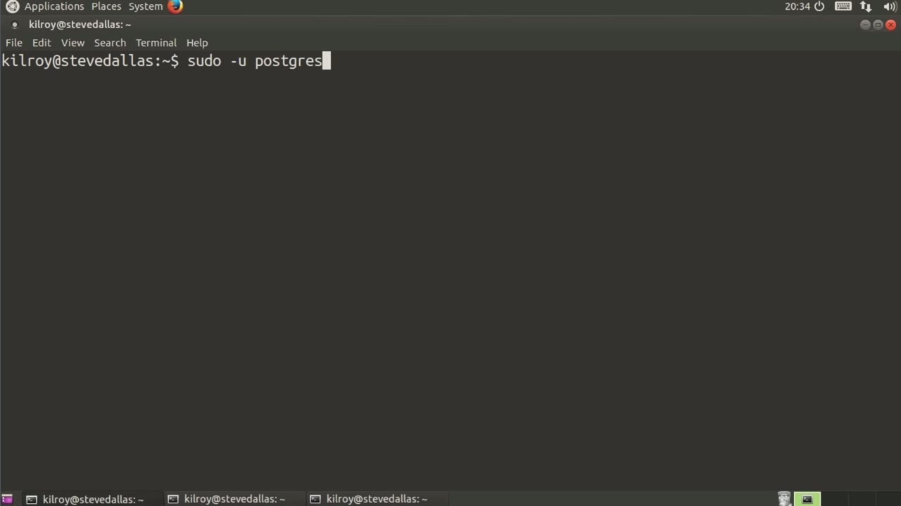
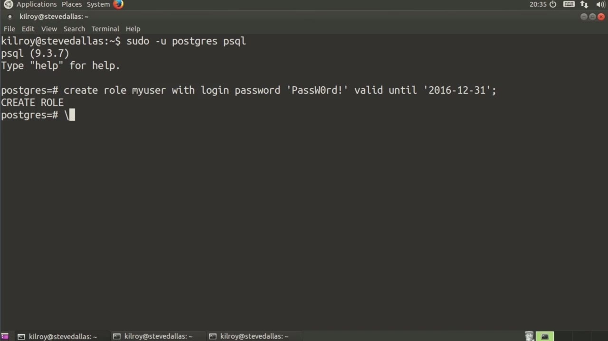
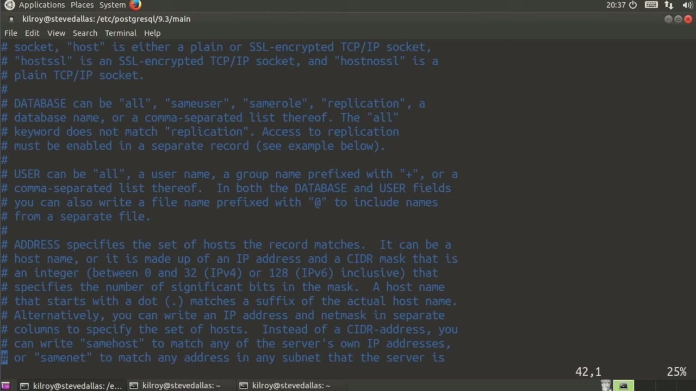

[← Course contents](../../02.md)

# 27. PostgreSQL

**Course:** [Linux Security & Administration From Boot Process to Firewalls](https://www.youtube.com/watch?v=_WB3evmgxYA)  
**Transcript:** [`Linux Security & Administration From Boot Process to Firewalls transcript`](../../../../course_videos/Linux%20Security%20%26%20Administration%20From%20Boot%20Process%20to%20Firewalls/Linux%20Security%20%26%20Administration%20From%20Boot%20Process%20to%20Firewalls.txt)  
**Video:** 01:53:10–01:57:10 ([open at this time](https://www.youtube.com/watch?v=_WB3evmgxYA&t=6790s))

## Introduction

We're gonna take a look at what we can do with PostgreSQL in terms of helping to lock it down a little bit better, although I should say PostgresQL actually comes pretty well locked down as it is, and there are some good capabilities that we can make use of that are already built into it. So the first thing that we want to do is log into the PostgresQL database And we're going to take a look at something that we can do there. I'm going to run psql, which is going to get me into the console basically or directly into the database where I can do some manipulation.

## Detailed Explanation

<details>
  <summary>Step 1 — Run `psql`</summary>

### Step 1 — Run `psql`

- [x] **Use `psql`**
  - We're gonna take a look at what we can do with PostgreSQL in terms of helping to lock it down a little bit better, although I should say PostgresQL actually comes pretty well locked down as it is, and there are some good capabilities that we can make use of that are already built into it. So the first thing that we want to do is log into the PostgresQL database
  - And we're going to take a look at something that we can do there. I'm going to run `psql`, which is going to get me into the console basically or directly into the database where I can do some manipulation.
  - So what I want to do is I'm going to create role and say my user with login, password, and I'm just going to give it just a password here.

- [x] **Now, what I'm going to do next is the important part**
  - Now, what I'm going to do next is the important part.
  - So I'm going to say valid until, and let's say 2016, 12-31.
  - One of the nice things about Postgrescue L actually is that I can create a user with a specific time period in mind.

- [x] **So I can make this particular user valid for, let's say a month, a**
  - So I can make this particular user valid for, let's say a month, a year, a year and a half, two months, whatever it turns out to be.

```bash
psql
```



</details>

<details>
  <summary>Step 2 — I can make it valid to a specific point in time so that it's no longer</summary>

### Step 2 — I can make it valid to a specific point in time so that it's no longer

- [x] **I can make it valid to a specific point in time so that it's no**
  - I can make it valid to a specific point in time so that it's no longer useful after that point in time.
  - In the case where I've got a lot of users sitting around that I have created and then just kind of forgotten about what I may end up doing is having to go through my database and all of my users and calling those users from time to time.
  - This can help save me from doing that by making sure that I am setting expiration dates on the users that I create.

- [x] **Now we're going to hop into the configuration files here for**
  - Now we're going to hop into the configuration files here for Postgres, and I'm going to edit one of these, and I'm going to show you some settings that we can make use of here.
  - HBA.conth, and I'm going to scroll down.
  - What this does is it gives me the ability to have access controls.

- [x] **With access controls, what I can do is make sure that only specific**
  - With access controls, what I can do is make sure that only specific IP addresses or networks get access to particular databases.



</details>

<details>
  <summary>Step 3 — I've got a number of fields here I can use</summary>

### Step 3 — I've got a number of fields here I can use

- [x] **I've got a number of fields here I can use**
  - I've got a number of fields here I can use.
  - First is the database, and then we've got user and address.
  - So this is not only a whitelist access control list.

- [x] **In other words, here's the list of people that I can**
  - In other words, here's the list of people that I can.
  - Allow, but I can also specifically say, here's a specific address or a network of addresses that I can block. So we're going to scroll down here and you can see some of these. So this is the type of access here. This is local access. We're saying all databases can log in with the user
  - Postgres. This is the primary cis admin account for Postgres. So now we've got some others.

- [x] **We're going to allow all databases, all users getting access from our**
  - We're going to allow all databases, all users getting access from our local host if we are using md5 as our authentication method.
  - So you can see we've got a lot of capability here to have some very finely grained access control lists when it comes to the users that we allow, the databases we allow them to where they can come in from, and then the authentication method that we can require that they use when they do come in.
  - All of these capabilities here give us some really powerful tools to lock down our PostgreSQL database server so that we're ensuring that only the right users get access to the right databases from the right systems.

- [x] **We're going to talk about a few ways that you can protect a Tomcat**
  - We're going to talk about a few ways that you can protect a Tomcat installation.



</details>

<details>
  <summary>Questions and Answers</summary>

## Questions and Answers

### Question 1: What does `psql` do in this chapter?

<details>
<summary>Answer</summary>

- [x] And we're going to take a look at something that we can do there. I'm going to run `psql`, which is going to get me into the console basically or directly into the database where I can do some manipulation.

</details>

### Question 2: What does step 1 cover (Run psql)?

<details>
<summary>Answer</summary>

- [x] We're gonna take a look at what we can do with PostgreSQL in terms of helping to lock it down a little bit better, although I should say PostgresQL actually comes pretty well locked down as it is, and there are some good capabilities that we can make use of that are already built into it. So the first thing that we want to do is log into the PostgresQL database
- [x] And we're going to take a look at something that we can do there. I'm going to run `psql`, which is going to get me into the console basically or directly into the database where I can do some manipulation.
- [x] So what I want to do is I'm going to create role and say my user with login, password, and I'm just going to give it just a password here.

</details>

### Question 3: What does step 2 cover (I can make it valid to a specific point in time so that it's no longer)?

<details>
<summary>Answer</summary>

- [x] I can make it valid to a specific point in time so that it's no longer useful after that point in time.
- [x] In the case where I've got a lot of users sitting around that I have created and then just kind of forgotten about what I may end up doing is having to go through my database and all of my users and calling those users from time to time.
- [x] This can help save me from doing that by making sure that I am setting expiration dates on the users that I create.

</details>

### Question 4: What does step 3 cover (I've got a number of fields here I can use)?

<details>
<summary>Answer</summary>

- [x] I've got a number of fields here I can use.
- [x] First is the database, and then we've got user and address.
- [x] So this is not only a whitelist access control list.

</details>

</details>

## Summary

This chapter, PostgreSQL, walks through Run psql; I can make it valid to a specific point in time so that it's no longer; I've got a number of fields here I can use. Commands from the transcript: `psql`.

## References

- [Linux Security & Administration From Boot Process to Firewalls (YouTube)](https://www.youtube.com/watch?v=_WB3evmgxYA)
- [This chapter at 01:53:10](https://www.youtube.com/watch?v=_WB3evmgxYA&t=6790s)
- [Local transcript](../../../../course_videos/Linux%20Security%20%26%20Administration%20From%20Boot%20Process%20to%20Firewalls/Linux%20Security%20%26%20Administration%20From%20Boot%20Process%20to%20Firewalls.txt)
