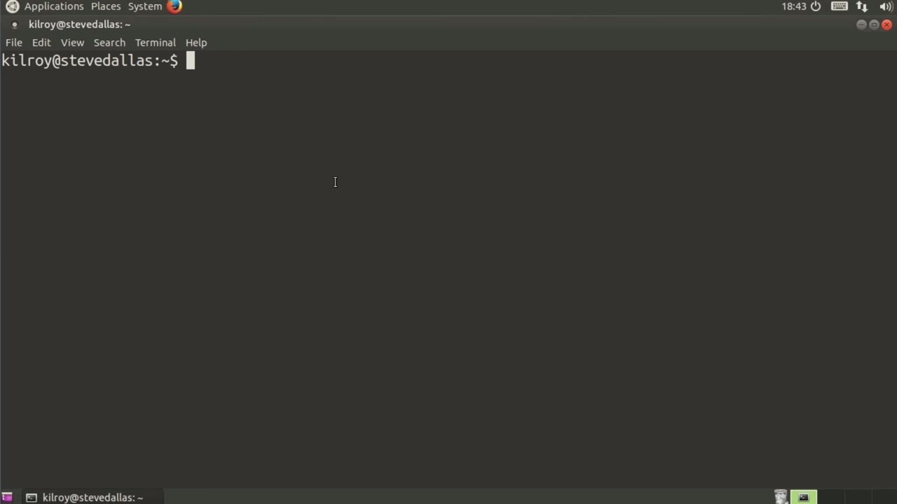
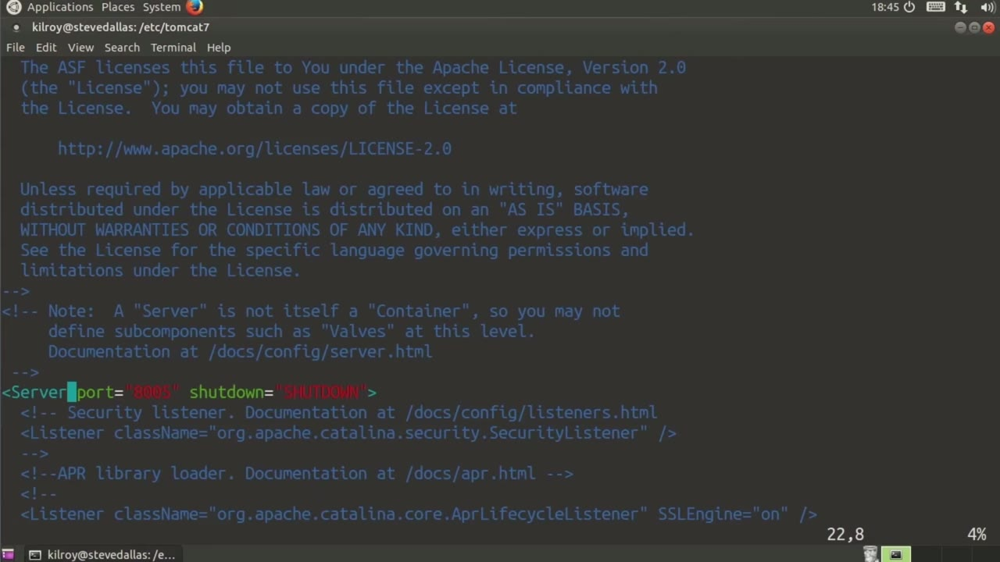
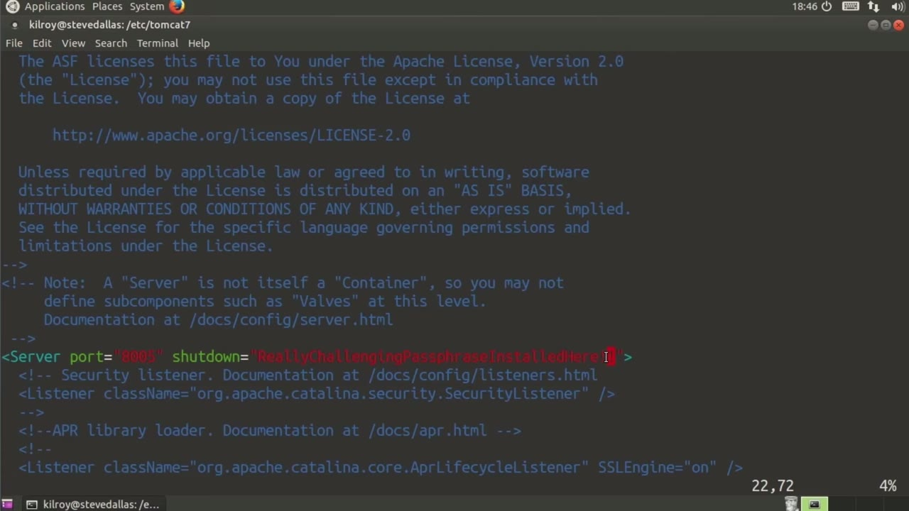
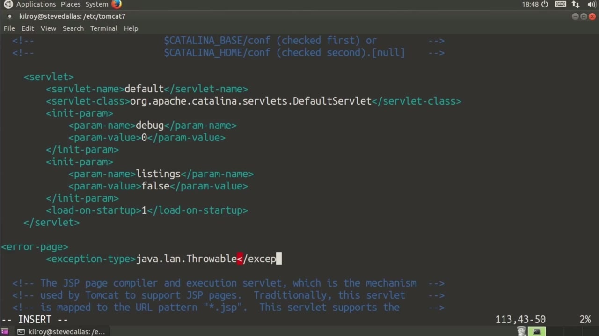

[← Course contents](../../02.md)

# 28. Tomcat

**Course:** [Linux Security & Administration From Boot Process to Firewalls](https://www.youtube.com/watch?v=_WB3evmgxYA)  
**Transcript:** [`Linux Security & Administration From Boot Process to Firewalls transcript`](../../../../course_videos/Linux%20Security%20%26%20Administration%20From%20Boot%20Process%20to%20Firewalls/Linux%20Security%20%26%20Administration%20From%20Boot%20Process%20to%20Firewalls.txt)  
**Video:** 01:57:10–02:02:45 ([open at this time](https://www.youtube.com/watch?v=_WB3evmgxYA&t=7030s))

## Introduction

Now, Tomcat is a web application server that uses Java. That this is an application itself, a program that sits and listens to network connections, and then what it does is it passes messages into an application that sits inside it. So sometimes you'll hear it referred to as an application container because it actually contains another application that has been written. Web messages, HTTP messages, and requests that are going into this particular web application.

## Detailed Explanation

<details>
  <summary>Step 1 — Run `shutdown port`, `shutdown`</summary>

### Step 1 — Run `shutdown port`, `shutdown`

- [x] **Now, Tomcat is a web application server that uses Java**
  - Now, Tomcat is a web application server that uses Java.
  - That this is an application itself, a program that sits and listens to network connections, and then what it does is it passes messages into an application that sits inside it.
  - So sometimes you'll hear it referred to as an application container because it actually contains another application that has been written.

- [x] **Web messages, HTTP messages, and requests that are going into this**
  - Web messages, HTTP messages, and requests that are going into this particular web application.
  - I'm going to go into my Tomcat directory. I've got Tomcat 7 installed here, and we're going to take a look at a couple of the configuration files that are here.
  - Now, these are written in XML that makes them somewhat self-documenting, and it should make them fairly easy to understand. Now, there are a couple of things going on here.

- [x] **Use `shutdown port`, `shutdown`**
  - First of all, there is a listener port that is configured with Tomcat.
  - Now this is called a `shutdown port` right here on Port 8,05.
  - And what this does is it gives you a way to connect to the server and send a clean `shutdown` message.

- [x] **And that's going to allow you to remotely control this particular**
  - And that's going to allow you to remotely control this particular server.
  - Now this isn't necessarily a great thing to have.
  - You can theoretically disable it, although if you need to cleanly shut it down remotely, having the port open isn't bad.

- [x] **But what you really want to do is you want to make sure you have a**
  - But what you really want to do is you want to make sure you have a really challenging passphrase installed here.
  - You don't want it to just be shut down as the password because what we're doing here is this is actually what you send to the server.

```bash
shutdown port
shutdown
```





</details>

<details>
  <summary>Step 2 — Run `shutdown`</summary>

### Step 2 — Run `shutdown`

- [x] **Use `shutdown`**
  - If what you send into this particular server port matches this `shutdown` message here, it will actually shut the server down.
  - You don't want to have that open to just everyone.
  - Now, we can just skim through this listing here.

- [x] **There are a number of connectors that give you the port that we're**
  - There are a number of connectors that give you the port that we're listening on and the protocol you can see.
  - There are some other connectors that are listening with different protocols in use.
  - If you've got different ways that you want to communicate to Tomcat, you would set those up based on whatever your needs were.

- [x] **I don't actually want to save that, so I'm going to quit out of there**
  - I don't actually want to save that, so I'm going to quit out of there.
  - And there's a couple of things that I want to do with web.xml.
  - The first thing is I want to look for a listing parameter.

- [x] **And the listing parameter determines whether we display basically**
  - And the listing parameter determines whether we display basically directory listings, and that's a really bad idea.
  - I want to make sure that that parameter is false.
  - Now something else that I want to do is look for an error page that doesn't actually exist.

- [x] **So what I want to do is insert a set of parameters here**
  - So what I want to do is insert a set of parameters here.
  - And that's going to be Java.lang.throwable.

```bash
shutdown
```



</details>

<details>
  <summary>Step 3 — what I'm doing here is I'm replacing the default error page</summary>

### Step 3 — what I'm doing here is I'm replacing the default error page

- [x] **And what I'm doing here is I'm replacing the default error page**
  - And what I'm doing here is I'm replacing the default error page.
  - The reason for that is because when Tomcat gets an exception, by default, it will throw up a stack trace, which means it will give all of the methods that have been called within the application.
  - So I want to set up an error page here, and this is something that I would actually have to create, would be this error jsp, that would do something other than provide that stack trace, because that's not a great thing to provide to an attacker.

- [x] **You would set that error page in there, and we've looked at web.xml**
  - You would set that error page in there, and we've looked at web.xml.
  - You can see there are a number of other parameters here.
  - I'm not going to worry so much about those.

- [x] **And the last thing I want to show you is the Tomcat Users XML file**
  - And the last thing I want to show you is the Tomcat Users XML file.
  - So we're going to look at Tomcat -users.
  - And this is a place where you can configure users if you want to use the manager application within Tomcat.

- [x] **So I would specify a role with a role name and then provide a**
  - So I would specify a role with a role name and then provide a username, make sure that I've got a password, and then provide the roles as well.
  - You can see there are some that are set up here.
  - This right here is a comment, and this is a closed comment.

- [x] **So this won't actually take effect here because all of this is**
  - So this won't actually take effect here because all of this is commented out.
  - But if you wanted to implement this manager component of Tomcat, you would need to have a user installed.
  - And this is where you would install users within Tomcat.

- [x] **A lot of what you would do from a security standpoint with Tomcat is**
  - A lot of what you would do from a security standpoint with Tomcat is make sure that your web application is written in a secure fashion, making sure that you're doing input validation, error checking, all of those good things.
  - But there are a couple of things you can do with the configuration as well.
  - And on an Ubuntu system, we are looking in /etc Tomcat 7 for the various XML configuration files where you would make some of those changes.



</details>

<details>
  <summary>Questions and Answers</summary>

## Questions and Answers

### Question 1: What does `shutdown port` do in this chapter?

<details>
<summary>Answer</summary>

- [x] Now this is called a `shutdown port` right here on Port 8,05.

</details>

### Question 2: What does `shutdown` do in this chapter?

<details>
<summary>Answer</summary>

- [x] And what this does is it gives you a way to connect to the server and send a clean `shutdown` message.

</details>

### Question 3: What does step 1 cover (Run shutdown port, shutdown)?

<details>
<summary>Answer</summary>

- [x] Now, Tomcat is a web application server that uses Java.
- [x] That this is an application itself, a program that sits and listens to network connections, and then what it does is it passes messages into an application that sits inside it.
- [x] So sometimes you'll hear it referred to as an application container because it actually contains another application that has been written.

</details>

### Question 4: What does step 2 cover (Run shutdown)?

<details>
<summary>Answer</summary>

- [x] If what you send into this particular server port matches this `shutdown` message here, it will actually shut the server down.
- [x] You don't want to have that open to just everyone.
- [x] Now, we can just skim through this listing here.

</details>

### Question 5: What does step 3 cover (what I'm doing here is I'm replacing the default error page)?

<details>
<summary>Answer</summary>

- [x] And what I'm doing here is I'm replacing the default error page.
- [x] The reason for that is because when Tomcat gets an exception, by default, it will throw up a stack trace, which means it will give all of the methods that have been called within the application.
- [x] So I want to set up an error page here, and this is something that I would actually have to create, would be this error jsp, that would do something other than provide that stack trace, because that's not a great thing to provide to an attacker.

</details>

</details>

## Summary

This chapter, Tomcat, walks through Run shutdown port, shutdown; Run shutdown; what I'm doing here is I'm replacing the default error page. Commands from the transcript: `shutdown port`, `shutdown`.

## References

- [Linux Security & Administration From Boot Process to Firewalls (YouTube)](https://www.youtube.com/watch?v=_WB3evmgxYA)
- [This chapter at 01:57:10](https://www.youtube.com/watch?v=_WB3evmgxYA&t=7030s)
- [Local transcript](../../../../course_videos/Linux%20Security%20%26%20Administration%20From%20Boot%20Process%20to%20Firewalls/Linux%20Security%20%26%20Administration%20From%20Boot%20Process%20to%20Firewalls.txt)
