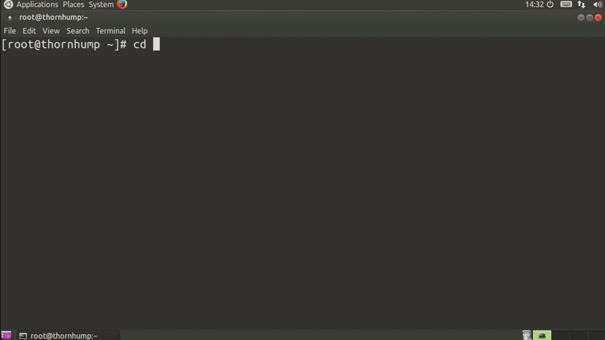
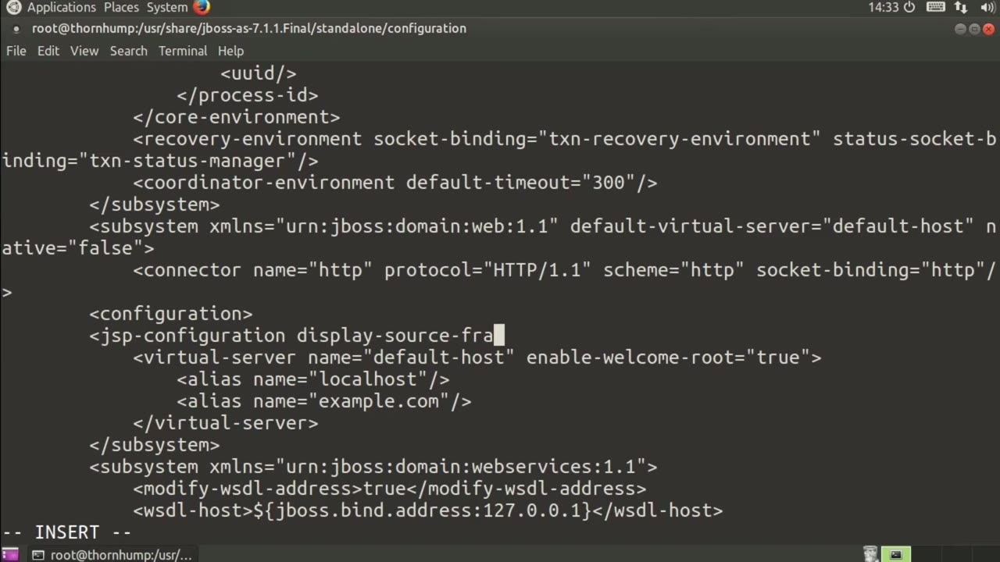
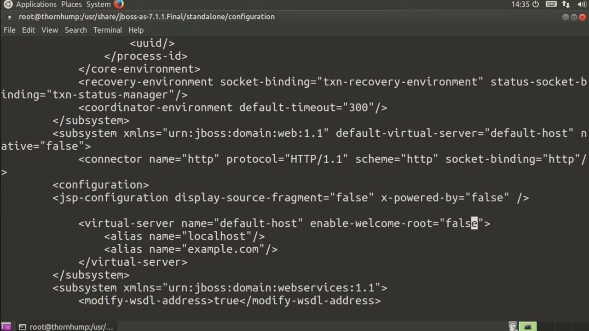

[← Course contents](../../02.md)

# 29. JBoss

**Course:** [Linux Security & Administration From Boot Process to Firewalls](https://www.youtube.com/watch?v=_WB3evmgxYA)  
**Transcript:** [`Linux Security & Administration From Boot Process to Firewalls transcript`](../../../../course_videos/Linux%20Security%20%26%20Administration%20From%20Boot%20Process%20to%20Firewalls/Linux%20Security%20%26%20Administration%20From%20Boot%20Process%20to%20Firewalls.txt)  
**Video:** 02:02:45–02:05:35 ([open at this time](https://www.youtube.com/watch?v=_WB3evmgxYA&t=7365s))

## Introduction

We're going to take a look at some ways that you can harden your J-Boss installation. I'm actually on a centos system, and the centos system has j-bos application server 7 installed. And we're going to take a look at one of the configuration files here. So we're going to go into configuration.

## Detailed Explanation

  
Step 1 — going to take a look at some ways that you can harden your J-Boss

### Step 1 — going to take a look at some ways that you can harden your J-Boss

- [x] **We're going to take a look at some ways that you can harden your**
  - We're going to take a look at some ways that you can harden your J-Boss installation.
  - I'm actually on a centos system, and the centos system has j-bos application server 7 installed.
  - And we're going to take a look at one of the configuration files here.

- [x] **So we're going to go into configuration**
  - So we're going to go into configuration.
  - And then I'm going to edit the XML file so we can make some changes to the XML so that we can actually have a slightly better configuration in terms of security.
  - I want to look for connector and I'm looking for this particular connector here.

- [x] **What I want to do after this is add some additional configuration**
  - What I want to do after this is add some additional configuration.

  
Step 2 — we're going to add a jsp configuration

### Step 2 — we're going to add a jsp configuration

- [x] **And we're going to add a jsp configuration**
  - And we're going to add a jsp configuration.
  - So what we are doing here is we are disabling the source fragment, meaning that when an error comes up, what happens sometimes is you will get a chunk of stack trace code, various other information that could be useful or interesting to an attacker.
  - And then we are going to turn off the X powered by.

- [x] **So we're not giving up any information about what application server**
  - So we're not giving up any information about what application server and version we are actually running.
  - Now we can also enable SSL here so we could turn on a connector for HTTPS and then set the scheme and turn on SSL and so forth.
  - I'm not going to go through that process here, but there is one other thing that I do want to do.

- [x] **And what that's going to do is disable the welcome content that is**
  - And what that's going to do is disable the welcome content that is installed by default on a J-Boss system.

  
Step 3 — If I disable the welcome content, it means that An attacker won't be

### Step 3 — If I disable the welcome content, it means that An attacker won't be

- [x] **If I disable the welcome content, it means that An attacker won't be**
  - If I disable the welcome content, it means that An attacker won't be able to go to this site while it's under construction or while anything else is going on and be able to get information about the fact that we've got J-Boss installed and that it's possibly a new installation,
  - which means that we may have some issues that they may want to make use of.
  - Those are a couple of things that we can do.

- [x] **As I said, the other thing that we can do that's quite a bit more**
  - As I said, the other thing that we can do that's quite a bit more detailed is we could enable SSL.
  - That really is just turning on an additional connector and providing information about where the key store and key files, as well as the ca certificate file, where all of that is turned on.

  
Questions and Answers

## Questions and Answers

### Question 1: What does step 1 cover (going to take a look at some ways that you can harden your J-Boss)?

Answer

- [x] We're going to take a look at some ways that you can harden your J-Boss installation.
- [x] I'm actually on a centos system, and the centos system has j-bos application server 7 installed.
- [x] And we're going to take a look at one of the configuration files here.

### Question 2: What does step 2 cover (we're going to add a jsp configuration)?

Answer

- [x] And we're going to add a jsp configuration.
- [x] So what we are doing here is we are disabling the source fragment, meaning that when an error comes up, what happens sometimes is you will get a chunk of stack trace code, various other information that could be useful or interesting to an attacker.
- [x] And then we are going to turn off the X powered by.

### Question 3: What does step 3 cover (If I disable the welcome content, it means that An attacker won't be)?

Answer

- [x] If I disable the welcome content, it means that An attacker won't be able to go to this site while it's under construction or while anything else is going on and be able to get information about the fact that we've got J-Boss installed and that it's possibly a new installation,
- [x] which means that we may have some issues that they may want to make use of.
- [x] Those are a couple of things that we can do.

## Summary

This chapter, JBoss, walks through going to take a look at some ways that you can harden your J-Boss; we're going to add a jsp configuration; If I disable the welcome content, it means that An attacker won't be.

## References

- [Linux Security & Administration From Boot Process to Firewalls (YouTube)](https://www.youtube.com/watch?v=_WB3evmgxYA)
- [This chapter at 02:02:45](https://www.youtube.com/watch?v=_WB3evmgxYA&t=7365s)
- [Local transcript](../../../../course_videos/Linux%20Security%20%26%20Administration%20From%20Boot%20Process%20to%20Firewalls/Linux%20Security%20%26%20Administration%20From%20Boot%20Process%20to%20Firewalls.txt)
