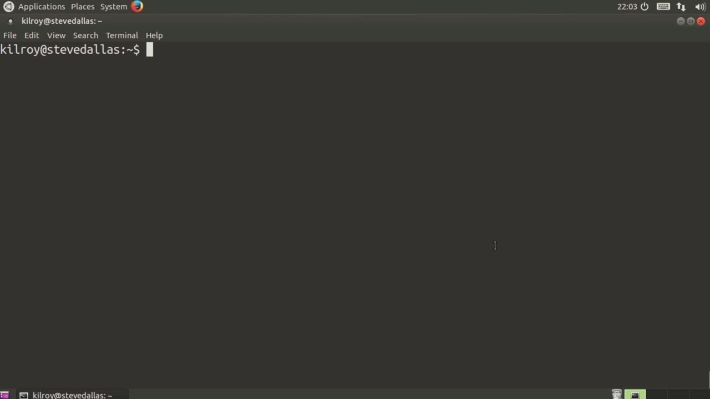
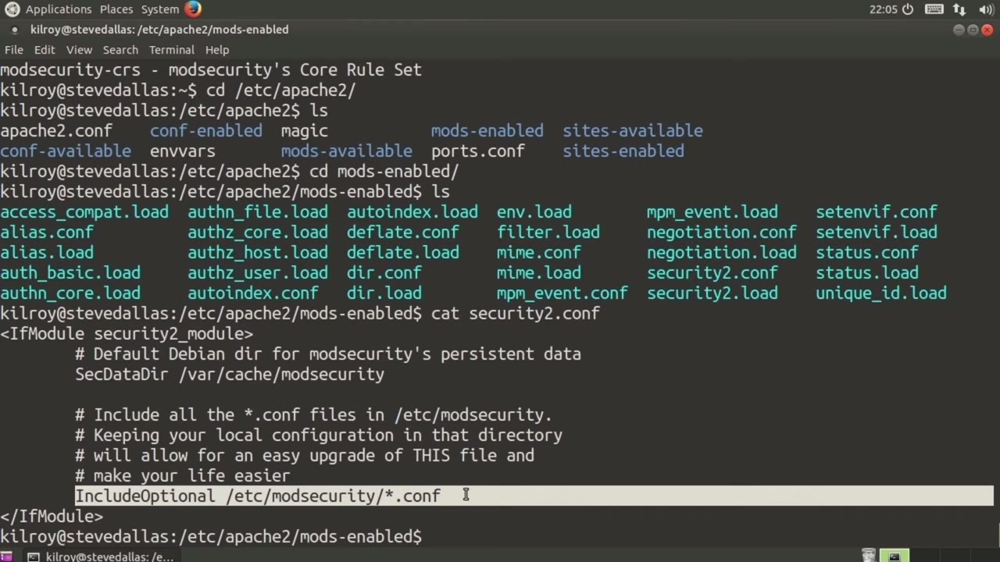
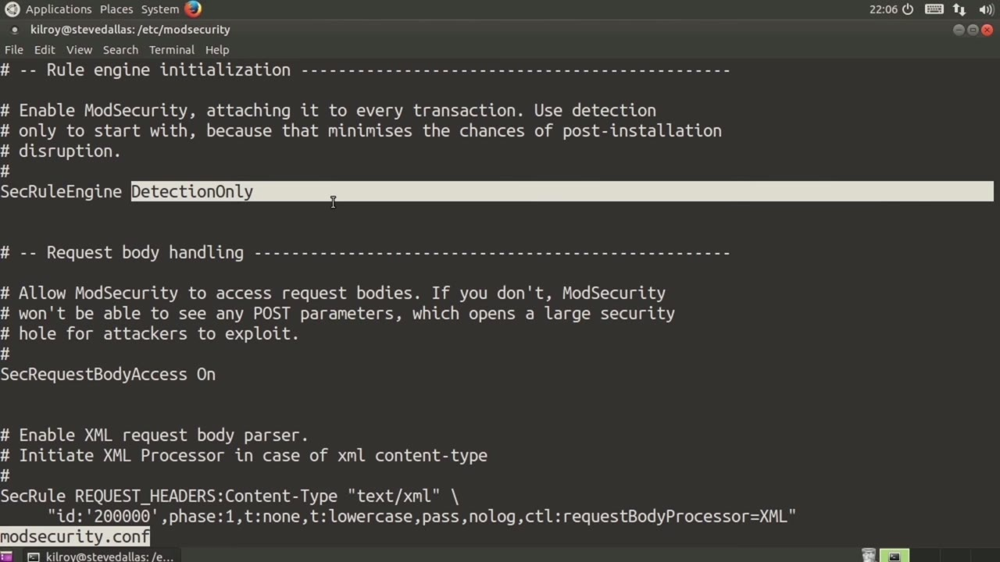
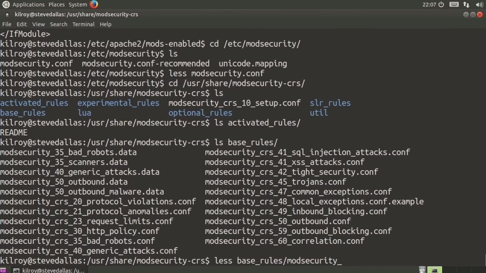

[← Course contents](../../02.md)

# 30. mod_security

**Course:** [Linux Security & Administration From Boot Process to Firewalls](https://www.youtube.com/watch?v=_WB3evmgxYA)  
**Transcript:** [`Linux Security & Administration From Boot Process to Firewalls transcript`](../../../../course_videos/Linux%20Security%20%26%20Administration%20From%20Boot%20Process%20to%20Firewalls/Linux%20Security%20%26%20Administration%20From%20Boot%20Process%20to%20Firewalls.txt)  
**Video:** 02:05:35–02:12:39 ([open at this time](https://www.youtube.com/watch?v=_WB3evmgxYA&t=7535s))

## Introduction

Now, we've talked about installing an Apache server, and when you've got an Apache web server, You need to open up ports in whatever firewall you've got, and those holes in the firewall are going to allow your traffic to come through. So the problem with that is that allows application attacks to come into your web server and whatever web application that you've got running on that web server. Well, we use a web application firewall. One web application firewall that you can use is one called Mod Security.

## Detailed Explanation

<details>
  <summary>Step 1 — Now, we've talked about installing an Apache server, and when you've</summary>

### Step 1 — Now, we've talked about installing an Apache server, and when you've

- [x] **Now, we've talked about installing an Apache server, and when you've**
  - Now, we've talked about installing an Apache server, and when you've got an Apache web server, You need to open up ports in whatever firewall you've got, and those holes in the firewall are going to allow your traffic to come through.
  - So the problem with that is that allows application attacks to come into your web server and whatever web application that you've got running on that web server.
  - Well, we use a web application firewall.

- [x] **One web application firewall that you can use is one called Mod**
  - One web application firewall that you can use is one called Mod Security.
  - So we've got Mod Security and you want to choose probably this one, if you're installing on an Ubuntu system.
  - If you're running on a Red Hat system or some other variation of Linux, you'll find a similar package.

- [x] **And then, of course, you need the core rule set**
  - And then, of course, you need the core rule set.
  - The core rule set is a set of rules that...
  - Determines whether messages coming into your web server are actually malicious, and then you can determine how you want to handle those.

- [x] **So let's take a look at the configuration for mod security**
  - So let's take a look at the configuration for mod security.
  - First of all, we're going to go into the Apache configuration directory, and then we're going to go into mods enabled, and you'll see we've got Security2.com.
  - So let's just take a look at Security 2.2.

- [x] **And what this says is we're specifying a data directory of VARCash**
  - And what this says is we're specifying a data directory of VARCash mod security.
  - This is where any persistent data associated with mod security is going to be located.



</details>

<details>
  <summary>Step 2 — Now, the other thing that we've got here is it's going to read a</summary>

### Step 2 — Now, the other thing that we've got here is it's going to read a

- [x] **Now, the other thing that we've got here is it's going to read a**
  - Now, the other thing that we've got here is it's going to read a configuration file in EtsyMod Security.
  - So we're going to go into EtsyMod Security.
  - When you install mod security, it installs modsecurity.comf-recommended.

- [x] **In order to make changes to these configurations, you need to move it**
  - In order to make changes to these configurations, you need to move it over to modsecurity.com.
  - As you can see in the configuration that we looked at from the module itself, it's only looking for files that are named with a dot-conf ending.
  - So this -recommended won't be read at all.

- [x] **So let's take a look at modsecurity.com**
  - So let's take a look at modsecurity.com.
  - There are a couple of ways to run a web application firewall.
  - When you first install it, the best thing to do is run it in detection-only mode.

- [x] **Detection only is going to parse the rules, and it's going to check**
  - Detection only is going to parse the rules, and it's going to check all of your traffic against those rules.
  - But the only thing it's going to do is generate log messages.



</details>

<details>
  <summary>Step 3 — Run `touch`</summary>

### Step 3 — Run `touch`

- [x] **Use `touch`**
  - It won't actually `touch` the...
  - Messages that are going into your web application.
  - It's only going to log them, meaning that's only going to be doing detection.

- [x] **When you are ready and you are sure that these rules aren't going to**
  - When you are ready and you are sure that these rules aren't going to break your web application, you can turn the sec rule engine on.
  - So there are a number of other configuration settings.
  - Most of these aren't really all that interesting, for the most part, unless you really want to go digging deep into the configuration and doing a lot of tweaks.

- [x] **The other one that you want to be aware of is when you actually find**
  - The other one that you want to be aware of is when you actually find problems with your web traffic, it's going to log those into this log file here. So you're going to get a ModSec underscore audit.
  - .log. So now let's take a look at where all of the rules are.
  - These are located in UserShare ModSecurity -crs.

- [x] **You can see there are some directories here**
  - You can see there are some directories here.
  - We're going to pop into activated rules.
  - And I'm going to show you that there's actually nothing here.

- [x] **This is because you need to determine what you want to actually**
  - This is because you need to determine what you want to actually activate yourself.
  - So here are a number of rules in base rules.

```bash
touch
```



</details>

<details>
  <summary>Step 4 — let's just take a quick look at one of them</summary>

### Step 4 — let's just take a quick look at one of them

- [x] **And let's just take a quick look at one of them**
  - And let's just take a quick look at one of them.
  - And let's just take a look at the generic attack.
  - Now, this is just a set of data that we could be looking for with any number of attacks.

- [x] **And let's take a look at one of the configuration files that would be**
  - And let's take a look at one of the configuration files that would be associated with that data.
  - So we're going to look at base rules, mod security, 40, generic attacks.com.
  - So now this is the configuration file that goes with that data file that we were just looking at.

- [x] **You can see they can be really difficult to understand**
  - You can see they can be really difficult to understand.
  - It does take a little bit of experience to know what it is you're looking at here.
  - So what this is looking for is a set of data here.

- [x] **This is actually a regular expression that tells the rule engine how**
  - This is actually a regular expression that tells the rule engine how to actually determine whether this rule gets triggered.
  - Then we trigger the second part of the rule, and then some of this has to do with what gets logged, and also what the disposition of the HTTP request coming through should be.
  - So for example, we may just drop it, we may also log it.

- [x] **There are a handful of things that we can do with the HTTP messages**
  - There are a handful of things that we can do with the HTTP messages that are coming through and get identified by Mod Security.
  - If I wanted to activate any of these rules, I could go into activated rules, and then I could say, let's say we're going to activate all of the base rules into this directory here.
  - So now I've got SIM links from the original rules, if I just show you here, -la.

- [x] **Are actually linked to all of the rules in base rules**
  - Are actually linked to all of the rules in base rules.
  - So now all of my base rules are actually activated, and all of these attacks are going to be noticed by my Mod Security installation.
  - So Mod Security, again, is a web application firewall.

- [x] **You can install it and then do configurations**
  - You can install it and then do configurations.
  - Once you've actually configured it, you can see the different rules that are in place.
  - So we've got base rules, we've got experimental rules, and then there are optional rules as well.

- [x] **And you can enable any ones that you choose to enable based on your**
  - And you can enable any ones that you choose to enable based on your specific web application and what you want to protect against.



</details>

<details>
  <summary>Questions and Answers</summary>

## Questions and Answers

### Question 1: What does `touch` do in this chapter?

<details>
<summary>Answer</summary>

- [x] It won't actually `touch` the...

</details>

### Question 2: What does step 1 cover (Now, we've talked about installing an Apache server, and when you've)?

<details>
<summary>Answer</summary>

- [x] Now, we've talked about installing an Apache server, and when you've got an Apache web server, You need to open up ports in whatever firewall you've got, and those holes in the firewall are going to allow your traffic to come through.
- [x] So the problem with that is that allows application attacks to come into your web server and whatever web application that you've got running on that web server.
- [x] Well, we use a web application firewall.

</details>

### Question 3: What does step 2 cover (Now, the other thing that we've got here is it's going to read a)?

<details>
<summary>Answer</summary>

- [x] Now, the other thing that we've got here is it's going to read a configuration file in EtsyMod Security.
- [x] So we're going to go into EtsyMod Security.
- [x] When you install mod security, it installs modsecurity.comf-recommended.

</details>

### Question 4: What does step 3 cover (Run touch)?

<details>
<summary>Answer</summary>

- [x] It won't actually `touch` the...
- [x] Messages that are going into your web application.
- [x] It's only going to log them, meaning that's only going to be doing detection.

</details>

### Question 5: What does step 4 cover (let's just take a quick look at one of them)?

<details>
<summary>Answer</summary>

- [x] And let's just take a quick look at one of them.
- [x] And let's just take a look at the generic attack.
- [x] Now, this is just a set of data that we could be looking for with any number of attacks.

</details>

</details>

## Summary

This chapter, mod_security, walks through Now, we've talked about installing an Apache server, and when you've; Now, the other thing that we've got here is it's going to read a; Run touch; let's just take a quick look at one of them. Commands from the transcript: `touch`.

## References

- [Linux Security & Administration From Boot Process to Firewalls (YouTube)](https://www.youtube.com/watch?v=_WB3evmgxYA)
- [This chapter at 02:05:35](https://www.youtube.com/watch?v=_WB3evmgxYA&t=7535s)
- [Local transcript](../../../../course_videos/Linux%20Security%20%26%20Administration%20From%20Boot%20Process%20to%20Firewalls/Linux%20Security%20%26%20Administration%20From%20Boot%20Process%20to%20Firewalls.txt)
