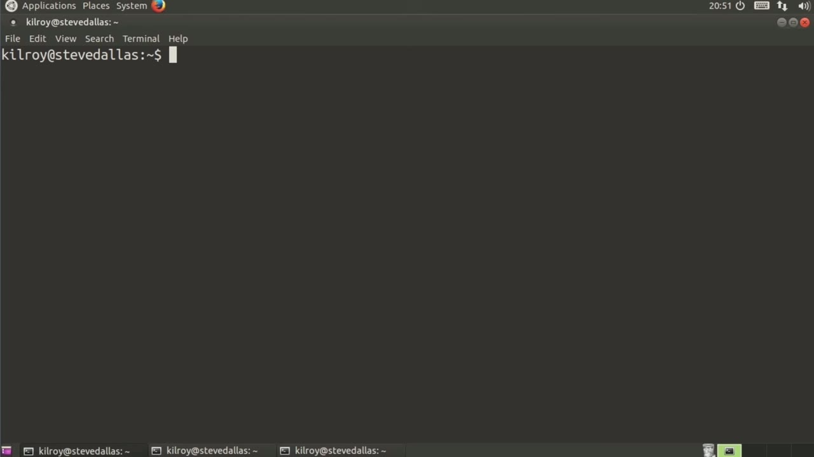
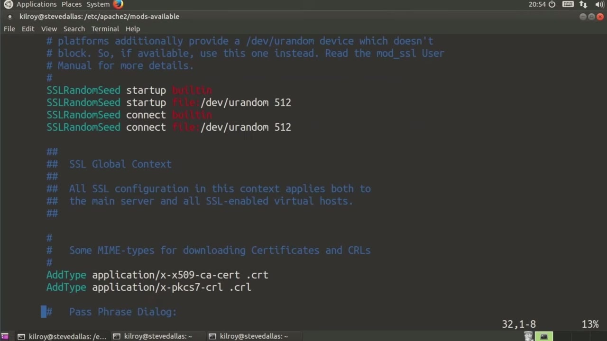
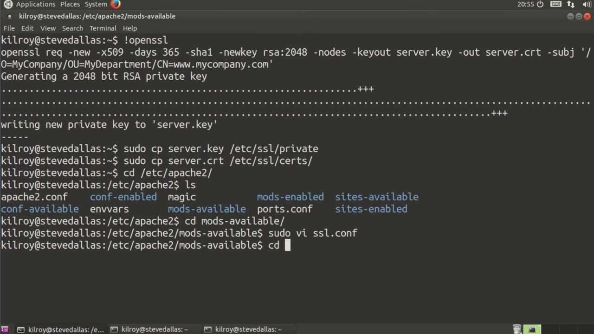

[← Course contents](../../02.md)

# 31. SSL-TLS And Apache

**Course:** [Linux Security & Administration From Boot Process to Firewalls](https://www.youtube.com/watch?v=_WB3evmgxYA)  
**Transcript:** [`Linux Security & Administration From Boot Process to Firewalls transcript`](../../../../course_videos/Linux%20Security%20%26%20Administration%20From%20Boot%20Process%20to%20Firewalls/Linux%20Security%20%26%20Administration%20From%20Boot%20Process%20to%20Firewalls.txt)  
**Video:** 02:12:39–02:19:11 ([open at this time](https://www.youtube.com/watch?v=_WB3evmgxYA&t=7959s))

## Introduction

Any time that you need to do communication to a web server where you're passing information back and forth, you really need to make sure that you are encrypting that. So the way to encrypt it is to use something like SSL or preferably TLS to perform that encryption for you. It is the more recent version of SSL does the same thing in a different way. It's considered to be stronger than SSL and as a general rule more secure.

## Detailed Explanation

<details>
  <summary>Step 1 — Any time that you need to do communication to a web server where you're</summary>

### Step 1 — Any time that you need to do communication to a web server where you're

- [x] **Any time that you need to do communication to a web server where**
  - Any time that you need to do communication to a web server where you're passing information back and forth, you really need to make sure that you are encrypting that.
  - So the way to encrypt it is to use something like SSL or preferably TLS to perform that encryption for you.
  - It is the more recent version of SSL does the same thing in a different way.

- [x] **It's considered to be stronger than SSL and as a general rule more**
  - It's considered to be stronger than SSL and as a general rule more secure.
  - So the first thing that I need to do is create a certificate.
  - Normally, I would go to a certificate vendor and create that certificate.

- [x] **There are plenty of vendors that will do that for you**
  - There are plenty of vendors that will do that for you.
  - Your company may even have the ability to perform that task for you and generate a server certificate.
  - Server certificates are generally a fair bit of money unless you have your own certificate authority and your company is capable of doing that for you.

- [x] **In this case, for the purposes of demonstration, I'm creating my own**
  - In this case, for the purposes of demonstration, I'm creating my own self-signed certificate.
  - It's going to be for an x.509 certificate.
  - We are going to use Shaw One as our hashing algorithm for verification.

- [x] **We're going to get a new key, and the key is going to use RSA as its**
  - We're going to get a new key, and the key is going to use RSA as its algorithm with 2048 bits.
  - We're going to write the key out to the file server.key, and then the certificate out to server.crr.



</details>

<details>
  <summary>Step 2 — Run `touch`</summary>

### Step 2 — Run `touch`

- [x] **And then I just created a bogus subject line**
  - And then I just created a bogus subject line.
  - Doesn't really mean anything. Again, this is for the purposes of demonstration.
  - My organization I'm saying is my company.

- [x] **My organizational unit is my department**
  - My organizational unit is my department.
  - Of course, that's not really my server name, but for what we're doing here, that's going to work just fine.
  - The first thing I need to do is copy server.key into SSL private.

- [x] **So the key is going to go into private, and then I'm going to copy my**
  - So the key is going to go into private, and then I'm going to copy my server.
  - So now I've got my key and my certificate in place.
  - I need to go into my Apache configuration, and there's two things I need to do here.

- [x] **Use `touch`**
  - First of all, I'm going to go into Mods -available, and we'll just take a quick look at the SSL configuration here. So this is the configuration for the SSL module.
  - So we've got a number of parameters that we're not going to `touch` at all, and then I want to show you a couple that you may want to `touch` at some point.
  - This is only going to enable medium and high ciphers.

- [x] **You may potentially want to remove medium from this list**
  - You may potentially want to remove medium from this list.
  - And then the other place that you may want to take a look at is the SSL cipher suite.
  - You may want to specify some particularly so that you guarantee that what you're getting is a very high degree of confidence that you're using the best algorithm that's available.

- [x] **The other thing that you may want to do is SSL protocol is currently**
  - The other thing that you may want to do is SSL protocol is currently set to all.
  - You can force tlsv1.2 or some combination of TLS and potentially get rid of sslv3 because sslv3 is considered to be weaker than the other.
  - So you can force the use of TLS over SSL here.

```bash
touch
```



</details>

<details>
  <summary>Step 3 — Run `ln -S`, `ls -la`</summary>

### Step 3 — Run `ln -S`, `ls -la`

- [x] **Use `ln -S`**
  - I'm going to go up into mods enabled, and I'm going to say `ln -S`, mods, And then I'm going to create a SIM link here to this directory.
  - So now we've got the load file and the configuration file in place so that we'll actually load up the SSL configuration and make sure that we are loading the modules.
  - So now I need to go into Sites -available.

- [x] **And you can see there's a default SSL config there, and we'll take a**
  - And you can see there's a default SSL config there, and we'll take a quick look at that.
  - There's one thing that I need to do here, and I need to, first of all, you can see the SSL engine is on.
  - In this case, what I'm going to do is replace these files here, which would be perfectly fine, except that what I've got here is server.crT.

- [x] **These are ones that just come with the standard Apache configuration**
  - These are ones that just come with the standard Apache configuration.
  - These are keys that are already in place.
  - I'm going to use the ones that I actually created here.

- [x] **And then the rest of this, I'm just going to leave alone**
  - And then the rest of this, I'm just going to leave alone.
  - So you can see that we've got a number of other parameters.
  - Some of this is common for just an Apache configuration.

- [x] **You can see we're setting up directory parameters**
  - You can see we're setting up directory parameters.
  - So this is what you would do for any virtual host site.
  - In this case, we're just adding some SSL parameters on top of it.

- [x] **All right, let me clear the screen here**
  - All right, let me clear the screen here.
  - I can see exactly what I'm doing where I'm moving files around.
  - I want to make sure that I'm in exactly the right place.

- [x] **Use `ls -la`**
  - I'm going to move up into Sites -enabled.
  - And you can see I don't have an SSL configuration here.
  - So I'm going to say `ls -la`.

- [x] **That shows me that I'm sim linking here**
  - That shows me that I'm sim linking here.
  - And then defaultssl.com and I'm going to simlink it into this directory here. So now I've got an SSL configuration. I've got everything in place. All I need to do is say restart the Apache service.
  - So now that we've restarted Apache, we should be good to just connect to our local host over SSL and we should get an SSL connection. And of course we're going to get certificate warnings, but let's just see what we've got here.

- [x] **So I've got an understanding the risks, I'm going to add an exception**
  - So I've got an understanding the risks, I'm going to add an exception.
  - And sure enough, we've got an SSL configured Apache on our local Apache server.

```bash
ln -S
ls -la
```



</details>

<details>
  <summary>Questions and Answers</summary>

## Questions and Answers

### Question 1: What does `touch` do in this chapter?

<details>
<summary>Answer</summary>

- [x] So we've got a number of parameters that we're not going to `touch` at all, and then I want to show you a couple that you may want to `touch` at some point.

</details>

### Question 2: What does `ln -S` do in this chapter?

<details>
<summary>Answer</summary>

- [x] I'm going to go up into mods enabled, and I'm going to say `ln -S`, mods, And then I'm going to create a SIM link here to this directory.

</details>

### Question 3: What does `ls -la` do in this chapter?

<details>
<summary>Answer</summary>

- [x] So I'm going to say `ls -la`.

</details>

### Question 4: What does step 1 cover (Any time that you need to do communication to a web server where you're)?

<details>
<summary>Answer</summary>

- [x] Any time that you need to do communication to a web server where you're passing information back and forth, you really need to make sure that you are encrypting that.
- [x] So the way to encrypt it is to use something like SSL or preferably TLS to perform that encryption for you.
- [x] It is the more recent version of SSL does the same thing in a different way.

</details>

### Question 5: What does step 2 cover (Run touch)?

<details>
<summary>Answer</summary>

- [x] And then I just created a bogus subject line.
- [x] Doesn't really mean anything. Again, this is for the purposes of demonstration.
- [x] My organization I'm saying is my company.

</details>

### Question 6: What does step 3 cover (Run ln -S, ls -la)?

<details>
<summary>Answer</summary>

- [x] I'm going to go up into mods enabled, and I'm going to say `ln -S`, mods, And then I'm going to create a SIM link here to this directory.
- [x] So now we've got the load file and the configuration file in place so that we'll actually load up the SSL configuration and make sure that we are loading the modules.
- [x] So now I need to go into Sites -available.

</details>

</details>

## Summary

This chapter, SSL-TLS And Apache, walks through Any time that you need to do communication to a web server where you're; Run touch; Run ln -S, ls -la. Commands from the transcript: `touch`, `ln -S`, `ls -la`.

## References

- [Linux Security & Administration From Boot Process to Firewalls (YouTube)](https://www.youtube.com/watch?v=_WB3evmgxYA)
- [This chapter at 02:12:39](https://www.youtube.com/watch?v=_WB3evmgxYA&t=7959s)
- [Local transcript](../../../../course_videos/Linux%20Security%20%26%20Administration%20From%20Boot%20Process%20to%20Firewalls/Linux%20Security%20%26%20Administration%20From%20Boot%20Process%20to%20Firewalls.txt)
