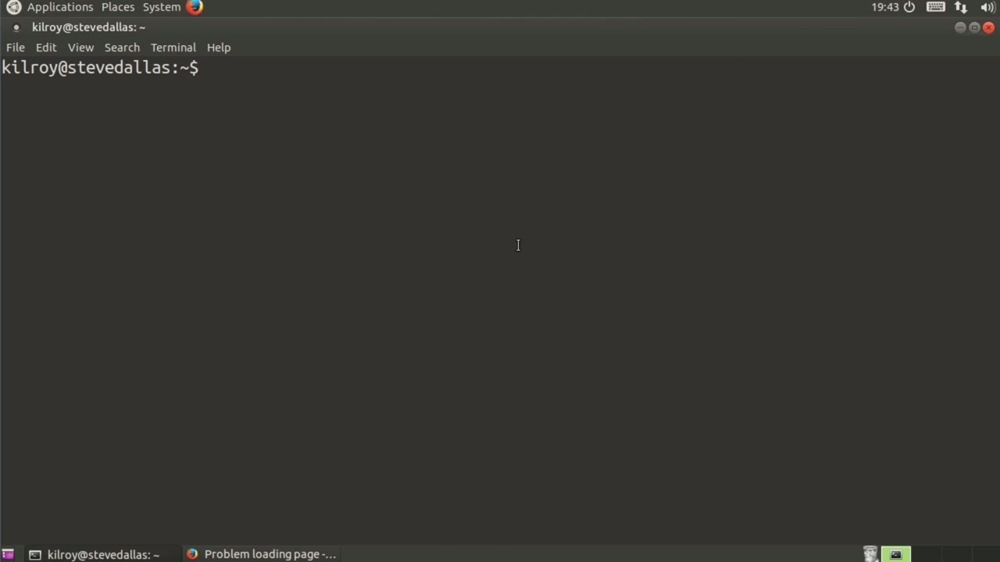
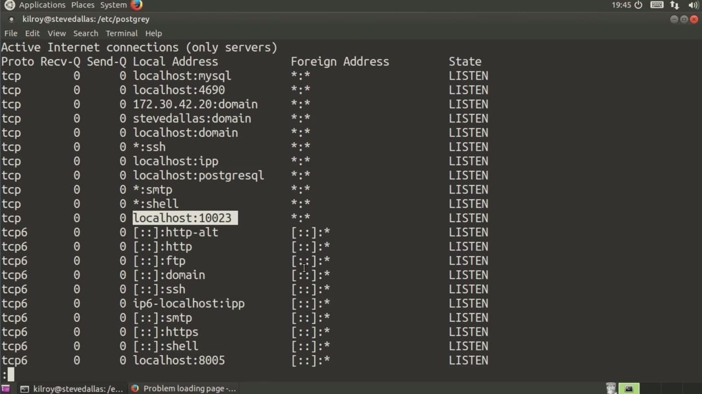
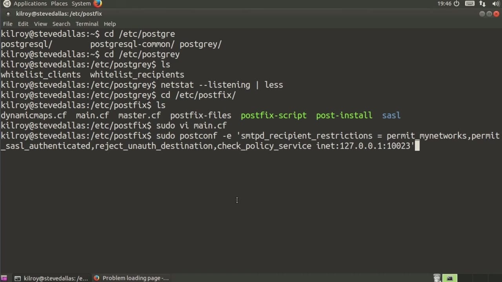

[← Course contents](../../02.md)

# 32. SPF And Greylisting In Postfix

**Course:** [Linux Security & Administration From Boot Process to Firewalls](https://www.youtube.com/watch?v=_WB3evmgxYA)  
**Transcript:** [`Linux Security & Administration From Boot Process to Firewalls transcript`](../../../../course_videos/Linux%20Security%20%26%20Administration%20From%20Boot%20Process%20to%20Firewalls/Linux%20Security%20%26%20Administration%20From%20Boot%20Process%20to%20Firewalls.txt)  
**Video:** 02:19:11–02:23:23 ([open at this time](https://www.youtube.com/watch?v=_WB3evmgxYA&t=8351s))

## Introduction

One way of limiting the amount of spam that you get at your mail server is using a technique called gray listing. What gray listing does is it delays mail from somebody that it doesn't know about. An email message in what the gray listing software will do will be to send a completely legitimate SMTP response saying, hold on. If it's a legitimate sender, that legitimate sender will go, oh, okay, I'll wait some period of time and then I'll try to resend. What the message that they get indicates is this is how long you should wait.

## Detailed Explanation

  
Step 1 — One way of limiting the amount of spam that you get at your mail server

### Step 1 — One way of limiting the amount of spam that you get at your mail server

- [x] **One way of limiting the amount of spam that you get at your mail**
  - One way of limiting the amount of spam that you get at your mail server is using a technique called gray listing.
  - What gray listing does is it delays mail from somebody that it doesn't know about.
  - An email message in what the gray listing software will do will be to send a completely legitimate SMTP response saying, hold on. If it's a legitimate sender, that legitimate sender will go, oh, okay, I'll wait some period of time and then I'll try to resend.

- [x] **What the message that they get indicates is this is how long you**
  - What the message that they get indicates is this is how long you should wait.
  - Now, some software is good about waiting that period of time.
  - But really, gray listing works pretty well.

- [x] **There's a piece of software that you can install**
  - There's a piece of software that you can install.
  - On Linux systems called PostGray that works with the PostVix mail server that is actually really good at doing this gray listing and limiting the amount of mail you are getting from illegitimate senders. So let's take a look at PostGray and the first thing I'm going to do
  - Is I'm just going to show you where all of the different configuration files are stored.

- [x] **So we've got /etc Post Gray, there's whitelist clients and white list**
  - So we've got /etc Post Gray, there's whitelist clients and white list recipients.
  - If you want to make sure that some mail servers or some people who you are getting mail for always get through the gray listing, then you can put them onto these white lists.
  - So the next thing that we need to do is figure out what port that Post Gray is actually listening on.

- [x] **Now I can tell you, but I'm going to just do this so that we can just**
  - Now I can tell you, but I'm going to just do this so that we can just double check.
  - I'm going to send this off to less here.

  
Step 2 — Now, in this case, I happen to know that it's 10 to 3, so we can see

### Step 2 — Now, in this case, I happen to know that it's 10 to 3, so we can see

- [x] **Now, in this case, I happen to know that it's 10 to 3, so we can see**
  - Now, in this case, I happen to know that it's 10 to 3, so we can see that that's actually listening there.
  - So the next thing that we need to do is go into our post-fix directory.
  - And they need to find the recipient restrictions line.

- [x] **And in this case, I don't actually have a recipient restrictions line**
  - And in this case, I don't actually have a recipient restrictions line.
  - So what I can do here is I can use a program called postconf to actually add that line in for me.
  - So I'm going to add smtbd recipient restrictions.

- [x] **So if anybody has authenticated, that's okay**
  - So if anybody has authenticated, that's okay.

  
Step 3 — going to reject unauthorized destination

### Step 3 — going to reject unauthorized destination

- [x] **We're going to reject unauthorized destination**
  - We're going to reject unauthorized destination.
  - And then finally, we're going to use a policy service.
  - And I'm going to check my local host on port 1023, and that's where our graylist software is actually stored.

- [x] **So now I can take a look at main.cf again, and I ought to have that**
  - So now I can take a look at main.cf again, and I ought to have that line at the very bottom.
  - Now all I have to do is reload my post-fix server here.
  - And now I have my gray listing software configured, and so I should be able to send messages in from somewhere, and I would see something in my mail log, indicating that the message had actually been delayed.

- [x] **So one other place that I want to show you here, While we are looking**
  - So one other place that I want to show you here, While we are looking at the configuration for this is in the default directory, this is where defaults for a lot of different services and programs are stored, and I want to look at the post-gray defaults here.
  - So we've got options that tells us which port we're actually listening on.
  - The other thing I can do is say delay is equal to some period of time.

- [x] **The default is going to be 300 seconds, which is five minutes, 30**
  - The default is going to be 300 seconds, which is five minutes, 30 seconds, I could say 60 seconds, maybe I could say 180 seconds here, and that would be okay.
  - I would have to restart my post-gray server for that to take effect, but gray listing is a really good way of making sure that some of these bogus senders aren't actually getting through to your mail server and getting spam into you.

  
Questions and Answers

## Questions and Answers

### Question 1: What does step 1 cover (One way of limiting the amount of spam that you get at your mail server)?

Answer

- [x] One way of limiting the amount of spam that you get at your mail server is using a technique called gray listing.
- [x] What gray listing does is it delays mail from somebody that it doesn't know about.
- [x] An email message in what the gray listing software will do will be to send a completely legitimate SMTP response saying, hold on. If it's a legitimate sender, that legitimate sender will go, oh, okay, I'll wait some period of time and then I'll try to resend.

### Question 2: What does step 2 cover (Now, in this case, I happen to know that it's 10 to 3, so we can see)?

Answer

- [x] Now, in this case, I happen to know that it's 10 to 3, so we can see that that's actually listening there.
- [x] So the next thing that we need to do is go into our post-fix directory.
- [x] And they need to find the recipient restrictions line.

### Question 3: What does step 3 cover (going to reject unauthorized destination)?

Answer

- [x] We're going to reject unauthorized destination.
- [x] And then finally, we're going to use a policy service.
- [x] And I'm going to check my local host on port 1023, and that's where our graylist software is actually stored.

## Summary

This chapter, SPF And Greylisting In Postfix, walks through One way of limiting the amount of spam that you get at your mail server; Now, in this case, I happen to know that it's 10 to 3, so we can see; going to reject unauthorized destination.

## References

- [Linux Security & Administration From Boot Process to Firewalls (YouTube)](https://www.youtube.com/watch?v=_WB3evmgxYA)
- [This chapter at 02:19:11](https://www.youtube.com/watch?v=_WB3evmgxYA&t=8351s)
- [Local transcript](../../../../course_videos/Linux%20Security%20%26%20Administration%20From%20Boot%20Process%20to%20Firewalls/Linux%20Security%20%26%20Administration%20From%20Boot%20Process%20to%20Firewalls.txt)
