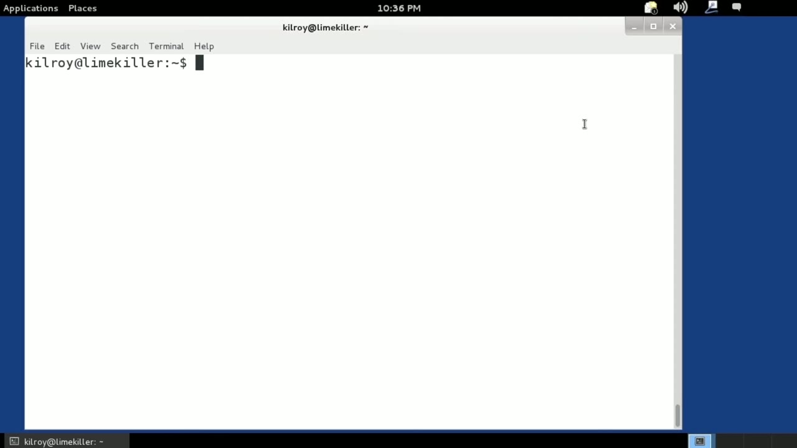
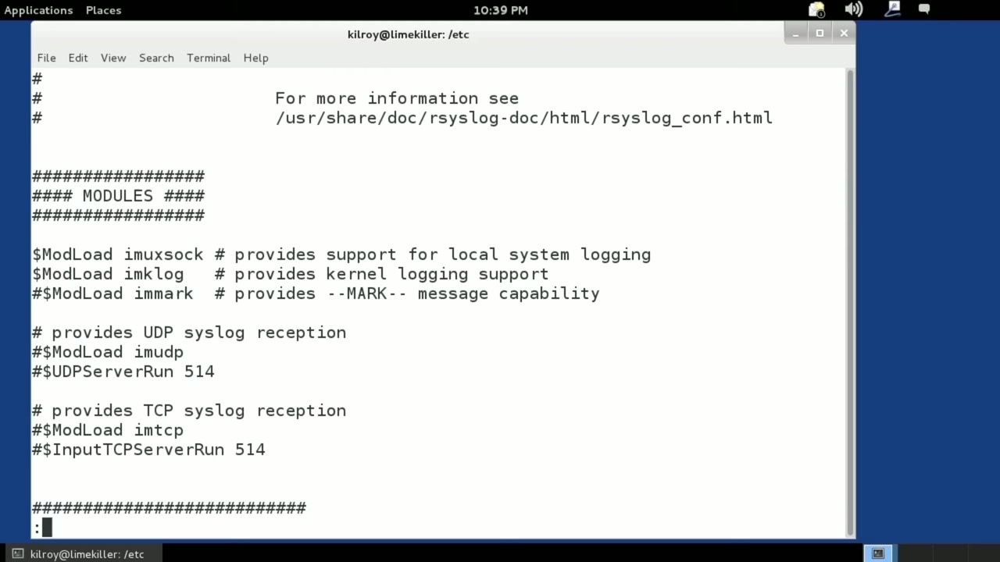
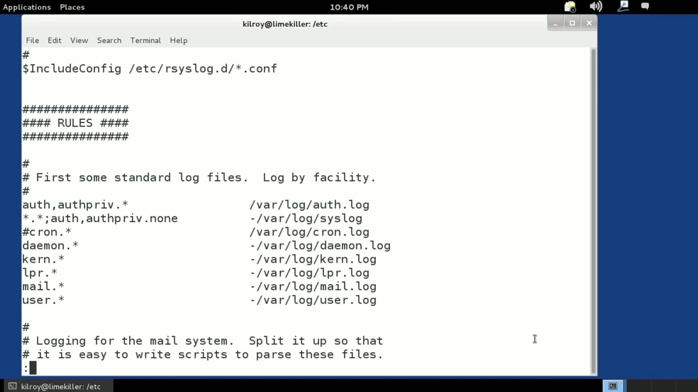

[← Course contents](../../02.md)

# 33. What you will learn in this Module

**Course:** [Linux Security & Administration From Boot Process to Firewalls](https://www.youtube.com/watch?v=_WB3evmgxYA)  
**Transcript:** [`Linux Security & Administration From Boot Process to Firewalls transcript`](../../../../course_videos/Linux%20Security%20%26%20Administration%20From%20Boot%20Process%20to%20Firewalls/Linux%20Security%20%26%20Administration%20From%20Boot%20Process%20to%20Firewalls.txt)  
**Video:** 02:23:23–02:29:20 ([open at this time](https://www.youtube.com/watch?v=_WB3evmgxYA&t=8603s))

## Introduction

SISLog is the system logging facility, and SISLog is where most applications actually communicate in order to generate log files. Log files are incredibly important for system administrators, developers, lots of different people who need to figure out what's going on with the system. Most Linux systems are going to store their logs in the directory var log /var slash log. And you will see that there's actually several log files in this directory. What determines what log file gets used is a configuration file.

## Detailed Explanation

  
Step 1 — SISLog is the system logging facility, and SISLog is where most

### Step 1 — SISLog is the system logging facility, and SISLog is where most

- [x] **SISLog is the system logging facility, and SISLog is where most**
  - SISLog is the system logging facility, and SISLog is where most applications actually communicate in order to generate log files. Log files are incredibly important for system administrators, developers, lots of different people who need to figure out what's going on with the system.
  - Most Linux systems are going to store their logs in the directory var log /var slash log.
  - And you will see that there's actually several log files in this directory.

- [x] **What determines what log file gets used is a configuration file**
  - What determines what log file gets used is a configuration file.
  - So we're going to go into the directory where the configuration files are stored.
  - Many Linux distributions at the moment are using R syslog for their syslog server.

- [x] **Over the years there have been a lot of different syslog servers**
  - Over the years there have been a lot of different syslog servers.
  - There used to be one called syslog -ng for next generation.
  - There's the original syslog. bsd has a syslog.

- [x] **There's a lot of different syslogs that are available**
  - There's a lot of different syslogs that are available.
  - On many systems, this is the directory where all of the configuration files for are syslog are stored.
  - If you've got multiple configuration files like a system-specific one and there may be some others, It's fairly common these days to break up configuration files into multiple files.

- [x] **In this case, this system doesn't have multiple files**
  - In this case, this system doesn't have multiple files.
  - It's just got one. So we will take a look at that.

  
Step 2 — that is going to be called our syslog.conf

### Step 2 — that is going to be called our syslog.conf

- [x] **And that is going to be called our syslog.conf**
  - And that is going to be called our syslog.conf.
  - So you can see we've got modules that supports loading different modules that give different support.
  - And then we've got our global directives down here.

- [x] **Down at the bottom, this is the one that I'm really most interested**
  - Down at the bottom, this is the one that I'm really most interested in at the moment.
  - On the left-hand side, you can see the facilities.
  - Off and off-Priv, Kron, Demon, Kern, lpr, Mail, user, those are all facilities.

- [x] **A facility is a way of grouping different logs into a single category**
  - A facility is a way of grouping different logs into a single category.
  - All of the mail transfer programs will use the mail facility, for example.
  - Any service that is just running in the background would be called a demon.

- [x] **Authorization is probably going to log to the auth facility**
  - Authorization is probably going to log to the auth facility.
  - So we've got our facilities on the left-hand side.
  - There are about 14 or 15 facilities in all.

- [x] **That are specified by the SISLog standard**
  - That are specified by the SISLog standard.
  - In this case, we're only referencing a handful of those.

  
Step 3 — You can certainly add the other ones in if you want

### Step 3 — You can certainly add the other ones in if you want

- [x] **You can certainly add the other ones in if you want**
  - You can certainly add the other ones in if you want.
  - These are the ones that are most common that you are going to run into.
  - You will also notice here there is an asterisk after the facility.

- [x] **The asterisk is there to indicate the severity. So there are a small**
  - The asterisk is there to indicate the severity. So there are a small number of severities that you can specify from informational all the way up to critical. You can indicate that you only want to log some of them and different severities you may want to log to different files. In this case
  - Basically any severity at all in these particular facilities are going to get logged to these files. These are the files that we are going to log to.
  - So you can see all of them are in var log, and then each of them has a separate log file based on the facility.

- [x] **You could, of course, dump everything into the same log file, but**
  - You could, of course, dump everything into the same log file, but that sort of defeats the purpose of creating facilities to begin with.
  - As I said, log files are incredibly useful when you have a problem with your system, one of the first places you're probably going to want to go is the log file, just go into var log and see if you can find an error message or a warning or something in the relevant log file to indicate to you what's going on.
  - This is really handy when you've got services that are running that are going to be logging using syslog rather than dumping something out to the terminal or console that you can actually see.

- [x] **Programs that are maybe services that are running in the background**
  - Programs that are maybe services that are running in the background that are demons, or maybe user interface programs, GUI-based programs, they may also be logging because they may not have a good way of dumping error messages out somewhere that you can actually see them.
  - So the log facility on any Linux system is probably going to be some form of syslog.
  - You're going to be looking for a syslog configuration file to tell you what facilities log to what files.

- [x] **Or, of course, you can also just look in var log**
  - Or, of course, you can also just look in var log.
  - And in most cases, it's going to be fairly easy to determine what log file goes to which facility.
  - For example, kern.log is obviously the Kern facility.

- [x] **Mail.log is going to be the mail facility and so on**
  - Mail.log is going to be the mail facility and so on.
  - So syslog is a really important service that's running, and we will be talking about how to actually read these log files coming up.

  
Questions and Answers

## Questions and Answers

### Question 1: What does step 1 cover (SISLog is the system logging facility, and SISLog is where most)?

Answer

- [x] SISLog is the system logging facility, and SISLog is where most applications actually communicate in order to generate log files. Log files are incredibly important for system administrators, developers, lots of different people who need to figure out what's going on with the system.
- [x] Most Linux systems are going to store their logs in the directory var log /var slash log.
- [x] And you will see that there's actually several log files in this directory.

### Question 2: What does step 2 cover (that is going to be called our syslog.conf)?

Answer

- [x] And that is going to be called our syslog.conf.
- [x] So you can see we've got modules that supports loading different modules that give different support.
- [x] And then we've got our global directives down here.

### Question 3: What does step 3 cover (You can certainly add the other ones in if you want)?

Answer

- [x] You can certainly add the other ones in if you want.
- [x] These are the ones that are most common that you are going to run into.
- [x] You will also notice here there is an asterisk after the facility.

## Summary

This chapter, What you will learn in this Module, walks through SISLog is the system logging facility, and SISLog is where most; that is going to be called our syslog.conf; You can certainly add the other ones in if you want.

## References

- [Linux Security & Administration From Boot Process to Firewalls (YouTube)](https://www.youtube.com/watch?v=_WB3evmgxYA)
- [This chapter at 02:23:23](https://www.youtube.com/watch?v=_WB3evmgxYA&t=8603s)
- [Local transcript](../../../../course_videos/Linux%20Security%20%26%20Administration%20From%20Boot%20Process%20to%20Firewalls/Linux%20Security%20%26%20Administration%20From%20Boot%20Process%20to%20Firewalls.txt)
