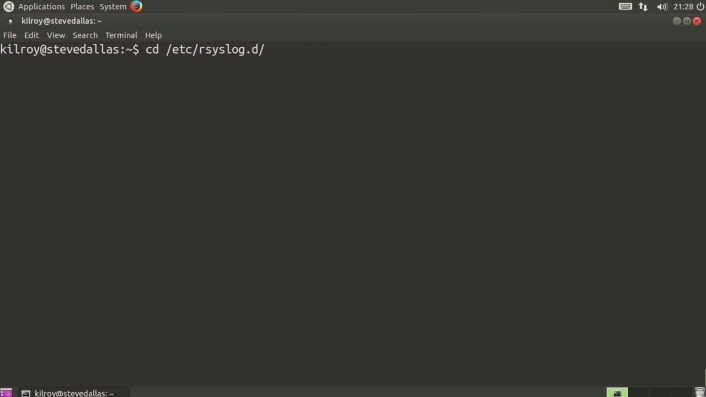
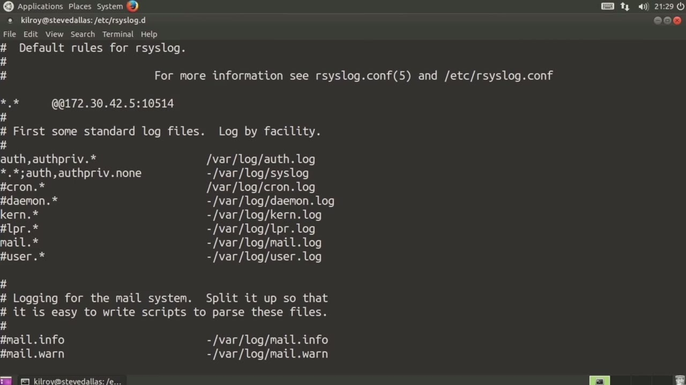
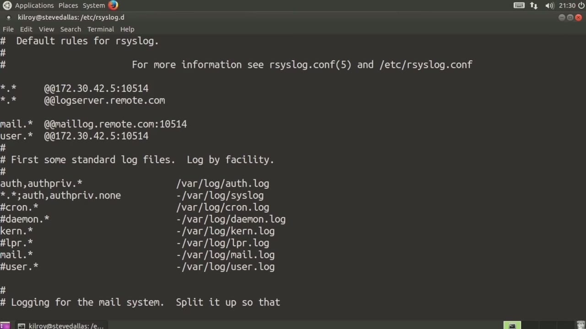

[← Course contents](../../02.md)

# 34. Remote Logging

**Course:** [Linux Security & Administration From Boot Process to Firewalls](https://www.youtube.com/watch?v=_WB3evmgxYA)  
**Transcript:** [`Linux Security & Administration From Boot Process to Firewalls transcript`](../../../../course_videos/Linux%20Security%20%26%20Administration%20From%20Boot%20Process%20to%20Firewalls/Linux%20Security%20%26%20Administration%20From%20Boot%20Process%20to%20Firewalls.txt)  
**Video:** 02:29:20–02:33:11 ([open at this time](https://www.youtube.com/watch?v=_WB3evmgxYA&t=8960s))

## Introduction

A pretty common activity when it comes to syslog is to send the syslog messages off the system. So what I want to do is show you how you would configure your... Syslog server to send your log messages off to another system that's actually listening for those syslog messages. So let's just take a look here at the default configuration. We've looked at this and this is where all of the log files are stored. If I want to log to another system, What I can do here is just add in a line.

## Detailed Explanation

  
Step 1 — A pretty common activity when it comes to syslog is to send the syslog

### Step 1 — A pretty common activity when it comes to syslog is to send the syslog

- [x] **A pretty common activity when it comes to syslog is to send the**
  - A pretty common activity when it comes to syslog is to send the syslog messages off the system.
  - So what I want to do is show you how you would configure your...
  - Syslog server to send your log messages off to another system that's actually listening for those syslog messages. So let's just take a look here at the default configuration. We've looked at this and this is where all of the log files are stored. If I want to log to another system,

- [x] **What I can do here is just add in a line**
  - What I can do here is just add in a line.
  - And I'm going to say basically everything here.
  - I want to send off to, let's say, 172.30.42.42.5 is going to be my remote syslog server.

- [x] **And then I'm going to specify the port number**
  - And then I'm going to specify the port number.

  
Step 2 — If I want to add another system, All I would have to do would be to

### Step 2 — If I want to add another system, All I would have to do would be to

- [x] **If I want to add another system, All I would have to do would be to**
  - If I want to add another system, All I would have to do would be to create an additional line, and I could say my log server.
  - Now, that's sending everything off to those.
  - So all of my mail messages send to a mail log server.

- [x] **And I forgot the port number here, so let's add that in**
  - And I forgot the port number here, so let's add that in.
  - So now I have configured my R syslog server.
  - Again, we're using an implementation here of syslog called R syslog.

- [x] **Similar sorts of statements will work with different syslog**
  - Similar sorts of statements will work with different syslog implementations.

  
Step 3 — R syslog is a pretty common implementation on Linux distribution

### Step 3 — R syslog is a pretty common implementation on Linux distribution

- [x] **R syslog is a pretty common implementation on Linux distribution**
  - R syslog is a pretty common implementation on Linux distribution.
  - You would configure your Linux system to send your syslog messages off to a remote server.
  - There are some good reasons for doing that.

- [x] **If an adversary or an attacker were to gain access to your system**
  - If an adversary or an attacker were to gain access to your system, they may be able to corrupt or remove your log messages.
  - If your syslog server is sending the messages immediately off to another system, doesn't much matter what your local system says, your log messages are protected on a syslog server that is somewhere other than where your log files or your local system actually is.
  - So now you've got two places where your log files are, assuming you keep all of the entries below here in place.

- [x] **So you've got logging locally as well as remotely**
  - So you've got logging locally as well as remotely.
  - If there is some sort of discrepancy between the two of them, you have to figure out which one you trust.
  - I'm going to assume probably that your syslog server is well hardened, and probably the only service listening on it is going to be the syslog service.

- [x] **So assuming that that's not vulnerable to any exploit, probably the**
  - So assuming that that's not vulnerable to any exploit, probably the logs on there are going to be the reliable ones, and you might assume that the local logs on this particular server, for example, your system has been infiltrated and the log messages have been corrupted or potentially removed.
  - So that's a good reason to log to a remote syslog server, and this would be how you would configure our syslog in order to do that.

  
Questions and Answers

## Questions and Answers

### Question 1: What does step 1 cover (A pretty common activity when it comes to syslog is to send the syslog)?

Answer

- [x] A pretty common activity when it comes to syslog is to send the syslog messages off the system.
- [x] So what I want to do is show you how you would configure your...
- [x] Syslog server to send your log messages off to another system that's actually listening for those syslog messages. So let's just take a look here at the default configuration. We've looked at this and this is where all of the log files are stored. If I want to log to another system,

### Question 2: What does step 2 cover (If I want to add another system, All I would have to do would be to)?

Answer

- [x] If I want to add another system, All I would have to do would be to create an additional line, and I could say my log server.
- [x] Now, that's sending everything off to those.
- [x] So all of my mail messages send to a mail log server.

### Question 3: What does step 3 cover (R syslog is a pretty common implementation on Linux distribution)?

Answer

- [x] R syslog is a pretty common implementation on Linux distribution.
- [x] You would configure your Linux system to send your syslog messages off to a remote server.
- [x] There are some good reasons for doing that.

## Summary

This chapter, Remote Logging, walks through A pretty common activity when it comes to syslog is to send the syslog; If I want to add another system, All I would have to do would be to; R syslog is a pretty common implementation on Linux distribution.

## References

- [Linux Security & Administration From Boot Process to Firewalls (YouTube)](https://www.youtube.com/watch?v=_WB3evmgxYA)
- [This chapter at 02:29:20](https://www.youtube.com/watch?v=_WB3evmgxYA&t=8960s)
- [Local transcript](../../../../course_videos/Linux%20Security%20%26%20Administration%20From%20Boot%20Process%20to%20Firewalls/Linux%20Security%20%26%20Administration%20From%20Boot%20Process%20to%20Firewalls.txt)
