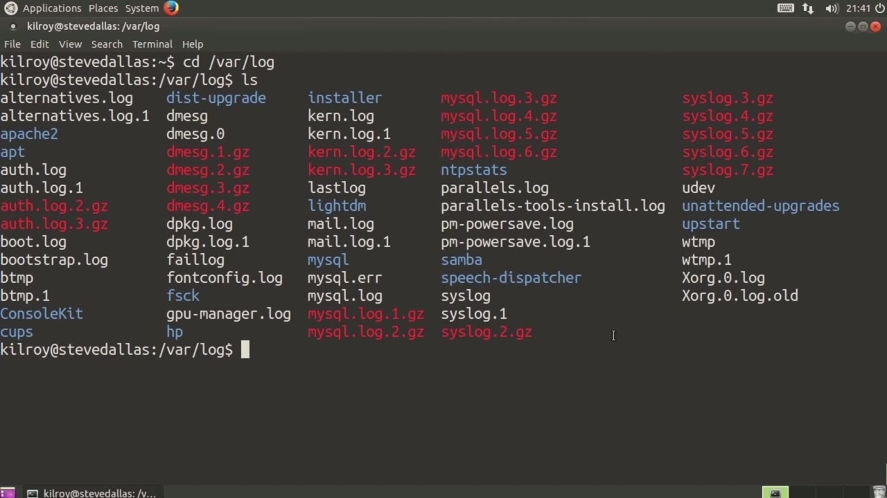
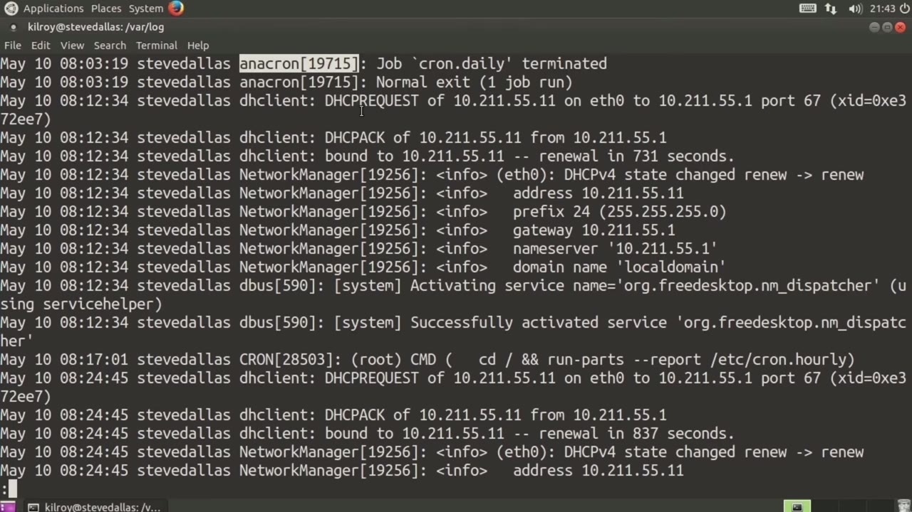
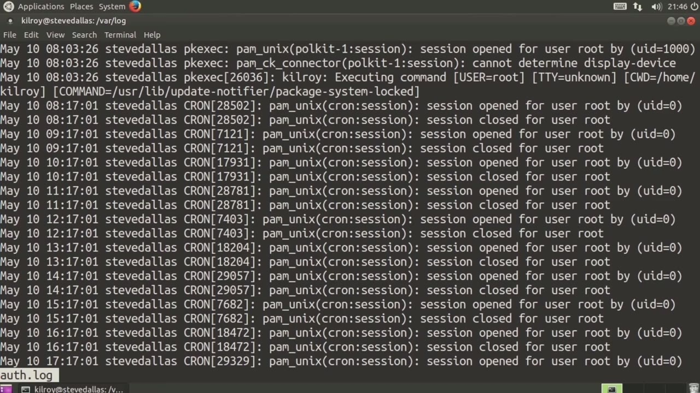

[← Course contents](../../02.md)

# 35. Reading Log Files

**Course:** [Linux Security & Administration From Boot Process to Firewalls](https://www.youtube.com/watch?v=_WB3evmgxYA)  
**Transcript:** [`Linux Security & Administration From Boot Process to Firewalls transcript`](../../../../course_videos/Linux%20Security%20%26%20Administration%20From%20Boot%20Process%20to%20Firewalls/Linux%20Security%20%26%20Administration%20From%20Boot%20Process%20to%20Firewalls.txt)  
**Video:** 02:33:11–02:38:58 ([open at this time](https://www.youtube.com/watch?v=_WB3evmgxYA&t=9191s))

## Introduction

Now that we've talked about configuring the syslog server, let's talk about how to read the log files. So we've got the log files, typically they're going to be in var log. All of your log files are going to be here. There is a log rotator that typically runs on Linux systems that will rotate the logs out, meaning it's going to store old ones and then create new log files.

## Detailed Explanation

<details>
  <summary>Step 1 — Run `less`</summary>

### Step 1 — Run `less`

- [x] **Now that we've talked about configuring the syslog server, let's talk**
  - Now that we've talked about configuring the syslog server, let's talk about how to read the log files.
  - So we've got the log files, typically they're going to be in var log.
  - All of your log files are going to be here.

- [x] **There is a log rotator that typically runs on Linux systems that will**
  - There is a log rotator that typically runs on Linux systems that will rotate the logs out, meaning it's going to store old ones and then create new log files.
  - That's why you'll see some of these log files have been GZipped, which you'll see here.
  - So we'll talk about log rotation a little bit later on, but right now let's just talk about how to read a log file.

- [x] **Use `less`**
  - We're going to take a look at the syslog file here, and I'm going to use `less`, which is a pager, which means it's only going to show a page at a time.
  - So if I just do this, we've got one page, and of course I can hit space, and then I can back up.
  - Now, we're looking at a syslog message file here.

- [x] **So the first part of the message file, each message is going to be**
  - So the first part of the message file, each message is going to be tagged with a timestamp.
  - So you can see this is the particular time stamp for this message.
  - This timestamp is based on the local time of the system.

- [x] **So in order to figure out what time this really is, if you're talking**
  - So in order to figure out what time this really is, if you're talking about multiple time zones, you need to figure out what time zone you're actually in.

```bash
less
```



</details>

<details>
  <summary>Step 2 — Run `anacron`</summary>

### Step 2 — Run `anacron`

- [x] **The next column here, or the next set of messages, is the name of the**
  - The next column here, or the next set of messages, is the name of the system.
  - This is the name of this particular system.
  - So all of the messages in this file are going to have this for the system name.

- [x] **Now, if you're doing remote logging and all of your log messages from**
  - Now, if you're doing remote logging and all of your log messages from multiple systems end up in a single log file, of course, this particular entry here is going to be different for everyone.
  - That's how you can figure out which message corresponds with which system.
  - This is going to be followed by the name of the process that actually generated the log file.

- [x] **Use `anacron`**
  - In this case, it's `anacron` and we've got the process id.
  - The process id in this particular case is 19715.
  - That is associated with the `anacron` process.

- [x] **Use `anacron`**
  - `anacron` will actually run processes hourly, daily, weekly, monthly, and so on.
  - What it has done is probably this is just finished rotating the logs in this case.
  - You can see the very first message is that the daily cron job has terminated and then we get a normal exit as the message.

- [x] **So having said that, let's move into the last portion here**
  - So having said that, let's move into the last portion here.

```bash
anacron
```



</details>

<details>
  <summary>Step 3 — Run `sudo`</summary>

### Step 3 — Run `sudo`

- [x] **This is the actual message that the process has generated**
  - This is the actual message that the process has generated.
  - All of the rest of this is created by the SISLog demon or service.
  - This is the actual message that is being sent to SISLog, and that's what's being written out.

- [x] **So this says JobCronDot Daily terminated**
  - So this says JobCronDot Daily terminated.
  - This is pretty simple to understand, not very complicated at all, even though these log files can look really challenging to understand if you just take them a line at a time, kind of pull out...
  - The bits that you know what they are and then get to the actual message.

- [x] **Most messages are fairly simple to understand**
  - Most messages are fairly simple to understand.
  - We've got another one from the dh client. This is the dynamic host configuration protocol client and this is a set of log messages here related to obtaining a particular IP address that has been acquired using the dh client process here. After that you've got network manager
  - And then debus, Cron, D-H-client Network Manager, and so on and so forth.

- [x] **So you can see all of the different log messages that are associated**
  - So you can see all of the different log messages that are associated with each of these processes.
  - So now I could go into, for example, mail.log.
  - There's no mail being sent back and forth with this particular system.

- [x] **So we could look at, for example, the kernel log, nothing from the**
  - So we could look at, for example, the kernel log, nothing from the kernel log.
  - There should be some messages in the off-log.
  - So you can see all of the messages associated with logging in, logging out.

- [x] **Use `sudo`**
  - `sudo`, for example, would be logged into this particular message, so you can see that there as well.
  - And then, of course, we've got the message.
  - That was generated by that particular process.

- [x] **So reading syslog messages is actually fairly straightforward**
  - So reading syslog messages is actually fairly straightforward.
  - Most of the messages are going to be in readable and understandable English.
  - Every once in a while you'll come across one that may be a little bit more obscure.

- [x] **You may have to have some specific knowledge of a particular**
  - You may have to have some specific knowledge of a particular application or the application internals in order to really understand what's going on.
  - But for the most part, you're going to be able to read these log messages now that you kind of know what the individual pieces and components of each log message are.
  - Maybe it makes it a little bit less intimidating to see all of that text and these really big log files.

- [x] **When you're looking at log files, there's an awful lot of data that**
  - When you're looking at log files, there's an awful lot of data that you can accumulate,

```bash
sudo
```



</details>

<details>
  <summary>Questions and Answers</summary>

## Questions and Answers

### Question 1: What does `less` do in this chapter?

<details>
<summary>Answer</summary>

- [x] We're going to take a look at the syslog file here, and I'm going to use `less`, which is a pager, which means it's only going to show a page at a time.

</details>

### Question 2: What does `anacron` do in this chapter?

<details>
<summary>Answer</summary>

- [x] In this case, it's `anacron` and we've got the process id.

</details>

### Question 3: What does `sudo` do in this chapter?

<details>
<summary>Answer</summary>

- [x] `sudo`, for example, would be logged into this particular message, so you can see that there as well.

</details>

### Question 4: What does step 1 cover (Run less)?

<details>
<summary>Answer</summary>

- [x] Now that we've talked about configuring the syslog server, let's talk about how to read the log files.
- [x] So we've got the log files, typically they're going to be in var log.
- [x] All of your log files are going to be here.

</details>

### Question 5: What does step 2 cover (Run anacron)?

<details>
<summary>Answer</summary>

- [x] The next column here, or the next set of messages, is the name of the system.
- [x] This is the name of this particular system.
- [x] So all of the messages in this file are going to have this for the system name.

</details>

### Question 6: What does step 3 cover (Run sudo)?

<details>
<summary>Answer</summary>

- [x] This is the actual message that the process has generated.
- [x] All of the rest of this is created by the SISLog demon or service.
- [x] This is the actual message that is being sent to SISLog, and that's what's being written out.

</details>

</details>

## Summary

This chapter, Reading Log Files, walks through Run less; Run anacron; Run sudo. Commands from the transcript: `less`, `anacron`, `sudo`.

## References

- [Linux Security & Administration From Boot Process to Firewalls (YouTube)](https://www.youtube.com/watch?v=_WB3evmgxYA)
- [This chapter at 02:33:11](https://www.youtube.com/watch?v=_WB3evmgxYA&t=9191s)
- [Local transcript](../../../../course_videos/Linux%20Security%20%26%20Administration%20From%20Boot%20Process%20to%20Firewalls/Linux%20Security%20%26%20Administration%20From%20Boot%20Process%20to%20Firewalls.txt)
