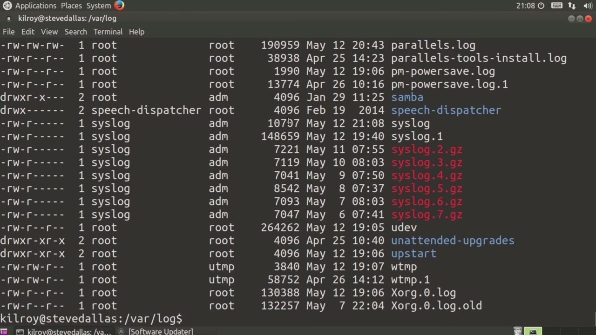
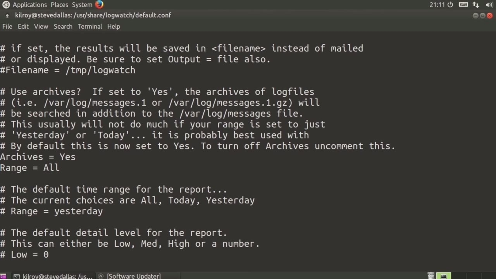
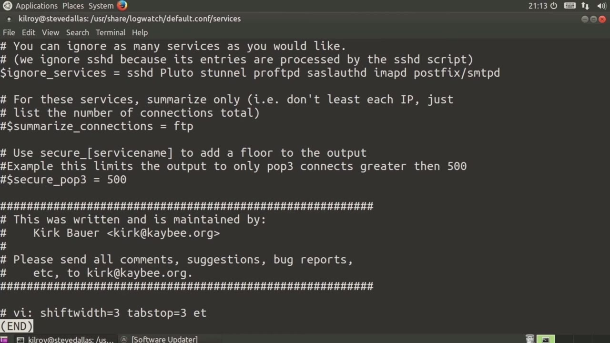

[← Course contents](../../02.md)

# 36. Logwatch

**Course:** [Linux Security & Administration From Boot Process to Firewalls](https://www.youtube.com/watch?v=_WB3evmgxYA)  
**Transcript:** [`Linux Security & Administration From Boot Process to Firewalls transcript`](../../../../course_videos/Linux%20Security%20%26%20Administration%20From%20Boot%20Process%20to%20Firewalls/Linux%20Security%20%26%20Administration%20From%20Boot%20Process%20to%20Firewalls.txt)  
**Video:** 02:38:58–02:45:26 ([open at this time](https://www.youtube.com/watch?v=_WB3evmgxYA&t=9538s))

## Introduction

Now, with this particular system, I don't do an awful lot with it. I'm using it as a virtual machine for what we're doing here, and really not an awful lot else, but you can see that I'm accumulating log messages. All of these logs really kind of accumulate data as the system is just running. What we can do is we can run the logwatch command, and that will help us really parse through some of the important things that are going on in these log files that we may actually want to pay attention to.

## Detailed Explanation

<details>
  <summary>Step 1 — Run `logwatch`</summary>

### Step 1 — Run `logwatch`

- [x] **Now, with this particular system, I don't do an awful lot with it**
  - Now, with this particular system, I don't do an awful lot with it.
  - I'm using it as a virtual machine for what we're doing here, and really not an awful lot else, but you can see that I'm accumulating log messages.
  - All of these logs really kind of accumulate data as the system is just running.

- [x] **Use `logwatch`**
  - What we can do is we can run the `logwatch` command, and that will help us really parse through some of the important things that are going on in these log files that we may actually want to pay attention to.
  - So let's take a look here inside the `logwatch` directory.
  - If I go into User Share `logwatch`, we've got the default configuration, and we're...

- [x] **Going to hop in there for just a second here. We'll take a look at**
  - Going to hop in there for just a second here. We'll take a look at the `logwatch`.com file. So this is the configuration file and you can see we've got yes equals true equals on equals one all of those things are the same. No equals false equals off equals zero. Our log directory is in var log that's going to be pretty
  - Standard. This is going to output to std out of course we could also do a text format and an html format.
  - We could output to a file, we could output to mail, we could do a base 64 in code.

- [x] **There's a lot of options here around output in format**
  - There's a lot of options here around output in format.
  - If we were going to mail, who are we going to mail to?
  - I could mail to root, so the root user on this particular system is going to get the output of `logwatch`. I could mail to a particular user at another domain or on another system using a different command format here.

- [x] **And that's all of the configurations around mail. So now we want to**
  - And that's all of the configurations around mail. So now we want to get into what we are going to be looking at. Now by default `logwatch` is only going to look at the primary log file. So for example, if we had a var log messages file, it's only going to look at varlog messages. It's not going to look at
  - Varlogmessages.1 or varlogmessages.1.g.z, which are the rotated logs.

```bash
logwatch
```



</details>

<details>
  <summary>Step 2 — Run `logwatch`</summary>

### Step 2 — Run `logwatch`

- [x] **Use `logwatch`**
  - So I have turned on archives here because I want to look at everything.
  - So my range in this case is going to be all. I could do range today, range yesterday.
  - If you were to run `logwatch` every day, you could set it to just today or yesterday, depending on when you're actually running `logwatch`.

- [x] **A number of other settings here. The service that we are going to be**
  - A number of other settings here. The service that we are going to be looking at is all in this case, meaning it's going to look through everything that we actually know about here.
  - So you can disable network services, you can enable network services if you didn't want to look at all of them.
  - I'm actually going to disable this entry here.

- [x] **Or not because I'm not doing this as root**
  - Or not because I'm not doing this as root.
  - So I'm just going to leave that one alone because it's not actually going to be able to write out because I didn't edit this as an administrative user.
  - So let's take a look in our services directory.

- [x] **You can see the different services here**
  - You can see the different services here.
  - So for example, let's take a look at the Samba config file.
  - It's got a title of Samba telling it which log file to look at.

- [x] **And then We're not really looking for much of anything else in this**
  - And then We're not really looking for much of anything else in this particular log file, but it does tell us which log file to look at.
  - Again, we've got a title of connections. Log file is secure.

```bash
logwatch
```



</details>

<details>
  <summary>Step 3 — Run `sshd`, `logwatch`, `sudo`</summary>

### Step 3 — Run `sshd`, `logwatch`, `sudo`

- [x] **We've got some other things that we are going to look at here**
  - We've got some other things that we are going to look `at` here.
  - So, for example, we've got Pop 3 is going to be connections.
  - And we're only going to output 500 of them.

- [x] **Use `sshd`**
  - So we're going to ignore `sshd`, S-Tunnel, Pro ftpd, s-a-s-l, off-D, imapd, and so forth.
  - So all of these we're not going to look `at`.
  - You can see we've got a number of different configuration files here that tell `logwatch` how to actually look `at` the log files and what to do with them once it is done looking `at` them.

- [x] **Use `logwatch`, `sudo`**
  - I'm going to run `logwatch` and you can see we've got a lot of output here.
  - So I'm going to scroll back up and you can see in this case this is the `sudo` log file.
  - So I now have a very short list of the different things that I ran using `sudo`.

- [x] **Use `at`, `sudo`**
  - And this is a really helpful little summary to have here so you can see the administrative commands that somebody actually ran.
  - You can see the user and what user effectively ran `at`.
  - So this is my user and I was effectively rude because of course we can use `sudo` to run as any other user.

- [x] **So now we've got some errors that are showing up here that came from**
  - So now we've got some errors that are showing up here that came from log files.
  - If I scroll up, we've got some new groups that were created.
  - We've got some password expiries that were changed for users.

- [x] **Use `logwatch`**
  - So we've got a fair amount of detail that is coming out of `logwatch`.
  - So you can use `logwatch` as a great way of summarizing activity on your system by parsing through the log files.
  - And again, you can turn on services, you can turn off services, you can specify exactly which log files to look `at`.

- [x] **And you'll get this nice little summary**
  - And you'll get this nice little summary.
  - Within Cron and have this run however often you wanted to, and then you could either specify today or all, depending on what log files you actually wanted to look `at` historically.
  - Now previously what we had done with CISLog

```bash
sshd
logwatch
sudo
at
```



</details>

<details>
  <summary>Questions and Answers</summary>

## Questions and Answers

### Question 1: What does `logwatch` do in this chapter?

<details>
<summary>Answer</summary>

- [x] What we can do is we can run the `logwatch` command, and that will help us really parse through some of the important things that are going on in these log files that we may actually want to pay attention to.

</details>

### Question 2: What does `sshd` do in this chapter?

<details>
<summary>Answer</summary>

- [x] So we're going to ignore `sshd`, S-Tunnel, Pro ftpd, s-a-s-l, off-D, imapd, and so forth.

</details>

### Question 3: What does `sudo` do in this chapter?

<details>
<summary>Answer</summary>

- [x] So I'm going to scroll back up and you can see in this case this is the `sudo` log file.

</details>

### Question 4: What does `at` do in this chapter?

<details>
<summary>Answer</summary>

- [x] You can see the user and what user effectively ran `at`.

</details>

### Question 5: What does step 1 cover (Run logwatch)?

<details>
<summary>Answer</summary>

- [x] Now, with this particular system, I don't do an awful lot with it.
- [x] I'm using it as a virtual machine for what we're doing here, and really not an awful lot else, but you can see that I'm accumulating log messages.
- [x] All of these logs really kind of accumulate data as the system is just running.

</details>

### Question 6: What does step 2 cover (Run logwatch)?

<details>
<summary>Answer</summary>

- [x] So I have turned on archives here because I want to look at everything.
- [x] So my range in this case is going to be all. I could do range today, range yesterday.
- [x] If you were to run `logwatch` every day, you could set it to just today or yesterday, depending on when you're actually running `logwatch`.

</details>

### Question 7: What does step 3 cover (Run sshd, logwatch, sudo)?

<details>
<summary>Answer</summary>

- [x] We've got some other things that we are going to look `at` here.
- [x] So, for example, we've got Pop 3 is going to be connections.
- [x] And we're only going to output 500 of them.

</details>

</details>

## Summary

This chapter, Logwatch, walks through Run logwatch; Run logwatch; Run sshd, logwatch, sudo. Commands from the transcript: `logwatch`, `sshd`, `sudo`, `at`.

## References

- [Linux Security & Administration From Boot Process to Firewalls (YouTube)](https://www.youtube.com/watch?v=_WB3evmgxYA)
- [This chapter at 02:38:58](https://www.youtube.com/watch?v=_WB3evmgxYA&t=9538s)
- [Local transcript](../../../../course_videos/Linux%20Security%20%26%20Administration%20From%20Boot%20Process%20to%20Firewalls/Linux%20Security%20%26%20Administration%20From%20Boot%20Process%20to%20Firewalls.txt)
