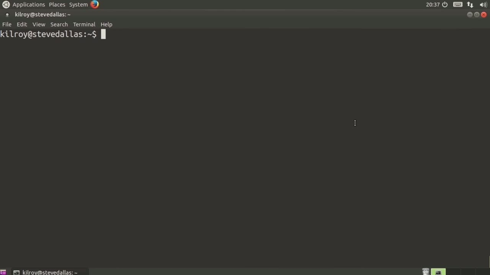
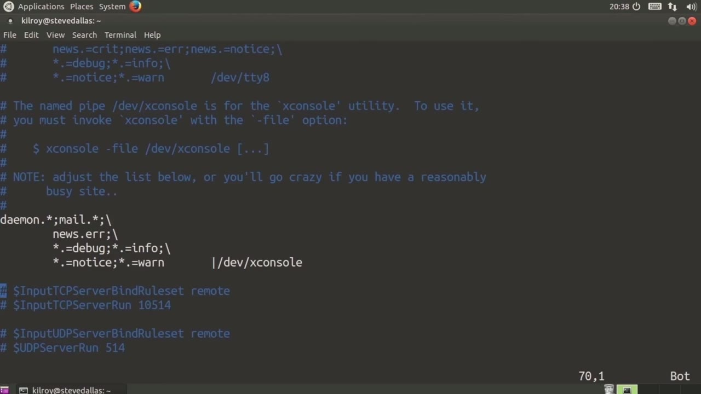
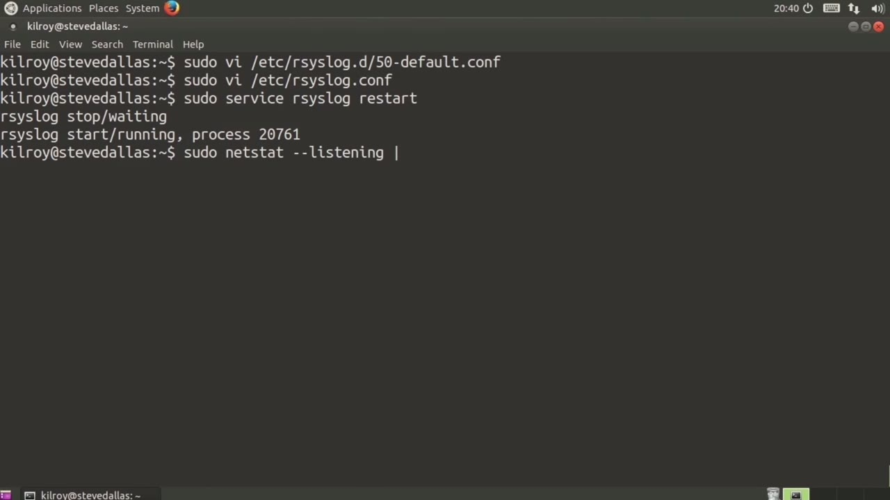

[← Course contents](../../02.md)

# 37. Log Aggregation

**Course:** [Linux Security & Administration From Boot Process to Firewalls](https://www.youtube.com/watch?v=_WB3evmgxYA)  
**Transcript:** [`Linux Security & Administration From Boot Process to Firewalls transcript`](../../../../course_videos/Linux%20Security%20%26%20Administration%20From%20Boot%20Process%20to%20Firewalls/Linux%20Security%20%26%20Administration%20From%20Boot%20Process%20to%20Firewalls.txt)  
**Video:** 02:45:26–02:50:08 ([open at this time](https://www.youtube.com/watch?v=_WB3evmgxYA&t=9926s))

## Introduction

Was to send our CISLog messages off to another server. What we need is a server that's actually going to be listening for those CISLog messages, locally. Why would you want to do that? Well, let's say that you've got a security information and event management system, which is sometimes called a SIM. That security information and Event management system will look at an aggregated set of log files in order to do correlation so that you could, for example, have a single alert about an attack or some other incident that may be happening on your network. So let's say, for example, and just kind of jumping to a catastrophic sort of place that somebody's launching

## Detailed Explanation

<details>
  <summary>Step 1 — Was to send our CISLog messages off to another server</summary>

### Step 1 — Was to send our CISLog messages off to another server

- [x] **Was to send our CISLog messages off to another server**
  - Was to send our CISLog messages off to another server.
  - What we need is a server that's actually going to be listening for those CISLog messages, locally. Why would you want to do that? Well, let's say that you've got a security information and event management system, which is sometimes called a SIM. That security information and
  - Event management system will look at an aggregated set of log files in order to do correlation so that you could, for example, have a single alert about an attack or some other incident that may be happening on your network. So let's say, for example, and just kind of jumping to a catastrophic sort of place that somebody's launching

- [x] **Root force password attacks on all of the systems on your network**
  - Root force password attacks on all of the systems on your network. You may want to have a rule in your SIM that's going to notice that and the SIM will actually generate a single alert if it knows to pay attention to those sorts of things rather than say 50 or 100 separate alerts
  - This really makes security management and log monitoring significantly easier if you've got all of your log messages in one place.
  - So let's just take a look at a couple of ways that we could actually do this.

- [x] **We could set up a listener on our local syslog server so that other**
  - We could set up a listener on our local syslog server so that other people can send messages to us.



</details>

<details>
  <summary>Step 2 — we've got one of our configuration files, and I just dumped these rules</summary>

### Step 2 — we've got one of our configuration files, and I just dumped these rules

- [x] **So we've got one of our configuration files, and I just dumped these**
  - So we've got one of our configuration files, and I just dumped these rules down in the bottom here.
  - So I could say dollar input TCP server bind rule set remote, dollar input TCP server run, and then specify a port number.
  - And then I could do the same thing with UDP.

- [x] **UDP is really the common syslog approach**
  - UDP is really the common syslog approach.
  - The default for syslog is to run on UDP.
  - TCP is more reliable of course. So there is some advantage to using TCP over UDP if you want to make sure that all of your log messages have been received, you really want to use TCP there.

- [x] **Otherwise, there's no guarantee that your log messages that have been**
  - Otherwise, there's no guarantee that your log messages that have been sent have actually been received by the server.



</details>

<details>
  <summary>Step 3 — Run `netstat`</summary>

### Step 3 — Run `netstat`

- [x] **So the other way that we can do this is we can actually load up a**
  - So the other way that we can do this is we can actually load up a module here, and then we're going to say dollar UDP server run and then specify the port number.
  - And I'm going to specify that I've got a TCP server that's going to be running again on port 514.
  - So now I should be able to just restart the service, and it's going to stop the service, start it back up again, and reread the configuration files.

- [x] **Use `netstat`**
  - Now, if I just run `netstat` and specify the listening ports or the services that are listening, and I'm going to pipe that through to less just so that we can see here.
  - Now we've got, I know this says Shell, and I'll show you the numeric version of this in a second.
  - That's actually what's been associated with TCP Port 514.

- [x] **Down here, though, if we look a little bit further down, you'll see**
  - Down here, though, if we look a little bit further down, you'll see we're listening on the SISLog port for UDP.
  - Let me just show you the numeric version here so you can see that we are actually listening.
  - On port 514 for TCP. So if I do a -n, you can see that we're listening on port 514.

- [x] **So I've got my syslog server listening there, and then I've got my**
  - So I've got my syslog server listening there, and then I've got my syslog server listening there as well. So now I have a syslog server that is going to be listening for log messages, and it's going to store them out to where all of my log messages are stored to.
  - Configuration to determine the log files that I am storing into. I'm using my local configuration for that. The remote configuration doesn't mean a thing because the remote configuration just says send it off to another system. We're going to get the facility and
  - The severity and then my local system log server is going to determine based on that where the log messages actually are going to be written out to. There are a couple of log files that we haven't

```bash
netstat
```



</details>

<details>
  <summary>Questions and Answers</summary>

## Questions and Answers

### Question 1: What does `netstat` do in this chapter?

<details>
<summary>Answer</summary>

- [x] Now, if I just run `netstat` and specify the listening ports or the services that are listening, and I'm going to pipe that through to less just so that we can see here.

</details>

### Question 2: What does step 1 cover (Was to send our CISLog messages off to another server)?

<details>
<summary>Answer</summary>

- [x] Was to send our CISLog messages off to another server.
- [x] What we need is a server that's actually going to be listening for those CISLog messages, locally. Why would you want to do that? Well, let's say that you've got a security information and event management system, which is sometimes called a SIM. That security information and
- [x] Event management system will look at an aggregated set of log files in order to do correlation so that you could, for example, have a single alert about an attack or some other incident that may be happening on your network. So let's say, for example, and just kind of jumping to a catastrophic sort of place that somebody's launching

</details>

### Question 3: What does step 2 cover (we've got one of our configuration files, and I just dumped these rules)?

<details>
<summary>Answer</summary>

- [x] So we've got one of our configuration files, and I just dumped these rules down in the bottom here.
- [x] So I could say dollar input TCP server bind rule set remote, dollar input TCP server run, and then specify a port number.
- [x] And then I could do the same thing with UDP.

</details>

### Question 4: What does step 3 cover (Run netstat)?

<details>
<summary>Answer</summary>

- [x] So the other way that we can do this is we can actually load up a module here, and then we're going to say dollar UDP server run and then specify the port number.
- [x] And I'm going to specify that I've got a TCP server that's going to be running again on port 514.
- [x] So now I should be able to just restart the service, and it's going to stop the service, start it back up again, and reread the configuration files.

</details>

</details>

## Summary

This chapter, Log Aggregation, walks through Was to send our CISLog messages off to another server; we've got one of our configuration files, and I just dumped these rules; Run netstat. Commands from the transcript: `netstat`.

## References

- [Linux Security & Administration From Boot Process to Firewalls (YouTube)](https://www.youtube.com/watch?v=_WB3evmgxYA)
- [This chapter at 02:45:26](https://www.youtube.com/watch?v=_WB3evmgxYA&t=9926s)
- [Local transcript](../../../../course_videos/Linux%20Security%20%26%20Administration%20From%20Boot%20Process%20to%20Firewalls/Linux%20Security%20%26%20Administration%20From%20Boot%20Process%20to%20Firewalls.txt)
