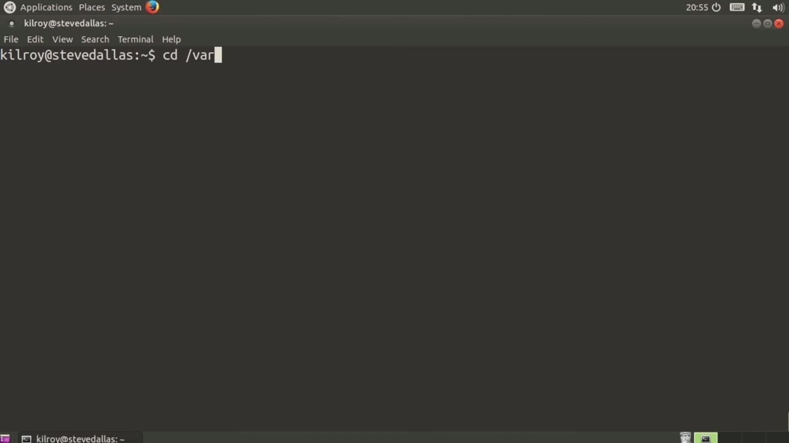
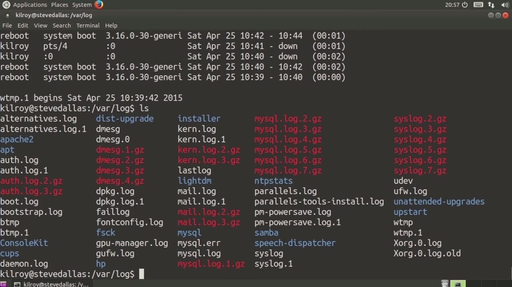
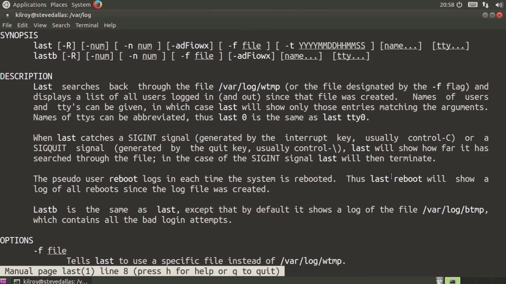

[← Course contents](../../02.md)

# 38. utmp And wtmp

**Course:** [Linux Security & Administration From Boot Process to Firewalls](https://www.youtube.com/watch?v=_WB3evmgxYA)  
**Transcript:** [`Linux Security & Administration From Boot Process to Firewalls transcript`](../../../../course_videos/Linux%20Security%20%26%20Administration%20From%20Boot%20Process%20to%20Firewalls/Linux%20Security%20%26%20Administration%20From%20Boot%20Process%20to%20Firewalls.txt)  
**Video:** 02:50:08–02:53:50 ([open at this time](https://www.youtube.com/watch?v=_WB3evmgxYA&t=10208s))

## Introduction

Actually talked about yet. So let's go into Var log again and you'll see here there is a w -temp file. It's about 11k and this particular log file keeps track of the logins on a system. If you see a U-Temp file, that is going to be a historical version of w -temp. In this particular case, we have a w -temp.1. Now, you're not going to be able to read this directly, so I could just take a look at this here, and I'll show you.

## Detailed Explanation

<details>
  <summary>Step 1 — Run `w -temp`, `w -temp.1`, `last`</summary>

### Step 1 — Run `w -temp`, `w -temp.1`, `last`

- [x] **Use `w -temp`, `w -temp.1`**
  - Actually talked about yet. So let's go into Var log again and you'll see here there is a `w -temp` file. It's about 11k and this particular log file keeps track of the logins on a system.
  - If you see a U-Temp file, that is going to be a historical version of `w -temp`.
  - In this particular case, we have a `w -temp.1`.

- [x] **Use `last`**
  - Now, you're not going to be able to read this directly, so I could just take a look at this here, and I'll show you.
  - So how am I actually going to be able to see this particular log file?
  - Well, I'm going to use the `last` command.

- [x] **Use `last`**
  - The `last` command is actually going to read that log file, and it's going to give me the output.
  - So you can see I've got a couple of instances that are still logged in, and then I've got some going back a few days at this point.
  - So if I wanted to see the older version, what I could do would be to say -fwtemp.1.

- [x] **And now we've got a more historical record of the logins over some**
  - And now we've got a more historical record of the logins over some period of time that that particular file covers.
  - Now, as I mentioned, you could see a U-Temp.
  - You might also see a btem file, which I don't happen to have here.

```bash
w -temp
w -temp.1
last
```



</details>

<details>
  <summary>Step 2 — The btemp file is going to have all of the failed logins</summary>

### Step 2 — The btemp file is going to have all of the failed logins

- [x] **The btemp file is going to have all of the failed logins**
  - The btemp file is going to have all of the failed logins.
  - There is another command that I just want to show you here.
  - The last log reports the most recent login for all users.

- [x] **So I could say last log, and then I'm going to pipe that out to less**
  - So I could say last log, and then I'm going to pipe that out to less.
  - And you can see Roots never logged in, all of these different services have never logged in.
  - That's all of the different services and the users that are on this particular system.

- [x] **So we also looked at last, and we'll just take a quick look at the**
  - So we also looked at last, and we'll just take a quick look at the manual page for last.



</details>

<details>
  <summary>Step 3 — Run `w -temp`, `lastb`</summary>

### Step 3 — Run `w -temp`, `lastb`

- [x] **Use `w -temp`, `lastb`**
  - So as I said, we've got B-Temp, and that is the failed logins.
  - U-Temp is the historical record of `w -temp`, and `w -temp` here is the log file that last actually reads through by default.
  - So I've actually got a different command, `lastb`.

- [x] **Use `w -temp`, `lastb`**
  - which is the same as last, except that it shows the bad login attempt.
  - So if I wanted to look at a different file that has the same data as the binary format in `w -temp`, I could specify -F.
  - We could just take a quick look at `lastb`.

- [x] **I don't believe there's any failed logins**
  - I don't believe there's any failed logins.
  - And it tells me when it began, but we've got nothing there.
  - So that's another set of files that can be really useful.

- [x] **Use `w -temp`**
  - You can see `w -temp` and we've got btemp there as well.
  - Let's just see because it looks like there's a B-Temp -1.
  - And so there's no bad logins there either.

- [x] **Those are another set of files that you want to take a look at**
  - Those are another set of files that you want to take a look at.
  - So you need to use these programs last and last B in order to be able to see the logins.
  - From users that have been on your system.

```bash
w -temp
lastb
```



</details>

<details>
  <summary>Questions and Answers</summary>

## Questions and Answers

### Question 1: What does `w -temp` do in this chapter?

<details>
<summary>Answer</summary>

- [x] Actually talked about yet. So let's go into Var log again and you'll see here there is a `w -temp` file. It's about 11k and this particular log file keeps track of the logins on a system.

</details>

### Question 2: What does `w -temp.1` do in this chapter?

<details>
<summary>Answer</summary>

- [x] In this particular case, we have a `w -temp.1`.

</details>

### Question 3: What does `last` do in this chapter?

<details>
<summary>Answer</summary>

- [x] Well, I'm going to use the `last` command.

</details>

### Question 4: What does `lastb` do in this chapter?

<details>
<summary>Answer</summary>

- [x] So I've actually got a different command, `lastb`.

</details>

### Question 5: What does step 1 cover (Run w -temp, w -temp.1, last)?

<details>
<summary>Answer</summary>

- [x] Actually talked about yet. So let's go into Var log again and you'll see here there is a `w -temp` file. It's about 11k and this particular log file keeps track of the logins on a system.
- [x] If you see a U-Temp file, that is going to be a historical version of `w -temp`.
- [x] In this particular case, we have a `w -temp.1`.

</details>

### Question 6: What does step 2 cover (The btemp file is going to have all of the failed logins)?

<details>
<summary>Answer</summary>

- [x] The btemp file is going to have all of the failed logins.
- [x] There is another command that I just want to show you here.
- [x] The last log reports the most recent login for all users.

</details>

### Question 7: What does step 3 cover (Run w -temp, lastb)?

<details>
<summary>Answer</summary>

- [x] So as I said, we've got B-Temp, and that is the failed logins.
- [x] U-Temp is the historical record of `w -temp`, and `w -temp` here is the log file that last actually reads through by default.
- [x] So I've actually got a different command, `lastb`.

</details>

</details>

## Summary

This chapter, utmp And wtmp, walks through Run w -temp, w -temp.1, last; The btemp file is going to have all of the failed logins; Run w -temp, lastb. Commands from the transcript: `w -temp`, `w -temp.1`, `last`, `lastb`.

## References

- [Linux Security & Administration From Boot Process to Firewalls (YouTube)](https://www.youtube.com/watch?v=_WB3evmgxYA)
- [This chapter at 02:50:08](https://www.youtube.com/watch?v=_WB3evmgxYA&t=10208s)
- [Local transcript](../../../../course_videos/Linux%20Security%20%26%20Administration%20From%20Boot%20Process%20to%20Firewalls/Linux%20Security%20%26%20Administration%20From%20Boot%20Process%20to%20Firewalls.txt)
